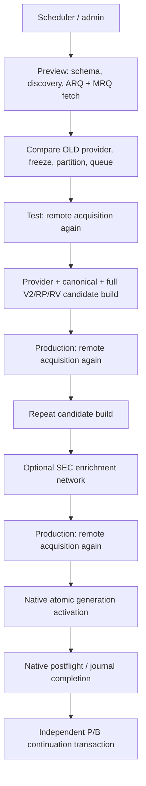
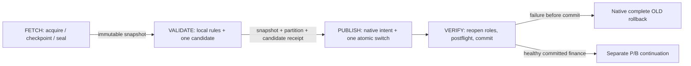

# Fundamentals Simplification V1 — architecture and master plan

**Decision: FETCH → VALIDATE → PUBLISH → VERIFY, using one immutable Sharadar acquisition snapshot per financial update operation.** This is an implementation-ready design, not an implementation or production authorization. No production source, database, queue, journal, configuration or archived patch is changed by this task. No live Sharadar acquisition is performed.

The user explicitly replaces the old four-pass source-freshness authorization contract. Freshness is established during FETCH; later remote changes are an accepted risk. VALIDATE/PUBLISH/VERIFY recheck captured integrity, local authority and publication safety, not Sharadar. A hash-verified local snapshot is now the authorized source, rather than a substitute pretending to satisfy the old fresh-remote checks.

Recommend **incremental orchestration replacement with current generations retained**, implemented in three substantial phases. The initial production-capable mode may retain individually verified ticker/dimension requests inside the single FETCH. Batch optimization is optional and cannot block the architectural simplification. On the audited 1,810-ticker scope, the fallback reduces base history calls from 14,480 to 3,620, a guaranteed **75% reduction for equal scope**, excluding retries and extra requests.

## 1. Governing evidence and scope

Starting source HEAD: `46617b24acd150da676074cf5462b023c0a1a7bb`. Verified governing ancestors:

- acquisition audit: `46617b24acd150da676074cf5462b023c0a1a7bb`;
- immutable recovery/backup binding correction: `9ed344e397fde8912eba5b0ebf38f285e7d4751d`;
- compact parent evidence: `abce59ad8ecf63acd5940642b03f837129aab1d4`;
- `PROVIDER_PAYLOAD_COMPLETENESS_V1`: `4d06c793cb6d1feb6120473955f7da2c9d4b500b`.

Governing repository documents are the daily acquisition audit, V2-only production baseline/final V2 publication contract, native immutable generation and recovery code/tests, Refresh production/source-binding contracts and the two baseline-integrity rollout reports. Earlier flat-file/online-backup descriptions do not override the later immutable-generation correction. The operating model stays full **V2 + RP V2 + RV**, ARQ canonical finance, MRQ retained source; no V1 finance fallback or MRQ canonical overlay is introduced.

Current read-only baseline: active generation `current_rebuild_2a684ef130c6a540de4adc560ab171ad`; watermark `2026-10-28`; 192,986 provider observations, including 185,940 ARQ/MRQ rows; 90,141 canonical quarters, including 74,637 with `period_end <= 2024-12-31`; 171 degraded-baseline tickers. These are observations, never implementation targets or hard-coded lists. All active provider rows currently lack V1 capture envelopes; they retain only their existing accepted/legacy authority.

The archived candidate is `temp/fundamentals_baseline_integrity_final_20261111/implementation_rebased.patch`, SHA-256 `913b5c164a6ace12cb740ed97df6a70ac3e0811d39b767b63cd2c87e5e56084b`. Its 23 source/test snapshots and the reports establish reusable locality, carry-forward and preserved-history semantics. Its one live attempt stopped in FETCH on HTTP 429; no successful live rollout is claimed. Integrate these concepts directly into the new path; do not require another old four-pass rollout first.

### Current architecture and duplication



| Existing owner / functions | Inputs and authoritative outputs | Network / DB effects | Safety to preserve; duplicated structure to remove |
| --- | --- | --- | --- |
| `scheduler.runner.run_scheduler_config`, `_run_fundamentals_refresh_preview_post_step`; `refresh_scheduler.run_scheduler_refresh_discovery`; `ui_service.full_workflow` | Config, native safety and operation intent → parent/child evidence, scheduler result | Locks/status artifacts; delegates finance | Keep ownership, single writer, truthful terminal status; replace Refresh's three-stage dispatch |
| `refresh_fundamentals.resolve_refresh_state`, `source_schema`, `discover_changed_tickers`, `resolve_identity`, `fetch_complete_history` | OLD publication state/universe/queue → discovery + full source responses | Schema/discovery/history HTTP; OLD and queue reads; histories held in RAM | Keep strict source/identity/completeness; persist inputs and acquire once |
| `load_current_history`, `compare_ticker_histories`, `build_source_history_merge`; `historical_freeze`; `refresh_review_queue` | Captured source + accepted OLD → comparison, safe/held/global, native review bindings | Local provider/canonical reads; Preview operational queue/audit writes | Keep financial rules; classify once, avoid repeated raw evidence embedding |
| `refresh_copy_runtime.run_apply`, `revalidate_bound_source` | Bound Preview → fresh source, Test candidate and receipt | Second remote pass; isolated candidate DB writes | Keep validators and candidate-building kernels; retire copy-Test as a second authorization/build engine for Refresh |
| `refresh_production.run_production_apply` | Test/Preview chain → Production candidate, journal, publication receipt | Two further remote passes; second candidate build; bounded SEC requests; native publication | Keep exact intent/path/lock/storage/local-source checks and native transaction; retire fresh remote checks and duplicate build |
| `source_bundle`, `full_v2_downstream`, `_validate_analysis_generation`, `_postflight` | Provider/canonical, read-only market bundle, protected taxonomy → full V2/RP/RV and lineage | Local reads/candidate writes; postflight read-only checks | Keep one full build and independent local verification; market/taxonomy are not publication/rollback roles |
| `generations`, `publication_journal`, `_verified_backups`, `_validate_generation_backup_binding` | Exact OLD/NEW roles and manifest hashes → atomic pointer, durable intent, terminal recovery | Three-role publication/rollback and journal only | KEEP; acquisition simplification does not replace this engine |
| `pb_ownership_future.FutureOwnershipWorkflow`, `pb_ownership_publication` | Safely committed financial generation → eligible ownership decisions/publication | Local, separate candidate/transaction/journal and cleanup owner | Keep eligibility and terminal decisions; expose as a separate linked operation |

Business safety resides in evidence identity, strict acceptance, protected OLD authority, exact partition, local dependencies, role integrity and recovery. The separate Preview/Test/Production remote passes and repeated equivalent builds are historical structure, not indispensable safety invariants under the newly approved freshness policy.

## 2. Target stage ownership and state machine



The financial operation has one `operation_id`, one successful `snapshot_id`, one accepted validation receipt and one successful financial generation activation. Several HTTP requests/retries within FETCH are not several acquisitions. A failed technical local attempt may be retried explicitly; ordinary success never builds the same financial candidate twice to satisfy a stage label.

| Stage | Exact future owner / API | Guarantees and outputs | Forbidden work |
| --- | --- | --- | --- |
| FETCH | New `admin/acquisition_snapshot.py`: `start_fetch`, `resume_fetch`, `seal_snapshot`, `open_snapshot` using native `providers/sharadar.py` / `source_capture.py` | Plan, request ledger, independent checkpoints, immutable source snapshot; OLD identity pinned; terminal coverage outcomes for every planned slot | Production financial writes, review approval, partial-input acceptance |
| VALIDATE | `refresh_fundamentals.validate_snapshot` plus shared `refresh_candidates.build_candidates` and retained native rule modules | Verify snapshot; compare once; classify one exact partition; protect all held/degraded states; build/prepare one complete inactive provider/canonical/analysis generation; `validation_receipt.json` | Any network, including SEC; fresh acquisition, active-role mutation |
| PUBLISH | Simplify `refresh_production.publish_validated_candidate` using existing native generation/journal/backups | Recheck exact OLD, source/candidate/partition/code/local-input bindings, authorization and disk; verified OLD backups; durable intent; one manifest switch | Network, financial reclassification, rebuild, queue approval invention |
| VERIFY | `refresh_production.verify_publication` using native `_postflight`, extended held preservation and journal helpers | Actual published role integrity, scope and lineage; one postflight; native completion or full OLD restoration; committed receipt and idempotent queue finalization | Network, another financial build, partial rollback, recovery of a healthy completed journal |
| Coordinator | New `admin/refresh_update.py`, invoked by existing service/scheduler | Four-stage control state, locks, explicit retries and compact result references | Another source store, nested financial Preview/Test/Production workflow |

Detailed states: FETCHING → FETCH_PAUSED or FETCH_SEALED → VALIDATING → VALIDATED → PUBLISHING → VERIFYING → PUBLISHED. Terminal alternatives: NO_CHANGE, BLOCKED, FAILED_BEFORE_PUBLISH, ROLLED_BACK, RECOVERED_RETRY_REQUIRED, RECOVERY_FAILED. Stage and outcome are distinct; a recovered operation is not relabeled published. The native journal remains the sole publication/recovery authority.

**Lock policy:** pin OLD under native writer locks before starting acquisition; own the existing admin operation while actively working and the credential limiter for requests. Do not hold taxonomy locks during HTTP or sleep through a long cooldown while retaining writer locks. Retain OLD references through the existing cleanup owner. Acquire the native production/scheduler locks in their existing order for VALIDATE through VERIFY; acquire protected taxonomy only after them. Recheck active OLD at local entry and immediately before activation. A writer that legitimately publishes while FETCH is paused causes OLD_BINDING_DRIFT on resume/local entry, not an automatic rebase or silent new acquisition. No occupied lock is bypassed.

A no-effective-safe-change validation ends NO_CHANGE with zero candidate builds and zero activations; holds remain durable. It does not manufacture a publication just to complete four boxes. An explicit dry run uses a named sealed snapshot, performs local validation and stops before PUBLISH. Opening Preview/dry run never implicitly starts another acquisition.

## 3. Immutable acquisition snapshot contract

### Identity and files

Use existing admin run artifacts, not a provider-cache DB:

```text
admin_runs/<operation_id>/
  request.json                         # operation identity, intent, pinned policies
  operation_result.json               # bounded mutable control; refs/counts only
  progress_status.json / progress_events.jsonl / heartbeat.jsonl
  fetch/
    acquisition_plan.jsonl            # deterministic selected ticker/dimension slots
    discovery_receipt.json            # exact query/filter/schema facts + source refs
    attempts.jsonl                    # actual transport attempts, no secrets
    checkpoints/<receipt_id>.json     # atomic terminal receipt per HTTP response
    responses/<receipt_id>.body       # exact native CSV/JSON response bytes
    captures/<receipt_id>.jsonl       # original native V1 record envelopes
    checkpoint_index.jsonl            # slot → receipt/body/capture coverage refs
    snapshot_manifest.json            # <=64 KiB root, written once at seal
  validation/partition.jsonl / validation_receipt.json / preservation.jsonl
  publication/commit_receipt.json / queue_finalization.json
  operation_report.md
```

The root manifest is bounded by storing variable-length scope and receipt indexes as streamed hash-bound files, not inlining histories. Every index line has a bounded size; raw bodies may be large but are streamed. Existing parent metadata remains bounded (target progress <=16 KiB, operation summary <=512 KiB); keep the accepted reference/hash model from `abce59ad8`. Do not create a second result DB or a remote version graph.

`FUNDAMENTALS_ACQUISITION_SNAPSHOT_V1` root fields: format, operation/snapshot IDs, provider/table/endpoint, acquisition start/end and oldest/newest record acquisition timestamps, pinned source-day/as-of policy, OLD generation/manifest reference, schema reference/fingerprint, plan/index references with path/type/size/SHA/count, coverage/scope fingerprint, transport mode, capture/normalization versions, complete/diagnostic outcome counts, freshness policy and seal time. The seal receipt stores the SHA-256 of the root; the root does not contain a circular self-hash.

Each HTTP receipt binds normalized non-secret request parameters, requested ticker set and allowed/required dimensions, coverage/date horizon, limit/offset strategy, original status, selected safe headers, actual attempt IDs, response/body size/hash, capture-sidecar size/hash, per-slot source key/row counts and hashes, completion reason and timestamps. Batch slots share one body and original capture provenance, not duplicated copies of the response. Readers decode a response once per stage/batch, route records by exact identity and preserve its original request fingerprint and acquisition time.

Paths must resolve inside the declared trusted run root, have an allowed artifact type and matching operation ID, reject symlinks/traversal and match byte size/hash. Hash the original stored content; compressed storage, if introduced, must bind both stored bytes and decompressed original bytes with size bounds. No API key, Authorization header or signed download credential appears in manifests/logs. Error diagnostics may be sanitized but are never authoritative financial input. Do not normalize/reconstruct a raw payload and call it the original acquisition.

### Completion, locality and failure are different facts

Slot states are COMPLETE_VERIFIED, DOCUMENTED_LOCAL_SOURCE_DEFECT, INCOMPLETE_RETRYABLE and SHARED_FAILURE. COMPLETE_VERIFIED requires native full capture, exact request/response identity, complete body, valid coverage, unique source keys and all applicable profile checks. HTTP 200, a small row count, a display label or a previously stored local row is insufficient by itself.

A sealed snapshot may contain explicit diagnostic-only ticker slots so provably isolated source defects can be held while safe peers publish. This means **FETCH scope processing is complete**, not that failed rows are attested COMPLETE. VALIDATE must prove locality independently; no proof means global STOP. Shared 429/auth/schema/transport failure pauses or blocks FETCH before an executable seal. Missing/tampered data for a slot declared COMPLETE is global evidence corruption, not a downgrade to a harmless local defect. An intentionally documented missing-receipt slot has no financial authority and may become a local exclusion only with positive identity/scope/OLD preservation proof.

### Resume and age

Checkpoints become durable independently using the existing atomic write/fsync pattern before the next request. An incomplete body/index entry never enters the complete index. On resume, verify completed checkpoints first and request only missing eligible slots; do not redownload complete slots just to reconstruct RAM. A local VALIDATE failure does not trigger FETCH. Pending/incomplete slots may be requested on resume; a body/receipt declared COMPLETE that is now missing or corrupt is an integrity failure, not a silently overwritten cache miss. STOP and preserve its evidence rather than hide tampering by downloading a replacement.

**Recommended explicit V1 age policy:** maximum 24 hours from the oldest accepted acquisition checkpoint to snapshot sealing/publication preflight; record the value in the operation request before FETCH and never silently extend it. This is a proposed operational bound, not an existing server guarantee. A snapshot is a client-frozen capture interval, not a simultaneous Sharadar database transaction. Preserve per-response times and validate cross-dimension consistency locally. Later remote changes inside the allowed age are the user-accepted risk.

A stale unsealed plan stops FETCH_STALE; a stale sealed snapshot stops SNAPSHOT_EXPIRED before publication. Start a new explicitly requested operation to refresh it. Other stale conditions are wrong OLD generation, changed identity/schema/coverage policy, incompatible capture contract, altered files or a different operation ID. Do not attach another operation's old snapshot to a new update. A valid local retry keeps the same operation/snapshot IDs and original timestamps; it creates a new validation/publication attempt receipt only. Historic snapshots remain inspectable after age expiry. Generate the operation UUID once before FETCH; derive snapshot ID from that UUID and use monotonically numbered validation/publication attempts. New candidate generation IDs include the operation UUID plus validation attempt and satisfy the native generation-ID contract; never overwrite an older failed generation directory.

### Retention

No automatic deletion in this design task. Future cleanup remains owned by the existing acceptance/cleanup mechanism. Pin snapshots and OLD/candidate references while FETCH is resumable, validation/publication is active, the journal is nonterminal, recovery/retry is possible, or review evidence/approval/audit depends on them. Failed/shared-source attempts retain useful completed checkpoints. After accepted publication, retire redundant scratch/candidates using native cleanup rules, but retain the source body/capture/manifest and committed/held evidence required to reproduce that publication. After a non-published STOP, redundant raw checkpoints become cleanup-eligible only after explicit native acceptance of that STOP and proof that no resume/review/recovery/audit need depends on them; preserve the attempt/outcome/hash receipts and mark removed data unavailable rather than reusable. No age-only deletion of the only financial, review or recovery evidence. A later explicit archival retention policy may compress/deduplicate or remove proven redundant copies without altering original hashes.

## 4. Native Sharadar acquisition strategy

Only public documentation was browsed; no authenticated or sample data endpoint was called. Official native Fundamentals docs describe comma-separated tickers, all dimensions when omitted, `limit`/`skip`, `lastupdated` filtering and redirected 5/10/full-year ZIP exports. They do not establish an ARQ+MRQ-only comma-list dimension filter or an atomic snapshot cursor. [Sharadar Fundamentals documentation](https://sharadar.com/docs/fundamentals).

The general native query documentation describes a one-year default lower date, one-field sorting, default limit 10,000 and offset-based skipping. Defaults and a short terminal page are not a stable multi-page snapshot guarantee. [Sharadar query documentation](https://sharadar.com/docs/getting-started).

These facts establish capabilities, not account entitlement or production batch completeness. Nasdaq Data Link behavior is not used as a substitute contract.

| Mode | V1 disposition | Coverage / fallback |
| --- | --- | --- |
| Existing one ticker/per dimension | Launch-safe fallback: one ARQ and one MRQ logical slot, once within FETCH | Retain native structural/source/profile checks; make intended history horizon explicit and verify it |
| One ticker, both required dimensions | Optional qualified mode via all-dimensions response, then exact local ARQ/MRQ routing | Do not send `dimension=ARQ,MRQ`: today's wrapper filters that literal out. Other upstream dimensions are captured but not accepted into ARQ/MRQ finance. |
| Five tickers/all dimensions | Preferred normal optimization **after qualification**; fixed deterministic groups of five | One body/receipt for multiple independently verified slots; partial/missing members remain explicit; cannot assume fewer requests mean less payload |
| Ten tickers/all dimensions | DEFER as default until five-ticker mode has measured row/byte margins | Same safety; larger failure/truncation/parse unit, not needed for one-fetch V1 |
| Full bulk ZIP | Exceptional authorized initialization/repair input, not routine daily mode | Native archive checksum/manifest/capture reader, complete member/stream/coverage validation; never a clean-slate replacement for unavailable accepted history |

Do not rely on an undocumented full-history default. FETCH records explicit approved date bounds and actual coverage, retaining OLD source history outside the returned window. Phase 1 must resolve the documented one-year default versus observed older histories using stored receipts and future authorized conformance evidence. For normal 10-year coverage, specify a lower source-date bound at least ten years back plus the native quarter-boundary margin, and an explicit source-day upper bound; retain older OLD observations. Use the same pinned bounds across request modes. Validate appropriate coverage for established companies; young listings/legitimate gaps use existing structural rules, not a false universal 40-row minimum. `from` is not the canonical financial-freeze boundary. No new date filter may silently convert omitted OLD rows to source removals.

**Completeness policy:** verify requested/returned ticker membership, allowed/required dimensions, unique exact primary keys, successful full capture, intended horizon, source window/identity coherence and complete transport. A missing required member has no accepted input. Only independently proven present histories may proceed as local safe candidates; malformed foreign identity or unproven shared response coverage blocks the batch/operation. Preserve original per-response capture metadata when splitting locally.

Prefer batches that finish below the proven response limit. At a limit hit or uncertain membership, checkpoint the response as diagnostic and split only unverified slots by ticker/dimension within the same FETCH; never accept truncation or re-fetch already complete slots. Raw HTTP offset pagination is not the initial safety dependency: without a stable server cursor/version/total, offset exhaustion alone cannot exclude omitted rows during updates. Use disjoint subrequests below limits, or a checksum-bound immutable export with verified exhaustion. If even a single-slot response cannot be proven complete, hold it locally only with positive isolation/OLD authority; otherwise STOP. Discovery exact-limit partitioning must also retain its fail-closed coverage proof.

The offline native-capture fixture confirms that a multi-ticker response can retain V1 provenance through per-ticker/ARQ/MRQ routing. It does **not** prove server batch behavior, entitlement, horizon, pagination, omission semantics or completeness. Batch enablement requires the focused conformance gates below under separate acquisition authorization; the single-fetch fallback remains sufficient for implementation.

## 5. Rate limits, retry and operation identity

Use one credential-scoped, process-independent limiter in the native transport. Start conservatively with one in-flight request and at least the existing 0.5-second start interval. This is a proposed client default, not a claim about Sharadar's quota. A non-secret credential identifier owns one small atomic cooldown/control file under existing operational temp/control storage and a kernel lock; it is not a provider-data DB. Native schema/discovery/history/bulk attempts and retries participate. Direct clients outside the limiter must be reported as unmanaged usage, not assumed absent.

Count every actual opener attempt, including retries and failed batch/subdivision attempts, with operation/stage/request/slot IDs, safe endpoint/parameters, timestamps, outcome, bytes and native request ID if supplied. Never substitute ticker progress for HTTP-attempt or successful-history counts.

On shared HTTP 429, set a durable credential-wide not-before time, checkpoint, and pause the operation immediately. Do not continue the ticker loop with thousands of individual retries. Accept numeric and HTTP-date Retry-After; honor valid guidance as a minimum, including values above 60 seconds. If waiting exceeds the operation's wait budget, release locks and return FETCH_PAUSED with resume time instead of clipping the server delay and retrying early. With absent/invalid guidance use bounded exponential backoff with jitter; recommended delays 5/15/60 seconds, at most three retry attempts per failed logical request and never past the pinned age/deadline. A shared 429 normally pauses before those retries; resume is explicit or an already-authorized scheduler resume of the same FETCH plan, never a new financial approval. Auth/schema/shared-identity failures block until the actual cause changes.

| User/runner action | Identity and work permitted |
| --- | --- |
| Resume interrupted/429 FETCH | Same operation, OLD, plan and age policy; verify checkpoints; fetch only missing/unverified slots after cooldown |
| New update | New operation ID and new FETCH; no substitution from another operation's sealed snapshot |
| Retry local validation | Same valid sealed snapshot; no HTTP. Invalidate the failed candidate/receipt, retain diagnostics and record the reason/new local attempt. |
| Retry pre-boundary publication | Same operation/snapshot/candidate only if every local binding still matches, age is valid and no destructive boundary was crossed |
| Retry after native recovery | First entry performs recovery only and returns RETRY_REQUIRED. A later explicit retry reruns local safety/validation under current locks, against restored OLD and the original eligible snapshot; no silent activation of an old failed candidate. |

Rebuild on a local retry only when the earlier build was incomplete, corrupt, deleted by native recovery cleanup or invalidated by demonstrated local input drift. This is an explicit failed-attempt/recovery boundary, not the ordinary old Test-plus-Production double construction. A source coverage/age/OLD drift failure may require a new operation because the source contract changed, not merely because a local validator failed.

## 6. One local acceptance and candidate pipeline

### Four separate authorities

1. **Current remote capture:** immutable snapshot bodies and original V1 acquisition envelopes, never a reconstructed normalized object.
2. **Previously accepted finance:** verified OLD provider/canonical/analysis and existing legacy rules. OLD rows do not gain a V1 timestamp/envelope by being copied.
3. **New acceptance:** only complete verified source records for eligible safe tickers, matching exact identity, schema, financial/quarter rules, approved removal authority and source profiles.
4. **Historical carry-forward:** exact accepted OLD financial/source/provenance state under freeze/retention or whole-ticker hold, with degradation still documented.

VALIDATE opens the snapshot through a verified reader and reconstructs native trusted history views locally, preserving original captures. It does not call a client or create new acquisition provenance. It verifies required slot coverage, including diagnostic-only slots and unknown/outside-universe exclusions; compares each known ticker once; applies native accounting/fiscal/payload/freeze rules; and creates one complete deterministic partition.

Keep separate structured measures for new ARQ quarter advancement, current-period revisions, frozen preservation and payload changes. A final HISTORICAL_REVISION label must never suppress a current-quarter advance. Preserve all applicable BASE, HISTORICAL_FREEZE and P/B source profiles, absent/null/value distinctions and complete raw payload hashes. Schema/normalization faults that cross ticker boundaries remain global.

The snapshot binds all acquired inputs to the operation. A review's **material evidence fingerprint** continues to use the native source/financial/identity content rules; do not replace it with an acquisition root hash containing a new run ID/time on every download. Publication binds both the immutable acquisition identity and the native review/approval evidence. No approval eligibility broadening, automatic repair or reopening of terminal decisions is permitted.

### Deterministic partition

Write sorted, hash-bound scope records: SAFE_REPLACEMENT, ORDINARY_LOCAL_HOLD, BASELINE_INTEGRITY_HOLD, TRUE_GLOBAL_BLOCKER, and no-change/outside-universe dispositions. The partition fingerprint binds stable ticker/company/security/provider identities, input/OLD authority references, material evidence, approved action bindings, exclusion decisions and policy versions. Require unique identities and disjoint safe/held sets. PUBLISH verifies that fingerprint; it does not reclassify or silently drop a blocker.

A financial publication requires at least one effective safe replacement and zero true globals. One or hundreds of independent proven local defects remain local. A diagnostic-only failed source slot never supplies financial values. Unknown identity, foreign/wrong-ticker response, cross-company dependency, shared schema/source defect, invalid OLD, unsafe journal, partition collision or inability to preserve accepted state remains fail-closed.

### Locality and baseline carry-forward

Integrate the archived `review_locality.py` and `baseline_carry_forward.py` logic and directly relevant fixtures, adapting their inputs to snapshot references. Preserve generic proof for novel review shapes, exact identity/accepted-baseline fingerprints, recursive shared/foreign-identity checks, safe replacement equality and complete OLD/candidate held comparison. Do not blindly restore the old orchestration or its full inlined `incoming` evidence: bind one immutable evidence reference/content hash and keep the original raw proof inspectable. Old queue/audit evidence remains unchanged and readable.

A LOCAL_BASELINE_INTEGRITY_HOLD requires verified active immutable OLD roles and valid accepted canonical finance/fiscal identity, despite incomplete historical provider provenance. Exclude **all incoming data for that ticker**. The OLD generation is carry-forward authority, not evidence that missing provider observations are valid. Missing/stale references remain missing/stale; no synthetic observation, repaired pointer or silently improved provenance is permitted.

Scan the entire OLD canonical/provider domain independently of discovery, watermark and queue before the rebuild. Protect every degraded identity, including one with no acquisition slot because it was absent discovery/queue. That slot has no accepted incoming data; local OLD carry-forward can still be proven. Unknown/unisolatable identity or shared cross-company dependence is global. Never hard-code the historical count of 171.

Capture and restore held state through the inactive rebuild using the proven native pattern before date/TTM/analysis construction. Compare OLD against both prepared and published NEW for identity, fiscal year/quarter, period/report/source/first-public dates, every financial value, parent equity, original provider raw/header/capture data, canonical provenance/parent tables and degraded-reference condition. Only explicitly permitted physical canonical IDs may be remapped. Exact OLD provider observation identity for held data remains intact.

V1 retains whole-ticker quarantine; it does not quietly introduce within-ticker partial acceptance to bypass a historical/fiscal/source hold. New quarters/current revisions remain eligible for provably safe tickers, and a held ticker does not block safe peers. A future change to accept part of an otherwise held ticker would be a separate financial policy decision.

### Historical freeze and one build

Keep `period_end <= 2024-12-31` as the accepted canonical boundary. Do not use filing date, fiscal label or `lastupdated` as a substitute. Established OLD historical financial values, first-public dates, parent-equity semantics and valid provenance remain protected; narrowly reviewed historical removal/repair and WFRD exceptions retain their exact native bindings. Never delete the 90,141-quarter history or infer that all frozen conflicts are operationally harmless.

Reduce work by comparing once and representing frozen accepted-state changes with stable fingerprints and references, producing detailed field differences only when opened. Keep the source identity/coverage and freeze checks required to detect actual conflict; do not skip all historical processing or equate the presentation predicate with financial approval. Full raw inputs stay in the snapshot, not repeated in every held item, queue row, stage result and report. The first reduction is four financial comparisons/build paths to one, not an unproven historical acceptance shortcut.

Build one provider candidate from OLD with **exact safe replacement-set equality** and native retained-history merge; preserve unrelated and held provider data. Build one fresh canonical candidate with OLD identity/date preservation and protected held states. Run one complete V2/RP/RV analysis build. Held provider/canonical financial authority stays exact; derived held-ticker analysis may legitimately change with the bound market inputs or peer universe. Do not claim all analysis rows for a held ticker are frozen, or add a second analysis store to preserve them. Retain current compact market source bundle and protected direct taxonomy semantics from `source_bundle`; market/taxonomy are read-only dependencies, never extra publication/rollback roles. Freeze their as-of and semantic bindings in the validation receipt and recheck local drift before publication. Do not copy a 14 GB taxonomy DB merely to recreate the old Test/Production split.

Prepare the inactive generation through `prepare_generation_from_candidates` once, verifying it consumes/moves only candidate files—never pass active OLD paths. A successful `validation_receipt.json` binds operation/snapshot/root SHA, OLD manifest/role hashes, exact partition/ref/hash, inactive NEW manifest/role hashes and SQLite checks, native preservation/date/provider/analysis checks, local market/taxonomy bindings, code/config/policy fingerprints, as-of and expiry. Candidate preparation is not activation.

### SEC/publication-date boundary

The current `candidate_publication.run_candidate_publication` can call SecClient during Production. That cannot remain in an entirely local VALIDATE/PUBLISH/VERIFY path.

If SEC enrichment is enabled, acquire its bounded filing/document inputs **during FETCH**, as supplementary immutable receipts under the same operation. Use source/OLD identities and a conservative quarter/time superset to plan these inputs; this planning does not decide financial eligibility or build a candidate. Preserve the existing bounded network budget and capture all inputs a local SEC reader needs. VALIDATE applies enrichment only to the actual native eligible quarter scope through a frozen/offline client; a missing cache item must not fall through to HTTP. Existing native unresolved/partial-enrichment outcomes remain explicit and cannot manufacture a first-public date.

Always preserve established `first_public_result_date`; initialize genuinely new safe quarters only through the accepted canonical date policy. Old accepted financial bootstrap dates are not overwritten by a later source availability date or an absent SEC response. If a source profile/policy requires independent date evidence and the FETCH snapshot lacks it, local validation holds/stops that scope. The design does not relax mandatory publication-date evidence to avoid a network call.

## 7. Native publication, VERIFY and recovery

### PUBLISH rechecks, without reconstructing finance

Under native production/scheduler ownership and the required local dependency locks, require:

- exact current OLD generation/manifest and role hashes, terminal healthy journal, no conflicting preparation/sidecars and appropriate explicit production intent;
- the same operation-owned sealed snapshot, all required files/coverage hashes and pinned age; stream verification instead of retaining full source bodies in RAM;
- exact successful local validation receipt, unchanged validator/config/policy, safe/held/global partition, relevant approval/queue material state and candidate generation;
- full candidate role/hash/SQLite/lineage validity and unchanged market/taxonomy semantic dependencies;
- disk headroom for native backups/scratch and complete OLD recovery evidence.

Any drift invalidates local publication authority. A new review affecting a safe ticker is not silently ignored. Hash/reference verification is an independent local safety check, not another financial classification or build. Hash each response once per verification pass, not once per ticker sharing a batch body.

Reuse `_verified_backups(..., immutable_generation=OLD)` and `_validate_generation_backup_binding` with the exact byte binding fixed by `9ed344e3`. Journal role hashes, verified backup hashes and OLD manifest agree under the native immutable contract. Keep fsync/intent/atomic pointer behavior and the existing recovery functions.

Extend `prepare_journal`'s authorization metadata with an explicit discriminator, e.g. `authorization_contract=FUNDAMENTALS_SIMPLIFICATION_V1`, operation/snapshot/root/validation receipt identity, exact scope fingerprint and references. Existing Preview/Test identifiers are absent/null for this new authorization path, **not fake Preview/Test receipts**. Legacy callers retain their old explicit authorization discriminator and real IDs. Preserve the native role/OLD/NEW/recovery fields so recovery remains independent of which workflow authorized publication; test old and new receipts with the accepted recovery code. This is an authorization adaptation, not a new publication engine.

Persist PREPARED and activation intent durably, then call the existing `activate_prepared_generation` / `activate_generation` expected-OLD check exactly once. Provider/canonical/analysis are one complete NEW generation. Do not use sequential live role replacement for the new path, patch live canonical in place or maintain a second active-generation pointer.

### VERIFY and commit

Reopen the activated roles and run one postflight: active manifest and all role hashes, SQLite/FKs/identity uniqueness, actual safe provider replacement set, held full economic/provenance/degradation equality, first-public-date preservation/new-safe initialization, WFRD and provider payload rules, V2/RP/RV package/market/taxonomy lineage and exact validated source/partition provenance. Recheck snapshot references/integrity. No new remote input, candidate recomputation or full analysis build is permitted in VERIFY.

A failed pre-commit postflight invokes only the native full OLD-generation restore and verification. Healthy success writes the existing journal COMPLETED/PASSED/NOT_REQUIRED and an immutable committed financial receipt. Readers retain atomic whole-generation semantics; UI/P/B must not label the transaction successful merely because the NEW pointer was switched before postflight.

The provider watermark is stamped **in the candidate** under its established meaning, including pending-held reevaluation semantics. It becomes logically committed with the successful journal, not by modifying an immutable provider file after activation. FETCH/checkpoint dates never advance it. Queue observations can be recorded durably during local classification, as the current Preview does; approval consumption/resolution that depends on publication happens only from the committed receipt. Omitted holds never auto-resolve.

Queue SQLite finalization is not atomically the same write as a filesystem pointer. Reuse native idempotent receipt/audit reconciliation: retain a durable pending-finalization control state, block reuse of affected approvals until reconciled, and retry locally with the committed operation ID. A bookkeeping/UI/cleanup failure **after a healthy durable commit** reports PUBLISHED_WITH_REVIEW_SYNC_PENDING and must not roll back committed finance. A failure before commit/postflight still follows native OLD rollback. Do not create another database/outbox engine.

### Crash and retry matrix

| Boundary | Required result |
| --- | --- |
| FETCH interruption/429 | No financial write; complete checkpoints survive, partial ones ineligible; explicit same-plan resume |
| VALIDATE failure | OLD unchanged; same sealed source usable for an eligible local retry; no remote reacquisition merely for a local error |
| Failure before durable native publication intent | No active change; retry only after rechecking all local authority |
| Crash at generation preparation/activation intent or after activation before completion | Native OLD restoration/verification, RECOVERED and RETRY_REQUIRED; never complete NEW by guessing |
| Ordinary post-boundary failure | Restore the complete OLD three-role generation, verify hashes/manifest, ROLLED_BACK |
| Missing/tampered required OLD/backup or failed restoration | RECOVERY_FAILED, block writers; no partial recovery or network-based reconstruction |
| Healthy completed journal | No recovery call or replay |
| Failure after committed finance while finalizing queue/P/B/cleanup | Finance stays committed; independent local reconciliation/continuation failure is reported separately |

Recovery must work even if the acquisition snapshot is missing/corrupt or the network is unavailable: OLD role/backup/manifest evidence is sufficient. Such snapshot damage blocks a later publication retry, not the restoration of OLD. The first recovery-triggering entry returns RETRY_REQUIRED; a later retry runs all new-contract local guards, revalidating/rebuilding only as required by the failed recovery boundary and still using the original eligible snapshot. Expired/source/OLD-mismatched inputs require a new explicitly requested update.

### P/B is a separate existing transaction

`FutureOwnershipWorkflow` currently performs its own copied eligibility rehearsal and `OwnershipPublicationWorkflow.publish`, potentially activating another generation. Do not hide that as the financial update's one activation or move ownership acceptance before the financial commit.

After successful financial VERIFY and required queue finalization, invoke/enqueue the existing P/B continuation with a **distinct linked ownership operation ID**, binding the exact committed financial generation and its source provenance. It performs no Sharadar calls and preserves its native eligibility, terminal decisions, source drift, journal and cleanup rules. Its failure cannot roll back the financial commit. The UI reports financial and ownership outcomes separately. If ownership publishes, that is an explicitly recorded second **ownership** transaction, not a second financial candidate/activation inside FETCH→VALIDATE→PUBLISH→VERIFY.

For NO_CHANGE, the new financial path does not fabricate a publication to trigger this automatic post-publication hook. The existing independently authorized safe-no-op P/B route remains available with its full native eligibility proof; it is not converted into unconditional permission from a display label. No terminal ownership case is reopened.

## 8. Database strategy: retain current generations

| Concern | A — Retain generations, replace workflow | B — Parallel clean rebuild from fresh source + OLD history |
| --- | --- | --- |
| Implementation complexity | New acquisition/control contract; existing schema/builders/recovery retained | Same new workflow plus migration/reconciliation of identities, all historical authority and old references |
| Data-loss risk | Existing OLD immutable authority remains the anchor | High unless every absent/older OLD quarter, source and date is explicitly retained and matched |
| Older unavailable history | Exact native retention/carry-forward | Cannot reconstruct it from today's source window; must import OLD anyway |
| First-public dates / identity continuity | Existing preservation map and company/security/provider mapping | Full additional natural-key/date/ID mapping proof required |
| Freeze / P/B / WFRD | Existing native rules and approved artifacts remain bound | Must reproduce all historical financial/ownership/boundary exceptions, not infer them from current raw rows |
| Broken provenance | Explicit local carry-forward hold and repair backlog | Must remain explicitly broken, not silently reconstructed as valid |
| Publication / recovery | One existing native OLD→NEW transaction | Still requires the same verified OLD/NEW transaction; no simplification of recovery |
| Duration / test scope | One current full canonical/analysis rebuild per changed update | Extra migration/full-history comparisons, source preparation and expanded recovery/reader tests |

**Recommend A.** Incremental simplification means changing orchestration and evidence, not adopting incremental or partial financial rebuilds. Retain the established full canonical/V2/RP/RV reconstruction once per changed update, with protected OLD carry-forward. No production reset is necessary. A clean rebuild would need to carry the same unavailable OLD history and broken provenance forward, adding migration risk while leaving acquisition/orchestration work unchanged. Option B is DEFERRED, not authorized. Current 90,141 quarters and their source/date/ownership authority remain protected; only exact native approved changes may alter eligible financial scope.

## 9. Exact disposition of existing complexity

Disposition applies to normal Refresh. Shared Add/Remove, reviewed repair, taxonomy and ownership contracts must not be broken by deleting a file that they still import.

| Module / mechanism | Disposition | Replacement invariant / reason |
| --- | --- | --- |
| `refresh_fundamentals.run_preview` orchestration | RETIRE after cutover | FETCH seal + local `validate_snapshot` receipt; dry run uses an existing snapshot, not a fresh independent sequence |
| `refresh_copy_runtime.run_apply` as Refresh authorization stage | RETIRE | One candidate validated in place locally; exact inactive-generation/hash/lineage receipt replaces a duplicate copied build |
| `revalidate_bound_source` remote Test/Production path | RETIRE for new Refresh | Same sealed capture with independent local integrity/OLD/candidate checks; explicit new freshness contract |
| `refresh_production.run_production_apply` monolith | SIMPLIFY | `publish_validated_candidate` + `verify_publication`; retain proven backup/journal/postflight kernels, no acquire/build |
| Discovery, identity, structural history validation | KEEP / SIMPLIFY ownership | One FETCH; retain exact coverage/identity, persist plan/results and dimension detail |
| `SharadarClient` transport/limiter | SIMPLIFY | Shared credential pacing, actual-attempt ledger and correct cooldown; source capture V1 unchanged |
| `source_capture.py`, `provider_payload.py` and strict profile logic | KEEP | Raw/native acquisition integrity; no manufactured legacy attestation |
| `load_current_history`, comparison/merge/freeze kernels | KEEP, execute once | Same accepted financial and source-retention rules, compact reference evidence |
| `_observation_id`, `insert_provider_source_row`, `replace_provider_histories`, `validate_provider_candidate`, `fresh_rebuild_canonical` | MERGE into shared `refresh_candidates.py` where appropriate | One implementation; update imports in freeze, accounting boundary, universe removal and controlled rebuild before removing old exports |
| Full V2/RP/RV builder and local validators | KEEP | One full READY build; independent read-only validation/postflight is not a second build |
| `source_bundle.py` market/protected taxonomy | KEEP | Read-only bound local inputs, native lock ordering and drift rejection |
| Generic `full_workflow.py` / `workflow_evidence.py` | KEEP shared; RETIRE only Refresh's old three-stage adapter | Add/Remove and legacy history still use proven bounded references. New coordinator has four bounded stage records, not another embedded-child parent. |
| Review queue/audit and approval functions | KEEP / SIMPLIFY stored new evidence | Same durable decisions and eligibility; append compact references to new observations without rewriting old audit records |
| Archived `review_locality`, `baseline_carry_forward` | MERGE semantics/tests | Positive generic exclusion proof, discovery-independent protection and exact OLD state equality |
| Historical source retention | KEEP | Complete coverage/membership proof and exact OLD retained rows; no deletion disguised as acquisition filtering |
| `generations.py`, publication journal, rollback/recovery | KEEP | Existing one pointer and exact OLD/NEW backup/role authority; additive authorization metadata only |
| `_verified_backups`, `_candidate_manifest`, shared production helpers | KEEP shared exports | Remove/universe/P/B/payload/backlog/controlled-rebuild callers still depend on them; do not delete with old Refresh orchestration |
| `candidate_publication` remote client during Production | RETIRE that location; MERGE source acquisition into FETCH | VALIDATE's frozen local SEC reader; no network cache-miss fallthrough |
| P/B future/publication policy | KEEP | Separate linked local ownership transaction after committed finance, no held incoming source use |
| Operational page/service/scheduler result projection | SIMPLIFY | One Update action and four-stage status; preserve actionable review and native authority |
| Preserved-history projection/CSV | MERGE archived implementation | Pure passive hiding only; shared N/M/CSV aggregation and read-only evidence access |
| Legacy run artifacts/history readers | KEEP bounded read-only compatibility | Old IDs/status/evidence remain readable; no artifact rewrite or executable authorization from old labels |
| Refresh-only legacy service/CLI execution adapters, duplicated fixtures and stage gates | RETIRE in Phase 3 after replacement/import migration | One new accepted execution path; keep semantic tests, remove only obsolete repeated-fetch expectations |
| Reset/rebuild migration; undocumented selective-delta cache; ten-ticker default | DEFER | Not needed for the approved one-fetch simplification; require independent evidence/policy before adoption |

Shared callers include `universe_removal`, `remove_tickers`, `accounting_boundary_review`, `current_state_rebuild`, `provider_payload_workflow`, `publication_backlog_drain` and `pb_ownership_publication`. Move/repoint imports and tests before deleting dead Refresh entry points. Any temporary execution adapter has an explicit Phase 3 removal gate; do not leave two indefinitely selectable financial Refresh engines. A failure of the new path must not automatically fall back to four remote acquisition passes.

## 10. Minimal operational UI and history

The main screen shows last sealed acquisition (ID/time/age), last successful financial publication (generation/time), four-stage operation status, safe effective changes, ordinary/baseline local holds, true globals, publication result and next action. Acquisition success, financial commit and any ownership continuation are distinct facts. Show progress units explicitly: tickers, required ticker/dimension slots, verified/failed/deferred slots and actual HTTP attempts.

Actions: **Update Fundamentals**, **Resume acquisition** when paused, **Retry local validation** for an eligible sealed snapshot, **Publish validated update** where an explicit manual publication intent is still required, and **View evidence**. Existing authorized scheduler intent can execute the whole new flow without separate Preview/Test/Production user actions. A local dry-run/preview opens an existing operation snapshot/receipt and never fetches implicitly. An acquisition-only operation cannot be promoted to publication by changing a label; phase/deployment authority and operation intent remain explicit.

Merge archived action-first review/preserved-history behavior. Hide only pure passive historical preservation cases in the normal operational list. Mixed/actionable, capture/fiscal/identity/baseline/global, approval-eligible, deep and unknown actionable cases remain visible. Keep explicit hidden-history evidence/audit access. Preserve the native approval guards when loading actionable evidence on demand.

Use one pure aggregation for `Historical values preserved: N tickers · M seen in latest run` and on-demand CSV. N is distinct unresolved queue tickers with qualifying HELD frozen-history evidence; M intersects N with actual frozen-preservation encounters in the latest complete authoritative **local classification** bound to a sealed FETCH. FETCH alone does not establish M. A partially classified run does not replace the last complete classification; show its ID/date truthfully. Broken latest completed evidence produces M unavailable, not an older silently substituted value. Legacy completed Preview evidence is read only through the existing bounded compatibility projection.

Retain the fixed `/fundamentals/admin/preserved-history.csv` route and archived columns: ticker, presentation_status, primary_reason, issue_codes, affected_historical_observation_count, latest_seen_run_id/date, operator_action_required and current_next_action. Deterministic unique ticker rows, UTF-8, CSV quoting/formula neutralization, attachment/no-store/nosniff; no persistent CSV or duplicate DB. Neither rendering nor download changes financial/review state or approval authority.

Run History retains 8/16/24 behavior, native run IDs and old interrupted/STOPPED outcomes. New results link snapshot, validation, financial journal and separate ownership operation. It never eagerly loads whole raw responses or giant legacy child evidence. New queue projections should load only required presentation fields, with large raw detail fetched on explicit evidence access; do not rewrite immutable audit history to compact the UI.

## 11. Coherent end-to-end acceptance contract

| Invariant | Required proof |
| --- | --- |
| Exactly one completed FETCH per financial update | Operation-owned seal ID/root hash; no attaching another operation's snapshot |
| Zero network after FETCH | Transport/network-denial tests around VALIDATE/PUBLISH/VERIFY, including SEC/cache misses |
| Complete strict new inputs | Native V1 envelopes, original body/capture hashes, identity, profiles and coverage for each accepted slot |
| Failed/partial inputs never accepted | Explicit diagnostic statuses; all incoming data for held ticker excluded |
| One exact partition | Unique safe/held/global identities and partition hash fixed by local validation |
| Generic isolated defects remain local | Positive exclusion/OLD preservation proof, not a ticker/reason/count allowlist |
| True shared failure remains global | Schema/identity/source/partition/journal corruption cannot become a local label |
| All degraded OLD protected | Complete canonical-domain scan independent of discovery; exact held state/degradation equality |
| Financial acceptance unchanged | Existing financial, fiscal, source capture, P/B and reviewed removal/WFRD rules |
| Accepted history and new current finance | Freeze/date preservation, native new-quarter/current-revision tests; no label-based skipping |
| Three consistent NEW roles | One candidate build, manifest hashes, V2/RP/RV/dependency checks |
| Exact OLD/NEW journal authority | Native generation IDs/roles/backups plus additive operation/snapshot/validation binding |
| Ordinary and crash recovery | Complete OLD restore, fail-closed recovery, first-entry RETRY_REQUIRED and no network dependency |
| Committed-only P/B | Distinct linked operation reads committed financial generation; no held incoming source or terminal reopen |
| Durable reviews and watermark | Receipt-bound idempotent finalization; holds stay pending past watermark; no FETCH-only financial watermark advance |
| Traceability and age | Original capture interval, code/policy/as-of, all typed references and pinned expiry verified |

Local rechecks may deliberately repeat hashes/SQLite/read-only lineage verification at different safety boundaries. They must not repeat remote source acquisition, recompute another financial partition at publication or rebuild a second equivalent candidate merely for authorization.

## 12. Three master implementation phases

These are phase specifications, not implementation prompts. No live operation or production deployment is authorized by this document. Keep phases substantial; split only at the distinct acquisition, financial-publication and accepted-UI/dead-code rollback boundaries.

### Phase 1 — Single-fetch acquisition foundation

**Scope/modules:** native `providers/sharadar.py` transport sink/attempt ledger/shared limiter, `source_capture.py` verified persisted replay, new `admin/acquisition_snapshot.py`, existing artifact/reference support and focused acquisition fixtures. No change to live financial service/scheduler routing. Add an explicit ACQUIRE_ONLY entry/profile for disposable/offline qualification; its result is not a financial publication receipt. Do not deploy the archived baseline patch.

**Artifacts:** exact immutable raw bodies/original captures; bounded seal root; deterministic slot plan and coverage index; atomic completed checkpoints; actual HTTP ledger; credential cooldown; resume/expiry/diagnostic receipts. Pin OLD, schema and profile/as-of policy. Recommended normal lower bound is the first day of the quarter containing the ten-year lookback date, minus one additional quarter, with upper bound the pinned source day (for 2026-11-11, 2016-07-01 through 2026-11-11). This is an explicit proposed request setting, not a claim about a provider default or entitlement. Preserve older accepted OLD rows and prove native retention/coverage semantics; insufficient/ignored bounds are not COMPLETE. Discovery remains a non-authoritative trigger, not a filtered full-history input.

**Tests/disposable acceptance:** fake native HTTP through real capture boundary; ARQ/MRQ and batch routing; all absent/null/value profiles; body/capture/receipt/path/operation tamper; exact limit/truncation, missing dimension/ticker, malformed identity; streamed bulk and incomplete download; concurrent credential processes/cooldown; numeric/HTTP-date long Retry-After; interrupted checkpoints before/after atomic commit; resume only missing slots; source age/schema/OLD mismatch; compact indexes and peak memory. A batch with uncertain complete coverage must fall back or hold/STOP, not pass because the fixture contains expected rows.

**Batch gate:** use paired singleton mode by default until native public-contract plus separately authorized bounded conformance evidence establishes the desired horizon, all-dimension output, response limits and per-slot completeness. Then qualify singleton all-dimension and five-ticker grouping. Do not make either required to complete Phase 1. No rate-limit probing. The ten-ticker default stays deferred.

**STOP:** capture/coverage/identity or resume integrity unproven; response requires lossy reconstruction; source scope/age changes silently; secrets in receipts; limiter bypass; partial data promoted; batch assumed complete without proof.

**Deployment/rollback:** land acquisition code inert to the current financial route. Its ACQUIRE_ONLY mode can create artifacts only under separately authorized read-only acquisition work, never update production roles/queue/watermark. Roll back its code/entry point if needed; preserve checkpoints as evidence. Existing generation/recovery code is unchanged.

**Commit boundary:** coherent acquisition foundation + directly relevant offline tests/docs. **Production authority boundary:** no live financial publication; any future real provider conformance/acquisition needs its own bounded authorization. This task authorizes none.

### Phase 2 — One-snapshot local validation and native publication

**Scope/modules:** new `admin/refresh_update.py`; repurpose `refresh_fundamentals` as local rule owner; extract shared candidate kernels to `refresh_candidates`; simplify `refresh_production`; integrate archived locality/carry-forward semantics and tests; adapt existing journal authorization metadata/service interfaces/source bundle/frozen SEC reader. Keep V2 schemas, native publication/recovery and original other-operation callers functioning. Import migration precedes deletion. Retire remote revalidation in the **new** financial route, not by disabling safety in old callers.

**Artifacts:** operation-bound sealed FETCH; sorted partition and complete held authority/degradation index; one inactive NEW generation; native local-input/date/build checks and validation receipt; journal with snapshot/validation discriminator and exact OLD/NEW roles; one financial postflight/commit receipt; idempotent queue finalization and source-only no-op receipt. No fabricated Preview/Test identifiers.

**Tests/disposable acceptance:** enter the new service/coordinator with injected native transport, real SQLite candidates, full canonical/V2/RP/RV builders and native activation/recovery. Required combined scenarios:

- A: new quarter/current revision plus ordinary fiscal/unknown isolated hold; safe peers publish once.
- B: safe peers plus one degraded baseline, incoming evidence excluded and complete OLD held state unchanged.
- C: at least 100 independent degraded holds, including identities outside discovery/acquisition/queue; full-domain protection and exact degraded condition survive rebuild.
- D: ordinary, baseline and pure/mixed frozen-history evidence together; valid safe current quarters are not skipped by HISTORICAL_REVISION labels.
- E: shared schema/foreign identity/safe-held overlap/broken snapshot or invalid OLD prevents any activation.
- F: native post-boundary ordinary failure restores all OLD bytes/manifest/watermark; backup bindings include `9ed344e3` regressions.
- G: crash at preparation/activation intent/activation/postflight boundaries restores OLD and requires retry; missing/corrupt source snapshot cannot prevent OLD recovery but blocks republishing.
- H: financial commit followed by separate native P/B operation; active published source only, ownership outcome separate and terminal decisions not reopened.
- I: one acquisition per required slot, exactly one normal canonical/full V2 build and one financial activation/postflight; hard network denial throughout all later stages, including SEC.
- J: local validation/publication retries use the same eligible snapshot; OLD/market/taxonomy/approval/code drift invalidates the correct local receipt without covert re-fetch; expired snapshot requires a new explicitly requested operation.

Compare new and retained candidate economics on the **same fixture/source**, not by fetching twice. Old four-pass fixtures are useful rule oracles; their repeated acquisition count is not a new invariant. Extend historical freeze, publication dates, source-removal approval, WFRD, payload and P/B semantic tests rather than rewrite their rules.

**STOP:** any held financial/provenance/first-public state changes; an isolated defect blocks safe peers without failed isolation proof; shared risk passes locally; duplicate candidate/network work remains; relevant local binding drifts; native backup/journal/recovery compatibility fails; postflight cannot restore OLD; queue approval may be consumed twice.

**Deployment/rollback:** new backend behind an explicit contract selection/default-off financial route; no automatic fallback to the four-pass engine. Complete targeted/disposable gates before a **separately explicitly authorized** controlled live operation. Before crossing its boundary rebaseline current roles/queue/locks/source and use a fresh UPDATE operation, not a Phase 1 ACQUIRE_ONLY snapshot relabeled as authority. Preserve audit receipt, exact source code and OLD recovery point. Pre-boundary rollback leaves OLD untouched; after boundary use native OLD recovery if uncommitted. After a healthy commit, software rollback alone must not reverse committed finance. Disable the affected execution route until a compatible backend is restored; keep read-only readers/recovery available.

**Commit boundary:** coherent new local validation/publication path with archive integration, native disposable acceptance and updated contracts. Commit accepted implementation; never claim an unsuccessful live rollout passed. **Production authority boundary:** a phase implementation request/merge is not permission to publish finance; live authorization is separate and bounded.

### Phase 3 — Operational UI, accepted cutover and removal of obsolete execution

**Scope/modules:** `ui_service`, `refresh_scheduler`, four-stage coordinator status/report, `dev_tools/fundamentals_admin_page.py`, fixed CSV route in scheduler UI, `history`/`workflow_evidence` projections, archived `preserved_history_presentation` and generic action-first review presentation. Remove now-unused Refresh Preview/Test/Production execution adapters and temporary reexports after shared import consumers/tests are migrated. Retain old artifact readers and generic Add/Remove/repair/ownership functionality that is still used.

**Artifacts:** compact four-stage operation result and exact acquisition/validation/publication links; separate ownership outcome; preserved N/M encounters and CSV projections; final module/dead-code inventory, run-history/performance and runtime non-mutation receipts. No financial DB schema migration or historical artifact rewrite.

**Tests/disposable acceptance:** actual native UI controls and HTTP CSV, pure hidden/mixed/approval/baseline visible, explicit hidden evidence access; one shared deduplicated N/M/CSV population; quoting/formula safety and read-only hashes; 8/16/24 legacy/new history; partial FETCH/429/resume and interrupted local/publication statuses; postflight vs ownership failure display. With at least 2 GiB total source/child evidence and 100 progress updates, root/control size and memory stay bounded, no response/body read on ordinary progress/history rendering, and source bodies remain separate references. Prove no leftover callable four-pass Refresh execution path in scheduler/admin routing and no stale shared imports.

**STOP:** current review/approval authority is hidden; M is invented from FETCH alone; CSV mutates state; duplicated remote path remains callable unintentionally; parent embeds raw evidence; historical outcomes are rewritten; ownership activation is counted as financial success or obscures rollback.

**Deployment/rollback:** select the accepted new contract for ordinary admin/scheduler Update only after explicit rollout authorization and current native gates. Final production acceptance uses the already accepted backend and separately bounded live authority; this document grants no additional attempts. UI-only rollback retains financial source/journal state and disables incompatible actions; no source reset or backup cleanup. Remove dead execution code only after the replacement and import migration are accepted. One documented accepted route remains, rather than indefinite parallel engines.

**Commit boundary:** accepted UI/history/cleanup-of-dead-code changes plus final production/HTTP acceptance report. **Production authority boundary:** final live/daily scheduler cutover must be explicitly authorized; screenshots/control tests or an existing FULL_WORKFLOW config alone do not authorize executing a different financial contract in this design task.

## 13. Request, storage and performance model

For an equal scope of N=1,810, no pagination/partition retries and one page per successful logical query:

| Mode | Base history HTTP calls | Base schema/discovery | Base total | History-call reduction vs old | 0.5 s start-spacing floor, total |
| --- | ---: | ---: | ---: | ---: | ---: |
| Existing four acquisition passes | 14,480 | 12 | 14,492 | — | 7,245.5 s |
| Single FETCH, paired singleton fallback | **3,620** | **3** | **3,623** | **75%** | 1,811 s |
| Single FETCH, one ticker/all dimensions | 1,810 | 3 | 1,813 | 87.5% | 906 s |
| Single FETCH, five tickers/all dimensions | 362 | 3 | 365 | 97.5% | 182 s |
| Single FETCH, ten tickers/all dimensions | 181 | 3 | 184 | 98.75% | 91.5 s |

Only the one-pass equal-scope reduction is architectural and independent of batch capability. The other rows are conditional request models, not demonstrated production throughput. “All dimensions” may transfer extra annual/TTM rows even though only ARQ/MRQ enter normal financial acceptance. The measured HTTP-call unit is an actual transport attempt; successful requests, completed slots and tickers are separate ledger counters. Add discovery partitioning, schema retries, transport retries, rejected batch/split attempts and any proven pagination to the table. Optional SEC inputs are additional non-Sharadar work. Never infer a provider quota from the earlier 1,531 progress counter.

The spacing figures are lower bounds between request starts, **not runtime promises**. Network response latency, cooldowns, parsing/capture/hash cost, local V2 build and disk verification add time. Successful current operation would otherwise also build a financial candidate twice; the new route removes that normal duplicate build. It does not remove independent read-only local integrity checks.

| Resource | Grounded model / engineering requirement |
| --- | --- |
| Wire data | Exact current response-byte totals were not retained. Let S be this operation's body + original capture metadata size. A paired single pass requests roughly one pass's inputs instead of four, but do not promise an exact byte ratio when source versions/modes differ. Batch all-dimension payload may be larger. |
| Historical reference, not forecast | Existing phase12c ten-year bulk evidence: ZIP 235,876,508 B; CSV 802,067,611 B; 1,036,805 global rows/all six dimensions. This is a different cohort/time and not a daily-transfer estimate. |
| Existing financial role size | Provider 968,331,264 B; canonical 749,371,392 B; analysis 912,351,232 B; total **2,630,053,888 B ≈ 2.449 GiB**. |
| Additional normal disk | Candidate + native OLD backups ≈ **4.899 GiB**, plus S, compact market input, bounded receipts and native SQLite/V2 scratch. OLD remains retained. Preparing/moving the candidate must not create a second equivalent NEW DB set. Native per-filesystem disk/margin preflight remains authoritative. |
| Planning example | If S were 1 GiB, candidate+backup+source alone would add about 5.899 GiB before scratch/margin; this is a sizing example, not measured S. Do not reserve only that amount or copy the unrelated 14 GB taxonomy DB unnecessarily. |
| Memory | Stream/hash bodies and indexes; retain at most a response/batch, one ticker comparison and bounded projection state rather than every acquired history or replicated held payload. Existing V2 builder working memory remains a separate measured budget. Normal-response byte/row guards must fail/split, never truncate. Target incremental FETCH working memory <=256 MiB on representative fixtures; qualify actual source sizes rather than claim this is already achieved. |
| Local bottlenecks | Full V2/RP/RV once; canonical preservation and source/profile checks; exact OLD/NEW/backup and snapshot hash scans; review projection of legacy large contexts. These are measurable local costs, not a reason to repeat HTTP acquisition. |
| Interrupted FETCH | Reverify completed checkpoint files and obtain only missing/invalid eligible slots within the same operation/age. No financial writes or discarded successful work merely because a later request is rate-limited. |
| Incremental daily scope | After a successful safe-peer publication the established financial watermark advances; subsequent discovery selects its normal overlap plus pending/boundary scopes. Actual future daily N is unknown; 1,810 is not a constant. |

Do not add speculative hold scheduling, arbitrary negative-discovery cache reuse or current-window partial replacement as a prerequisite. The single FETCH already removes three remote passes. Those further optimizations need independent policy/evidence and must not conceal missing completeness.

## 14. Focused acceptance matrix for the future implementation

| Area | Mandatory cases and observables |
| --- | --- |
| Single acquisition | Assert complete slot acquisition occurs once; after seal, monkeypatch native Sharadar and all network entry points to fail; VALIDATE/PUBLISH/VERIFY still complete locally. Failed retry/split attempts remain explicitly counted within FETCH. |
| Native capture | Unprojected full raw keys, exact source identities, null/absent states, BASE/FREEZE/PB profiles, original HTTP/capture timestamps/hashes and batch routing; no legacy relabeling or normalization-as-raw |
| Snapshot integrity | Wrong operation/path/type/ticker/dimension, symlink/traversal, body/receipt/index/root tamper, missing COMPLETE file, wrong schema/horizon and incomplete coverage all fail closed |
| Resume / age | Interrupt before/after receipt fsync and index update; complete ARQ survives failed MRQ; resume only missing slots; wrong OLD/expired/checkpoint policy rejected; no new FETCH for a mere local validator failure |
| 429 / concurrency | Numeric/HTTP-date/long/zero/malformed guidance, durable cross-process credential cooldown, no premature retry or per-ticker retry avalanche, exact attempts, secret-free evidence |
| Batch / pagination | Several tickers, both required and additional allowed dimensions, missing member, wrong response identity, exact limit, partial parse, duplicate keys and changing-offset page danger; proven splitting/fallback or STOP; bulk exhaustion/checksum |
| Current finance | New quarter plus payload changes retains advancement, recent revision, source removal/replacement, approved removal and correct P/B fields; no HISTORICAL_REVISION-label skipping |
| History | Fixed canonical freeze, complete retained OLD source/financial identity, source-window retention, narrowly approved historical repair/WFRD and unchanged first-public dates; no deletion of older unavailable quarters |
| Locality | Unknown isolated reason, missing receipt/empty/partial payload with positive OLD exclusion, fiscal conflict; foreign/shared/ambiguous cases global; many independent holds not escalated solely by count |
| Baseline | Missing/stale provider references, all-quarter OLD carry-forward, at least 100 holds including discovery-absent/unacquired cases, unsafe canonical/manifest global, degraded condition not silently repaired |
| Candidate / inputs | Exact safe replacement set; one normal canonical/full V2/RP/RV build; bound market/taxonomy and code/approval drift rejection; held provider/canonical economic/source/provenance equality before and after activation |
| Native publication | Exact intent and OLD/NEW generation, snapshot/partition/candidate receipt hashes, three roles only, durable PREPARED/activation intent, one manifest switch and one actual-role postflight |
| Recovery | Ordinary full OLD rollback; crash before/after activation/postflight; activation intent; exact immutable backup binding; interruption during recovery; corrupt/missing backup blocks; RETRY_REQUIRED; no recovery on healthy journal |
| Commit bookkeeping | Candidate watermark commits only with journal; queue/audit updates idempotent; missing finalization after healthy commit repairs locally without rollback or approval duplication |
| Ownership | Only committed financial authority, separate linked ownership transaction, no held source or terminal reopen; ownership/cleanup failure cannot reverse completed finance |
| UI / history | Last acquisition vs last publication, four stages, truthful partial/resume/recovered/STOP status, action-first visibility, correct N/M, CSV safety/rows, 8/16/24 history, no mutation or eager raw-body reads |
| Performance / cleanup | >=2 GiB total source artifacts, 100 progress updates, bounded root/control/memory, body hashing once per stage not per slot; no referenced snapshot/OLD/backup deletion, dead Refresh route/import removal |

These are acceptance specifications. The new architecture does not exist yet and is not claimed tested by today's existing-contract suite. No full suite is required unless a targeted failure demonstrates shared-core impact.

## 15. Remaining technical assumptions and STOP boundaries

Resolved architectural choices: one FETCH is the new freshness authority; no network after seal; no DB reset; one normal financial build/activation/postflight; native recovery retained; whole-ticker hold semantics; batch optional; SEC inputs captured in FETCH if needed; ownership is a separate post-commit transaction; proposed 24-hour source-age bound is explicit.

Remaining implementation/conformance facts to establish without changing these decisions:

- Account entitlement and exact native history/date-bound behavior, including the documented default versus older stored observed series. Require explicit request/coverage proof; do not silently accept a one-year result as ten years.
- Server multi-ticker/all-dimension omission/truncation semantics and effective response limits. No production batch default until qualified; use proven singleton fallback.
- No verified atomic remote cursor/export version for ordinary paged data; initial design avoids depending on offset pagination completeness.
- Actual wire sizes, capture-sidecar amplification, full candidate/V2 peak RSS, hash throughput, per-stage duration and service-specific cooldown guidance. Measure in Phase 1/2; do not invent a quota.
- Exact frozen/offline SEC response fixture coverage, including a missing supplementary item becoming native unresolved/held state rather than a hidden network call.
- Shared import migration and backward recovery parsing for new authorization metadata; source schemas and old run artifacts remain unchanged.

STOP any implementation/deployment attempt if the source flow or ownership of authoritative artifacts cannot be traced; source completeness/identity cannot be specified; a required input would need forbidden live mutation to validate; OLD history/date/provenance cannot be preserved; partition is ambiguous; candidate differs from its receipt; native OLD recovery would weaken; input/code/approval/OLD drift is ignored; global source failure is treated as financial authority; or new network remains after FETCH. Unknown batch behavior alone is not STOP for the architecture because fallback is retained.

A clean-reset shortcut losing accepted history or reconstructing missing provider provenance is rejected outright. No code deletion is accepted solely because a stage appears redundant; its replacement invariant and remaining callers must be proven first. No live financial execution or repeated rollout attempt is authorized by a design commit.

## 16. Work performed for this design

Read-only inspection traced current service/scheduler, acquisition/capture, V2/local dependencies, freeze/locality archive, native generation/journal/recovery, optional SEC and ownership continuation. Public official documentation was browsed only at `sharadar.com/docs/...`; no `api.sharadar.com` data/schema request was made. Nasdaq Data Link was not used to infer native behavior.

**52 existing targeted offline contract cases PASS**: generation checks, compact verified evidence/history, immutable backup mismatch rejection, native disposable ordinary rollback and activation-crash recovery requiring retry. An additional fake-transport probe uses the real native HTTP capture boundary to verify local two-ticker ARQ/MRQ routing preserves V1 provenance and that today's comma-list dimension wrapper is unsupported. It proves client compatibility only, not actual server batch behavior. Request arithmetic is checked separately. Full suite not run.

No production source code or archived patch was installed/modified, no provider/canonical/analysis/queue/journal/configuration mutation occurred, and no backup or historical data was cleaned. The final read-only audit at `2026-11-11T18:49:30.768754+00:00` confirms the same active generation and identical sizes/SHA-256 hashes for all nine protected runtime files: three active financial roles, manifest, journal, market, taxonomy, review queue and scheduler configuration. Local generated diagnostics remain outside the documentation-only commit; the commit excludes all runtime state and unrelated work. No push is authorized or performed.
