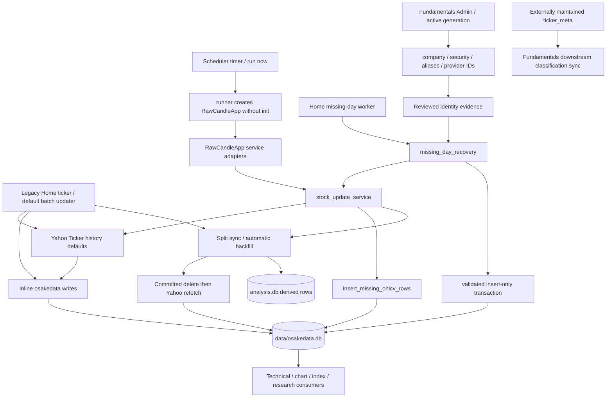

# RawCandle Next — architecture audit 01

OHLCV, security identity, metadata and corporate actions. **Audit date: 2026-10-14, Europe/Helsinki.** Repository HEAD at inspection: `3c3feb51ef5c78743b51e747160527a8d3364692`. Price-basis comparison reference: `e5cfcf5d`, [comparison report](../yahoo_price_basis_comparison_20261014.md).

**Status: recommendations for review, not approved implementation decisions. AUDIT ONLY. Production changes made by this audit: zero.** Companion [decision worksheet](keep_rewrite_remove_01.csv) contains stable IDs and separate business, implementation and initial-UI dispositions. No master plan, schema, migration or NG database was created.

Evidence labels: **VERIFIED FACT** means directly inspected source, configuration or read-only database results; **INFERENCE** means a consequence or limitation inferred from that evidence; **RECOMMENDATION** means proposed NG behavior. Prior research results are explicitly attributed to their existing reports and were not rerun here. “Active” below means a reachable implementation/configured invocation, not proof that every operation ran recently. Negative reachability findings are bounded to searched bindings, registries and commands.

## 1. Executive summary

**VERIFIED FACT:** RawCandle has a partly extracted stock-update service, but it has no single price-writer owner. The normal Home updater defaults to a separate inline implementation, the scheduled updater calls the shared service through a manufactured UI object, ticker onboarding writes directly from UI code, and split backfill has its own destructive writer. The stored price table contains adjusted OHLCV without Adj Close or a recorded source basis. See [main.py:3475](../../main.py#L3475), [service:475](../../services/stock_update_service.py#L475), [scheduler:2204](../../rawcandle/scheduler/runner.py#L2204).

**RECOMMENDATION:** retain sequential acquisition, bounded range planning, job receipts, strict missing-day validation and the Fundamentals company/security/provider identity concepts. Rewrite the contracts around one price writer and plain Python services. Explicitly store Yahoo `auto_adjust=False` OHLC, Adj Close and volume together in the future `osakedata_ng.db`. Every consumer must select its own basis; this audit does not approve ordinary prices for every calculation.

**VERIFIED FACT:** split refresh commits deletion of prices before requesting replacements, and “some replacement rows plus successful divergence recompute” can mark all ticker splits corrected. This can lose valid history on fetch failure or partial response and does not certify action units. All 6,427 stored split rows currently have the corrected flag, while prior research still documents unit/factor anomalies. The flag is operational history, not a quality certificate. [Backfill:70](../../analysis/splits_price_backfill.py#L70), [UI hook:210](../../main.py#L210).

**VERIFIED FACT:** the active canonical Fundamentals generation contains 2,560 securities and reusable permanent integer IDs; OHLCV contains 4,914 ticker routes, 2,354 outside that canonical set. Sharadar/Fundamentals membership therefore cannot become a general price prerequisite. 2,470 security starts and 2,475 alias starts are NULL or empty. Existing protection against reviewed successor/rename mistakes is useful but covers specific cases, not the whole universe.

**RECOMMENDATION:** reuse those IDs and continuity-review rules through a shared identity boundary with one allocation authority. Do not make every fetch join or initialize Fundamentals. Separate optional Sharadar lookup status from actual historical Fundamentals coverage. Preserve the externally maintained `data/osakedata.db.ticker_meta` as current Sector/Industry authority; downstream Fundamentals synchronization must not author that source.

**REMOVE candidates:** automatic earnings-blackout restrictions; per-price Sector/Industry copies and their fallback readers once migrated; test-only database/export stubs and the unbound partial-delete implementation. Keep earnings events as research evidence. Split deletion-first behavior is retired within a REWRITE of needed historical refresh functionality. No legacy files are deleted now.

**OPEN decisions:** shared identity authority/location and independent allocation; historical eligibility evidence standards; bounded revision policy; whether Polygon/Massive remains an optional source; initial UI maintenance powers. A separate derived-results database is not assumed merely because `analysis.db` exists.

## 2. Current-state subsystem map

**VERIFIED FACT — actual flow, including UI dependency:**



**INFERENCE:** service extraction alone has not established UI independence or writer ownership. A data refresh can still trigger unrelated calculation writes through callback adapters. The next architecture should separate source acceptance from derived calculation success.

## 3. Real entry points, data contracts and dependencies

### Yahoo collection and historical maintenance

| Entry point | Actual execution and writes | Basis / quality / scope |
|---|---|---|
| Home “Päivitä osaketiedot” → `RawCandleApp.update_stock_data`, `main.py:3475` | Inline default loop; optional `_use_stock_update_service` branch at 3477; normal `__init__` does not set that opt-in. Queries min/max dates, fetches, inserts missing dates, syncs splits, invokes backfill and derived work. | `history(start,end)` defaults. Start override uses `max(last_date+1, override)`, so it cannot request interior backfill or older refresh. Default market OMXH. |
| `run_stock_data_update`, `services/stock_update_service.py:1068` | Grouped candidates → plans → ticker flow → `insert_missing_ohlcv_rows` → split and calculation callbacks → final Dow callback. | Same implicit Yahoo basis; typed row has OHLCV and market only. Normal plan does not populate `expected_dates`. |
| Home “Hae data kantaan” / ticker submit → `fetch_stock_data`, `main.py:4726` | One or several tickers; existing tail or new history from 2018-01-02; inline schema ensure and `INSERT OR REPLACE`; metadata refresh; split sync/backfill; divergence/candlestick/Dow callbacks. | New non-index ticker screened using whole-history average Close < 1 and volume from 2025 onward. These are selection rules, not numerical qualification. Unlike shared conversion, fields may be stored NULL. |
| `fetch_and_save_from_file`, `main.py:2899` | Reads `data/tickers.txt`, skips existing tickers, fetches new history from 2018-01-02, writes directly and runs split/divergence paths. | Similar penny/2025-volume screens; explicit/inferred markets. Callable implementation exists; no live button binding or registered CLI to it found. |
| Home missing day → `recover_missing_day`, `main.py:3392` → `run_missing_day_recovery`, `services/missing_day_recovery.py:257` | Background worker; established market universe; skips all existing keys, including invalid existing bars; fetches absent keys only; strict validation and atomic key recheck; per-ticker commit/report. No derived recomputation or split repair. | Uses normal adjusted-only transport/conversion; exact symbol/timezone checks and reviewed identity holds. `firstTradeDate` informs POSSIBLE diagnostics, not verified listing proof. |
| Split fetch → `fetch_splits_for_ticker` / `sync_splits_for_ticker`, `stock/splits.py:23/:69` | Yahoo `.splits`; date/ratio insertion into `splits_data`; runtime table/column ensure. | Ratio float and local date string; no provider revision record, unit qualification or stable security ID. Error and no splits both yield empty list. |
| `RawCandleApp._maybe_backfill_splits_for_ticker`, `main.py:210`; `backfill_uncorrected`, `analysis/splits_price_backfill.py:179` | Commit delete from 2018; refetch using separate Yahoo writer; delete analysis_findings/divergence_data/results_data; recompute divergence; mark ticker splits corrected. | No complete expected-range validation before deletion or correction flag; market inferred after deletion, default USA if no surviving row. Cross-database changes are not one atomic transaction. |
| `analysis/backfill_splits_data.py:61 backfill` | Headless full/limited/ticker-list split evidence collection using `stock.splits`; no price repair itself. | Its dry-run still ensures schema and fetches provider data. Split price backfill dry-run also ensures market schema. Neither was run in this audit. |
| `blackout/fetch_blackouts.py:25 fetch_blackouts_for_tickers` / `:109 fetch_blackouts_for_missing_tickers` | Yahoo history actions and earnings dates into `analysis.db.blackout_dates`; event type and source retained; dividend cash amount discarded. Bulk routine processes all ticker routes, despite “missing” wording. | Normal history defaults; positive dividends only, earnings request limit 60; no claim of complete earnings history from 2018. Separate Yahoo cache configuration inside this path. |
| `scripts/repair_targeted_ohlcv_gaps.py` | Existing untracked task-specific diagnose/fetch/plan/apply CLI; `fetch_yahoo:144` explicitly requests False/actions, writer `apply:325` can modify production after manifest gates. | Inspected only; pre-existing user work preserved. Do not treat this task script as approved NG implementation or normal scheduled transport. |
| `analysis/research/yahoo_price_basis_acquire_20261014.py` and `...validate_20261014.py` | Explicit research acquisition through the shared fetch helper with a basis wrapper; standalone files, no production price writer. | Reachable headless research entry points; not part of normal operational refresh. Not rerun. |

**VERIFIED FACT — conversion/preservation:** `convert_history_to_ohlcv_rows` at service line 522 rejects missing OHLC, but its checks at 254–281 do not reject zero, negative, infinity, invalid high/low order or fractional volume truncation. Normal missing-date insertion preserves existing values, including bad ones. Historical provider changes to old bars therefore remain until a different refresh/maintenance path replaces them. Initialization and split refetch use different replace semantics. Preserving existing suspect values is an observed legacy policy; it is not authority to delete or repair them in this audit. The production table schema differs from inline CREATE statements: actual schema has surrogate `id`, nullable ticker/date, and a unique `(osake,pvm)` index, not the inline composite primary key.

**VERIFIED FACT — pacing, retries and locks:** shared service range pause 0.1 s; ticker pause 0.25 s on success or 0.1 s for short/failure branch; 5 s each 500 tickers (`service:241–305`). Legacy batch sleeps 1/1.5 s per ticker and 30 s each 500, with 0.5 s between long-range chunks. Missing-day service deliberately reuses the legacy ticker/batch sleeps. Split collection/backfill wrappers target at most 3 calls/tickers per second; these are not a universal Yahoo limiter. No application-level retry loop is present in normal history fetch; exceptions are handled at ticker/job boundaries, and empty frames can represent multiple upstream outcomes. Installed `venv/lib/python3.10/site-packages/yfinance/scrapers/history.py:34–38` supplies `auto_adjust=True`, `back_adjust=False`, `repair=False`, `keepna=False`, timeout 10 and `raise_errors=False`; these defaults were read locally, not exercised. Library internals may perform multiple HTTP requests per history invocation.

Scheduler uses nonblocking `fcntl.flock` (`runner:410`); configured FULL_WORKFLOW can use the Fundamentals production transaction lock (`runner:2390`). Home default update has `_coordinate_stock_update_ui` at `main.py:3474`; missing-day recovery shares the scheduler lock through `stock_update_operation_lock:80`. Ticker/file acquisition and split CLIs lack that same decorator. Manual `run_scheduled_stock_update` calls the UI adapter directly without acquiring the scheduler lock. **INFERENCE:** locking protects cooperating paths, not every price writer; insert writer's separate existing-key read is not equivalent to missing-day writer's `BEGIN IMMEDIATE` recheck.

### Markets and source-basis boundaries

**VERIFIED FACT:** configured markets are USA, OMXH, OMXS and Xetra; actual prices are USA/OMXH/OMXS. Suffix routing uses `.HE`, `.ST`, `.DE`; unknown or invalid market choices sometimes fall back to USA. Market configuration carries minimum volume, not exchange calendar/currency. The old schema-add path writes `suomi` for `.HE` tickers (`market_repository.py:111`), whereas current market code is `omxh`. This is an extant compatibility path, not evidence of current `suomi` rows.

| Market | Stored bars | Ticker routes | First / latest stored date | Current scheduler enabled |
|---|---:|---:|---|---|
| USA | 8,094,053 | 4,524 | 2018-01-02 / 2026-10-14 | Yes |
| OMXH | 201,657 | 98 | 2018-01-02 / 2026-10-13 | Yes |
| OMXS | 574,124 | 292 | 2018-01-02 / 2026-06-16 | No |
| Xetra | 0 | 0 | No price rows | No |

**INFERENCE:** stored maximum date is not a completed-session certificate. Normal fetch end is tomorrow in host local time, and service planning compares to today's date, not an exchange session calendar. OMXS staleness is consistent with disabled scheduling, but configuration alone does not prove the reason. Coverage CLI's default minimum 1,000 reference tickers is inappropriate for these Nordic universes unless overridden. Weekend rejection in missing-day recovery is not a holiday calendar.

**RECOMMENDATION:** ordinary Yahoo history remains retrospectively split-adjusted where the provider does so; do not call it original exchange-unit or point-in-time raw data. Fetch all six fields in one observation vintage, validate ordinary bars and adjustment factors separately, retain provenance and quality reasons, and provide an explicit basis to readers. Do not reconstruct Adj Close from legacy adjusted OHLCV alone. No provider configuration was changed here.

## 4. Relevant legacy UI functionality inventory

**VERIFIED FACT:** actual legacy top-level appbar is Home, Settings, Candles, Indeksit, Stock, Simulaatio, Analysis Dashboard, Results Dashboard, Tulokset, Exit (`main.py:3309` / routing `:4691`). It is not a database-maintenance menu. Separate scheduler UI has Scheduler, Forecast, Taxonomy, Fundamentals, Fundamentals Admin tabs (`dev_tools/stock_update_scheduler_ui.py:2251`). The table inventories subordinate operations within this audit boundary; unrelated calculation/report internals are excluded.

| Actual menu / subordinate operations | Handler and service boundary | Database reads / writes; shared usage | Business logic in UI? / initial NG admin need |
|---|---|---|---|
| Home → ticker input, submit, “Hae data kantaan” | `fetch_stock_data:4726` | Reads/writes osakedata; writes metadata/splits and derived analysis callbacks; its own Yahoo path | Yes: selection, fetch, DDL, persistence and orchestration. INCLUDE onboarding/job request through service. |
| Home → “Päivitä osaketiedot”, market selector, start date, count | `update_stock_data:3475`; `_on_update_market_change:716`; count `:3923`; opt-in service flow `:380` | osakedata candidate/tail reads and inserts; split/actions; analysis writes. Scheduler uses service variant, not default inline loop. | Yes. INCLUDE market/date intent, progress and receipt; separate append from historic refresh. |
| Home → “Hae puuttuvan päivän tiedot” | `recover_missing_day:3392` → `services.missing_day_recovery.run_missing_day_recovery` | osakedata/markets reads; JSON reviewed-conflict evidence; insert-only osakedata; report files | Mostly thin worker adapter. INCLUDE, adapted to six fields/calendar/IDs. No implicit downstream rebuild. |
| Home → Sector/Industry update button | `_build_update_sectors_button:4464` → `update_sectors_from_ui:3882` → `sector_update.update_sector_metadata:153` | Reads osakedata/markets/ticker_meta; Yahoo info; writes ticker_meta. Fundamentals uses separate downstream-only sync. | Market/UI orchestration embedded. INCLUDE source status/sync; source editing/acquisition ownership needs decision with external maintainer. |
| Home → “Näytä Tiedot” / price table | `show_stock_data:5155` | Reads osakedata; table/count rendering | Simple data inspector useful. INCLUDE small source table with quality/basis/identity. |
| Home → “Hae blackout-päivät” → tickers/start-date / fetch / close | `show_blackout_fetch_dialog:4122` → `fetch_blackouts_for_tickers` | Writes blackout_dates; reads Yahoo history/earnings | Dialog orchestrates business service. REWRITE as event inspection/acquisition; REMOVE restriction wording. |
| Home → “Päivitä blackout-päivät” → bulk progress / cancellation | `update_blackout_dates:4206` → `fetch_blackouts_for_missing_tickers` | Reads all price tickers; writes blackout_dates and blackoutdays.txt | Worker/progress adapter with misleading missing-only message. Keep useful event refresh outside restriction mechanism; bulk research UI DEFER. |
| Home → missing divergence / missing Dow buttons | `calculate_missing_divergences:3948`; `calculate_missing_stock_dow_structures:4047` | Reads source prices; writes analysis tables | Calculation details out of scope. Record downstream dependency; initially expose job outcome/pending state, DEFER legacy calculation controls. |
| Settings → market add/edit/reset/delete; name/abbreviation/suffix/min-volume; market stats | `create_settings_view:1019`; `_build_market_row:747`; `_edit_market:854`; `_save_market_form:906`; `_delete_market:934`; reset `:884`; `market_repository` | markets CRUD; price market associations and blackout/count reads; runtime schema ensure | Validation/orchestration mixed. INCLUDE simple market/route settings; clarify screen versus collection policy. |
| Settings → excluded tickers add/update/edit, activate/deactivate, delete, clear; reason/category | `_build_excluded_ticker_row:803`; `_save_excluded_ticker_form:961`; `_set_excluded_ticker_active:989`; `_delete_excluded_ticker:1004`; reset `:942` → `DatabaseManager` | analysis.excluded_tickers CRUD; research/returns readers | Policy is not security classification or price eligibility. INCLUDE basic scoped policy list; detailed consumer semantics next audit. |
| Stock → ticker fetch, range presets, chart/table, indicator/pattern toggles, select-all and pagination | `StockView._on_fetch_clicked:516`; range/toggle handlers `:461–505`; `stock.services.fetch_price_rows:31` | Reads prices, findings/results and blackout dates; `_fetch_ticker_meta:595` prefers ticker_meta then inline fallback; computes RSI/SMA in read helper | No Yahoo acquisition: “fetch” here means local read. INCLUDE compact source inspector; DEFER chart/indicator research interface. Replace mixed blackout coloring with typed events later. |
| Indeksit → market/sector/stock selection; sector-index / industry-index update; chart/range/normalization controls | `IndexPage.create_view:85`; `_on_update_click:756`; `_on_update_industry_click:810`; `index_calc.ensure_ticker_metadata:133` | Reads OHLCV/ticker_meta; writes derived index_daily. Even market/sector load can create/fill ticker_meta. | Derived index calculations out of scope; metadata side effect in scope. REMOVE implicit metadata-writing read path; DEFER index generation/graph UI. |
| Scheduler → save/reload config; markets/time/timezone; Run now; skip next/cancel skip; refresh logs/show more/open log; timer/status/summary | `stock_update_scheduler_ui.py:on_save_config:1387`, `on_reload_config:1422`, `on_run_now:1433`, skip `:1442/:1449`, logs `:1456` | scheduler JSON, lock/status, log/summary files; invokes CLI/runner; checkbox also enables Fundamentals full workflow | Suitable simplicity reference, but persistence/job code still large. INCLUDE small equivalent controls through services; do not copy five-tab application wholesale. |
| Fundamentals Admin → Add Tickers; Remove Tickers; Resolve ticker identity | `fundamentals_admin_page.py:153` operation dropdown; `on_preview:1723`, `on_full_workflow:1832`; `AdminUIService` dispatch `ui_service.py:398/:439/:617` | Reads active provider/canonical/universe/market; add/remove workflows can write provider/canonical/universe/downstream. Identity operation itself is PREVIEW only (`ui_service.py:226`). | UI routes work to services. INCLUDE shared identity lookup/holds; preserve Fundamentals-owned workflows in current app; do not copy scoring/rebuild workflow into general price collection. |
| Fundamentals Admin → Sector and Industry; Synchronize provider CIK; Preview / Test on copies / Production actions and confirmation | Same generic handlers; sector_industry.py; cik_sync.py | Sector/Industry operation writes downstream analysis role, reads market source; CIK writes issuer identity mappings. Capabilities vary by operation; not all buttons always visible. | Core service separation reusable. INCLUDE metadata status and owning-service sync links; copying production workflows is not authorized. |
| Fundamentals Admin → review queue, selected evidence, approve/hold/remove/restore actions; history refresh/show more/select/download/cleanup | `refresh_review_queue:1102`; `apply_review_action:625`; `on_history_refresh:1265`; select `:1300`; history/cleanup handlers `:1350–1496` | Admin artifacts/review state; some workflow actions can affect canonical/provider/downstream. Financial/fiscal/ownership reviews excluded except identity interface. | Keep reviewable identity evidence and receipts; DEFER unrelated financial review mechanisms and cleanup machinery from initial NG UI. |
| Scheduler → Taxonomy / Forecast / Fundamentals snapshot | Registered tabs and routes at `stock_update_scheduler_ui.py:2251` | Consumer domains; taxonomy entities/aliases and forecasts use their own read boundaries | Presence is not proof of initial NG need. Internals excluded; DEFER these editors/readouts. |

**VERIFIED FACT — callable leftovers versus live menus:** `create_database_view:2323` explicitly returns a minimal test view; database creation/import/export helpers at 2356–2392 are stubs. No production route/binding for that view/export handler, `fetch_and_save_from_file`, or `show_delete_stock_dialog` was found in the searched non-test Python entry points. `delete_stock_confirmed:4375` can delete prices and selected analysis rows, but leaves ticker_meta, splits, Dow and other dependencies. `save_csv_to_path:5021` is registered on FilePicker; no live download-button binding was found. **INFERENCE:** these are legacy removal candidates, not a categorical claim that no external user script ever calls them. Later removal must check external launchers before deleting APIs.

## 5. Scheduler and essential headless operations

**VERIFIED FACT:** `scheduler_config.json` enables OMXH and USA, at **04:30 Europe/Helsinki**, with technical relevance and Fundamentals FULL_WORKFLOW enabled; EC source refresh enabled; several other report/enrichment flags disabled. This is configuration, not proof a timer is currently running. `run_stock_update_scheduler.py:21` calls `run_scheduler_config`; `runner._run_one_market:2298` calls `RawCandleApp._run_stock_update_via_service`; `_build_app:2204` uses `object.__new__` to bypass UI construction. The extraction still imports and depends on UI methods. Run result/market logs and summary JSON exist as file-based operational state, not separate price tables.

| Headless operation (inspected, not executed) | Purpose / shared logic | NG assessment |
|---|---|---|
| `python -m rawcandle.cli.run_stock_update_scheduler --config …` | Scheduled whole configured run; lock/status/logs; source stage plus derived/Fundamentals post-steps | REWRITE driver to independent services; keep sequential markets and explicit receipts. |
| `python -m rawcandle.cli.run_scheduled_stock_update --osakedata-db … --analysis-db … --market …` | Manual service path with optional dates; manufactures RawCandleApp; no outer scheduler lock here | Keep headless operation; standardize locking and statuses. |
| `analysis/backfill_splits_data.py` | Populate/inspect split evidence from existing universe | Rewrite through action service; safe preview must not ensure schema or fetch unless explicit. |
| `analysis/splits_price_backfill.py` | Refetch prices and recompute divergence for uncorrected splits/ticker list | Replace delete-first path; old dry-run is not audit-safe. |
| `rawcandle.cli.check_market_day_coverage` | Read-only session coverage report from neighbor references | Rewrite market/eligibility/quality basis; retain diagnostic interface. |
| `rawcandle.cli.plan_market_day_recovery`, `...recover_market_day_missing_prices` | Explicit Polygon/Massive grouped-day candidate plan and insert-only apply; optionally downstream recompute | OPEN provider need; never silently splice a different adjustment basis. These names are distinct from Home's Yahoo-only missing-day service. |
| Fundamentals identity preview/add/remove/sector-industry/CIK CLIs in `rawcandle/cli/` | Existing identity authority and downstream classification operations | Reuse identity logic/interface only. Do not run or recreate whole Fundamentals workflow for OHLCV. |
| `scripts/repair_targeted_ohlcv_gaps.py`; dated price-basis research scripts | Scoped maintenance/research manifests and evidence | Keep ideas and evidence; task scripts are not shared writer ownership. |

**VERIFIED FACT:** optional fallback exists in service signatures but defaults False; normal adapters do not wire it, and normal plans leave expected dates empty (`service:77/:413/:617/:1089`, `main.py:299`). This is a supported injection seam, not proof of active automatic Polygon recovery. Polygon URL requests `adjusted=true` and produces the same five-field row (`services/polygon_massive_grouped_daily_provider.py:18`); legacy storage has no place to identify that source/basis. Forecast Yahoo requests and result-publication earnings acquisition are separate consumer domains, not additional OHLCV writers.

**RECOMMENDATION:** essential initial headless operations are onboarding/collection-universe management, daily collection, explicit historical refresh, gap/quality diagnosis, missing-session collection, action/identity evidence review, metadata sync status and job/receipt inspection. Keep derived recomputation behind separately specified consumers. No mandatory HTTP API, microservice or large ORM is justified.

## 6. Current database tables, ownership and indexes

**VERIFIED FACT:** measured with `sqlite3.connect(file_uri + '?mode=ro', uri=True)` plus `PRAGMA query_only=ON`; no application repository objects or schema helpers were instantiated. Counts are exact query results at inspection, not estimates. Footprints below are allocated table B-tree **plus its indexes**, measured through read-only SQLite `dbstat` and rounded to MiB; they exclude journal/WAL, shared freelist and other tables and are not deletion savings estimates. Each database was inspected separately; this is not an atomic cross-database snapshot.

The active Fundamentals pointer is `data/fundamentals_active_generation.json`, generation **`refresh_20261014T095401Z_refresh_fundamentals_43db1c8371f6_production_6917d617`**. In the following tables **P** means `data/fundamentals_generations/<that generation>/fundamentals_provider.db`, **C** means the corresponding `fundamentals_v4.db`. Flat `data/fundamentals_*.db` files still exist, but were not used as active counts. Resolver logic: [generations.py:98](../../rawcandle/fundamentals/generations.py#L98), `resolve_active_generation:178`. Historical paths in `role_verification` refer to the earlier `.preparing` validation; active files resolve from generation ID plus `roles`, not those verification paths.

Database sizes: osakedata **1,931.52 MiB**, analysis **11,874.05 MiB**, active provider **923.47 MiB**, active canonical **714.66 MiB**. The analysis size does not justify inventing an `analysis_ng.db`; most contents are outside this audit. Zero-byte root `analysis.db` and other placeholders are not operational source authorities.

The following inventory includes derived tables only where current source-refresh/delete paths directly read/write them. Their calculation internals are not audited. Codes: **S** source/evidence, **O** operational state/policy, **D** derived, **L** legacy; “rebuild” always means from identified retained upstream sources, not a guarantee that Yahoo will reproduce an old response.

| Database | Table | Rows | MiB incl. indexes | Role / rebuildability | Writers (reachable paths) | Readers | Redundancy / NG candidate |
|---|---|---:|---:|---|---|---|---|
| data/osakedata.db | `osakedata` | 8,869,834 | 1900.480 | S; Yahoo histories; exact vintage not reproducible | main.py fetch/update; stock_update_service; missing_day_recovery; splits_price_backfill; explicit maintenance CLI | Technical readers; stock/services; index_calc; coverage/research | Replace five-field/ticker schema; remove repeated classifications; osakedata_ng.db |
| data/osakedata.db | `splits_data` | 6,427 | 0.473 | S + O; Provider refetch possible; correction state not evidence | stock.splits; backfill_splits_data; mark_splits_corrected | UI/service automatic split backfill; action diagnostics | Action evidence in osakedata_ng.db; retire correction bit |
| data/osakedata.db | `ticker_meta` | 5,068 | 0.562 | S authoritative current classification; External maintainer/source required; exact old states not recoverable | External program (not inspected); sector_update; index_calc metadata filler | Index/stock/research; Fundamentals sector_industry read-only source | Controlled source read/sync; future NG metadata ownership decision; never replace authority with Fundamentals |
| data/osakedata.db | `markets` | 4 | 0.012 | O authoritative config; Only from retained operator configuration | market_repository; Settings | Acquisition; missing-day service; market selectors | Keep small market config; operational location OPEN |
| data/osakedata.db | `index_daily` | 122,689 | 28.051 | D; Yes with specified source/basis/algorithm | pages/index_page/index_calc | IndexPage; index/trend readers | Consumer audit; destination OPEN, no assumed analysis_ng.db |
| data/osakedata.db | `index_daily_old` | 12,204 | 1.930 | L/D; Likely derived; exact relation to current table not proven | Only migration rename path found | Migration copy/drop path; no current normal read found | OPEN retirement after content/dependency comparison; do not migrate by default |
| data/analysis.db | `blackout_dates` | 181,136 | 23.156 | S cache; Provider can refetch partial current events; historical completeness not guaranteed | blackout.fetch_blackouts; DatabaseManager.insert_blackout_entries | results_generator; preprocess_utils; stock chart; market stats | Separate earnings evidence and monetary actions; remove restriction semantics |
| data/analysis.db | `excluded_tickers` | 26 | 0.012 | O authoritative policy; Only from retained operator choices | DatabaseManager; Settings | Research and returns policy readers | Explicit scoped policy keyed by shared identity; location OPEN |
| data/analysis.db | `analysis_findings` | 1,782,501 | 401.699 | D; Yes under new baseline; legacy equivalence not required | Candlestick analysis callbacks; UI deletion; split cleanup | Stock/results/research | Invalidate/rebuild later; no source migration requirement |
| data/analysis.db | `divergence_data` | 8,867,512 | 1455.188 | D; Yes under new baseline | Divergence callbacks; split cleanup; UI deletion | Stock/results/research | Consumer audit and explicit basis/version invalidation |
| data/analysis.db | `results_data` | 37,361 | 57.188 | D; Yes under new baseline | Results generator; split cleanup; UI deletion | Results/research/regression readers | Retire blackout flags; recompute under later approved contract |
| data/analysis.db | `results_metadata` | 42 | 0.004 | O/D; Recreate for regenerated results | Results generator/DatabaseManager | Result generation/freshness checks | Review with results consumer; not primary source metadata |
| data/analysis.db | `stock_dow_structure_events` | 950,769 | 427.648 | D; Yes under new baseline | analysis.stock_dow_structure callback | Stock/technical/report readers | Consumer audit; current split cleanup does not delete this table |
| data/analysis.db | `stock_dow_structure_status` | 4,915 | 1.020 | O/D; Yes with regenerated events | analysis.stock_dow_structure callback | Incremental Dow freshness/planning | Replace freshness dependency with source-change receipts later |
| P | `sharadar_ticker_metadata` | 74,075 | 56.902 | S provider cache; Source snapshots required for exact vintage; current refetch possible | schema.bootstrap_review.insert_ticker_metadata; onboarding/refresh source pipeline | Identity resolver; CIK sync; historical universe; Fundamentals metadata | Reuse selective provider evidence; no mandatory full cache in OHLCV |
| P | `sharadar_action_metadata` | 156 | 0.078 | S partial evidence; Retained source needed for exact sample; not comprehensive | schema.bootstrap_review.insert_actions_metadata; refresh copy preservation | bootstrap identity review; historical-universe/profile research | Reuse dated evidence with source; do not treat 156 rows as action master |
| P | `sharadar_refresh_state` | 1 | 0.004 | O; Current refresh receipt can be recreated; prior source state not inferred | Fundamentals refresh pipeline | Refresh planning/status | Keep in Fundamentals; expose availability separately |
| C | `company` | 2,547 | 0.285 | S identity authority; Preserve IDs; do not reconstruct from ticker alone | Identity bootstrap; reviewed onboarding | Security/CIK/provider identities; Fundamentals/research | Reuse issuer IDs/model; shared authority ownership OPEN |
| C | `security` | 2,560 | 0.219 | S identity authority; Preserve IDs/evidence; generalized universe requires allocation | Identity bootstrap; reviewed onboarding/transitions | Fundamentals; forecasts identity; research | Reuse IDs/model; temporal routing and broader price universe required |
| C | `ticker_alias` | 2,575 | 0.285 | S identity evidence; Preserve reviewed aliases; empty starts not evidence | Identity bootstrap; ticker transition onboarding/reconciliation | Identity preview; forecasts; historical research | Rewrite date/provenance contract; no implicit successor price stitching |
| C | `company_cik` | 2,542 | 0.773 | S issuer identifier evidence; Retained provider/bootstrap provenance required | Identity bootstrap; onboarding; cik_sync | Issuer resolution; Fundamentals/SEC readers | Keep normalization/provenance; unify mapping responsibility |
| C | `provider_company_identity` | 2,527 | 0.484 | S issuer-provider mapping; Can rebuild from preserved validated CIK evidence | Provider CIK sync/onboarding | Identity/CIK resolver | Reuse provider-scoped mapping; reconcile company_cik |
| C | `provider_security_identity` | 2,557 | 0.250 | S security-provider mapping; Preserve reviewed links; do not regenerate from ticker guesses | Production bootstrap; reviewed onboarding/transitions | Identity/forecast/research readers | Reuse Sharadar permaticker link; never universal security ID |
| C | `fundamentals_operational_universe_member` | 12,313 | 5.371 | O versioned membership; From retained approved membership/source versions | Fundamentals onboarding/removal/universe publication | Fundamentals admin; classification sync; operational consumers | Keep Fundamentals policy separate from general collection membership |
| C | `fundamentals_operational_universe_member_alias` | 12,428 | 2.219 | O materialized aliases; From preserved versioned identity/membership policy | Universe publication pipeline | Universe readers; admin/research | Avoid second general identity authority; project shared aliases |
| C | `fundamentals_operational_universe_version` | 5 | 0.012 | O audit/version state; Current view from retained members; history needs approvals | Universe publication pipeline | Active-universe resolution/admin | Remain Fundamentals-owned; do not copy whole version framework into price layer |
| C | `fundamentals_operational_universe_active_version` | 1 | 0.008 | O pointer; From retained accepted universe publication | Universe activation | Operational membership readers | Keep pointer in owner; expose resolved view |
| C | `fundamentals_operational_universe_schema_meta` | 1 | 0.004 | O schema version; From approved schema initialization | Fundamentals schema helpers | Universe readers/writers | No independent price destination |
| C | `fundamentals_economic_structural_event` | 5 | 0.020 | S reviewed evidence; Only from retained event/review sources | Fundamentals structural_break persistence and reviewed context pipeline | structural_context; classification checks; Fundamentals consumers | Reuse evidence through small event interface; no mandatory lineage graph |
| F-A | `valuation_revised_result` | 89,470 | 83.648 | D with metadata projection; Derived under owning Fundamentals contract | Fundamentals valuation pipeline; sector_industry._apply_classification_corrections | Sector/Industry verification; valuation/snapshot readers | Remain downstream projection; not Sector/Industry authority |
| F-A | `relative_position_active_snapshot` | 1 | 0.012 | O derived pointer; From accepted owning-domain rebuild | Fundamentals relative-position activation/downstream refresh | Sector/Industry state binding; Fundamentals readers | Remain consumer-owned; metadata sync can inspect pointer |

**F-A** is `data/fundamentals_generations/<active generation>/fundamentals_analysis.db` (868.08 MiB). Only directly relevant classification storage/pointer are inventoried; scoring, valuation, financial observation and other downstream table internals are excluded. Their recomputation is not part of this audit. SQLite housekeeping tables are omitted.

### Index and identity relationship inventory

**VERIFIED FACT:** index names, uniqueness and columns were inspected for every table above. `U` denotes unique; unlabeled indexes are nonunique.

| Database / table | Existing indexes | Declared FK targets |
|---|---|---|
| osakedata.db / `osakedata` | `idx_osakedata_market_ticker_date` (market, osake, pvm); `idx_osakedata_mkt_sec_ticker_date` (market, sector, osake, pvm); `idx_osakedata_mkt_ticker_date` (market, osake, pvm); `idx_osake_pvm` U (osake, pvm) | None |
| osakedata.db / `splits_data` | `sqlite_autoindex_splits_data_1` U (osake, split_date) | None |
| osakedata.db / `ticker_meta` | `idx_ticker_meta_market_sector` (market, sector); `idx_ticker_meta_market` (market); `sqlite_autoindex_ticker_meta_1` U (ticker) | None |
| osakedata.db / `markets` | `idx_markets_abbrev` U (abbreviation); `sqlite_autoindex_markets_1` U (abbreviation) | None |
| osakedata.db / `index_daily` | `idx_index_daily_level_market_sector_industry_date` (level, market, sector, industry, date); `sqlite_autoindex_index_daily_1` U (date, level, market, sector, industry) | None |
| osakedata.db / `index_daily_old` | `idx_index_daily_level_market_sector_date` (level, market, sector, date); `sqlite_autoindex_index_daily_old_1` U (date, level, market, sector) | None |
| analysis.db / `blackout_dates` | `idx_blackout_date` (date); `idx_blackout_ticker` (ticker); `sqlite_autoindex_blackout_dates_1` U (ticker, date, event) | None |
| analysis.db / `excluded_tickers` | `idx_excluded_tickers_active` (active); `sqlite_autoindex_excluded_tickers_1` U (ticker) | None |
| analysis.db / `analysis_findings` | `idx_analysis_findings_ticker_date` (ticker, date); `idx_pattern` (pattern); `idx_date` (date); `idx_ticker` (ticker); `idx_unique_finding` U (ticker, date, pattern) | None |
| analysis.db / `divergence_data` | `idx_div_ticker_date` (ticker, date); `idx_div_date` (date); `idx_div_ticker` (ticker); `sqlite_autoindex_divergence_data_1` U (ticker, date) | None |
| analysis.db / `results_data` | `idx_results_market` (market); `idx_results_ticker_date_pattern` (ticker, date, candle_pattern); `idx_results_pattern_date` (candle_pattern, date); `idx_results_ticker_date` (ticker, date); `idx_results_pattern` (candle_pattern); `idx_results_date` (date); `idx_results_ticker` (ticker); `sqlite_autoindex_results_data_1` U (ticker, date, candle_pattern) | None |
| analysis.db / `results_metadata` | None | None |
| analysis.db / `stock_dow_structure_events` | `idx_stock_dow_events_event_type` (event_type); `idx_stock_dow_events_ticker_event` (ticker, event_date); `idx_stock_dow_events_ticker_confirmed` (ticker, confirmed_as_of_date); `sqlite_autoindex_stock_dow_structure_events_1` U (ticker, confirmed_as_of_date, event_type, event_date, pivot_radius, price_source) | None |
| analysis.db / `stock_dow_structure_status` | `idx_stock_dow_status_calculated_through` (calculated_through_date); `idx_stock_dow_status_market` (market); `sqlite_autoindex_stock_dow_structure_status_1` U (ticker, price_source, pivot_radius) | None |
| P / `sharadar_ticker_metadata` | `idx_sharadar_ticker_metadata_permaticker` (permaticker); `idx_sharadar_ticker_metadata_ticker` (ticker, table_name); `sqlite_autoindex_sharadar_ticker_metadata_1` U (table_name, ticker, permaticker) | None |
| P / `sharadar_action_metadata` | `idx_sharadar_action_metadata_ticker` (ticker, date, action); `sqlite_autoindex_sharadar_action_metadata_1` U (date, action, ticker, name, contraticker, contraname) | None |
| P / `sharadar_refresh_state` | None | None |
| C / `company` | `sqlite_autoindex_company_1` U (company_key) | None |
| C / `security` | `sqlite_autoindex_security_1` U (current_ticker) | company_id → company.company_id |
| C / `ticker_alias` | `sqlite_autoindex_ticker_alias_1` U (security_id, ticker, provider, valid_from) | security_id → security.security_id |
| C / `company_cik` | `sqlite_autoindex_company_cik_1` U (company_id, cik_normalized) | company_id → company.company_id |
| C / `provider_company_identity` | `sqlite_autoindex_provider_company_identity_1` U (provider, provider_identifier_type, provider_identifier_value) | company_id → company.company_id |
| C / `provider_security_identity` | `sqlite_autoindex_provider_security_identity_1` U (provider, provider_security_id) | security_id → security.security_id |
| C / `fundamentals_operational_universe_member` | `idx_fouv_member_ticker` (current_ticker, market); `idx_fouv_member_company` (company_id, universe_version_id); `sqlite_autoindex_fundamentals_operational_universe_member_1` U (universe_version_id, company_id) | security_id → security.security_id; company_id → company.company_id; universe_version_id → fundamentals_operational_universe_version.universe_version_id |
| C / `fundamentals_operational_universe_member_alias` | `sqlite_autoindex_fundamentals_operational_universe_member_alias_1` U (universe_version_id, security_id, alias_ticker, provider, valid_from) | universe_version_id → fundamentals_operational_universe_member.universe_version_id; company_id → fundamentals_operational_universe_member.company_id |
| C / `fundamentals_operational_universe_version` | `sqlite_autoindex_fundamentals_operational_universe_version_2` U (contract_version, economic_result_fingerprint); `sqlite_autoindex_fundamentals_operational_universe_version_1` U (universe_version_id) | None |
| C / `fundamentals_operational_universe_active_version` | `sqlite_autoindex_fundamentals_operational_universe_active_version_1` U (universe_version_id) | universe_version_id → fundamentals_operational_universe_version.universe_version_id |
| C / `fundamentals_operational_universe_schema_meta` | None | None |
| C / `fundamentals_economic_structural_event` | `idx_structural_event_company` (company_id, successor_ticker); `sqlite_autoindex_fundamentals_economic_structural_event_1` U (event_id) | None |
| F-A / `valuation_revised_result` | `idx_valuation_revised_status` (model_fingerprint, history_mode, valuation_status, reason_code); `idx_valuation_revised_current` (model_fingerprint, history_mode, company_id, fiscal_sequence); `sqlite_autoindex_valuation_revised_result_1` U (company_id, fiscal_year, fiscal_quarter, model_fingerprint, history_mode) | None |
| F-A / `relative_position_active_snapshot` | `sqlite_autoindex_relative_position_active_snapshot_2` U (snapshot_id); `sqlite_autoindex_relative_position_active_snapshot_1` U (model_fingerprint) | snapshot_id → relative_position_snapshot.snapshot_id |

**INFERENCE / RECOMMENDATION — schema consequences:**

- `idx_osakedata_market_ticker_date` and `idx_osakedata_mkt_ticker_date` duplicate the same `(market,osake,pvm)` ordering. Keep one suitable NG access path after query review, not both by inheritance. Unique `(osake,pvm)` prevents duplicate legacy ticker/date keys but cannot distinguish the same symbol reused by different securities/markets. Neither prices nor actions have identity FKs. The new writer must resolve security identity before persistence.
- `security.current_ticker` is globally unique, while alias uniqueness is `(security_id,ticker,provider,valid_from)`. There is no overlap exclusion constraint for competing ticker routes. SQLite NULL components can also weaken a composite UNIQUE rule. Date interpretation must be explicit and validated by the identity owner; a universal ticker reuse model is not already proven by these constraints.
- Company/security/provider relationships are declared FKs where shown, but enforcement is per connection. Declared FKs do not prove every historical writer enabled enforcement. Cross-database consumers of integer IDs have no SQLite FK to the active canonical database. Preserving IDs matters during a future authority move.
- `company_cik` and `provider_company_identity(SEC,CIK)` represent related issuer mappings in two forms. They have different keys; synchronize through one owner rather than create a third CIK registry. `ticker_meta`, inline price metadata and derived valuation classifications are similarly distinct authority/projection roles, not interchangeable sources.
- `index_daily_old` has 12,204 rows even though the migration code at `index_calc.py:97–106` renames/copies/drops that name. No normal reader was found. Do not declare it safely redundant without comparing retained contents and external use. Classification remains OPEN.
- 12,313 operational-universe members and 12,428 member-alias rows span five versions, not that many distinct securities. Their versioned research/administrative policy need not be cloned into price ingestion. Avoid stripping reviewed history from the existing Fundamentals subsystem in this audit.

## 7. Sharadar / Fundamentals identity reuse

**VERIFIED FACT:** canonical `company` and `security` separate issuer identity from a tradable security. The active generation has 2,547 companies, 2,560 securities, 2,557 provider-security links, 2,542 company CIK rows covering 2,542 companies, and 2,527 SEC/CIK provider-company mappings. Current OHLCV has 4,914 ticker routes; every canonical current ticker has a price route, but 2,354 price routes are outside canonical Fundamentals. “Outside” is a current string-set comparison, not a historical identity proof or assertion of missing Sharadar metadata.

`admin/identity_resolution.py:22` defines EXISTING_SECURITY, NEW_SECURITY, TICKER_TRANSITION_SAME_SECURITY, BUSINESS_COMBINATION_NEW_SECURITY, REORGANIZATION_SUCCESSOR and IDENTITY_REVIEW_REQUIRED. `resolve_ticker_identity:393` examines current/alias/provider/CIK evidence and separates issuer continuity from security continuity. `approval_material:95`, `approval_fingerprint:123` and `_review_current_state:234` bind approved review to source/canonical state. CIK company matching can create a distinct security rather than merge shares automatically. These are practical reusable safeguards, not a mandate to use Sharadar for every instrument.

**VERIFIED FACT — dates are weaker than column names suggest:** 2,470 of 2,560 `security.valid_from` are NULL; only one security has a non-NULL end and 18 are inactive. Of 2,575 aliases, five start values are NULL and **2,470 bootstrap starts are empty strings**, so **2,475 are effectively undated**, not just five. Only five aliases have nonempty end dates. Bootstrap inserts empty valid_from explicitly (`schema/identity_calendar_bootstrap.py:238`). Onboarding uses provider `firstpricedate`, first local market date or application date as a start fallback (`admin/batch_add_tickers.py:1388`); same-security transition uses reviewed date or provider/date fallback (`:1347`). Therefore even nonempty starts need provenance before serving as verified listing boundaries.

**VERIFIED FACT — existing safeguards are scoped:** registry JSON contains DRK/ANY PROPOSED with no effective date, and approved KRSA/CYCN (2026-09-09), PSQL/BBCQ (2026-08-28), QVCG/QVCAQ (2026-08-06) resolutions. Separately the structural-event table contains five dated cases (VMRK/EQR, IA/ISSC, VAI/AIHS, NXH/BBBY, NMAD/LIXT), with VAI REVIEW_REQUIRED and the others ACCEPTED. These labels differ from registry APPROVED and must not be silently equated. `admin/structural_context.py:11` also carries a hardcoded transition list. The separate prior price-basis report researches META/FB, VRT, VATE, DEC and NFE; those research conclusions are not automatically populated as operational registry events.

`services/missing_day_recovery.ExistingIdentityEvidence:108` checks approved registry effective dates and predecessor/subject strings, independently of Fundamentals membership. It does not call full fingerprint/current-state validation from the identity resolver. **INFERENCE:** it is useful conservative protection for those dated cases but not a universal security master. A future shared evidence reader should apply the identity owner's validation instead of duplicating a reduced approval rule.

**VERIFIED FACT — other identity consumers:** `rawcandle/forecasts/identity.py:39 ForecastIdentityResolver` reads canonical provider links, aliases and current security as of acquisition timestamp; it does not create another security registry. Its alias end comparison is inclusive. `batch_add_tickers.py:1355` closes the old alias on the effective date and opens the new alias at that date, so future routing should explicitly define interval edges rather than copy consumers' assumptions. EC sidecar `ec_entity`/`ec_entity_alias` (`ec_datacenter_taxonomy_loader.py:197/:231`, `ec_sidecar_migration.py:32`) are ecosystem entity keys/aliases. Their internals and taxonomy are outside scope; do not assume all group/entity IDs should be replaced by security IDs. They will need an explicit mapping for security entities, not another general security authority. Forecasts and EC tables are not proposed for migration here.

**RECOMMENDATION — practical reuse without a per-fetch Fundamentals dependency:** retain current security/company IDs, provider-scoped links, CIK normalization and review semantics. Define one shared allocation/identity owner covering price securities beyond the Fundamentals universe. Either expose a narrow read interface from that owner or synchronize a validated small identity projection to the NG price environment, with explicit freshness/conflict handling and a single allocator. Price collection resolves a local approved route before calling Yahoo; it does not query Fundamental observations/scoring or require Sharadar membership for each request. Fundamentals membership remains a separate domain policy. Exact physical location and transition ownership are OPEN, not a competing identity system approved by this audit.

**RECOMMENDATION — optional provider state:** expose exactly `sharadar_status` = AVAILABLE / NOT_FOUND / UNCERTAIN / NOT_CHECKED, `sharadar_permaticker`, `sharadar_last_checked`. AVAILABLE means a qualified provider identity was found, not that all required historical Fundamentals exist. NOT_FOUND requires an actual scoped lookup result; absence from canonical or a stale local cache is not enough. Keep historical Fundamentals coverage/periods/dimensions in a separate owning-domain result. Preserve uncertainty rather than force a guessed CIK, ticker or permaticker into a universal identifier.

## 8. Metadata coverage and gaps

| Attribute | VERIFIED current coverage | Gap / RECOMMENDATION |
|---|---|---|
| Internal security / issuer identity | Canonical security_id/company_id; security→company FK; provider links | Preserve IDs; extend independent general collection universe; no ticker-derived identity. |
| Permaticker | Provider table keyed by `(table_name,ticker,permaticker)`; security mapping scoped SHARADAR | Membership does not establish history completeness or universal identity; add explicit availability status/check time. |
| Current ticker / aliases / name | Canonical current_ticker; dated/undated aliases; current company_name/provider name; partial namechange actions | Current names are not name history; retain reviewed dated rename evidence and qualified alias routes. |
| Exchange / market | Canonical exchange, provider exchange, price market, markets suffix mapping | Exchange and coarse market sometimes mixed (`exchange` fallback “usa”); no general dated listing venue contract. |
| Currency / country | No normalized fields in inspected canonical security/provider metadata schema; Yahoo provider metadata can supply observations to diagnostics | Need source/as-of semantics; do not infer security currency from issuer country or ADR listing. No new provider request performed. |
| SEC CIK | company_cik with normalized/display/source/confidence; provider_company_identity SEC/CIK; parsing `secfilings` URLs | Issuer mapping, not universal security identifier. Current dual mappings need reconciliation, not replacement by ticker. |
| SIC code / description | Partial `sicchangefrom/to` action records: 6 each | No normalized current SIC fields in inspected identity schema; all 20,949 stored `stocks` payloads have only the 14 metadata keys listed below, no SIC. Partial action changes cannot form complete current SIC or history. Broader source acquisition/coverage OPEN. |
| Security type / share class / ADR | Provider category includes Domestic/Canadian Common/Preferred Stock, ADR Common/Preferred, primary/secondary class; 20,949 stocks rows | Category is useful evidence but primary/secondary labels are not a full named share-class identity (e.g. exact A/B rights). Canonical security lacks normalized type/class attributes. |
| REIT / SPAC | Structural review heuristics recognize SPAC/recapitalization; dated business-combination examples; Sector/Industry available | No comprehensive canonical REIT/SPAC flags found. Real Estate sector alone does not verify REIT status, and post-combination current metadata does not certify old operating-company eligibility. |
| Listing / delisting | Provider first/last price dates and current isdelisted; canonical active/valid dates; a few delisted/regulatory/bankruptcy actions | Neither first Yahoo price nor provider firstpricedate is a verified IPO/listing date. Current inactive flag is not a dated delisting reason. Keep evidence confidence and unknown dates. |
| Sector / Industry | Authoritative current ticker_meta; 5,068 rows; Fundamentals reads and synchronizes downstream only | Current-only, no source timestamp/history fields. Preserve external ownership and clarify ancillary local writers. Historical classification is a future research requirement decision, not automatic full versioning. |

**VERIFIED FACT:** stocks payload keys are `category, exchange, firstpricedate, firstquarter, isdelisted, lastpricedate, lastquarter, lastupdated, name, permaticker, relatedtickers, secfilings, table, ticker`. 20,848 of 20,949 stocks rows have nonempty secfilings; 11,733 have relatedtickers. Related symbols are candidate evidence, not proof of predecessor continuity. The entire provider metadata table has 74,075 rows across multiple provider table namespaces; these are not 74,075 canonical securities.

| ticker_meta market | Rows | Missing Sector | Missing Industry |
|---|---:|---:|---:|
| OMXH | 109 | 12 | 12 |
| OMXS | 320 | 31 | 31 |
| USA | 4,639 | 474 | 474 |

Missing includes SQL NULL, empty/whitespace or literal `NULL`. Counts describe this table, not exactly the current collection universe: metadata rows exceed current price routes in each market. Price rows carry inline Sector in **4,102,272** rows and Industry in **4,400,812** rows; OMXS copies are empty. Nonempty does not imply accuracy or history. `StockView._fetch_ticker_meta` can fall back to `MAX(sector/industry)` over price rows. `IndexPage._load_markets/_refresh_sectors` calls `ensure_ticker_metadata`, which fills missing labels from inline history while preserving existing non-NULL metadata labels (`index_calc.py:133–205`). **INFERENCE:** multiple ancillary writing/copy paths complicate an otherwise clear current authority. Preserve that authority and move consumers to one metadata reader; do not let Fundamentals author it. The external maintainer itself was not inspected and its exact invocation/synchronization contract remains unknown.

## 9. Corporate-action coverage, conventions and gaps

**VERIFIED FACT:** `splits_data` contains **6,427** dated Yahoo ratios, all flagged corrected. There is no dedicated complete monetary dividend table in osakedata. `analysis.blackout_dates` contains **72,508 dividend dates** (2018-01-02–2026-03-06) and **108,628 earnings dates** (2018-01-02–2026-09-02); no dividend amount, currency, payment date or cash entitlement unit is stored there. Max dates show stored coverage, not proof the acquisition jobs remain current or a universal earnings calendar.

Sharadar action metadata contains only **156** retained records, selected for flagged tickers by `schema/bootstrap_review.insert_actions_metadata:200`, not a full action universe. Counts: split 85; dividend 11; namechangefrom/to 9 each; tickerchangefrom/to 5 each; sicchangefrom/to 6 each; relation 10; delisted 4; regulatorydelisting 3; acquisitionby/of 1 each; bankruptcyliquidation 1. Observed dates range 2025-09-02–2026-08-31. This is useful partial source evidence, not historical coverage back to 2018.

| Event need | Existing evidence | NG conceptual treatment |
|---|---|---|
| IPO / listing | Provider firstprice/Yahoo firstTradeDate diagnostics; sparse canonical starts | VERIFIED listing date only with source evidence; keep first observed price as a separate fact. Unknown listing eligibility must remain explicit. |
| Delisting / reason | Current isdelisted/active; sparse dated delisted, regulatory and bankruptcy actions | Small dated events with reason/source; no fabricated exact terminal date or executable delisting return. |
| Ticker / company name change | Aliases, current names, paired partial actions; reviewed same-security cases | Same-security rename keeps security ID and dated route; company/security successor decisions are separate. |
| Merger / acquisition / reorganization | Registry resolutions, structural events and sparse contra-ticker actions | Retain predecessor/successor evidence and comparability decision; no automatic history attachment. |
| Split / reverse split | Yahoo dated ratio, partial Sharadar split evidence | Explicit ratio orientation (new shares per old share for Yahoo convention), source date, observed units and revision check; do not multiply already provider-adjusted history again. |
| Dividend / special distribution | Yahoo history has cash field but blackout persistence drops amount; partial Sharadar action value | Preserve source cash amount/currency/unit qualification where available; distinguish ex-date from payment/entitlement accounting. No guessed original-unit amount. |
| SPAC combination | Review classes and selected structural/price-research evidence | Dated eligibility/comparability boundary, with issuer/security continuity separately decided. Do not grant operating-company warm-up to prior SPAC prices. |
| Spin-off | No comprehensive normalized operational record found in inspected scope | Support a small typed evidence event only where a concrete case/consumer requires it; no lineage graph by default. |

**VERIFIED FACT from existing reports, not new provider verification:** [price-basis comparison](../yahoo_price_basis_comparison_20261014.md) found 732 DEC zero factors, 988 NFE negative factors and 595 VATE negative factors in the returned False-frame adjustment reconstruction. All ordinary Close denominators in that sample were positive finite. These are sample factor failures, not counts of current production zero rows. [Zero-price audit](../ohlcv_zero_price_audit_20261014.md) separately reports 692 stored DEC zeros; [targeted verification](../ohlcv_negative_and_null_repair_20261014.md) retains NFE/VATE negatives because current adjusted Yahoo replacements remained invalid. Its two repaired NULL rows were separate pre-existing authorized work, **not writes made by this architecture audit**.

DEC requires separate US admission/security-boundary evidence; the comparison excludes pre-2023-12-18 NYSE history and resets at 2025-11-24 new-security boundary. VATE's historical route requires continuing-common-stock evidence rather than trusting relatedtickers. NFE's 2026-09-14 reported ratio 0.02 coincides with a 0.33→13.88 Close jump on both bases. **INFERENCE:** a consistent adjustment factor and valid ordinary OHLC do not alone certify split-unit consistency or executable returns. All current split flags being “corrected” does not resolve these anomalies. Cause and full corporate-action economic accounting remain unverified here.

**RECOMMENDATION:** retain source observations and rejected/held reasons separately from accepted calculation segments. Preserve bad-date positions and break warm-up/returns at disallowed identity/unit boundaries. Do not clip negative/zero factors, interpolate away missing sessions, rescale empirically or silently substitute another basis. A source refresh should first acquire and validate a bounded replacement, then atomically replace accepted rows, leaving good stored history intact if acquisition fails. Separate action ingestion, price refresh and derived invalidation; no automatic full-history deletion for a newly observed split.

**VERIFIED FACT — blackout dependency retirement:** `results_generator._compute_blackout_flags:1425` creates earnings windows 0–2 calendar days before events and dividend windows 0–1, sets combined `is_blackout_window`, and assigns it to `exclude_from_regression` (`:1463`). `analysis/preprocess_utils.apply_blackout_flags:38` is another flag path; schema/result column lists persist these flags (`database_manager.py:145/:221/:1201`). Stock coloring reads an untyped date set (`stock/services.py:115`, `stock/view.py:819`). **RECOMMENDATION:** remove automatic earnings restrictions and their generated exclusion dependency in NG, audit/rebuild consuming derived outputs under the new baseline, and retain typed earnings research data where needed. Do not carry the combined blackout mechanism into NG through dividend events. Explicit dividend/action research rules, if desired later, require their own basis/consumer decision. Earnings blackouts are unrelated to exchange closures and missing-price days.

## 10. KEEP / REWRITE / REMOVE / OPEN assessment

**RECOMMENDATION:** the companion CSV is the full review worksheet, not an approval register. All 31 rows have the required ID, area, functionality, implementation, active consumers, problems, recommendation, reason, interface, dependencies and risk, plus separate business functionality, implementation disposition and initial UI scope. Overall recommendation principally classifies the current implementation contract: needed functionality can be KEEP while its implementation is REWRITE. Core implementation candidates may be retained inside an overall rewrite (for example the pure range splitter and strict missing-day validator).

| ID | Area | Functionality | Implementation recommendation | Business / initial lightweight UI |
|---|---|---|---|---|
| A01-01 | OHLCV | Bounded sequential Yahoo date-range acquisition | REWRITE | KEEP; INCLUDE through jobs |
| A01-02 | OHLCV | Daily existing-universe incremental update | REWRITE | KEEP; INCLUDE |
| A01-03 | OHLCV | Ticker and file onboarding/history initialization | REWRITE | KEEP; INCLUDE ticker/batch input; OPEN file format |
| A01-04 | OHLCV | History conversion and numerical qualification | REWRITE | KEEP; INCLUDE quality counts |
| A01-05 | OHLCV | Price persistence and overwrite policy | REWRITE | KEEP; INCLUDE planned operation/results |
| A01-06 | OHLCV | Adjustment-basis preservation and reconstruction | REWRITE | KEEP; INCLUDE diagnostics; defer model switches |
| A01-07 | OHLCV | Single market/date Yahoo missing-row recovery | REWRITE | KEEP; INCLUDE |
| A01-08 | OHLCV | Market coverage diagnosis | REWRITE | KEEP; INCLUDE |
| A01-09 | OHLCV | Polygon/Massive grouped-day fallback | OPEN | OPEN; DEFER |
| A01-10 | OHLCV | One-off targeted gap and anomaly maintenance | REWRITE | KEEP; INCLUDE generic review; defer task scripts |
| A01-11 | Actions | Yahoo split evidence collection | REWRITE | KEEP; INCLUDE inspect/refresh |
| A01-12 | Actions | Automatic split-triggered destructive refetch | REWRITE | KEEP verified refresh; REMOVE automatic delete-first policy; INCLUDE planned maintenance only |
| A01-13 | Actions | Dividend and earnings evidence acquisition | REWRITE | KEEP; INCLUDE events/status; defer bulk research tools |
| A01-14 | Actions | Automatic earnings-blackout restrictions | REMOVE | REMOVE restriction; KEEP events separately; REMOVE restriction controls |
| A01-15 | Identity | Stable security/company/provider identity model | KEEP | KEEP; INCLUDE lookup |
| A01-16 | Identity | Dated aliases and ticker-reuse protection | REWRITE | KEEP; INCLUDE review queue |
| A01-17 | Identity | Reviewed identity continuity evidence | KEEP | KEEP; INCLUDE lookup/review; approval policy OPEN |
| A01-18 | Identity | SEC CIK normalization and provenance | KEEP | KEEP; INCLUDE status; sync via owning service |
| A01-19 | Metadata | Current Sector/Industry authority and downstream sync | REWRITE | KEEP; INCLUDE inspect/sync; source editing OPEN |
| A01-20 | Metadata | Per-bar metadata copies and legacy fallback | REMOVE | KEEP metadata functionality; REMOVE repeated persistence; REMOVE copy/fallback controls |
| A01-21 | Metadata | Sharadar availability versus historical Fundamentals coverage | REWRITE | KEEP; INCLUDE status |
| A01-22 | Metadata | Security category/share class/ADR/REIT/SPAC/SIC coverage | REWRITE | KEEP; INCLUDE essential fields; defer research enrichment |
| A01-23 | Actions | Historical listing/delisting/rename/combination evidence | REWRITE | KEEP; INCLUDE eligibility holds/events |
| A01-24 | Metadata | Markets and collection policy configuration | REWRITE | KEEP; INCLUDE |
| A01-25 | Metadata | Research exclusion list | REWRITE | KEEP; INCLUDE basic policy list |
| A01-26 | Scheduler | Scheduled/manual job orchestration and locking | REWRITE | KEEP; INCLUDE run/skip/config/logs |
| A01-27 | UI | Lightweight operational administration | REWRITE | KEEP operational UI; INCLUDE essentials; DEFER charts/scoring/forecast/taxonomy editors |
| A01-28 | UI | Legacy price chart/table and CSV export | REWRITE | KEEP table/export; DEFER rich charts; INCLUDE compact table/export; DEFER rich chart |
| A01-29 | UI | Legacy database stubs and unbound destructive ticker deletion | REMOVE | REMOVE stubs; OPEN physical purge requirement; REMOVE |
| A01-30 | OHLCV | Derived sector/industry indexes and old index table | OPEN | OPEN; KEEP only proven requirement; DEFER index generation/graphs |
| A01-31 | OHLCV | Derived analysis invalidation after source changes | REWRITE | KEEP; INCLUDE pending/failed downstream status |

Implementation recommendations: **3 KEEP, 23 REWRITE, 3 REMOVE, 2 OPEN**. Risk is migration/data-contract risk, not permission to change production now.

Largest KEEP candidates are the company/security/provider model, reviewed identity authority validation and CIK normalization/provenance. Keep useful core helpers within rewrites: bounded range splitting, injected stock factory, progress events, `valid_bar`, atomic missing-row key recheck, flock coordination and JSON receipts. Largest REWRITE candidates are source representation/writer ownership, incremental versus historical refresh intent, destructive split handling, dated identity routing and service/scheduler separation. Largest REMOVE candidates are automatic blackout restrictions, inline classification copies/fallbacks and test-only/partial destructive legacy UI helpers. Retirement dependencies are in the worksheet; nothing is deleted by this audit.

## 11. Simplification opportunities

**RECOMMENDATION:**

1. One Yahoo price acquisition adapter with explicit options, exclusive date-end semantics, bounded sequential requests and typed outcomes. UI, scheduler, CLI and research should share it; action acquisition can use its transport without conflating event collection with price replacement. Retain conservative pacing as an explicit owner setting; no need for multiple wrapper-specific delay systems.
2. One source writer with insert-missing and validated-refresh intents. Validate before starting replacement; transactional key/replacement checks and structured receipts replace copy-pasted SQL and implicit replace policies. Keep source acceptance independent from divergence/candlestick/Dow completion.
3. One general security allocation/route authority using the existing Fundamentals identity model. A small local validated projection is acceptable if needed for independent price operations; allocation and continuity decisions cannot diverge. Universe membership, research exclusions and ecosystem entity IDs are policies/consumer keys, not new security masters.
4. One authoritative current classification reader; remove millions of inline labels and readers that resurrect them. Fundamentals remains a downstream consumer. Do not build a full classification versioning subsystem until point-in-time classification research concretely requires it.
5. A small dated evidence collection for listings, terminal events, renames, successor boundaries, splits and dividends, with source and review state. Retain existing reviewed evidence instead of an elaborate lineage graph or another competing registry. Economic comparability can differ from legal/common-stock continuity.
6. Thin service consumers in CLI and admin UI, no `RawCandleApp` construction/import for headless collection. Simple jobs expose plan/progress/receipt and pending downstream invalidations. Preserve efficient incremental operations; database minimization alone is not the objective.
7. Drop obsolete database/export UI stubs from NG and do not mechanically translate every button or old index table. Keep source diagnostics and explicit collection retirement; decide physical purge requirements separately. Keep accepted operational receipts, but do not clone all Fundamentals generation/copy/rehearsal machinery into a small daily price service without need.

## 12. Conceptual NG boundaries (no DDL or implementation)

| Boundary | Responsibility | Depends on / exposes |
|---|---|---|
| 1. Security identity and metadata | Stable issuer/security IDs; provider links; dated routing; current authoritative classification integration; optional provider status. One allocation owner. | Existing Fundamentals identity/evidence and external classification owner; exposes resolve/lookup/conflict with source and qualified dates. No financial scoring dependency. |
| 2. Yahoo price acquisition | Explicit False OHLC + Adj Close + volume from same response vintage; session/date normalization; sequential pacing; typed provider outcomes. | Approved security route and requested range; returns source candidates and provenance; does not write DB or calculate signals. |
| 3. Corporate-action evidence and adjustment context | Dated ratios/cash/distributions/identity events; revisions and evidence quality; split-unit diagnostics. | Source observations and reviewed identity; exposes event/context reads; never silently stitches successor history or deletes prices. |
| 4. OHLCV storage | Sole price-writer owner, unique resolved observation keys, efficient incremental reads, source acceptance and refresh receipts. Future `osakedata_ng.db` has permanent `_ng` suffix. | Accepted candidate fields/identity/quality contract; no UI or calculation imports. Physical location of shared metadata/actions remains a decision. |
| 5. Quality and historical eligibility | Finite positive ordered ordinary OHLC, nonnegative finite volume; separate valid factor checks; calendar and identity/unit segment eligibility; explicit unknown/hold. | Source bars, events, dated routes and market calendars; exposes bar/range/session qualification and calculation segment boundaries. First observed price is not verified IPO. |
| 6. Application/services | Plan/run onboarding, daily collection, historic refresh, gap recovery, evidence/metadata review and exports. Explicit basis required for all price readers. Source changes publish invalidation receipts. | Narrow identity/acquisition/action/storage/quality interfaces; no mandatory web API. Derived technical consumers separately define their contracts in later audit. |
| 7. Scheduler and lightweight admin UI | Market/time config, run/skip, progress/status/logs, small source inspector and reviewable holds/maintenance plans. | Services only; all writes coordinate through common writer/operation locks. Rich research graphics remain separate later work. |

**RECOMMENDATION:** zero-day derived recomputation from 2018 is acceptable; source eligibility and warm-up can begin later when justified. No effort to reproduce legacy technical results is required. No `analysis_ng.db` assumption, migration DDL, new module or NG database follows from these conceptual boundaries.

## 13. Topics requiring user decisions

These are review topics, **not approval requests to execute changes during this audit**.

| Decision | Suggested direction | What stays unresolved until reviewed |
|---|---|---|
| Shared identity authority and allocation | Reuse existing IDs/review model; extend a common owner beyond Fundamentals; local validated price projection only if useful | Physical storage, transition ownership and allocator for non-Sharadar/non-US securities. |
| Dated route/eligibility standards | Evidence-backed boundaries, unknown separate from eligible/ineligible; explicit half-open or otherwise documented alias intervals | Minimum source authority, handling undated bootstrap starts and when collection versus calculation is held. |
| Historical provider revision policy | Explicit bounded staged refresh, retain good data on failure; receipt drives invalidation | Overlap/window cadence, scope around splits/distributions and retention of superseded source observations. Avoid an unbounded revision archive without need. |
| Consumer price bases | Each consumer declares ordinary/dividend-adjusted/other appropriate economic contract | Later model-specific choices; no global ordinary-basis switch. |
| Non-US contract | Include OMXH/OMXS validation/calendar/currency cases before approval | Different sessions, volume conventions and security/category coverage; Xetra initial scope. |
| Optional Polygon/Massive recovery | Keep isolated evidence adapter only if operational need warrants it | Provider access, basis reconciliation and who may approve mixed-source candidate replacement. |
| Source classification ownership | Existing ticker_meta remains authority; read/sync interface with external maintainer | Whether NG may request source refresh, how freshness is recorded, whether historical classifications are required. |
| Initial admin powers | Daily jobs, onboarding, inspection/holds, missing sessions and reviewed refresh plans | Who may resolve identity, alter collection membership or purge sources; rich research UI deferred. |
| Action depth | Minimal sourced listing/terminal/rename/split/dividend/combination evidence | Payment-date/P&L requirements, special distribution treatment and concrete spin-off cases. No lineage graph presumed. |
| Old index data and exclusions | Audit consuming functionality before deciding relocation/elimination | index_daily_old exact redundancy, index basis, research exclusion semantics and derived destination. |

## 14. Risks, unknowns and scope for the next audit

**VERIFIED limitations:** this is a targeted static/read-only audit, not live execution proof. No network call, scheduler, application initialization, repair, recovery, recalculation, migration or production test was run. External metadata maintainer, external launchers, currently running timer state and actual historical request failure frequency were not inspected. SQLite connections provide per-query/database observations, not a coordinated publication snapshot across databases. Data/source identity correctness is not proven by successful COUNT or schema inspection. No full integrity scan, FK consistency sweep or index benchmark was required to establish the findings.

**HIGH risks requiring later controlled implementation review:** wrong identity assignment for ticker reuse; misusing first price dates as IPO; losing history on refresh failure; a mixed-basis writer/consumer transition; silently merging predecessor prices; interpreting split-unit discontinuity as return; treating adjusted-price dividends as original-unit entitlements; missing invalidation of downstream datasets; importing stale flat Fundamentals files instead of active generation.

**OPEN coverage:** complete listings/delistings, reasons and non-US historical identities; source quality for every security; comprehensive SIC/REIT/SPAC/share-class mapping; dividends/currency/payment-date conventions; provider revisions; whether undated rows can be qualified from retained evidence. Existing sector labels and source caches may be useful without certifying their full historical meaning.

**Suggested next iteration — derived consumer contracts and invalidation, not repository-wide renewal:** inspect the OHLCV/identity interfaces of candlestick analysis, divergence persistence, stock Dow inputs, returns/regression preprocessing, stock chart read calculations and sector/industry indexes. For each, specify required price basis, quality/segment/warm-up rules, source-change invalidation and zero-day rebuild entry points from 2018. Audit exclusion/blackout dependency retirement and any price-derived copies. Do not audit SwingMaster state rules, divergence algorithm internals, DC/EC taxonomy, Fundamentals scoring/valuation/forecast internals or unrelated research engines unless a later user-approved scope explicitly adds them.

## 15. Commands, read-only queries and validation

**VERIFIED FACT:** only shell text/file inspection and standalone standard-library Python were used. Python ran with `-S` to avoid repository `sitecustomize.py` and accidental application imports. No pytest/application test suite was run: this documentation-only audit needed artifact/schema validation, and several nominal dry-run application paths can ensure production schemas or call providers.

Primary exact execution commands (cwd `/home/kalle/projects/rawcandle`):

```bash
pwd
cat '/home/kalle/.codex/attachments/770e515f-3ab9-4bfb-b1f3-ec8ce2995fbd/Pasted text.txt'
find .. -maxdepth 2 -name AGENTS.md -print
ls -l data/*.db
rg --files rawcandle services ui stock scripts blackout | rg '(yahoo|ohlcv|split|dividend|ticker|security|fundamental|scheduler|metadata|blackout|stock_update|history)'
rg -n 'yfinance|yf\.|auto_adjust|history\(|download\(' main.py services rawcandle stock ui scripts blackout --glob '*.py'
rg -n '^class |^def |^    def ' main.py services/stock_update_service.py stock/splits.py market_repository.py blackout/fetch_blackouts.py
rg -n 'fetch_and_save_from_file|show_delete_stock_dialog|on_database_export_click|save_csv_to_path' --glob '*.py' --glob '!venv/**' --glob '!tests/**' .
rg -n '_use_stock_update_service|coordinate_stock_update_ui|fetch_and_save_from_file|delete_stock|create_database_view|blackout' main.py stock/view.py simu --glob '*.py'
rg -n 'fallback_enabled|expected_dates|polygon|recover_missing_ohlcv' services/stock_update_service.py main.py rawcandle/cli/run_scheduled_stock_update.py
rg -n 'blackout|is_blackout_window' analysis --glob '*.py'
rg -n 'retry|raise_errors|repair|auto_adjust|timeout|interval' venv/lib/python*/site-packages/yfinance/scrapers/history.py
cat docs/yahoo_price_basis_comparison_20261014.md
cat scheduler_config.json
cat data/fundamentals_active_generation.json
cat stock/splits.py
cat blackout/fetch_blackouts.py
cat analysis/splits_price_backfill.py
cat analysis/backfill_splits_data.py
cat sector_update.py
python3 -S /tmp/rawcandle_audit01_inventory.py
python3 -S /tmp/rawcandle_audit01_coverage.py
python3 -S /tmp/rawcandle_audit01_recommendations.py
python3 -S /tmp/rawcandle_audit01_tables.py
git rev-parse HEAD
git status --short
git diff --stat
git diff --name-only
```

`rg` outputs above were often bounded with `head`/`tail`, then relevant functions were read with `sed -n` rather than inferred from the clipped output. Additional targeted source reads: `main.py` ranges `1,380`, `2899,3170`, `3170,3279`, `3292,3560`, `3560,3890`, `4122,4299`, `4328,4664`, `4726,5017`; service `1,670`, `671,804`; missing-day `1,430`; runner `2204,2215`, `2298,2364`, `2375,2520`; Fundamentals generations `1,220`, identity resolution `1,200`, bootstrap `203,242`, onboarding `1340,1407`, sector_industry `1,155` and `400,475`; index_calc `133,211`; stock/view `516,641`, stock/services `1,150`; results_generator `1436,1468`; forecasts/identity `1,180`; EC migration `1,95`. Relevant function inventories and dispatch bindings in scheduler/admin UI, Fundamentals contracts/schema/bootstrap/CIK/taxonomy modules, CLI recovery and existing targeted repair script were searched with `rg -n` before those reads. Discovery probes for guessed UI/schema filenames that did not exist produced no evidence and were corrected to the actual files listed above. No absence finding relies on a failed guessed-path probe.

Exact database inventory algorithm and SQL used (no application imports):

```python
# Executed as python3 -S /tmp/rawcandle_audit01_inventory.py.
# Per database/table listed in section 6:
c = sqlite3.connect(path.resolve().as_uri() + '?mode=ro', uri=True, timeout=10)
c.row_factory = sqlite3.Row
c.execute('PRAGMA query_only=ON')
c.execute("SELECT name FROM sqlite_master WHERE type='table' ORDER BY name")
c.execute('SELECT sql FROM sqlite_master WHERE type="table" AND name=?', (table,))
c.execute('PRAGMA index_list("' + table + '")')
c.execute('PRAGMA index_info("' + index_name + '")')
c.execute('PRAGMA foreign_key_list("' + table + '")')
c.execute('SELECT COUNT(*) FROM "' + table + '"')
# names = [table] + its index names; placeholders are one ? per name:
c.execute('SELECT SUM(pgsize) FROM dbstat WHERE name IN (' + placeholders + ')', names)
c.close()
# JSON results written only to /tmp/rawcandle_audit01_inventory.json.
# A later identical read-only loop added valuation_revised_result and
# relative_position_active_snapshot from the active fundamentals_analysis.db.
```

Exact coverage/evidence queries used in `python3 -S /tmp/rawcandle_audit01_coverage.py` and supplemental `python3 -S -` checks, each on a mode=ro/query_only connection:

```sql
-- data/osakedata.db
SELECT * FROM markets;
SELECT market,COUNT(*) rows,COUNT(DISTINCT osake) tickers,MIN(pvm) first_date,
 MAX(pvm) last_date,SUM(sector IS NOT NULL) inline_sector_rows,
 SUM(industry IS NOT NULL) inline_industry_rows FROM osakedata GROUP BY market;
SELECT market,COUNT(*) rows,
 SUM(sector IS NULL OR TRIM(sector)='' OR UPPER(TRIM(sector))='NULL') missing_sector,
 SUM(industry IS NULL OR TRIM(industry)='' OR UPPER(TRIM(industry))='NULL') missing_industry
 FROM ticker_meta GROUP BY market;
SELECT DISTINCT osake FROM osakedata;
SELECT is_price_data_corrected,COUNT(*) FROM splits_data GROUP BY is_price_data_corrected;
-- active canonical
SELECT COUNT(*) total,SUM(valid_from IS NULL) undated_start,
 SUM(valid_to IS NOT NULL) dated_end,SUM(active=0) inactive FROM security;
SELECT COUNT(*) total,SUM(valid_from IS NULL) undated_start,
 SUM(valid_to IS NOT NULL) dated_end FROM ticker_alias;
SELECT source,provider,COUNT(*),SUM(valid_from IS NULL OR TRIM(valid_from)=''),
 SUM(valid_to IS NOT NULL AND TRIM(valid_to)<>'') FROM ticker_alias GROUP BY source,provider;
SELECT COUNT(DISTINCT company_id) FROM company_cik;
SELECT provider,provider_identifier_type,COUNT(*) FROM provider_company_identity
 GROUP BY provider,provider_identifier_type;
SELECT current_ticker FROM security;
SELECT successor_ticker,predecessor_ticker,event_type,event_date,effective_date,review_status
 FROM fundamentals_economic_structural_event;
-- active provider
SELECT action,COUNT(*) rows,MIN(date) first_date,MAX(date) last_date
 FROM sharadar_action_metadata GROUP BY action;
SELECT category,payload_json FROM sharadar_ticker_metadata WHERE table_name='stocks';
-- data/analysis.db
SELECT event,COUNT(*) rows,MIN(date) first_date,MAX(date) last_date
 FROM blackout_dates GROUP BY event;
```

Payload JSON was parsed with Python `json.loads`; key/nonempty/category counts used `collections.Counter`. Canonical and price ticker sets were compared in Python, without writable ATTACH or database copies. The four-record registry was read as JSON; its authority/fingerprint algorithms were inspected as source rather than executed. Active generation was resolved from pointer JSON in standalone code, not by running the application's resolver/initializers.

Artifact checks: CSV parses, unique stable IDs, allowed recommendation/risk values, all required fields populated, every recommendation is NOT_APPROVED, 31 IDs represented in report, measured totals reconcile, local Markdown targets exist and source line references are in bounds. Exact final validator command: `python3 -S /tmp/rawcandle_audit01_validate.py`. Final `git diff --check -- docs/rawcandle_ng` and worktree inspection verify documentation output and identify unrelated pre-existing changes. **Validation result: PASS** — 31 complete unique worksheet rows, 16 numbered report sections, 11 valid local links, 31 measured tables and reconciled OHLCV totals; static checks confirm the cited resolver/correction functions, deletion commit and local Yahoo default. This is artifact validation, not proof of future runtime behavior or a rerun of tests cited in previous reports.

## 16. Production safety and review handoff

**VERIFIED FACT:** this audit created only `docs/rawcandle_ng/architecture_audit_01_ohlcv_identity.md` and `docs/rawcandle_ng/keep_rewrite_remove_01.csv` inside the repository; task scripts/measurement JSON were written under `/tmp`. Production-change count initiated by this audit: **0**. All database handles used read-only URI mode; no VACUUM, ANALYZE, schema modification, backup/copy, NG database, repair/recovery job, provider request or broad recalculation was executed. Production/application code, Fundamentals and Forecasts were not modified. No commit or push was made.

Existing unrelated worktree changes were preserved, including the modified Fundamentals publication journal, generation pointer/directories, price repair reports/output folders, the existing targeted repair script and unrelated research plot artifacts. They are not audit deliverables or evidence of audit-created production changes. No claim is made that another process could not change live files during inspection; the zero count concerns this audit's actions, not a whole-system immutability guarantee. Review the worksheet incrementally before authorizing any implementation. **TEE COMMIT — REVIEW ONLY, NO COMMIT.**
