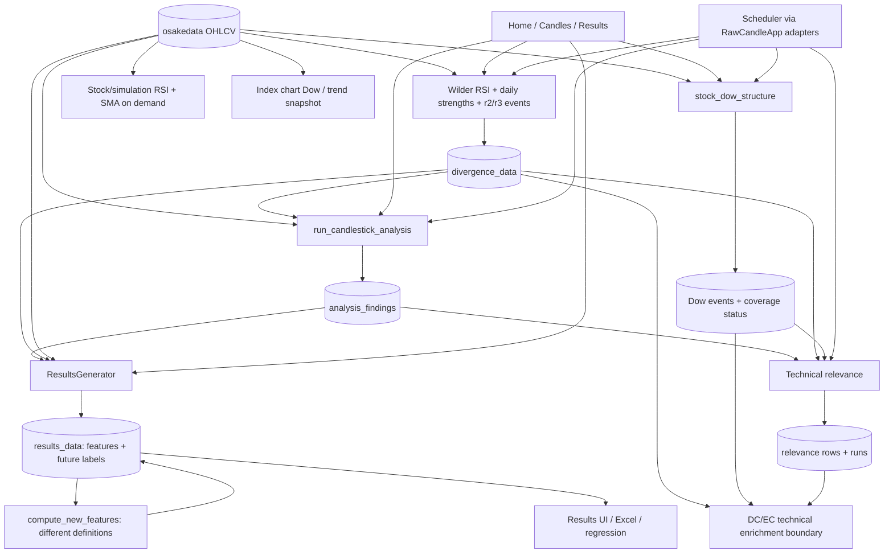

# RawCandle Next — architecture audit 02

Technical calculations, divergences, Dow structure and analysis persistence. **2026-10-14, Europe/Helsinki.** Inspected HEAD: `82fea88aed9909747e1c3274b65788cb491f1488`.

**AUDIT ONLY. Recommendations are not approved decisions. Production changes initiated by this audit: zero. No commit or push.** Deliverables: this report and [review worksheet](keep_rewrite_remove_02.csv). [Audit 01](architecture_audit_01_ohlcv_identity.md) and its worksheet remain recommendations. No new database, migration, algorithm change or final NG master plan follows from this report.

Labels: **VERIFIED FACT** = source/configuration/read-only measurement or isolated synthetic result; **INFERENCE** = a consequence or risk inferred from the traced path; **RECOMMENDATION** = an option for review. Reachability means a registered/configured/callable path, not proof of recent execution. This audit excludes Fundamentals/Forecast internals, SwingMaster state-rule redesign, DC/EC algorithm/taxonomy redesign and unrelated research engines. DC/EC are inspected at technical input/output boundaries only.

## 1. Executive summary

**VERIFIED FACT — correctness priorities:**

1. **Confirmed divergence availability defect.** V2 emits at `rsi_pivot + radius`, even when the associated price pivot requires another bar. Synthetic full-history versus prefix tests reproduce an event appearing one bar early for **both radius 2 and radius 3**. Radius 3 is consumed as a confirmed signal by technical relevance and DC/EC enrichment. This is an actual upstream date-contract defect, not a warning merely because pivots use future observations (§4, §8).
2. **Confirmed retrospective composite dating.** A later radius-3 divergence expands combo eligibility to candles around `pivot2 ±3`; earlier candles are stored with their original candle dates and no later availability date. Subsequent consumers treat finding date as confirmation. Historical association is legitimate research data, but that date is not an actionable composite signal date (§4).
3. **Confirmed mathematical disagreement.** Candle/downtrend RSI returns 0 on a strictly rising input where the Wilder implementation returns 100. Same-named result features are then overwritten by a second enrichment pass with different units/definitions: RSI slope, gap, shadow, volatility, volume impulse and reversal context (§3). This changes feature meaning by execution path.
4. **Confirmed insufficient daily pattern context.** Normal price update passes its newly fetched interval to pattern analysis; SQL filters prices to that interval before detecting. A one-bar daily input cannot evaluate two/three-bar patterns, 6/7-bar formations or a 205-bar cup/handle gate, despite older source history being available (§5).

**VERIFIED FACT — useful foundations:** the stock Dow kernel distinguishes pivot date from confirmation date and passes a controlled prefix-causality check; its state/event structure and zero-event coverage status are useful. Simple SMA, explicit-seed EMA, Wilder RSI, trailing candle geometry and breakout pattern functions are reusable. Existing tests cover many local definitions, but some encode the current divergence timing instead of testing what was knowable at that date.

**VERIFIED FACT — persistence:** `data/analysis.db` is **11,874.05 MiB**. Core divergence storage has 8,867,512 daily rows, while radius-3 event rows are only 252,611. Technical relevance has 2,232,951 rows using **8,983.93 MiB including indexes**, dominated by its table/verbose context, not just indexes. It retains overlapping run projections. Results are comparatively small (37,361 rows / 57.19 MiB), but mix decision-time features with forward outcomes and conflicting calculation paths.

**RECOMMENDATION:** keep reusable pure kernels and explicitly named events; rewrite availability, qualification, source invalidation and publication contracts. Consider compact divergence events plus reusable RSI, rather than an all-in-one daily divergence table. Evaluate relevance current projections versus retained historical runs according to audit/research needs. Remove redundant NG aliases/copies and automatic earnings-blackout restrictions after migrating their consumers. **Do not delete persistent outputs solely because they are large.**

**OPEN:** divergence score versus confirmed-event product need; definition/seed/quality contracts; desired historical relevance receipts; shared features versus on-demand calculation; whether a separate analysis database is useful at all. No `analysis_ng.db` is presumed.

## 2. Calculation implementation and execution map

**VERIFIED FACT — principal current dependency paths:**



| When / actual entry | Calculation and persistence | Separation problem / NG admin need |
|---|---|---|
| **Normal price collection**, Home batch and ticker acquisition | `main.py:299` adapters / `:3475` inline updater call `_calculate_and_save_divergences:4299`, `_run_incremental_candlestick_analysis:482`, Dow post-step. Service path `stock_update_service.py:740/:940` does the same via callbacks. Source writes therefore trigger divergence/findings/Dow writes. | Scheduled source driver constructs `RawCandleApp` without UI initialization (`runner.py:2204`). Rewrite into independent job services; include progress/receipts, not automatic opaque analysis side effects. |
| **Scheduler** `run_stock_update_scheduler` → `runner._run_one_market:2298` | Price service callbacks above, then `_run_technical_relevance_post_step:1360`; configured USA/OMXH, relevance enabled for USA. Relevance start is end minus **45 calendar days**, run ID derived from market/end date (`:1450`). DC/EC consume technical outputs at their boundary. | Keep explicit source/calculation stages and failures. No scheduler run was executed. |
| **Home manual** “Laske puuttuvat divergenssit” / “Laske puuttuvat Dow-rakenteet” | `main.py:3948` selects missing divergence dates → recompute; `:4047` uses Dow missing/outdated coverage selector. | “Missing date” is not “changed value.” Include scoped rebuild/status rather than preserve stale-only predicates. |
| **Candles** pattern checkboxes/select all, ticker/list/all, full/date range, downtrend/MA/volume filters | `main.py:1152/:2393` → `run_candlestick_analysis:301`; UI saves returned findings. Random downtrend controls bind at `main.py:1540` → `downtrend_generator.generate_random_findings`. | Universe/batch/filter selection and persistence are embedded in UI. Include generic jobs/coverage; defer detailed research switches and random controls. |
| **Analysis Dashboard** | `analysis/view.py` reads findings, filters/sorts and deletes individual/filtered findings (`:870/:878`). `AnalysisEngine` facade is callable/tested; `_run_analysis:828` has no current action-button binding in `_create_action_buttons:374`. | Do not call facade unused just from imports. Keep inspector/diagnostics; review deletion effects and facade/external reachability before retirement. |
| **Results Dashboard / Tulokset** | `findings/view.py` reads/deletes/exports results despite the “findings” module name. `results/view.py:62 generate_results_to_database` coordinates `ResultsGenerator.generate_results` then **`run_feature_enrichment`**, with force-rebuild/filter options. Export/cache and clear controls bind at `:1795–1843`. Separate `main.start_results_generation:2760` invokes pattern analysis for CSV. | Important live second feature writer is in a UI coordinator. Move calculation/persistence to services; initial UI can show job status. Defer rich export/regression interface. |
| **On demand** Stock / simulation | `stock.services.fetch_price_rows:31` reads prices, computes RSI/SMA then limits display; `simu.engine.py:113` computes RSI/volume maps. `IndexPage` chart/trend readers invoke separate marker/snapshot functions. | These reads are computations, not Yahoo fetches. Reuse named kernels; rich charts/simulation remain separate UI work. |
| **Explicit CLI / maintenance / research** | `analysis/run_stock_dow_structure.py` supports ticker/market, radius, tail, explicit confirmation boundary, full; `analysis/results_generator.py` has a headless main. `compute_new_features.py`, `recompute_history_normalization.py`, `backfill_bulldiv_metrics.py`, `recompute_volumes.py` update derived results; EMA/SMA/RSI scan CLI reads prices+RSI and exports optional forward returns. Technical relevance has run/export CLIs. | Do not run nominal dry-runs against production: schema initialization may still occur. Retain scoped headless operation through common owners. No maintenance job was run. |

**VERIFIED FACT:** `DatabaseManager.__init__`/schema initialization performs schema changes, finding deduplication and migrations (`database_manager.py:319–355/:1296`); `ResultsGenerator.__init__:69` calls `ensure_market_schema` on the source database. The audit did not instantiate either. Dow dry-run wrappers still call schema ensure. Read-only inspection must bypass these constructors.

## 3. Actual definitions, parameters and overlapping indicator contracts

All operational price readers below use legacy persisted OHLCV. **VERIFIED FACT:** these functions do not select an ordinary/adjusted basis explicitly; they inherit whatever is stored. Yahoo False + Adj Close is a proposed future representation, not the present calculator contract.

| Family / functions | Definition, input and warm-up | Invalid / missing behavior; outputs, writer/readers and tests |
|---|---|---|
| **SMA** `stock/services.py:293 _apply_sma` | Arithmetic trailing mean, chart windows **5/20/50/200**. Need `window` accepted closes. Running sum/deque. | NULL close emits NULL on that row but does not clear deque: later mean bridges the gap. Chart-only output. `ResultsGenerator.calc_ma_series` instead requires all closes in the requested fixed-position window; DC metrics filters missing closes before rolling. Existing stock/indicator, results and DC metric tests are consumers' local coverage. |
| **SMA-seeded EMA** EMA scan `_calculate_ema_series:174`, DC `swing_ticker_metrics.py:148` | First EMA = mean of first N closes; subsequent `E_t = 2/(N+1)*C_t + (1-2/(N+1))*E_(t-1)`. Scan EMA20/SMA50 first cross can be compared once prior SMA50 exists (at least 51 closes), RSI strictly > default **50**. DC uses EMA10/20, SMA10 and short EMA slopes. | Scan excludes SQL NULL close but not all nonpositive/nonfinite values. DC rejects nonfinite values but removes NULL closes/volumes from separate sequences. Scan outputs CSV; DC writes projections through its owning pipeline. No universal seed equivalence with first-price EMA. Synthetic S09 shows 30 versus 31.25 on `[10,20,30,40]`, span 3. |
| **First-price EMA / MACD** nested `results_generator.py:889 calc_ema`, `:904 calc_macd` | Start E0=C0; MACD EMA12−EMA26, signal EMA9 of MACD, histogram difference. Wrapper requires end index >=26; outputs at **t−1**. | Any missing historical close aborts MACD for that finding; an old hole can block all later values. No invalid-segment reset. Stored in results_data; normal Results UI can later enrich other columns. `tests/test_results_generator.py` covers result generation. |
| **Wilder RSI** `divergence_v1.py:18 compute_rsi_wilder`; `simu/indicators.py:17 compute_rsi` | Mean of first 14 deltas, then G/L = `(13*previous+current)/14`; first value at index14 = **15 prices**. Divergence outputs NULL RSI for its first 29 bars despite recurrence beginning earlier. | No common finite/positive/segment gate. Zero loss + gains →100. Both flat →**50 in divergence, 0 in simulation/Stock**. Normal candles use stored divergence RSI first, Wilder fallback for missing dates on their already range-cut input. Synthetic S01/S02; `test_divergence_v1`, `test_divergence_engine`, simulation/stock tests. |
| **Rolling RSI** `candlestick_patterns.py:123 calculate_rsi` | Arithmetic rolling14 means of positive/negative differences, not Wilder recurrence. First diff is replaced by zero, giving earlier rolling readiness. | Replaces zero loss with **infinity in the denominator**, making no-loss RSI **0**, including rising prices. Live `downtrend_generator._calculate_rsi14:267` uses this on up to 50 prior rows and stores findings.rsi14; deprecated divergence cache also uses it. Synthetic S01 verifies rising 1…40 →0 versus Wilder100. `test_downtrend_generator_core`, old cache/pattern tests do not establish mathematical equivalence. |
| **ATR** nested `ResultsGenerator.calc_atr:863`, duplicate `_calc_atr` in `recompute_history_normalization.py:147` | TR=max(H−L, abs(H−previousC), abs(L−previousC)); **arithmetic mean**, not Wilder smoothing. 14-bar window ends **t−1**. Wrapper needs preceding close; allows at least **70%** valid TR values (10 of14). ATR_ratio=100*ATR/t0_low. | Missing components skipped; actual contributing count can differ. Zeros/negatives/order not uniformly qualified. Results persistence and maintenance writer; existing result tests. Name ATR_14 does not encode partial-window policy. |
| **Returns / normalized prices** `ResultsGenerator._process_finding:589`; DC `_calculate_return:133`; scan forward metrics | Results historical fields `t_-h=100*C_(t-h)/Low_t`, future `t_h=100*C_(t+h)/Close_t`, not symmetric close returns. DC returns = C_t/C_(t-h)−1 for **5/10/20/60** accepted closes. Scan forward max/min close return over default60 future rows. | Positive result denominators required; DC rejects zero denominator but does not universally reject negative closes. Removed rows change bar horizons. Forward outcome access is intentional labeling, not inherently look-ahead leakage; keep labels separate from live features. |
| **Volatility** Results `calc_volatility:712`, `calc_index_volatility:799`; enrichment `compute_index_volatility_from_history:318` | Results population stdev of **price levels normalized to t0_low**, windows **2/5/10/15/20**, excluding t0; index levels normalized to index t0_close. Enrichment writes **raw price-level** population stdev over previous10 with full10 readiness. Neither is standard deviation of daily returns. | Results allows >=2 retained values after skipping missing; enrichment needs10. Same destination names can carry different units. Explicit per-feature definition required. |
| **Gap/range/body/shadow** Results `:1028–1068`; enrichment `:294` | Results gap-down=max(0,−100*(Open_t−Close_(t−1))/Low_t); Body=abs(C−O)/(H−L); Shadow=(upper+lower)/(H−L). Enrichment gap=sign(g)*log1p(abs(g)), g=(O−prevC)/(prevC+1e−6); Shadow=log1p(lower/(upper+1e−6)). | Names agree, formulas/sign/scales do not. Fixed epsilons break exact scale invariance near zero. Results clips shadows to nonnegative; enrichment does not provide same qualification. Both write same results columns. |
| **Slopes / volume / context** Results `:772/:812/:1215`, enrichment `:162/:341/:349/:368` | Results RSI_slope_5=(RSI_t−RSI_(t−5))/5; enrichment writes raw difference. Results volume impulse=V_t/mean(previous5 positive volumes); enrichment uses previous10. Results reversal context=abs(t_10−100)/10 + volatility10/2 +(volume_impulse−1); enrichment=.4*(100−t_10)+.4*bullish−.2*volatility10. | Recent BullDiv uses **0…5 bar offsets** in generator but **0…5 calendar days** in enrichment. Synthetic S10: same 40→60 RSI move yields 4 versus20. `tests/test_compute_new_features.py` tests enrichment, not its equivalence to generator. |
| **Trend screens / research controls** analyzer `_is_in_downtrend:32`; run_analysis local filter `:474`; candlestick filter `:5`; downtrend_generator `:135` | Checkpoints C_(t−10)>C_(t−5)>C_(t−2)>C_t; main filter minimum default3% drop, optional SMA5<SMA10 and C_t<SMA10, optional recent5 volume >=1.2×older history. Random control generator needs55 rows and its SMA5/10 ends t−1, whereas main candle filter includes t0. | Truthy-value/missing handling differs. Random sampling is not deterministic unless seed/universe/sample choices are fixed; these are control cohorts, not detector signals. Existing downtrend/filter tests. |

**VERIFIED FACT — volume and consumer units:** Results volume ratios use 100*mean(window positive volumes)/mean(previous100 positive volumes), with historical windows2/5/10/15/20 ending t−1 and single-day t0/future windows; the maintenance copy `recompute_volumes.compute_volume_ratio:55` follows that formula. `simu.compute_volume_growth:49` instead returns 100*(V_t/mean(previous10 volumes)−1), while DC volume_vs_avg20 is V_t/mean(last20 non-NULL volumes, including t), a ratio. DC distance fields ending `_pct` hold C/MA−1 as a fraction, not multiplied by100; EMA10/20 slope-positive compares the current EMA with3/5 bars earlier. `backfill_bulldiv_metrics._compute_metrics:140` uses calendar-day offsets and a findings-first/fallback-divergence source, differing from generator bar offsets even where slope scaling agrees. These maintenance/read variants reinforce the need for explicit units and ownership.

**VERIFIED FACT — technical relevance definition:** `rawcandle/technical_signal_relevance.py:50/:397/:471` maps signal direction/family and confirmed Dow context into RELEVANT / WEAK_CONTEXT / NOISE with reason codes. Defaults: near pivot <=5 bars since confirmation, recent BOS <=10 bars, recent reset <=20 bars, active-level distance threshold3%; near-level is recorded as context while the classification rule table principally uses trend/family/BOS/pivot/reset. Example: trend-aligned continuation/hidden divergence is relevant; same-trend regular divergence is weak context; counter-trend reversal depends on a recent opposing BOS. Eligible events are filtered by confirmation time (`:229`). Output is deterministic for supplied context/config, not a measured probability or new divergence algorithm. Input confirmation defects can still contaminate that otherwise explicit as-of interface. Tests include `test_technical_signal_relevance`, sources, service, batch and persistence.

**VERIFIED FACT:** the Results UI immediately invokes enrichment after generating results (`results/view.py:135–158`), so the conflicts are on a real reachable path. A later history-normalization maintenance command can change several of those columns again. A `created_at` filter on the second pass uses host-local `datetime.now` formatting against SQLite default timestamps; the code does not bind enrichment to an explicit list of committed result IDs. **INFERENCE:** timezone/second-resolution boundaries can select the wrong enrichment subset; its frequency was not measured. None of these conflicts is resolved merely by choosing a different price basis.

**RECOMMENDATION:** give each feature a stable definition including units, time alignment, seed, minimum history and gap treatment. Retain simple kernels where suitable; prefer one computation owner to mutable post-generation enrichment. Fixes and model selections remain unimplemented.

## 4. Divergence architecture and signal timing

### Active definitions versus legacy paths

**VERIFIED FACT:** two materially distinct operational definitions coexist inside `divergence_engine.py`: **V1 daily strengths** and **V2 pivot event flags**, the latter parameterized by radius2/3 and four regular/hidden directions. They are not eight independent engines. `divergence_v1.py` supplies Wilder RSI, trailing candidates and score formulas. The persisted table has no calculation/basis/source-version column even though a source constant says DIVERGENCE_V1.

A third, legacy definition family is `candlestick_patterns.is_bullish_divergence:417` / `is_bearish_divergence:542`, wrapped by `deprecated.divergence_cache.py`. Those use Close extrema, mandatory trend, nearest previous trailing extremum over30 rows, minimum separation3, RSI delta>=3, and 1–3 strength based on capped RSI/price/duration components. Normal `run_analysis` imports the bullish helper but current detection branches read divergence_data instead. No current production call to the legacy functions/cache was found in the targeted UI/scheduler/service/CLI paths; tests and the deprecated wrapper are reachable. External callers were not proven absent, so retirement remains **OPEN**. `bullish_divergence_core_model.py` is a regression/research consumer, not another divergence detector.

### V1 scores: continuously evaluated candidates

At each t after30 price rows, V1 searches previous **90 rows** for prior trailing **10-row** low/high candidates. It uses **Low for bullish**, **High for bearish**, fallback Close when absent, and **Close RSI**. Only the previous anchor must be a trailing candidate; current t need not be a local extremum. Regular bullish requires lower price/higher RSI; regular bearish higher price/lower RSI; hidden bullish higher price/lower RSI; hidden bearish lower price/higher RSI. Current/prior price must be positive for a score.

Strength is the maximum across eligible prior anchors: `.45*clamp(price_move/.08) + .45*clamp(RSI_change/10) + .10*zone_score`, clipped0…1. Bullish zone scores are1/.7/.4/.1 at RSI<=30/35/40/otherwise; bearish symmetric >=70/65/60. No stored chosen-anchor identity survives this max reduction. There is no future confirmation requirement in this trailing score; treating it as a confirmed pivot event is a **semantic mismatch**, not evidence of look-ahead in V1 itself.

**VERIFIED FACT:** 8,387,100 of8,867,512 stored rows (**94.58%**) have at least one positive strength across four directions. This measures low selectivity of “any positive strength,” not model accuracy. Scores repeatedly describe an underlying move and can remain positive on successive dates. Whether this continuous feature remains useful is a product/research decision, not an automatic REMOVE.

### V2 events: centered price/RSI extrema and availability defect

`_compute_raw_pivot_candidates:155` uses equality to min/max in the centered **2r+1** window; null/NaN in that pivot window rejects it. `_collapse_tied_clusters:176` keeps the **last** adjacent equal-valued candidate. Price pivots are paired only consecutively; gap **5…30 bars**. RSI anchor is RSI **at price p1**, not necessarily a separately matched RSI pivot. At p2 the RSI extremum can lie at **p2−1,p2,p2+1**, tried in that order. Four directions use strict opposing price/RSI movements. A binary flag is written at **RSI p2-match index+r**; radius-specific gap/drop/pivot2 date accompanies regular event metadata. Hidden events have gap/drop but no separate hidden pivot2 date field. Same-day collisions remain one binary flag; shared regular geometry can be overwritten by later assignments, so the daily row is not a lossless collection of all structures.

**VERIFIED FACT — S03:**

| Radius | Second price pivot | Stored signal date | Earliest price-pivot confirmation | Flag from full history / history through stored date |
|---|---|---|---|---|
| 2 | 2024-09-08 | 2024-09-09 | 2024-09-10 | **1 / 0** |
| 3 | 2026-02-10 | 2026-02-12 | 2026-02-13 | **1 / 0** |

These are isolated synthetic dates, not production event counts. With RSI match=p2−1, its confirmation is one bar before price p2 confirmation. Full-frame price pivot detection already saw that extra bar, then backdates the event. `recompute_divergence_for_ticker` persists the row at that date. `technical_signal_relevance_sources.read_divergence_observations:502/:585` uses divergence **date as signal_confirmed_as_of_date**; `swing_analysis_readers.read_divergence_enrichment:306` reads r3 flags on requested as-of date. Therefore the date error crosses a real calculation→storage→consumer path. Tests `test_compute_divergence_series_accepts_rsi_pivot_at_p2_minus_1:589` assert the existing early r2 date; they do not prove causal availability.

**INFERENCE:** plateau collapse can additionally revise anchor selection as later equal candidates arrive; a full prefix-stability study for long ties was not performed. Do not assert every event leaks or quantify affected production rows from these examples. Correct earliest knowability must account for **both** price and oscillator confirmation, and any plateau-finalization rule.

### Combos and asymmetric semantics

**VERIFIED FACT:** `_load_divergence_snapshot:166` produces bullish finding dates from r3 flags, but bearish/hidden sets use **positive V1 strength OR r3 flag**. Regular bullish combo eligibility includes positive strength as well as r3 dates. `run_candlestick_analysis:421–436` expands eligibility around stored pivot2 ±3 bars; `:986` creates/relabels BullDiv+base-candle findings on the earlier candle's own date. With normal UI selecting “Bullish Divergence,” base patterns plus all mapped combos are added; without it, a priority base candle can be replaced by its combo name. Output therefore depends on pattern selection, not solely price structure.

Those findings have date/strength/RSI but no component-event availability field. Main UI saves them to analysis_findings; technical relevance's candle reader sets `date AS signal_confirmed_as_of_date` (`sources.py:708`). **VERIFIED:** retrospective association is exposed with an earlier confirmation date. **INFERENCE:** any backtest/live historical selection using that date can receive future divergence context; profitability impact and affected live decisions were not measured. Keep retrospective associations explicitly labeled or publish a composite at max(component availability), as a **RECOMMENDATION**, not an implemented algorithm.

### Incremental divergence and persistence

Only-missing recomputation loads all source dates, finds earliest absent divergence key, takes **154 context rows** (30+90+10+14), and rewrites from20 rows before first missing date. If no key is missing it does nothing, regardless of changed OHLC values. Wilder recurrence is restarted on that context: S04 gives RSI40.5852171768 full baseline versus40.5858054683 bounded, difference0.0005882915 at the same synthetic observation. This is an exact determinism mismatch, not proof of a changed trade in that example. A finite warm-up approximates recurrence state; it does not reproduce it exactly.

The wrapper commits deletion of the output suffix before constructing DatabaseManager and saving replacements (`divergence_recompute.py:157–169`). **INFERENCE:** failed save can leave a hole, while downstream artifacts still reference old outputs. `INSERT OR REPLACE` supports many legacy positional tuple lengths (`database_manager.py:2055`), obscuring the current row contract. Generic boolean/gap fields mirror r2; measurement found zero generic flag mismatches. **RECOMMENDATION:** decide continuous-score need, persist explicit compact events separately from shared RSI if useful, retain chosen anchors, use a named typed contract and atomic publication. Recurrence checkpoints or replay from qualified segment start are alternatives; no new divergence algorithm was implemented.

## 5. Dow structure and candle/chart pattern analysis

### Stock Dow: confirmed events and reconstructable state

**VERIFIED FACT:** `stock_dow_structure.py` defaults radius**3**, incremental tail**30 bars**, bounded initial selection from **2024-01-01**, version `stock_dow_v1`. `_build_pivot_candidates:504` requires a **unique High maximum / Low minimum** in the full centered2r+1 window; equal extrema are rejected, unlike divergence's last-tie collapse. Pivot p becomes available at p+r. `calculate_ticker_events:1133` processes candidates at their confirmation index and persists **event_date=pivot date** and **confirmed_as_of_date=availability date**. S06 full history filtered by confirmation matches the prefix's three events. Future bars used for a centered pivot are not themselves leakage when confirmation is respected.

High labels: first H, then HH if strictly above previous labeled high, otherwise LH. Low labels: first L, then HL if strictly above previous labeled low, otherwise LL. Thus equal nonlocal highs/lows fall into LH/LL; no tolerance. Trend=UP for latest HH+HL, DOWN for LH+LL, else NEUTRAL. UP activates last HL support; DOWN activates last LH resistance. First current-bar Low below support / High above resistance produces BOS; a consecutive next breach resets epoch/state to NEUTRAL. Recovery clears that direction's breach counter. These tests use **High/Low**, although persisted `price_source='close'` and `structure_price=close` imply another contract. Correct metadata is needed; do not blindly preserve that label.

`stock_dow_structure_events` stores compact event dates **plus wide post-event state snapshots and copied OHLCV**. `status` records calculation-through date even for zero-event histories, avoiding repeated work just because no event exists. `_load_latest_state_before:893` reconstructs state from a prior event; tail replacement deletes by **confirmation date**, then replays. Explicit CLI `--recalc-from-date` also addresses confirmation date; no prior reconstructable state triggers full replay. Missing/outdated helper compares latest non-NULL source Close date to coverage, not source values or definition revision.

**VERIFIED FACT:** NULL Close rows are skipped, compressing bar positions; zero/negative Close is not excluded by the freshness test. NULL High elsewhere in a pivot window can cause `max`/`min` TypeError (S07). Bounded initial mode excludes all pre-2024 bars; it does not seed from 2018. The 2018 rows currently in production show other/full runs existed, not that every default run reconstructs that baseline. The missing/outdated loop catches ticker errors and continues without a per-ticker savepoint; a deletion done before a later calculation error can remain in the transaction that commits other tickers. This is a **traced failure-path consistency risk**, not a claim that production deletion occurred during the audit. The explicit `run_stock_dow_structure` wrapper instead rethrows errors; do not conflate its rollback behavior with the selector's.

Readers `technical_signal_relevance_sources.py:766` and `swing_analysis_readers.py:237` filter confirmation<=as-of, protecting stock Dow availability. As-of readers do not consistently filter every possible radius/version/source variant, so future multi-definition storage needs an explicit selection contract. Tests: `test_stock_dow_structure.py` covers confirmation, ties, BOS/reset, reconstruction, explicit/tail/full and zero-event coverage; its mere test names are not a newly executed suite result.

### Distinct chart Dow and snapshot definitions

**VERIFIED FACT:** `pages/index_page/index_utils.compute_dow_markers:9` is a separate chart algorithm. It considers truncated left/right windows at series edges and updates historical marker/state at the **pivot date**, without confirmation fields. S08: a third-bar H at value3 on prefix `[1,2,3]` disappears when extended to `[1,2,3,4,5]`. `index_plot.py:139/:219` renders it; `trend_chains.py:66` derives chains from those markers. This verifies **repainting annotations and retrospective chart state**, not an executed trading/backtest leak. If reused as decision-time historical input it would need causal redesign; current inspected consumers are graphical chains/plots.

A third structural view, `trend_snapshot._swing_points:9`, strictly excludes k unconfirmed edge bars, uses scalar value (k2/3/4, default2), latest two highs/lows and current value for bias/break. It is recomputed over a clamped trailing lookback; confirmation is implicit in the as-of slice, not stored on SwingPoint. `trend_calc.py` is its facade; `IndexPage:1142` consumes it. This is not stock Dow's epoch/BOS process. Whether to retain separate projections remains OPEN; no SwingMaster/DC/EC algorithm was redesigned.

### Pattern definitions and knowability

**VERIFIED FACT:** operational `run_analysis` uses pure functions in `candlestick_patterns.py` / `chart_patterns.py`, not `AnalysisEngine.analyze_price_data`. Return values are booleans or named finding dictionaries; analysis_findings stores positive detections only, one ticker/date/pattern. Required observations end at idx in these candle/chart detectors. No future-bar access beyond idx was found in their traced detection windows. Their event is knowable at the final input bar's close, absent a future-divergence composite. A geometric “hammer” is a detected shape, not a separately confirmed reversal.

| Detector group | Actual definition / history requirement | Confirmation / numerical issue |
|---|---|---|
| Hammer / Dragonfly Doji | Hammer: body<.4*range, lower>2*body, upper<body. Dragonfly: body<.1*range, lower>.6*range, upper<.1*range. **1 bar**. | No next-bar reversal requirement. Main functions differ from `AnalysisEngine.detect_hammer` (lower>=1.5*body, upper<=.7*body) and generic doji<=.1*range. |
| Shooting Star / Hanging Man | **1 bar**; body/range<=.35; long shadow>=2*max(body,.05*range,1e−9), short<=.5*floor; placement in lower/upper45% region respectively. | Explicit range>0 but not complete global quality check; epsilon floors affect tiny scaled prices. |
| Bullish/Bearish Engulfing; Piercing; Dark Cloud | **2 bars**. Engulf reverses color and spans prior body; bullish uses strict inequalities, bearish allows equal body bounds. Piercing opens below priorClose, closes beyond midpoint but below priorOpen; dark cloud is mirrored midpoint penetration. | End at second close; floating ties and gaps materially change detection. Analyzer facade has its own method definitions/names. |
| Three White Soldiers; Morning/Evening Star; Abandoned Baby | **3 bars**. Soldiers: three rising green open/close bodies. Morning star: red, middle body<half first body, green above first midpoint. Evening star uses strong first body>=.45*range, middle<=.35*range and red midpoint penetration. Abandoned baby: strong first/third, middle doji<=.12*range, gaps and third recovery. | Third bar already supplies specified recovery/penetration; no fourth-bar confirmation. Gap tolerance=max(.001*reference_price,1e−9). |
| Falling Three Methods | **5 bars**; strong first/fifth red bodies>=.45*range; three inner bodies<=.6*first body and contained in first body with tolerance; fifth closes below firstClose. | Candidate consolidation versus completed fifth-bar break should not be confused; only completed pattern returned. |
| Bullish/bearish flags | **6 bars**: 3-bar colored pole move>=5%, 2-bar pullback/rebound range<=5%, final close breaks consolidation. | End at sixth-bar close; fixed short-window definition, not a general discretionary flag detector. |
| Bull/bear rectangles; ascending/descending triangles; pennants | **7 bars**. Rectangles: 3-bar pole>=4%, 3-bar range<=4%, final break. Triangles: alternating three near-flat resistance/support tests span<=2%, strictly rising lows/falling highs; final break. Pennants: 3-bar pole>=5%, three narrowing highs/lows range<=5%, final break. | These are completed breakout patterns, not stored candidates. Strict rise/fall/tie semantics; ratios mostly invariant under constant positive scaling. |
| Cup and Handle | `chart_patterns.py:295`, idx>=**204**. SMA200 now and five bars ago; close above nonfalling SMA. Cup30…150 bars, depth15…35%, rims within5%, bottom inside20…80% width and repeated near-low counts. Handle>=3, bounded search to50 and <=cup_width/3; depth<=12%, upper-cup placement, volume contraction; final close above rim/handle with >=handle average volume. | Up to220-bar search and repeated nested scans. Uses only data through idx, though interior cup-bottom comparisons are symmetric within an already historical cup. Missing/NaN/invalid values and range resets not centrally qualified. |

Pattern signal strength is not calibrated prediction quality: `run_analysis._calculate_signal_strength:37` uses fixed bases/shape ratios, optional **volume>100,000 →1.1 multiplier**, rounds to3 decimals and clamps0…1. Volume threshold is market-independent. Daily divergence score may be attached to a confirmed divergence whose chosen structure is different; some event flags can have zero attached current V1 strength. Strength scales differ from old 1–3 divergence helper scores.

**VERIFIED FACT — incremental pattern failure:** `service:786` chooses analysis_start=min(fetch range starts), `main:482` passes it unchanged, and `run_analysis:360–400` filters SQL before computing. No earlier warm-up input is loaded. Missing OHLC rows are dropped and index reset, so patterns can bridge an invalid/missing observation. Publication inserts/replaces returned positives but does not remove old patterns that stop matching after changed source data. Pattern tests (`test_chart_patterns`, `test_bearish_candlestick_patterns`, `test_pattern_selection`, `test_bulldiv_combo_patterns`) establish local fixtures; they do not repair that input/persistence contract.

**RECOMMENDATION:** retain selected pure detectors with explicit definitions and quality gates. Separate calculation context from requested output interval, record availability and no-signal coverage, replace the affected detection partition transactionally, and reserve graphical/research controls for later UI work.

## 6. Analysis database: measured tables and dependencies

**VERIFIED FACT:** inspected `data/analysis.db` with URI `mode=ro` and `PRAGMA query_only=ON`. Counts are exact query observations. Footprint is table B-tree plus associated indexes via read-only `dbstat`, rounded MiB; no VACUUM/ANALYZE, backup, copy, integrity migration or app schema ensure. File size12,450,844,672 bytes; page size4096; pages3,039,757; freelist0. Counts were measured independently of Audit01 and are not a coordinated cross-database snapshot.

Every core table below is **derived, cache or operational**, not authoritative OHLCV. Regeneration needs retained source bars, correct identity/action eligibility, chosen definition/parameters and run/universe inputs; exact legacy output reproduction is not required under NG. Recomputability does not imply providers can restore old source vintages. Research exclusions and event evidence retain their own authority/provenance; do not regenerate operator choices from prices.

| Table | Rows | MiB incl. indexes | Purpose / main keys | Active writers | Active readers | Frequency / granularity | Rebuildability and NG option |
|---|---:|---:|---|---|---|---|---|
| `analysis_findings` | 1,782,501 | 401.70 | Derived detections; ticker/date/pattern unique; id/strength/RSI/created_at and legacy candle code | UI saves run_analysis; analyzer facade callable; random-downtrend generator; delete controls | Stock; Analysis/results generator; relevance; exports | During collection, manual pattern/control jobs; positive-only, no completed-no-signal record | Rebuildable from source + chosen patterns/params/seed; replace events/coverage, do not store repeated RSI by default |
| `divergence_data` | 8,867,512 | 1455.19 | Daily cache+derived event flags; PK ticker/date; RSI, four strengths, r2/r3/generic booleans and geometry | divergence_recompute; DatabaseManager.save_divergence_batch; split cleanup | Candles/combos; results/enrichment; EMA scan; DC/EC enrichment; relevance | Daily tail/missing/full; rows on almost every source date | Rebuildable, but exact Wilder state reseed differs; evaluate shared RSI + compact events; remove generic aliases |
| `results_data` | 37,361 | 57.19 | Derived research feature+forward-label rows; unique ticker/date/candle_pattern; wide metrics/blackout fields | ResultsGenerator; compute_new_features; normalization/volume/BullDiv maintenance; UI clear/delete; split cleanup | Results dashboard/Excel/regression; related research consumers | Explicit UI/headless generation; UI second enrichment; requires future20 bars | 37,361 rows for36,157 ticker/dates; 1,204 repeated date rows. Shared features can reduce duplication; keep matured label contract |
| `results_metadata` | 42 | 0.00 | Operational generation receipt; id, generated_at, count, elapsed | DatabaseManager.insert_results_metadata after successful generation | Results UI/status | On generation with writes; not per-source-change coverage | Recreate for new runs; row count/time do not certify exact source/definitions or label maturity |
| `stock_dow_structure_events` | 950,769 | 427.65 | Derived event+state cache; unique ticker/confirmation/type/event/radius/price_source; full state and copied OHLCV | stock_dow_structure wrapper; normal/source/manual/CLI jobs | Technical relevance; DC/EC Dow enrichment; event displays | Tail/explicit/full/bounded generation | Useful compact events and restart state; redundant OHLCV removable if source snapshots remain reconstructable; preserve confirmation semantics |
| `stock_dow_structure_status` | 4,915 | 1.02 | Operational freshness/coverage; PK ticker/price_source/radius; calculated range/run/status | Dow wrappers via _upsert_status_row | Missing/outdated selector; admin status | Every processed ticker, including no events | Keep useful zero-event coverage; add source/definition dependency instead of latest-date-only freshness |
| `technical_signal_relevance` | 2,232,951 | 8983.93 | Derived per-run classification/context; composite PK run+ticker+timeframe+date+name+source_type/source_id+rule_version; trace | Relevance service/batch/persistence; scheduler and CLI | Relevance export/query; DC technical context | Scheduled45-calendar-day overlapping windows; explicit scoped runs | Rebuildable from available input events+Dow+rule/config/source version; current versus historical materialization OPEN |
| `technical_signal_relevance_runs` | 185 | 0.09 | Operational run config/version receipt; PK run_id; rule/mapping/reason versions/config JSON | Relevance service and scheduler/CLI | Run existence gate; exports/status | Per run; deterministic same-day scheduler ID skips existing run | Keep compact receipts; run existence alone cannot detect corrected source or changed inputs |
| `blackout_dates` | 181,136 | 23.16 | Event evidence cache; unique ticker/date/event; source/date only | blackout fetch service / DatabaseManager | Results/preprocess/stock event coloring | Manual event acquisition; not calculation refresh | Retain useful earnings/dividend evidence under Audit01; REMOVE automatic restrictions; no assumption historical source completeness |
| `excluded_tickers` | 26 | 0.01 | Authoritative operator research policy; PK ticker; reason/category/active | Settings / DatabaseManager | Research/returns selection readers | Manual policy changes | Not derived from OHLCV; preserve policy through owning metadata boundary; exact consumer scope later audit |

### Core indexes and relationships

| Table | Existing indexes (U = unique) | Declared FK |
|---|---|---|
| `analysis_findings` | `idx_analysis_findings_ticker_date` (ticker, date); `idx_pattern` (pattern); `idx_date` (date); `idx_ticker` (ticker); `idx_unique_finding` U (ticker, date, pattern) | None |
| `divergence_data` | `idx_div_ticker_date` (ticker, date); `idx_div_date` (date); `idx_div_ticker` (ticker); `sqlite_autoindex_divergence_data_1` U (ticker, date) | None |
| `results_data` | `idx_results_market` (market); `idx_results_ticker_date_pattern` (ticker, date, candle_pattern); `idx_results_pattern_date` (candle_pattern, date); `idx_results_ticker_date` (ticker, date); `idx_results_pattern` (candle_pattern); `idx_results_date` (date); `idx_results_ticker` (ticker); `sqlite_autoindex_results_data_1` U (ticker, date, candle_pattern) | None |
| `results_metadata` | None | None |
| `stock_dow_structure_events` | `idx_stock_dow_events_event_type` (event_type); `idx_stock_dow_events_ticker_event` (ticker, event_date); `idx_stock_dow_events_ticker_confirmed` (ticker, confirmed_as_of_date); `sqlite_autoindex_stock_dow_structure_events_1` U (ticker, confirmed_as_of_date, event_type, event_date, pivot_radius, price_source) | None |
| `stock_dow_structure_status` | `idx_stock_dow_status_calculated_through` (calculated_through_date); `idx_stock_dow_status_market` (market); `sqlite_autoindex_stock_dow_structure_status_1` U (ticker, price_source, pivot_radius) | None |
| `technical_signal_relevance` | `idx_technical_signal_relevance_run_id` (run_id); `idx_technical_signal_relevance_ticker_tf_class_date` (ticker, timeframe, relevance_class, signal_date); `idx_technical_signal_relevance_ticker_tf_date` (ticker, timeframe, signal_date); `sqlite_autoindex_technical_signal_relevance_1` U (run_id, ticker, timeframe, signal_date, signal_name, signal_source_type, signal_source_id, relevance_rule_version) | run_id → technical_signal_relevance_runs.run_id |
| `technical_signal_relevance_runs` | `sqlite_autoindex_technical_signal_relevance_runs_1` U (run_id) | None |
| `blackout_dates` | `idx_blackout_date` (date); `idx_blackout_ticker` (ticker); `sqlite_autoindex_blackout_dates_1` U (ticker, date, event) | None |
| `excluded_tickers` | `idx_excluded_tickers_active` (active); `sqlite_autoindex_excluded_tickers_1` U (ticker) | None |

**VERIFIED FACT / INFERENCE:** divergence PK already supplies ticker/date ordering, duplicating `idx_div_ticker_date`; results unique ticker/date/pattern ordering duplicates `idx_results_ticker_date_pattern`. Prefix indexes may still have workload/size benefits: benchmark before later removal. All core relationships except relevance run→run receipt are logical cross-table/cross-database dependencies, without source/security FKs. Definition/basis/revision selection is missing from most keys. Nullable pattern fields weaken uniqueness where NULL is allowed. No index was removed.

### DC/EC consumer boundary inventory (not their algorithm audit)

These small projections are measured because technical inputs propagate into them. Their rules/taxonomy are excluded. Core tables above and these boundaries account for nearly all allocated analysis pages; other administrative/report tables are not proposals for wholesale migration. All are derived/operational and conditionally rebuildable from retained source/taxonomy/rule inputs. No separate NG destination is chosen.

| Boundary table | Rows | MiB incl. indexes | Writer → reader / frequency / simplification boundary | Key indexes |
|---|---:|---:|---|---|
| `dc_ticker_swing_signal_daily` | 236,414 | 180.91 | analysis/datacenter_indices owning calculator/persistence → swing reports and EC projection loaders; daily/backfill; retain interface, do not redesign rules | (signal_date,exit_risk_signal); (signal_date,pullback_signal); (signal_date,breakout_signal); (primary_subindustry,signal_date); (ticker,signal_date); (signal_date,signal_version); U (signal_date,taxonomy_version,ticker,signal_version) |
| `dc_group_swing_signal_daily` | 51,492 | 30.76 | analysis/datacenter_indices owning calculator/persistence → swing reports and EC projection loaders; daily/backfill; retain interface, do not redesign rules | (signal_date,overheat_risk_level); (signal_date,timing_state); (group_type,group_name,signal_date); (signal_date,signal_version); U (signal_date,taxonomy_version,group_type,group_name,signal_version) |
| `dc_group_synthetic_ohlc_daily` | 67,035 | 48.57 | analysis/datacenter_indices owning calculator/persistence → swing reports and EC projection loaders; daily/backfill; retain interface, do not redesign rules | (ohlc_date,trend_classification); (ohlc_date,latest_structure_label); (group_type,group_name,ohlc_date); (ohlc_date,calc_version); U (ohlc_date,taxonomy_version,group_type,group_name,calc_version) |
| `dc_group_index_daily` | 272,058 | 128.25 | analysis/datacenter_indices owning calculator/persistence → swing reports and EC projection loaders; daily/backfill; retain interface, do not redesign rules | (index_date); (taxonomy_version,group_type,group_name,index_date); U (index_date,taxonomy_version,group_type,group_name) |
| `ec_ticker_signal_daily` | 77,614 | 76.77 | rawcandle/ec_*_loader projection → EC reports/source-layer consumers; configured refresh/backfill; map corrected technical inputs explicitly | (source_run_id); (ticker,signal_date); (entity_id,signal_date); (ecosystem_id,signal_date); U (ecosystem_id,taxonomy_version_id,signal_date,entity_id,signal_version) |
| `ec_group_signal_daily` | 16,059 | 14.11 | rawcandle/ec_*_loader projection → EC reports/source-layer consumers; configured refresh/backfill; map corrected technical inputs explicitly | (source_run_id); (entity_type,signal_date); (entity_id,signal_date); (ecosystem_id,signal_date); U (ecosystem_id,taxonomy_version_id,signal_date,entity_id,signal_version) |
| `ec_group_synthetic_ohlc_daily` | 31,376 | 30.14 | rawcandle/ec_*_loader projection → EC reports/source-layer consumers; configured refresh/backfill; map corrected technical inputs explicitly | (source_run_id); (entity_type,signal_date); (entity_id,signal_date); (ecosystem_id,signal_date); U (ecosystem_id,taxonomy_version_id,signal_date,entity_id,ohlc_calc_version) |
| `ec_group_index_daily` | 16,059 | 13.71 | rawcandle/ec_*_loader projection → EC reports/source-layer consumers; configured refresh/backfill; map corrected technical inputs explicitly | (source_run_id); (entity_type,signal_date); (entity_id,signal_date); (ecosystem_id,signal_date); U (ecosystem_id,taxonomy_version_id,signal_date,entity_id,calc_version) |
| `dc_report_technical_relevance_context_v2` | 0 | 0.02 | DC report context persistence → reports; report runs; consumes relevance, not a second divergence engine | (relevance_class,signal_family,signal_date); (signal_date,taxonomy_version,report_window,ticker); U (run_id,signal_date,taxonomy_version,report_window,ticker,signal_name,signal_confirmed_as_of_date) |
| `dc_pipeline_watermark` | 51 | 0.02 | DC pipeline watermark persistence → incremental planners; each pipeline stage; watermark is not a source-revision dependency | (end_date); (component_name); U (component_name,taxonomy_version,market,signal_version,calc_version) |
| `ec_pipeline_watermark` | 15 | 0.01 | EC pipeline watermark loader → incremental planners; each pipeline stage; watermark is not a source-revision dependency | (ecosystem_id,status); U (ecosystem_id,pipeline_name,source_table) |

**VERIFIED FACT — density and history:** divergence covers4,915 ticker routes, 2018-01-02–2026-10-14; radius2 any-direction event rows275,543 (**3.11%**), radius3 rows252,611 (**2.85%**). These sets overlap; do not sum as distinct events. Most non-event rows still hold RSI or continuous scores. Generic r2 boolean duplicates have zero measured mismatches. Results cover3,121 tickers, 36,157 ticker/dates, 2018-01-30–2026-02-11. That partial/mature historical research coverage is not proof a daily job malfunctioned.

Technical relevance has185 run receipts. Its table alone is **8,437.71 MiB**, indexes **546.22 MiB** combined, total8,983.93 MiB = **75.66% of file size**. The first1,000-row trace sample has mean1,944.299 and maximum2,332 characters; it is not an estimate from all rows or proof of space recoverable by truncation. A sampled logical signal `(AA,1d,2026-04-06,Dark Cloud Cover,CANDLE,CANDLE,TECH_SIGNAL_RELEVANCE_V1)` occurs in **seven distinct runs**. Runs retain different evaluation receipts, so repeated keys are not automatically corruption. Current scheduler reuses overlapping45-calendar-day windows and skips already existing daily run IDs. Current source fixes are not part of that run-existence key.

**INFERENCE:** optional retention/current-projection policy could materially reduce repeated context storage, but per-run reproducibility, debugging needs, event/source revisions and real daily query cost must be evaluated before choosing it. There is no evidence to mandate a particular new DB layout or drop old results now. Zero-byte root `analysis.db` is not the operational database; no separate production divergence-cache table exists in the inspected analysis schema.

## 7. Redundancy and simplification opportunities

**RECOMMENDATION:**

- Share small, explicit indicator kernels with named seeds/time alignment. Keep consumer-specific meaning in contracts: trailing SMA, Wilder RSI and return volatility are not interchangeable with sample-normalized price features. Do not erase meaningful variant definitions merely to minimize function count.
- Replace the daily divergence omnibus with an option of compact typed events plus separately reusable RSI/continuous feature storage. If scores remain useful, a daily feature cache can be justified; event geometry should not be overwritten in a binary daily collision. Querying recent events should not require interpreting generic/r2/r3 alias columns.
- Consolidate result feature generation, enrichment and maintenance writers. One feature name must have one formula/unit/version. Remove compatibility aliases and repeated per-pattern copies after readers migrate; provide explicit export projections for legacy formats if still required.
- Keep Dow event+availability and zero-event coverage. Evaluate whether every event needs all copied OHLCV and state fields: full snapshots speed restarts/as-of reads; lean events plus sparse checkpoints reduce repetition but cost replay. No event-sourcing framework is needed for this trade-off.
- Review relevance storage against its purpose: current classification, compact run receipt or historical per-run audit projections. Keep enough evidence to explain/reproduce results; verbose rule traces can be sampled or normalized only if audit needs allow. Avoid a mandatory generalized version store.
- Move UI coordinators and calculation writers into ordinary Python services shared by CLI, scheduler and admin. UI requests jobs/reads receipts; acquiring a price should not conceal cross-database calculation writes. On-demand Stock/Index display calculations can stay ephemeral where cheap and clearly separated.
- Replace random research-control persistence in the operational findings stream with explicitly seeded cohort artifacts if this research requirement survives. Preserve explicit source inputs and sampled roster for reproduction.
- Retire automatic earnings-blackout exclusion and related result/preprocessing flags in NG; retain useful typed earnings research events. This does not concern exchange closures or missing-bar eligibility.

## 8. Calculation correctness and historical look-ahead assessment

| Finding | Evidence level and traced consumption | Practical implication |
|---|---|---|
| **Q01 V2 event availability one bar early** | **VERIFIED:** engine event index at [divergence_engine.py:298](../../analysis/divergence_engine.py#L298), persisted by recompute; relevance/consumer uses date as confirmation. S03 tests r2 and r3 prefix mismatch with controlled price/oscillator arrays. | HIGH. An emitted historical signal is not yet knowable on its recorded date. Require causal availability contract before any NG historical decisions. Impact frequency/performance OPEN. |
| **Q02 combo backdating** | **VERIFIED:** future r3 context expands earlier candle eligibility [run_analysis.py:427](../../analysis/run_analysis.py#L427); combo saved at candle date; relevance reader uses finding date as confirmation. | HIGH. Retrospective association and actionable composite need different availability. No claim about real executed trades. |
| **Q03 chart markers repaint** | **VERIFIED:** centered/truncated edge marker algorithm and plot/chain consumers; S08 removes prefix H after extension. | Historical annotation/state is retrospective. Execution/backtest vulnerability is conditional on reuse; no trading consumer was established. Stock Dow's confirmation-aware path is separate. |
| **Q04 RSI no-loss bug** | **VERIFIED:** `loss.replace(0,np.inf)` in `calculate_rsi:140` and live downtrend findings path. S01 rising inputs →0 versus100. | HIGH mathematical error for RSI interpretation; not a global claim that normal divergence RSI is wrong. Flat conventions also differ (S02) and require an explicit decision. |
| **Q05 feature meaning changes after write** | **VERIFIED:** Results UI coordinator calls generator then enrichment; conflicting definitions in §3, S10 verifies enrichment slope. | HIGH correctness/reproducibility risk independent of price basis. Older stored rows do not reveal which writer last supplied each feature. |
| **Q06 daily pattern false negatives / gaps bridged** | **VERIFIED:** requested-only SQL range before multibar detection; missing OHLC drop/reset index. Daily wrapper supplies new tail. | Required context missing; bar counts may skip a quality gap. No need to execute production jobs to establish the contract error. |
| **Q07 incremental RSI reseeding drift** | **VERIFIED:** bounded154-row window and fresh Wilder seed; S04 difference at same observation. | Full/incremental identity is approximate. Near thresholds/pivots this can change events (**INFERENCE**, not demonstrated outcome in S04). |
| **Q08 destructive/non-atomic result publication** | **VERIFIED source:** divergence delete commits before saving; Dow selector catches/continues after mutable per-ticker operations; split cleanup commits three table deletions. | Failure-path loss/inconsistency risk. No production failure or loss was induced/measured. Use compute-first transactional partition publication/savepoints. |
| **Q09 intentional forward labels** | **VERIFIED:** ResultsGenerator requires t+20 and stores future prices/volumes; scan optionally examines future60. Regression/Excel are known label consumers. | Future outcomes are legitimate research labels. Merely storing them is **not** look-ahead; leakage requires using them as decision features or future-aware cohort selection. Those downstream algorithm internals are not audited here. |
| **Q10 incomplete freshness contract** | **VERIFIED:** missing-key divergence; latest-date Dow; global MAX-date results; existing-run relevance; no shared source revision. | Same-date historical corrections or removals may remain undetected. See §10; invalidation requires value/identity/basis changes, not only advancing latest date. |

**RECOMMENDATION:** future acceptance should include prefix-invariance/available-at tests, full versus incremental equality under the chosen recurrence contract, missing/invalid-position tests, ties/near-ties and corporate-action boundary fixtures. Existing local detector tests should remain useful evidence, but not requirements to reproduce erroneous legacy behavior under NG zero-day.

## 9. Price-basis and data-quality implications

**VERIFIED prior evidence, not rerun:** [zero-price audit](../ohlcv_zero_price_audit_20261014.md) distinguishes preserved zero/negative/NULL observations from missing dates. [Yahoo comparison](../yahoo_price_basis_comparison_20261014.md) documents ordinary OHLC validity with invalid DEC/NFE/VATE adjustment factors, identity boundaries and NFE's split-unit discontinuity. It shows basis-sensitive classifications even beyond those anomaly cases. Six same-vintage fields preserve a basis choice; they do not certify price units, identity, point-in-time source availability or economic return validity.

| Separate concern | Current behavior in inspected calculators | Required reviewed contract / options |
|---|---|---|
| **Source preservation** | Legacy price writers preserve some invalid values; calculation wrappers often drop them independently. | Preserve source evidence and its reasons; no deletion/repair merely because a feature rejects input. |
| **Calculation eligibility** | Divergence drops missing Close and retains zero/negative series for RSI; V1 rejects nonpositive anchor prices, V2 has no equivalent positivity gate. Patterns drop missing OHLC; Dow drops NULL Close but can fail on NULL H/L. Stock SMA retains deque across NULL; DC filters missing closes/volumes independently. | Per-family qualification and bar-position policy. Price ratios need valid denominators; geometric features require ordered finite candles; oscillator/returns need segment treatment. Do not prescribe one universal invalid policy for every feature. |
| **Warm-up / recursive state** | RSI/EMA state can carry provider/unit changes or be reseeded on a truncated range; skipped observations silently shorten horizons. | Reset/replay at disallowed identity/action/quality boundaries; declare minimum accepted history and whether gaps break a segment. Exact recurrence checkpoint versus full segment replay remains a choice. |
| **Feature/event quality** | Binary events, heuristic strengths and incomplete windows mostly lack quality reasons. 0 often means no signal, insufficient history or failed context indistinguishably. | Distinguish valid no-event, insufficient history, rejected bar, uncertain identity, adjustment hold and provider absence. Do not clip bad factors or bridge gaps to manufacture certainty. |
| **Decision-time availability** | Stock Dow has two dates; divergence/composites expose inconsistent dates; future labels stored with same t0 row. | Event time, earliest knowledge time and label maturity are separate fields/contracts. Current provider-revised history is not original historical knowledge. |

**RECOMMENDATION by family, not universal basis:** trend/oscillator/distribution-neutral research may request validated dividend-adjusted OHLC; gap, quote-level pattern/execution-oriented research may need ordinary split-consistent OHLC with event flags; return/P&L labels must state whether adjusted-close reinvestment-style returns or explicit share/cash accounting is intended. Neither basis automatically cures provider-unit discontinuities. The report makes no global ordinary-basis choice.

Constant **positive** common scaling preserves many candle ratios, extrema order, normalized strengths and RSI, but varying dividend factors across bars can alter multibar shapes, EMA/SMA relationships, RSI and divergence. Floating exact equality, strict breakout comparisons, nonlocal equal Dow highs/lows and divergent tie-collapse rules can change labels after provider rounding/revision. Fixed epsilon floors (`1e−9`, `1e−6`), volume thresholds and mixed gap normalizers weaken scale invariance. Negative factors can reverse High/Low ordering; zero factors destroy candle geometry. **RECOMMENDATION:** feature eligibility must validate its requested basis and reset at unsupported unit/identity changes; do not silently switch basis or infer listing from first available prices.

## 10. Source-change propagation and invalidation

| Source operation | VERIFIED current propagation | Missing / unnecessary refresh and NG implication |
|---|---|---|
| **Normal daily append** | Writes source; recomputes missing divergence with overlap; newly fetched interval pattern analysis; final Dow missing/outdated step. Scheduler then recent relevance/consumer stages. Does not run ResultsGenerator through normal source service. | Pattern warm-up incorrect; recurrence reseed differs; source day can be incomplete. Explicit source/calculation stages and completed-session contract required. Do not force all research labels to compute daily. |
| **Home Yahoo missing-day insert** | `services/missing_day_recovery.py` intentionally performs only validated insert/report; no split/derived recomputation. Explicit Polygon recovery CLI is a distinct path and can invoke downstream adapters under its own safeguards. | Later normal append may detect a missing divergence key, but date-current Dow can remain “up to date”; findings/results/relevance have no guaranteed repair-from-date. Source receipt should expose pending invalidations; preserve safe source-only operation. |
| **Historical existing-price replacement** | Ordinary insert-missing updater skips existing keys. Targeted maintenance/replacement paths can change source without advancing latest date or removing divergence key. No universal change receipt. | RSI/EMA can be stale through segment tail; rolling features over their influence windows; pivots and stateful Dow/events through affected confirmations/tail; patterns may stop matching; matured labels and all consumer projections may need recompute. Scope depends on definition, not fixed20/30 overlap. |
| **Split-related refresh** | `main._maybe_backfill_splits_for_ticker:210`/split CLI delete/refetch source from2018; `splits_analysis_helpers.py:13` deletes findings, divergence and results; recomputes divergence and marks corrected. Normal outer flow may recalc only newly fetched pattern range and latest-date Dow. | Dow/relevance/DC/EC tables not explicitly cleared by that helper. Previously complete status/run IDs can suppress refresh despite replaced prices. Deleting all three derived tables is broader than necessary, yet misses other descendants. Use changed-range dependency receipt instead. |
| **Ticker/security identity correction** | Legacy technical keys/readers use ticker/date, not shared security_id or dated route. Fundamentals identity evidence is a separate boundary established in Audit01. No technical invalidation receipt consuming such a correction was found. | Remap/quarantine/rebuild affected dates deliberately; do not inherit predecessor history or rekey all years merely because current symbol changed. Detailed identity migration remains a later approved task. |
| **Results finding/source correction** | Existing findings are replaceable/deletable by UI. Results generation selects new dates after global results max or new tickers; date-filter/force options can rebuild explicitly. | Existing-ticker older backfilled/changed findings can be missed; deleted findings need derived cleanup. Relevance same-day run existence may retain old classifications. Publish stable logical event IDs and explicit partition invalidation. |
| **Future NG zero-day rebuild** | No NG workflow exists or was run. Legacy defaults include 2024 bounded initial Dow and retained historical result definitions. | Choose baseline/identity segments/definitions/bases first; calculate from2018 or later verified boundary, load proper warm-up, atomically publish each result partition and receipt. No requirement to match legacy outputs or clone current DBs. |

**RECOMMENDATION — simple contract, not a DAG/event-sourcing system:** source owner emits a small change record containing stable security ID, affected date range, append/insert/replace/remove/identity-or-basis-change type and source revision. Each named consumer defines its minimum context, forward influence/state reset and label-maturity rules. A job plan lists affected consumer partitions; status records last consumed source revision + definition/basis/parameters, calculated-through date and success/hold/failure. Compute before writing; publish affected rows and coverage atomically, use per-ticker savepoints where a batch continues. Keep completed-source receipt separate from downstream completion and expose pending work in admin UI. Recursive state replay/checkpoint choices stay explicit; a date watermark alone is insufficient.

## 11. KEEP / REWRITE / REMOVE / OPEN recommendations

The [CSV](keep_rewrite_remove_02.csv) contains all required fields per significant subsystem: code references/consumers, verified problems, recommendation/reason/interfaces/dependencies/risk, separate business and implementation dispositions, initial UI scope, and **RECOMMENDATION_NOT_APPROVED**. Overall disposition classifies the implementation contract; KEEP pure kernels still requires limited quality/interface adaptation. OPEN avoids declaring a legacy callable unused without invocation evidence.

| ID | Functionality | Recommendation | Business disposition / initial UI |
|---|---|---|---|
| A02-01 | Shared SMA/EMA primitives | **KEEP** | KEEP; DEFER indicator controls; INCLUDE job configuration |
| A02-02 | Wilder RSI primitive | **KEEP** | KEEP; INCLUDE diagnostics only |
| A02-03 | Rolling candle/downtrend RSI | **REWRITE** | KEEP RSI functionality; DEFER random-control UI |
| A02-04 | ATR/MACD and historical technical feature generation | **REWRITE** | KEEP selected features; INCLUDE job/status; DEFER detailed feature UI |
| A02-05 | Mutable second feature enrichment pass | **REWRITE** | KEEP functionality; REMOVE conflicting second pass; INCLUDE receipt; DEFER feature research tools |
| A02-06 | V1 daily regular/hidden strengths | **OPEN** | OPEN continuous score versus retire; DEFER research choices |
| A02-07 | V2 confirmed regular/hidden events r2/r3 | **REWRITE** | KEEP; INCLUDE diagnostics/rebuild receipt |
| A02-08 | Dense divergence persistence and RSI cache | **REWRITE** | KEEP efficient reusable access; granularity OPEN; INCLUDE coverage/status |
| A02-09 | Divergence incremental recurrence and invalidation | **REWRITE** | KEEP; INCLUDE planned refresh |
| A02-10 | Legacy candle extrema divergence and separate cache | **OPEN** | OPEN; DEFER |
| A02-11 | Divergence/candlestick temporal combinations | **REWRITE** | KEEP association research; actionable model OPEN; INCLUDE diagnostics; DEFER model selection |
| A02-12 | Confirmed stock Dow event kernel | **KEEP** | KEEP; INCLUDE event inspector |
| A02-13 | Dow incremental persistence and coverage status | **REWRITE** | KEEP; INCLUDE coverage/rebuild/status |
| A02-14 | Legacy retrospective chart Dow markers/chains | **REWRITE** | KEEP visualization; execution use OPEN; DEFER |
| A02-15 | Trailing value-based trend snapshot | **OPEN** | OPEN; DEFER |
| A02-16 | Single and multibar candle detectors | **KEEP** | KEEP selected patterns; DEFER detailed switches; INCLUDE compute status |
| A02-17 | Breakout chart patterns and cup/handle | **KEEP** | KEEP selected patterns; DEFER graphical UI |
| A02-18 | Pattern calculation input window and publication | **REWRITE** | KEEP; INCLUDE bounded jobs/receipts |
| A02-19 | Parallel AnalysisEngine pattern facade | **OPEN** | OPEN current facade; KEEP useful detector functions; DEFER legacy facade |
| A02-20 | Random downtrend research controls | **REWRITE** | OPEN research requirement; DEFER |
| A02-21 | Pattern findings and event identity | **REWRITE** | KEEP; INCLUDE compact inspector |
| A02-22 | Research results/forward labels persistence | **REWRITE** | KEEP research functionality; DEFER research export tooling; INCLUDE status |
| A02-23 | Repeated same-day features and compatibility columns | **REMOVE** | KEEP information; REMOVE duplicate persistence; REMOVE compatibility controls |
| A02-24 | Technical relevance classification and context projection | **REWRITE** | KEEP consumer functionality; detailed algorithm outside scope; INCLUDE job/status; DEFER rule editor |
| A02-25 | Relevance run history and verbose traces | **OPEN** | KEEP auditability; historical granularity OPEN; INCLUDE receipt lookup |
| A02-26 | Source-change propagation and zero-day rebuild | **REWRITE** | KEEP; INCLUDE plan/progress/failure |
| A02-27 | Calculation eligibility and decision-time availability | **REWRITE** | KEEP; INCLUDE held reasons/coverage |
| A02-28 | UI-independent technical jobs and operations | **REWRITE** | KEEP operational jobs; INCLUDE jobs/coverage; DEFER rich graphs/regression |
| A02-29 | Legacy backfill/repair calculation copies | **REWRITE** | KEEP controlled maintenance; REMOVE duplicate future paths; INCLUDE generic scoped rebuild |
| A02-30 | Earnings-blackout exclusion mechanism | **REMOVE** | REMOVE restriction; KEEP events; REMOVE restriction controls |

Totals: **5 KEEP, 18 REWRITE, 2 REMOVE, 5 OPEN**. Risk concerns correctness/dependency migration, not permission to act. Largest KEEP candidates: explicit SMA/EMA/Wilder kernels, confirmed Dow event kernel, pure trailing candle/chart detectors. Largest REWRITE candidates: divergence/composite availability, conflicting feature writers, pattern history loading, source invalidation and publication. REMOVE targets redundant NG persistence/compatibility copies and automatic earnings restrictions; dependencies must be retired first. Legacy detector/cache and extra chart/snapshot facades remain OPEN where requirement/reachability is uncertain.

## 12. Architecture questions and alternatives for user review

These are **options**, not final architecture decisions or requests to implement them now.

| Decision | Practical alternatives | Trade-offs / suggested review criterion |
|---|---|---|
| **Shared indicators** | A small pure Python module with explicit named seed/flat/gap policies; or narrow consumer-local kernels behind a common documented contract. | Central kernels prevent formula drift and simplify edge tests; local variants can be justified by distinct models. Avoid a generic plugin registry. Decide mathematical definitions before consolidation. |
| **Divergence redesign research** | Retain V1 as clearly labeled continuous candidate feature and V2 as causal events; or keep only a redesigned confirmed-event family. | Scores support screening/continuous research but are dense and repeatedly describe one move. Events are compact/explainable but require anchor/tie/availability design and score calibration if needed. Research prefix stability, signal clustering and value of scores before retiring functionality. No replacement algorithm supplied here. |
| **Dow event/status representation** | Current wide event+restart-state snapshots with corrected provenance; or lean event records plus occasional checkpoints/current coverage row. | Wide snapshots make incremental/as-of reads cheap and deterministic from preserved state. Lean records save repetition but cost replay and require checkpoint invalidation. Keep confirmation and zero-event coverage in either design. |
| **Pattern results** | Persist compact positive events+coverage for daily/recent universe; or generate requested histories on demand with a bounded cache. | Pure single-bar detection is cheap; cup/handle and repeated full universes can be expensive. Persistence helps joins/research and makes no-signal status observable; on-demand avoids stale unused detections. All options need warm-up/context and a replace-partition policy. |
| **Analysis database** | A small separate `_ng` derived SQLite database; co-located compact derived tables where appropriate; or minimal persistence plus reproducible research artifacts. | Separation can isolate source writes and rebuild derived data, but adds dependency/publication coordination. On-demand can simplify storage but increase daily scans and latency. Choose from workload/ownership needs, not current filenames or size alone. If a new DB is chosen, use permanent `_ng` naming. |
| **Incremental versus rebuild** | Exact recursive checkpoints per qualified segment; or deterministic replay from segment/baseline start, with bounded rolling features optimized separately. | Checkpoints reduce daily compute but need revision-aware invalidation. Replay is simpler and robust but more costly. A finite arbitrary RSI warm-up is approximate; decide acceptable numerical contract explicitly. Zero-day full rebuild does not automatically solve subsequent increments. |
| **Feature quality/basis** | Consumer-declared basis and feature-specific eligibility with shared input qualification primitives; or small named bundles for known consumer classes. | Explicit contracts add some configuration but avoid implicit ordinary/adjusted changes and gap bridging. Bundles are simpler operationally if definitions remain visible. Do not impose one invalid policy on all features. |
| **Source invalidation** | Small source-change record plus each consumer's range/recurrence planner and partition receipt; or explicit coordinated batch-rebuild operation for limited scope. | First supports reliable daily updates/repairs; second may suffice initially but can overcompute and miss dependencies if manual. Neither requires a generic DAG/event log framework. Same-date corrections must be observable. |
| **UI-independent execution/reporting** | Plain Python services used by both CLI and lightweight job/status UI; optional API only if a later separate UI requires it. | Removes manufactured UI objects and UI-embedded publication logic; keeps operational surfaces small. Preserve source/derived status distinction and reviewable plans. Rich charts/regression/export features can wait. |
| **Relevance history/trace retention** | Retain all justified immutable run projections; current logical-signal projection plus compact receipts; or retain detailed sampled/reviewed historical runs. | Historical auditability versus repeated45-day context, trace volume and query cost. Require clear source/rule/config fingerprints; run_id alone does not make an old run reproducible after source changes. Benchmark and agree retention before any deletion. |

## 13. Suggested subsequent audit scope and remaining unknowns

**RECOMMENDATION:** Audit03 could examine research/execution consumer contracts: returns/forward-label maturity, regression feature/label boundaries and sampling, simulation signals and actionable event timing, exports/cache freshness, and SwingMaster/DC/EC **ingestion contracts** for the technical outputs identified here. Treat state-rule/taxonomy redesign as a separate explicitly authorized scope. Fundamentals/Forecast scoring and valuation internals remain excluded. Prioritize proving that confirmed availability dates survive all adapters, and that source corrections invalidate results/exports rather than selecting a new global architecture first.

**OPEN / limitations:** no production recalculation was run, so affected signal/trade counts, exact causal defect frequency, runtime benchmarks and performance impact remain unknown. No strategy profitability claim follows from synthetic tests. Stored feature provenance is insufficient to determine the last formula writer of every row. Complete external CLI/facade reachability, desired research retention, non-US quality/volume/calendar rules, event tie finalization, source version retention and approved seed/basis/flat conventions require decisions/evidence. Boundary DC/EC rows were measured without auditing their algorithms. Current index charts/legacy snapshots are not evidence of a headless trading consumer. Live provider response revisions and complete security histories were not reverified.

## 14. Exact commands, queries and isolated tests

**VERIFIED FACT:** source inspection used `rg`, `sed`, `cat`, Git read operations and standalone Python. Measurement scripts used only standard-library SQLite through URI **mode=ro** plus `PRAGMA query_only=ON`. No DatabaseManager, ResultsGenerator, scheduler, repair or job wrapper was instantiated. No pytest suite was invoked. Synthetic checks compiled selected function/class/constant AST nodes into temporary modules; relative application imports and top-level job/main code were omitted. Numerical execution used only in-memory synthetic data and existing pandas/numpy, with `-I -S` and explicit existing venv package path. No packages were installed.

Exact task-script commands, executed from `/home/kalle/projects/rawcandle`:

```bash
python3 -S /tmp/rawcandle_audit02_db.py
python3 -S /tmp/rawcandle_audit02_profile.py
python3 -S /tmp/rawcandle_audit02_boundary_db.py
venv/bin/python -I -S /tmp/rawcandle_audit02_synthetic.py
python3 -S /tmp/rawcandle_audit02_worksheet.py
python3 -S /tmp/rawcandle_audit02_tables.py
python3 -S /tmp/rawcandle_audit02_validate.py
git rev-parse HEAD
git status --short
git diff --name-only
git diff --check -- docs/rawcandle_ng
```

Synthetic script was rerun once after adding radius3 to S03; final result **10 check families PASS**, with both radii in S03. Tests **demonstrate current defects**, rather than requiring a new implementation. They do not execute provider/SQLite/application jobs.

| Check | Exact tested property / result |
|---|---|
| S01 | Monotonic Close1…40: Wilder RSI100, candle rolling RSI0. |
| S02 | Flat40-price series: divergence RSI50, simulation/Stock RSI0. |
| S03 | Full versus prefix divergence flag: r2 Sep9 before price confirmation Sep10; r3 Feb12 before price confirmation Feb13. Both full1/prefix0. Synthetic dates are ordered bar labels, not exchange-session assertions. |
| S04 | Same deterministic 500-price sine/trend input, full versus154-context reseed: RSI difference0.0005882914983. |
| S05 | One NaN Close in40 positions: divergence output39 positions; missing date removed. |
| S06 | Stock Dow prefix versus full results filtered by confirmation: three identical known events. A controlled positive causality check, not a proof for every input. |
| S07 | NULL High neighbor in stock pivot window raises TypeError. |
| S08 | Legacy chart right-edge H on `[1,2,3]` disappears with `[4,5]` appended. |
| S09 | SMA-seeded span3 EMA versus first-price recurrence:30 versus31.25. |
| S10 | Actual enrichment RSI_slope_5 for40→60 is20; generator's traced per-bar formula is4. No generator DB/job wrapper executed. |

Read-only inventory algorithm: per listed table, `SELECT COUNT(*)`, `SELECT sql FROM sqlite_master WHERE type='table' AND name=?`, `PRAGMA index_list`, `PRAGMA index_info`, `PRAGMA foreign_key_list`, and `SELECT SUM(pgsize) FROM dbstat WHERE name IN (?,...)` for table+index names. Database header queries were `PRAGMA page_count`, `PRAGMA page_size`, `PRAGMA freelist_count`. Boundary tables use the identical procedure with `PRAGMA table_info` for columns. SQLite housekeeping tables and unrelated domain internals were excluded. Outputs were written only to `/tmp/rawcandle_audit02_*.json`.

<details>
<summary>Exact targeted source-inspection commands (some outputs were bounded/truncated and followed by narrower reads)</summary>

```bash
rg --files analysis simu services rawcandle stock tests | rg '(diverg|dow|indicator|candle|pattern|feature|preprocess|results_generator|technical.*relevance|price.*feature)'
rg -n '^def |^class |^    def ' analysis/divergence* analysis/stock_dow_structure.py simu/indicators.py analysis/preprocess_utils.py; rg -n 'EMA|SMA|RSI|ATR|ewm\(|rolling\(|pct_change\(|std\(' analysis/{candlestick_analyzer,results_generator,divergence_recompute}.py simu/indicators.py stock/services.py --glob '*.py'
rg --files analysis | head -100; rg -n 'detect_|pattern|divergence|dow|indicator' main.py services/stock_update_service.py | head -100
cat analysis/divergence_v1.py; sed -n '1,240p' analysis/divergence_engine.py
sed -n '240,580p' analysis/divergence_engine.py; cat analysis/divergence_recompute.py
rg -n '^class |^def |^    def |ewm\(|rolling\(|pct_change\(|std\(' analysis/analyzer.py analysis/candlestick_patterns.py analysis/chart_patterns.py analysis/results_generator.py compute_new_features.py analysis/bullish_divergence_core_model.py; cat simu/indicators.py
sed -n '1,125p' analysis/analyzer.py; sed -n '403,627p' analysis/analyzer.py; sed -n '417,620p' analysis/candlestick_patterns.py
sed -n '947,1270p' analysis/analyzer.py; sed -n '1,160p' analysis/candlestick_patterns.py; sed -n '123,147p' analysis/candlestick_patterns.py
sed -n '1,115p' analysis/stock_dow_structure.py; sed -n '362,412p' analysis/stock_dow_structure.py; sed -n '504,568p' analysis/stock_dow_structure.py; sed -n '959,1133p' analysis/stock_dow_structure.py
sed -n '1133,1341p' analysis/stock_dow_structure.py; sed -n '1461,1585p' analysis/stock_dow_structure.py
sed -n '2393,2615p' main.py; sed -n '482,566p' main.py; sed -n '1,180p' analysis/run_analysis.py; sed -n '716,758p' analysis/analyzer.py
rg -n 'compute_divergence_series|is_bullish_divergence|is_bearish_divergence|DIVERGENCE_V|calculate_rsi|compute_rsi|ewm\(' main.py analysis/run_analysis.py analysis/analyzer.py analysis/results_generator.py stock/services.py simu services rawcandle/technical* tests/test_divergence* --glob '*.py'
sed -n '589,860p' analysis/results_generator.py; sed -n '860,1110p' analysis/results_generator.py
rg -n '^def |Bullish Divergence|divergence_snapshot|rsi14|RSI|start_date|iloc|dropna|selected_patterns' analysis/run_analysis.py | tail -115; sed -n '180,310p' analysis/run_analysis.py
sed -n '310,620p' analysis/run_analysis.py
sed -n '85,224p' analysis/results_generator.py; sed -n '494,529p' analysis/results_generator.py; sed -n '589,670p' analysis/results_generator.py; sed -n '1110,1265p' analysis/results_generator.py
cat analysis/chart_patterns.py; sed -n '147,417p' analysis/candlestick_patterns.py
rg -n 'EMA|SMA|RSI|ATR|ewm\(|rolling\(|pct_change\(' simu stock analysis/datacenter_indices/{calculator,swing_ticker_metrics,swing_group_synthetic_ohlc,swing_analysis_readers}.py rawcandle/technical* rawcandle/cli/run_ema20_sma50_rsi_signal_scan.py --glob '*.py'; rg -n '^def |^class |EMA|SMA|RSI|ATR|ewm\(|rolling\(' rawcandle/research/ema20_sma50_rsi* --glob '*.py'
sed -n '900,1068p' analysis/run_analysis.py; sed -n '1,160p' tests/test_divergence_engine.py; rg -n 'def test|future|confirm|look|prefix|ties' tests/test_divergence* tests/test_stock_dow_structure.py tests/test_chart_patterns.py tests/test_bearish_candlestick_patterns.py tests/test_bulldiv_combo_patterns.py
sed -n '589,624p' tests/test_divergence_engine.py; sed -n '1,180p' rawcandle/technical_signal_relevance_sources.py; rg -n 'confirmed_as_of_date|event_date|divergence|calc_version|SELECT|JOIN' rawcandle/technical_signal_relevance_sources.py stock/services.py | tail -85; rg -n 'EMA|SMA|RSI|ATR|ewm\(|rolling\(|pct_change\(' simu stock analysis/datacenter_indices/calculator.py rawcandle/cli/run_ema20_sma50_rsi_signal_scan.py --glob '*.py'
cat rawcandle/cli/run_ema20_sma50_rsi_signal_scan.py; rg --files services rawcandle/research | rg '(ema|sma|technical|feature|setup)' ; rg -n 'ewm\(|rolling\(|def compute_ema|def calculate_ema|def .*rsi|def .*atr' services analysis/combo_features.py analysis/downtrend_generator.py stock/services.py
sed -n '1,230p' analysis/combo_features.py; sed -n '162,216p' compute_new_features.py; sed -n '252,368p' compute_new_features.py; sed -n '368,484p' compute_new_features.py
sed -n '1921,2140p' analysis/stock_dow_structure.py; sed -n '1585,1771p' analysis/stock_dow_structure.py
rg --files rawcandle services simu reverse | rg -v '(fundamentals|forecasts)' | rg '(swing|setup|signal|indicator|feature|calc|research)' | head -85; rg -n 'ewm\(|rolling\(|def .*ema|def .*rsi|def .*atr|def .*sma|def .*dow' analysis/datacenter_indices/swing_ticker_metrics.py analysis/datacenter_indices/swing_analysis_readers.py reverse simu pages/index_page stock/services.py --glob '*.py' | head -90; sed -n '213,322p' analysis/downtrend_generator.py; rg -n '^def |^    def |INSERT|UPDATE|DELETE' analysis/downtrend_generator.py analysis/same_day_aggregates.py analysis/recompute_history_normalization.py
sed -n '1,180p' pages/index_page/index_utils.py; rg -n 'compute_dow_markers|find_peaks|pivot|shift|confirmed|idx \+|i \+' pages/index_page/index_utils.py | head -65; sed -n '125,185p' analysis/datacenter_indices/swing_ticker_metrics.py; sed -n '237,285p' analysis/datacenter_indices/swing_analysis_readers.py; sed -n '293,335p' stock/services.py
rg -n 'divergence_data|analysis_findings|results_data|technical_signal_relevance|stock_dow_structure' analysis/database_manager.py | head -110; rg -n '^    def (save_divergence|get_divergence|insert_finding|bulk_insert_results|get_latest|clear|insert_results_metadata)' analysis/database_manager.py; sed -n '323,493p' analysis/results_generator.py; cat analysis/splits_analysis_helpers.py
rg -n '^def |^class |^    def |fresh|DELETE|INSERT|UPDATE' rawcandle/technical_signal_relevance_persistence.py rawcandle/technical_signal_relevance_batch.py rawcandle/technical_signal_relevance_service.py | head -95; rg -n 'compute_dow_markers' pages/index_page analysis/datacenter_indices stock simu --glob '*.py'; sed -n '1,120p' tests/test_divergence_cache.py
rg --files deprecated | rg 'diverg'; rg -n '^def |^class |^    def |pivot|RSI|rolling|lookback|find_peaks|shift' deprecated/divergence* | head -95; rg -n 'divergence_cache|is_bullish_divergence\(|is_bearish_divergence\(' main.py analysis stock simu services rawcandle/technical* deprecated --glob '*.py'; sed -n '1415,1469p' analysis/database_manager.py; sed -n '2510,2620p' analysis/database_manager.py; sed -n '2935,3098p' analysis/database_manager.py
sed -n '2050,2175p' analysis/database_manager.py; sed -n '2390,2489p' analysis/database_manager.py; sed -n '2610,2695p' analysis/database_manager.py; sed -n '1,130p' rawcandle/technical_signal_relevance_persistence.py; sed -n '170,245p' rawcandle/technical_signal_relevance_service.py
sed -n '740,804p' services/stock_update_service.py; sed -n '3730,3838p' main.py; sed -n '3948,4122p' main.py; sed -n '2760,2825p' main.py; rg -n 'generate_random_findings|generate_results|backfill|calculate_rsi' main.py analysis/view.py analysis/run_analysis.py analysis/analyzer.py | head -65; sed -n '185,272p' analysis/datacenter_indices/swing_ticker_metrics.py
sed -n '1360,1455p' rawcandle/scheduler/runner.py; sed -n '340,415p' rawcandle/technical_signal_relevance_persistence.py; sed -n '502,590p' rawcandle/technical_signal_relevance_sources.py; sed -n '1,105p' analysis/view.py; rg -n '^    def |generate_results|clear_|delete_|get_divergence|run_all' analysis/view.py | tail -60; sed -n '494,602p' compute_new_features.py
sed -n '1,145p' analysis/results_generator.py; sed -n '294,368p' compute_new_features.py; sed -n '1,125p' analysis/same_day_aggregates.py; sed -n '828,860p' analysis/view.py; rg -n 'run_feature_enrichment|ResultsGenerator|generate_results|backfill_bulldiv|recompute_history_normalization' main.py analysis services rawcandle/scheduler dev_tools --glob '*.py' | head -75
rg -n 'ResultsGenerator|run_feature_enrichment|generate_results\(|BullishDivergenceModel|run_stock_dow_structure|compute_divergence_series' main.py analysis stock services results findings regression dev_tools --glob '*.py' | head -110; sed -n '374,391p' analysis/view.py; rg -n '_run_analysis|run_analysis_for_ticker' analysis/view.py main.py; sed -n '1,90p' analysis/preprocess_utils.py; sed -n '117,235p' analysis/preprocess_utils.py
rg -n 'ResultsGenerator|generate_results|compute_new_features|def .*generat|clear|delete|on_click=' findings/*.py results/*.py | head -95; rg -n 'divergence|stock_dow_structure|technical_signal_relevance' analysis/datacenter_indices/swing_analysis_readers.py | head -65; sed -n '1,100p' analysis/run_stock_dow_structure.py; sed -n '430,455p' analysis/stock_dow_structure.py
sed -n '62,168p' results/view.py; sed -n '900,975p' analysis/run_analysis.py; sed -n '749,813p' analysis/stock_dow_structure.py; sed -n '893,959p' analysis/stock_dow_structure.py; sed -n '1771,1895p' analysis/stock_dow_structure.py
rg -n 'cache|cache_path|excel_cache|mtime|fresh' results/view.py results/excel_exporter.py findings/view.py stock/services.py | head -70; sed -n '1,100p' deprecated/divergence_cache.py; sed -n '1,90p' analysis/recompute_history_normalization.py; sed -n '135,180p' analysis/downtrend_generator.py
rg -n '^def |^class |pivot|confirm|future|window' pages/index_page/trend_calc.py pages/index_page/trend_snapshot.py pages/index_page/trend_chains.py | head -95; sed -n '1,180p' pages/index_page/trend_calc.py; sed -n '1,180p' pages/index_page/trend_snapshot.py; rg -n 'trend_snapshot|trend_calc|compute_snapshot|build_snapshot' analysis/datacenter_indices/swing_group* pages/index_page/*.py | head -50; rg -n 'divergence|rsi|dow' stock/services.py | tail -30
rg -n 'on_click=|ft.Text\(|label=|def ' main.py | sed -n '1,105p'; rg -n 'rsi14|calculate_rsi' analysis/downtrend_generator.py | tail -15; sed -n '30,85p' analysis/datacenter_indices/swing_ticker_metrics.py; rg -n '^def |^class |confirmed|pivot|window' pages/index_page/trend_models.py tests/test_trend_snapshot.py | head -50; git rev-parse HEAD
sed -n '147,233p' analysis/analyzer.py; sed -n '342,417p' analysis/candlestick_patterns.py; sed -n '749,813p' analysis/stock_dow_structure.py; sed -n '310,325p' rawcandle/technical_signal_relevance_persistence.py; sed -n '1455,1485p' rawcandle/scheduler/runner.py; rg -n '^def |relevance|rsi|ema|sma|divergence' analysis/backfill_bulldiv_metrics.py | head -20; rg --files tests | rg '(indicators|stock_services|swing_ticker_metrics|ema20|trend_snapshot)'
```

</details>


<details>
<summary>Exact read-only profile SQL</summary>

```sql
-- divergence_density
SELECT COUNT(*) rows,COUNT(DISTINCT ticker) tickers,MIN(date) first_date,MAX(date) last_date,SUM(bullish_strength>0 OR bearish_strength>0 OR hidden_bullish_strength>0 OR hidden_bearish_strength>0) any_strength,SUM(is_bullish_divergence_r2=1 OR is_bearish_divergence_r2=1 OR is_hidden_bullish_divergence_r2=1 OR is_hidden_bearish_divergence_r2=1) event_r2,SUM(is_bullish_divergence_r3=1 OR is_bearish_divergence_r3=1 OR is_hidden_bullish_divergence_r3=1 OR is_hidden_bearish_divergence_r3=1) event_r3,SUM(is_bullish_divergence!=is_bullish_divergence_r2 OR is_bearish_divergence!=is_bearish_divergence_r2 OR is_hidden_bullish_divergence!=is_hidden_bullish_divergence_r2 OR is_hidden_bearish_divergence!=is_hidden_bearish_divergence_r2) generic_flag_mismatches FROM divergence_data;
-- finding_patterns
SELECT pattern,COUNT(*) rows FROM analysis_findings GROUP BY pattern ORDER BY rows DESC;
-- result_coverage
SELECT COUNT(DISTINCT ticker) tickers,COUNT(DISTINCT ticker||char(0)||date) ticker_dates,MIN(date) first_date,MAX(date) last_date FROM results_data;
-- dow_types
SELECT event_type,COUNT(*) rows,MIN(event_date) first_date,MAX(confirmed_as_of_date) last_confirmed FROM stock_dow_structure_events GROUP BY event_type;
-- relevance_run_counts
SELECT run_id,COUNT(*) rows FROM technical_signal_relevance GROUP BY run_id ORDER BY rows DESC LIMIT 5;
-- relevance_trace_sample
SELECT COUNT(*) sample_rows,AVG(LENGTH(rule_trace)) avg_trace_chars,MAX(LENGTH(rule_trace)) max_trace_chars FROM (SELECT rule_trace FROM technical_signal_relevance LIMIT 1000);
-- relevance_pages
SELECT name,SUM(pgsize) bytes FROM dbstat WHERE name IN ('technical_signal_relevance','sqlite_autoindex_technical_signal_relevance_1','idx_technical_signal_relevance_run_id','idx_technical_signal_relevance_ticker_tf_class_date','idx_technical_signal_relevance_ticker_tf_date') GROUP BY name;
-- one_signal_repeated
SELECT COUNT(*) rows,COUNT(DISTINCT run_id) runs FROM technical_signal_relevance WHERE ticker=? AND timeframe=? AND signal_date=? AND signal_name=? AND signal_source_type=? AND signal_source_id=? AND relevance_rule_version=?;
```

The last query parameters were the sampled logical signal tuple shown in §6. No writable ATTACH or database copy was used.

</details>

<details>
<summary>Reproducible isolated synthetic harness (final executed source)</summary>

Save this to `/tmp/rawcandle_audit02_synthetic.py` and use the exact command above. It reads existing source definitions and executes synthetic transformations only. S03 supplies controlled oscillator values directly to isolate confirmation timing; it is not a production ticker/RSI sample.

```python
import sys,pathlib,ast,types,typing,datetime,dataclasses,collections,statistics,contextlib,io,json,math
ROOT=pathlib.Path('/home/kalle/projects/rawcandle')
sys.path.insert(0,str(ROOT/'venv/lib/python3.10/site-packages'))
import pandas as pd
import numpy as np

def pure_module(rel,extra=None):
 tree=ast.parse((ROOT/rel).read_text());keep=[]
 for n in tree.body:
  if isinstance(n,(ast.FunctionDef,ast.ClassDef,ast.Assign,ast.AnnAssign)):keep.append(n)
  elif isinstance(n,ast.ImportFrom) and n.module=='__future__':keep.append(n)
 mod=types.ModuleType('audit02_'+rel.replace('/','_').replace('.','_'));sys.modules[mod.__name__]=mod
 mod.__dict__.update(vars(typing));mod.__dict__.update({'pd':pd,'np':np,'Path':pathlib.Path,'dataclass':dataclasses.dataclass,'defaultdict':collections.defaultdict,'deque':collections.deque,'datetime':datetime.datetime,'timezone':datetime.timezone,'dt':datetime,'_dt':datetime,'mean':statistics.mean,'pstdev':statistics.pstdev,'sqlite3':None,'config':types.SimpleNamespace(RSI_PERIOD=14,VOLUME_SMA_WINDOW=10),'PriceRow':types.SimpleNamespace})
 if extra:mod.__dict__.update(extra)
 exec(compile(ast.Module(body=keep,type_ignores=[]),rel,'exec'),mod.__dict__);return mod
v1=pure_module('analysis/divergence_v1.py');eng=pure_module('analysis/divergence_engine.py',vars(v1));cp=pure_module('analysis/candlestick_patterns.py');si=pure_module('simu/indicators.py');dow=pure_module('analysis/stock_dow_structure.py');legacy=pure_module('pages/index_page/index_utils.py');scan=pure_module('rawcandle/cli/run_ema20_sma50_rsi_signal_scan.py');enrich=pure_module('compute_new_features.py');results={}
# Independent mathematical boundary expectations, rather than snapshots of code.
closes=[float(i) for i in range(1,41)]
rw=v1.compute_rsi_wilder(closes);rc=cp.calculate_rsi(pd.DataFrame({'Close':closes}))['RSI'].iloc[-1]
assert rw[-1]==100.0 and rc==0.0
results['S01_monotonic_rsi']={'Wilder':rw[-1],'candlestick_rsi':float(rc),'expected_monotonic_gain_RSI':100}
flat=[100.0]*40;sr=si.compute_rsi([types.SimpleNamespace(date=datetime.date(2026,1,1)+datetime.timedelta(days=i),close=x) for i,x in enumerate(flat)])
assert v1.compute_rsi_wilder(flat)[-1]==50 and list(sr.values())[-1]==0
results['S02_flat_rsi']={'divergence':50,'simulation_stock':0}
# Existing public test's deterministic price/RSI pivot example. Query full versus prefix.
lows=[10.,9.,8.,9.,10.,9.,8.,7.,8.,9.,10.];highs=[20.]*11;rsi=[40.,36.,30.,35.,36.,34.,31.,34.,35.,38.,39.];dates=[f'2024-09-{d:02d}' for d in range(1,12)]
f=eng._compute_v2_event_flags_for_radius(dates,lows,highs,rsi,radius=2)
p=eng._compute_v2_event_flags_for_radius(dates[:9],lows[:9],highs[:9],rsi[:9],radius=2)
assert f[0][8]==1 and p[0][8]==0
results['S03_early_divergence_date']={'p2_date':dates[7],'written_signal_date':dates[8],'price_p2_confirmation_date':dates[9],'full_flag':f[0][8],'prefix_flag':p[0][8]}
# Radius 3, used by operational relevance consumers, has the same early-date defect.
l3=[11.,10.,9.,8.,9.,10.,11.,10.,9.,7.,9.,10.,11.]
r3=[45.,40.,35.,30.,35.,40.,38.,36.,31.,34.,36.,39.,41.]
d3=[f'2026-02-{i+1:02d}' for i in range(13)]
f3=eng._compute_v2_event_flags_for_radius(d3,l3,[20.]*13,r3,radius=3)
p3=eng._compute_v2_event_flags_for_radius(d3[:12],l3[:12],[20.]*12,r3[:12],radius=3)
assert f3[0][11]==1 and p3[0][11]==0
results['S03_early_divergence_date']['radius3']={'p2_date':d3[9],'written_signal_date':d3[11],'price_confirmation_date':d3[12],'full_flag':f3[0][11],'prefix_flag':p3[0][11]}

# RSI recurrence state is not exactly reconstructed from a bounded warm-up.
cs=[100+0.02*i+3*math.sin(i*.37) for i in range(500)];all_rsi=v1.compute_rsi_wilder(cs);tail_rsi=v1.compute_rsi_wilder(cs[336:]);delta=abs(all_rsi[-10]-tail_rsi[-10]);assert delta>0
results['S04_RSI_reseed_difference']={'context_rows':154,'full_RSI_at_index490':all_rsi[490],'bounded_RSI_at_index490':tail_rsi[154],'abs_difference':delta}
# Normal divergence converter drops missing closes, compressing the bar index.
df=pd.DataFrame({'pvm':pd.date_range('2026-01-01',periods=40).strftime('%Y-%m-%d'),'close':[100+i for i in range(40)],'low':[99+i for i in range(40)],'high':[101+i for i in range(40)]});df.loc[20,'close']=np.nan
converted=eng.compute_divergence_series(df);assert len(converted)==39 and df.loc[20,'pvm'] not in {r['date'] for r in converted}
results['S05_missing_position_removed']={'input_positions':40,'output_positions':len(converted)}
# Dow uses confirmed dates correctly for a controlled complete-input example.
vals=[1.,2.,4.,2.,1.,2.,3.,2.,1.,3.,5.,3.,2.,4.,6.]
bars=[dow.PriceBar('SYN','usa',f'2026-01-{i+1:02d}',x,x+.2,x-.2,x,100) for i,x in enumerate(vals)]
kwargs={'pivot_radius':2,'start_confirmed_as_of_date':bars[0].date,'initial_state':None,'run_id':'SYN','created_at_utc':'2026-01-01T00:00:00Z'}
full=dow.calculate_ticker_events(bars,**kwargs);pref=dow.calculate_ticker_events(bars[:9],**kwargs);known=[r for r in full if r['confirmed_as_of_date']<=bars[8].date]
assert known==pref
results['S06_Dow_prefix_causal_control']={'prefix_rows':len(pref),'matching_full_known_rows':len(known)}
bad=list(bars);bad[1]=dataclasses.replace(bad[1],high=None)
try:dow._build_pivot_candidates(bad,2)
except TypeError:results['S07_Dow_null_neighbor']='TypeError verified'
else:raise AssertionError('null neighbor unexpectedly accepted')
# Standalone chart markers expose unconfirmed right-edge extrema.
with contextlib.redirect_stdout(io.StringIO()):
 marker1,_=legacy.compute_dow_markers([{'date':datetime.date(2026,1,i+1),'value':v} for i,v in enumerate([1.,2.,3.])],window=2)
 marker2,_=legacy.compute_dow_markers([{'date':datetime.date(2026,1,i+1),'value':v} for i,v in enumerate([1.,2.,3.,4.,5.])],window=2)
prior1=[r for r in marker1 if r['date']==datetime.date(2026,1,3)];prior2=[r for r in marker2 if r['date']==datetime.date(2026,1,3)]
assert prior1!=prior2
results['S08_chart_edge_repaint']={'at_three_bar_prefix':prior1,'same_date_with_two_more_bars':prior2}
# SMA/EMA mathematical seeding differs from first-price recursive EMA.
ema=scan._calculate_ema_series([10.,20.,30.,40.],3);assert ema==[None,None,20.,30.]
firstseed=10.
for x in [20.,30.,40.]:firstseed=.5*x+.5*firstseed
assert firstseed!=ema[-1]
results['S09_EMA_seeds']={'SMA_seed_final':ema[-1],'first_price_seed_final':firstseed}
# Same named RSI_slope_5 is difference in enrichment, per-bar slope in generator.
rd=pd.DataFrame({'ticker':['SYN'],'date':['2026-01-06'],'RSI14_t0':[60.]});dv=pd.DataFrame({'ticker':['SYN']*6,'date':[f'2026-01-{i+1:02d}' for i in range(6)],'rsi':[40.,44.,48.,52.,56.,60.]})
slope=float(enrich.compute_rsi_slope(rd,dv).iloc[0]);assert slope==20.
results['S10_RSI_slope_contract']={'enrichment':slope,'generator_formula_per_bar':(60.-40.)/5}
pathlib.Path('/tmp/rawcandle_audit02_synthetic.json').write_text(json.dumps(results,indent=2,default=str));print(json.dumps(results,indent=2,default=str));print('PASS: 10 isolated synthetic checks; no application imports, SQLite connections, provider calls or job execution.')
```

</details>

Additional final source checks, read-only:

```bash
sed -n '1,170p' rawcandle/technical_signal_relevance.py
sed -n '288,358p' rawcandle/technical_signal_relevance.py
sed -n '397,470p' rawcandle/technical_signal_relevance.py
sed -n '147,186p' analysis/recompute_history_normalization.py
sed -n '1,185p' analysis/recompute_volumes.py
sed -n '140,205p' analysis/backfill_bulldiv_metrics.py
sed -n '1,31p' analysis/datacenter_indices/swing_ticker_metrics.py
sed -n '2415,2488p' analysis/database_manager.py
sed -n '557,581p' rawcandle/technical_signal_relevance_sources.py
```

**Artifact validation result: PASS** — 30 complete unique worksheet rows, 15 report sections, 7 valid local links, 21 measured table counts/footprints reconciled, 10 synthetic check families, whitespace valid and Audit01 unchanged.

Artifact validation uses `python3 -S /tmp/rawcandle_audit02_validate.py`: CSV completeness/unique IDs/recommendation-risk-status enums, 15 report sections, measured table totals and linked paths, static source findings, and whitespace. No application test runner or fixtures were invoked. Initial discovery failures (guessed candlestick_analyzer/trend test filenames) were corrected to actual files before drawing conclusions.

## 15. Production safety and handoff

**VERIFIED FACT:** repository outputs created by this audit are only:

- `docs/rawcandle_ng/architecture_audit_02_technical_analysis.md`
- `docs/rawcandle_ng/keep_rewrite_remove_02.csv`

Temporary scripts and measurement/test JSON are under `/tmp`. Production changes initiated by the audit: **0**. All live database connections were **mode=ro / query_only=ON**. No application code, production schema/database, scheduler configuration, provider setting, Fundamentals or Forecast data was modified. No provider request, scheduler/production job, repair, recalculation, database copy/backup, NG database, deletion/migration or final master-plan change was executed. Synthetic data transformations are the only numerical executions.

Unrelated worktree changes present at start remain outside this audit: Fundamentals publication journal/generation files, prior price-repair reports/output folders and targeted repair script, unrelated PE research plot files. Audit01 documents and their commit remain unchanged. No guarantee is made against independent external processes changing files during inspection; the zero count concerns this audit's actions. No commit or push was made. **TEE COMMIT — REVIEW ONLY, NO COMMIT.**
