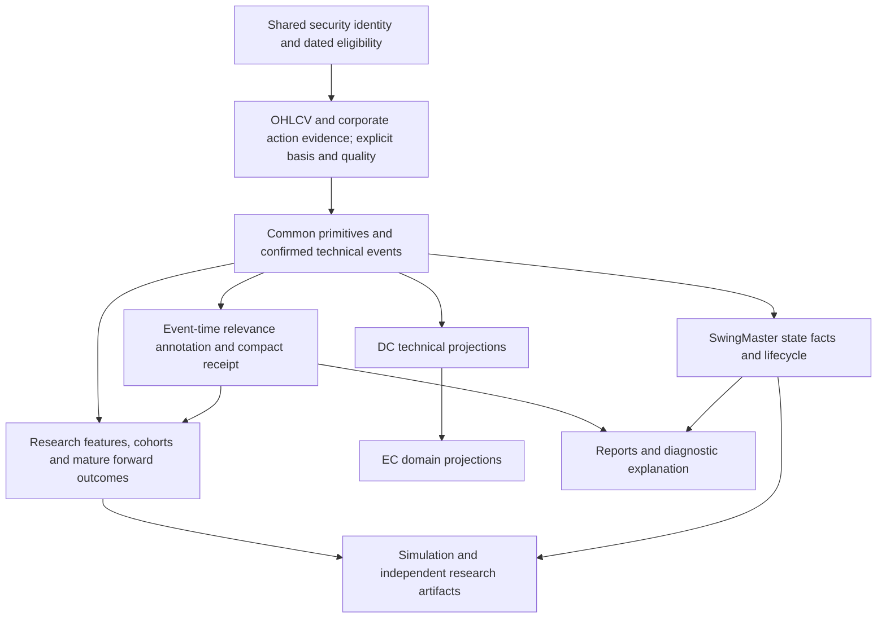

# RawCandle Next — Architecture Audit 03

Research, Results, Simulations and Downstream Technical Consumers. Inspection date: 2026-10-14. **AUDIT ONLY — NO IMPLEMENTATION OR FINAL ARCHITECTURE DECISIONS.**

RawCandle inspected HEAD: `3b331df9d8c8c9ee580f8d00efceb3caae90730f`. SwingMaster inspected HEAD: `0a62a6db590677f0043f753e874d097790deb3ab`, repository `/home/kalle/projects/swingmaster` (read-only throughout). References starting `SM/` resolve under that repository; other source paths resolve under `/home/kalle/projects/rawcandle`. Line numbers identify inspected definitions, not a promise of stability after subsequent edits.

Evidence labels: **VERIFIED FACT** = inspected execution/reader/writer path or stated measurement; **INFERENCE** = implication with limits; **RECOMMENDATION** = proposed future treatment; **OPEN / INSUFFICIENT EVIDENCE** = unresolved requirement or unmeasured effect. All worksheet recommendations have status `RECOMMENDATION_NOT_APPROVED`.

Inputs read and reused: [Audit 01](architecture_audit_01_ohlcv_identity.md), [worksheet 01](keep_rewrite_remove_01.csv), [Audit 02](architecture_audit_02_technical_analysis.md), [worksheet 02](keep_rewrite_remove_02.csv), [price-basis comparison](../yahoo_price_basis_comparison_20261014.md). Their 61 recommendations remain proposals. Prior detector audits and large RawCandle table measurements were not repeated. The user's explicit requirement to **retain Technical Relevance as a calculation capability** governs this assessment; its large run-history store is a different functionality.

## 1. Executive summary

**RECOMMENDATION:** preserve research outcomes, technical relevance, useful simulations and SwingMaster's deterministic state/episode capabilities, while replacing their implicit data contracts. Common security identity, an explicit price reader, shared mathematical primitives, confirmed technical events and compact publication receipts are unavoidable shared boundaries. They do not require one large application or one universal strategy definition.

**VERIFIED FACT — principal new findings:**

- ResultsGenerator requires 20 prior and 20 subsequent observations and skips immature findings. Its global maximum result date can then permanently omit an older skipped or newly discovered event for an already represented ticker. An isolated exact-method fixture returned zero incremental rows versus two with an explicit date range.
- Forward closes, next-day candles, forward volumes and forward benchmark levels are legitimate outcome data. Default regression predictor lists exclude those fields. No direct default `t5/t20` predictor leakage was found. However, random row train/test splitting does not isolate chronological periods or related ticker windows; OLS is fitted and summarized on the full selected sample.
- Missing outcome values become success=0 in both label builders. The ordinary regression runner also drops missing numeric returns, limiting that defect there; the BullishDivergenceModel logistic branch drops missing success labels rather than missing source returns. Current measured stored results have no missing t2 or t20, so this is a verified code-path defect, not a measured historical error count.
- RawCandle simulations use stored event dates and divergence strengths without independent availability dates. Thus Audit 02's early divergence dates and retrospective combos reach signal selection and hypothetical fills. They also interpret positive divergence strength as an event even where the explicit event flag would differ.
- DC Dow readers apply confirmation-date filtering; DC divergence readers use stored dates and r3 flags. EC copies these DC fields. The relevance companion reader filters signal date but not confirmation date, demonstrated with a controlled delayed signal. This must be corrected at the contract boundary, not by inventing new relevance rules.
- SwingMaster's own Dow helper emits pivot markers on confirmation day and has tests for this. Its state logic is distinct from RawCandle's trend/relevance machinery and should not be removed as a duplicate. Its RawCandle divergence export reader nevertheless inherits the early-date defect.
- SwingMaster episode dual-score production trains on a specified historical year band and scores all episodes, including that band. Exit-day features are then available through a current episode score table; EW score attachment uses episode ID without an availability-date check. Treating those scores as entry-day historical information is unsafe. This does not establish that every report or every trade uses this path.
- A scoped relevance measurement for AA found **787 stored rows, 22 logical event keys and 177 runs**. The ordinary reports need compact classifications/reasons plus some context projections, not repeated multi-kilobyte traces. SwingMaster's optional snapshot export does consume context; removing all context access would break functionality.

**INFERENCE:** the largest practical simplifications are separating feature/event publication from label maturation; replacing overlapping relevance runs with one accepted event annotation (or narrow extension); and integrating SwingMaster capabilities through shared services rather than bringing another collector, scheduler, identity registry and writer stack into NG.

No profitability, full-backtest, model-quality or production-frequency claim is made. The audit creates only the requested report and worksheet; commit/push were not performed.

## 2. Actual research/results workflow map

| Reachable entry | Execution and inputs | Outputs / actual purpose | NG functionality treatment |
|---|---|---|---|
| Main `Tulokset` route; `results/view.py:62,210,509,1176` | ResultsGenerator over `analysis_findings`, full ticker OHLC, divergence rows, benchmark OHLC, blackout events/current metadata; generation then enrichment (`compute_new_features.py`) | Wide `results_data`, generation metadata, overwritten `data/results.xlsx`; date/ticker/pattern/combo filters and random export selections | REWRITE service ownership; preserve event research and export |
| Results Dashboard `/findings`; `main.py:2145`, `findings/view.py:48,988,1257` | Reads stored results, pattern/market/date/combo/strength selection, result averages, stock drill-down | Excel selected/random sample, optional future-outcome bounds; graphical browsing | KEEP research purpose; later graphical UI; narrow admin inspection initially |
| Analysis Dashboard `/analysis`; `main.py:2093`, `analysis/view.py:25,374,828` | `AnalysisEngine` in `analysis/analyzer.py:122`; findings database; Run handler explicitly uses AAPL/MSFT/GOOGL | Findings table, counts, filtering, deletion; export action says forthcoming (`:865`) | Existing analysis capability is real; replace demonstration ticker binding and unsafe direct mutations; do not call export stub complete functionality |
| Main candle analysis; `main.py:2761`; `analysis/print_results.py:1` | Selected historical candles through existing analysis runner | Finding counts, per-event CSV-style report with optional strength/RSI | Preserve headless reporting via shared events, defer detailed UI |
| Regression toolkit; `regression/view.py:12,376`; `regression/run_regression.py:864` | Stored results, selected years/market/patterns/features/horizons; optional BullishDivergenceModel | Logistic held-out row diagnostics, OLS coefficients/summary, VIF, crisis/blackout/combo summaries, timestamped text reports and saved preferences | REWRITE research contract; no new framework designed here |
| Regression script `regression/run_regression.py:1584` | Default runner and diagnostics in `__main__` | Text report plus missing/duplicate/label diagnostics | CLI-reachable. No main-menu construction of RegressionView found in targeted symbol search; do not claim it is currently a working main navigation page |
| Random downtrend controls; `analysis/downtrend_generator.py:366`; Results UI bindings | Random ticker/date search, 55-row downtrend predicate, future data requirement | `analysis_findings` pattern `downtrend`, then results/exports/regression control cohort | Preserve explicit control-cohort research; replace sampling/provenance implementation |
| Simulation route `/simu`; `main.py:3266,3344`; `simu/view.py` | SimulationService → SimulationEngine; selected securities/dates/capital/entry and exit filters | Per-ticker capital/trade summaries; batch workbook (`financials_N.xlsx`) | Genuine simplified hypothetical simulation, not merely signal illustration; later research UI |
| Publication event-window CLI/research modules | `rawcandle/research/result_publication_daily_ohlc.py`, `result_publication_event_window.py`, `result_publication_matched_comparison.py`; tested by corresponding `tests/test_result_publication_*.py`; CLI adapters in `rawcandle/cli` | Source-qualified publication windows, partial/completeness statuses, forward/relative outcomes, matched descriptive comparisons, manifest/hash evidence | Retain these contract ideas; adapt price/identity interfaces; independent research artifact |
| Revised PE study | `analysis/research/pe_return_20251003/revised_analysis.py`, `revised_report.md` | Current revised quarterly EPS versus subsequent stored-Close return; current taxonomy universe, no OOS claim | KEEP transparent descriptive study; not a certified PIT strategy or general model |
| SwingMaster CLI and optional snapshot UI | See section 6 and selective assessment | State/episode lifecycle, scoring, regime/macro/report/simulation outputs and optional RawCandle technical snapshots | Selective integration; no copied files |

**VERIFIED FACT:** no inspected RawCandle scheduler binding generates results or trains the regression toolkit. The scheduler does run technical analysis/relevance and DC/report stages (`rawcandle/scheduler/runner.py:1360,2510`); those feed research indirectly. Static CLI reachability is not evidence that an installed cron/timer executes a command. No job was invoked to establish reachability.

## 3. Feature versus forward-label boundary

`analysis/results_generator.py:589–1400` is the critical mixed row builder.

| Values | Information boundary and meaning | Assessment |
|---|---|---|
| t0 OHLC/body/shadow, current candle strength/RSI, trailing slopes/volumes | Available after the t0 bar closes, subject to actual detector confirmation and source quality | Features only at or after their availability time; a t0 close is not a pre-close input |
| `t_2`, `t_5`, etc. | Historical close divided by **t0 low** ×100 (`get_normalized_close`, `:711` vicinity) | Historical observations with an event-day denominator; available only after t0 low is known |
| `t2,t5,t10,t20` | Future observed-row close divided by **t0 close** ×100; not t0 low | Legitimate labels/descriptive outcomes. Regression docstring incorrectly says t0_low; code computes `(tH-100)/100` |
| `t1_alin/ylin/bodi/colour`, forward volumes, `SPX2/5/10/15/20`, `NDX2/...` | Future observations | Outcome-only, never default live predictors |
| `SPX_10`, `SPX_20`, `NDX_10`, `NDX_20` | Negative index offsets; underscore distinguishes history from future (`:1115–1143`) | Default regression uses these historical fields, not the positive-offset names |
| `ATR_14`, MACD, trend regimes | Generator's ATR/MACD/regime helper calls use idx−1; other t0 features include t0 | Mixed cutoff convention must be explicit; ATR is arithmetic mean TR, not automatically Wilder ATR |
| BullDiv recency, combo labels, relevance | Reads persisted technical results | Apparent trailing SQL does not repair an incorrectly backdated upstream event; availability must be explicit |
| `has_blackout_data`, sector metadata | Current dataset-wide event coverage/current classification | Retrospective source availability and current metadata, not certified historical features |
| SwingMaster `peak60`, `post60`, EW five-day confirmation | Future outcome windows or delayed confirmation | Useful research outputs; cannot be entry-day predictors |
| SwingMaster exit features and exit regime | Evaluated at episode/EW exit | Potential predictors at exit, not at earlier EW entry; name alone does not establish availability |

**VERIFIED FACT:** the generator returns None if `idx < 20` or `idx+20 >= len(stock_df)` (`:634` vicinity); horizons count stored observations, not a validated session calendar. It has no pending/mature/invalid label record or explicit maturity timestamp. A future data requirement is legitimate for a completed research sample, but requiring all 20 bars also discards events useful for daily feature publication or shorter horizons.

**VERIFIED FACT:** `_fetch_new_findings(:323)` uses `get_results_max_date(pattern_filter=...)` across the selected pattern set and existing ticker membership. Existing ticker findings with date ≤ that maximum are excluded, even if no result exists for that logical event. Explicit dates bypass this mechanism. `DatabaseManager.bulk_insert_results(:2597)` uses INSERT OR REPLACE on `(ticker,date,candle_pattern)`; this is an overwrite operation, not a durable receipt of the original calculation. Late discovery, skipped maturity and source revision do not trigger targeted regeneration. S02 demonstrates selection omission; no estimate of missing production events was computed.

**VERIFIED FACT:** repeated ticker-day features coexist once per pattern in the wide result table. Measured 37,361 result rows correspond to 36,157 ticker-days, a difference of 1,204 rows. Multiple patterns are legitimate distinct events; this count is repeated feature opportunity, not proof all rows are erroneous duplicates. Findings, divergence state and result strength/RSI/flags also overlap. Audit 02 established that UI enrichment can overwrite same-name features with different formulas; those values feed the actual regression whitelist.

**RECOMMENDATION:** publish confirmed events/features independently of labels. Research outcomes need named horizon, start/denominator basis, required sessions, maturity/quality status and actual terminal date. Mature labels can be recomputed cheaply in a sequential ticker pass; missing must stay unavailable, not failure. Preserve one event identity and shared features at the needed decision cutoff, with research-specific outcomes alongside it. A wide export remains useful as an artifact; a wide operational SQL table need not be the source of truth.

## 4. Regression and research sampling findings

**VERIFIED FACT — ordinary regression:** `regression/run_regression.py:46–119` enumerates feature columns; `:355` builds y/success from normalized future closes with strict `>` thresholds (defaults 2%,3%,5%,8% for 2/5/10/20). `:500` builds features/dummies. `:675` performs stratified random 80/20 row splitting with seed42; scaler fits only X_train, so no full-sample scaler leak is alleged there. `:753` OLS fits on all selected observations. `:1096` drops missing predictor/return/label/category values per horizon. VIF and full-sample summaries are exploratory diagnostics, not OOS profitability evidence.

**VERIFIED FACT — BullishDivergenceModel:** `analysis/bullish_divergence_core_model.py:24,141,277,312,410` filters patterns7/0, deduplicates ticker-date through `preprocess_signals`, uses a separate feature whitelist/exclusion set and random row split; it provides no chronology/embargo contract. Its logistic branch receives binary success labels after NaN return comparison has produced0, then drops missing feature/label values; it need not drop the original missing return. OLS drops missing numeric target. This matters for later partial datasets; measured current t2/t20 missing counts are0.

**VERIFIED FACT — dependence:** ordinary preprocessing (`analysis/preprocess_utils.py:117`) selects one representative ticker-day, preferring nonzero pattern and maximum `vahvuus` if available. This does not separate neighboring observations for the same ticker or their overlapping 20-bar outcomes across the random split. It also sacrifices the identities of simultaneous events. The split implementation permits earlier test observations and later training observations; actual overlap counts were not measured and model scores were not recomputed.

**VERIFIED FACT — control cohort:** `analysis/downtrend_generator.py:52` samples distinct symbols with any row since2024 using SQLite RANDOM(). `:135` requires `t−10>t−5>t−2>t0`, decline≥3%, prior-only MA5<MA10 and t0<MA10. `:450–530` samples available dates after54 history rows and before30 future rows, with a cap of500 attempts per ticker; Python random choice has no recorded seed. Thus controls are conditional on future coverage and the current inspected database roster. This is not an unconstrained uniform non-signal cohort or a calendar/market-matched comparator. It does not filter on future return magnitude in this predicate. Avoid conflating future-coverage selection with a demonstrated future-return threshold filter.

**VERIFIED FACT — export selection:** `results/excel_exporter.py:269` excludes bearish-divergence rows and drops missing forward values; optional growth/drop bounds operate on all t2/t5/t10/t20 outcomes. `findings/view.py:1257` and Results dialogs offer random export sampling. These are useful descriptive selection controls but an exported workbook can be selected by the dependent variable. It is not a neutral training sample without an explicit manifest. No automatic workbook-to-regression import path was found; ordinary regression reads SQL results. Do not assert outcome-conditioned exports contaminate that default SQL runner.

**VERIFIED FACT — source/metadata selection:** blackout preprocessing scans the available event history and sets `has_blackout_data` from membership in the entire loaded event dataset (`analysis/preprocess_utils.py:38`); that flag is in the ordinary predictor list. Both regressions can exclude earnings/dividend windows automatically. User-approved NG direction removes automatic blackout restrictions; preserve dates as optional research events. Current market/sector assignment is not a historical listing/classification contract (Audit01).

**VERIFIED FACT — other targeted research:** publication event windows retain missing offsets and COMPLETE/PARTIAL statuses (`rawcandle/research/result_publication_event_window.py:204,210`). Matched comparison explicitly loads latest market caps (`result_publication_matched_comparison.py:134`) and stratifies descriptive event cohorts; this is current-size matching, not a historical market-cap claim. PE revised-report explicitly discloses current membership, current accepted EPS history and stored-Close returns (`revised_report.md:64,157`). These bounded research contracts are more useful than forcing them into generic results_data.

**RECOMMENDATION:** preserve diagnostics, cohort comparisons and forward labels; replace implicit sample provenance and claims about random held-out rows. A research receipt should specify universe policy/date, selected logical IDs, feature cutoff/basis/definition, outcome maturity, filters and exclusion counts, split policy/seed and source receipt. Different strategies may keep distinct explicit predicates on top of the same primitives. No new regression framework, parameter tuning or training was performed.

## 5. Simulation architecture and correctness

**VERIFIED FACT:** `simu/main.py:SimulationService` is a facade over AnalysisRepository/PriceRepository and SimulationEngine. `simu/engine.py:SimulationSettings,SimulationEngine.run` implements:

1. Resolve stored findings/divergence signals in the requested date window; calculate RSI/volume from price history.
2. Observe the signal at that stored date's close; if filters pass, schedule a purchase at the next available bar's open.
3. Purchase integer shares using a fraction of remaining cash; repeated events may add to the position. Sale executes first if a sale and purchases share a day.
4. At close, compare close with the previous-closes moving-average drop reference and with average-cost take-profit; schedule the full-position sale for next bar open.
5. Value remaining shares at last available close on/before end. An open position's gain is not a completed winning trade.

These are explicit hypothetical next-open assumptions. A drop trigger is a close-based moving-reference exit, not an intraday guaranteed stop fill. The engine has no fee/spread/slippage, dividend cash ledger or split quantity events. It uses stored OHLC units and integer share sizing; current adjusted history is not original exchange-unit execution evidence. There is no demonstrated literal future label predictor in the engine, but a retrospectively dated signal can still make its supposedly next-day entry premature.

**VERIFIED FACT:** `simu/db.py:fetch_events` reads `analysis_findings(ticker,date,pattern,signal_strength)`; `fetch_divergences` reads generic bullish/bearish strengths where strength>0, without explicit event flags or availability. Audit02 measured strengths present on most divergence rows, so using strength as event identity is materially different from consuming sparse r2/r3 event flags. `simu/signals.py:resolve_signals` selects/combines those inputs. No event version or source receipt pins the simulation. Downtrend-only selection bypasses RSI and volume filters (`simu/engine.py`), a concrete business behavior to retain or review explicitly.

**VERIFIED FACT:** `simu/indicators.py` duplicates Wilder-style RSI with flat0, while Audit02's divergence RSI uses flat50. Volume growth uses the previous configured volume window, excluding today. PriceSeries orders existing rows and bridges absent dates. Determinism holds for fixed inputs/settings, but those are current mutable SQL inputs, not a reproducible historical snapshot contract.

**VERIFIED FACT:** `simu/view.py:1135` wires BatchSimulator; `simu/batch_simulator.py:run_batch_simulation` simulates independently per ticker, includes successful rows only when trades>0, keeps error rows, sorts profit and writes a parameters/results workbook. This is not a joint cash-constrained portfolio backtest; selected winners/nontraders are not a neutral universe summary. Core summaries are returned in memory; no dedicated RawCandle simulation SQL persistence was found in the relevant schema inspection.

**VERIFIED FACT — SwingMaster simulations:** `SM/swingmaster/cli/run_transactions_simu_fast.py:278,354,763` creates one-share hypothetical transaction rows from EW/PASS/NO_TRADE candidates using episode start/exit close fields and event dates, with badges and deterministic run identity. `run_transactions_simu_sell_fast.py`, `reporting/sell_rules_engine.py` add exits. `research/backtest_pass_stop35.py:114` builds a portfolio-series research view from supplied/deoverlapped trades and close percentage changes, supports cash buffer/position cap/ranking (previous calendar-day fastpass lookup), and computes benchmark/relative metrics. Preserve these distinct research questions, not their attribution as literal contemporaneous fills. A same-close entry using end-of-day state or a score derived from later exit data needs timing qualification. No complete strategy simulation or full economic validation was run.

**RECOMMENDATION:** retain simulation as a later research capability with separate event detection, earliest actionable availability, execution and outcome timestamps. Reuse shared primitives and prices; keep strategy-specific entry/exit semantics named. Financial accounting scope (descriptive adjusted-price ratios versus cash/share/action accounting and costs) is OPEN. Current results do not establish executable profitability.

## 6. SwingMaster and DC/EC technical consumer contracts

| Consumer boundary | Exact source/field expectations | Timing, missing data and versions | Confirmed impact / NG need |
|---|---|---|---|
| DC ticker technical inputs | `analysis/datacenter_indices/swing_ticker_metrics.py:185`: daily OHLC/close/volume; trailing returns5/10/20/60, MA10, SMA-seeded EMA10/20, slopes, rolling high20, avgvolume20 | Exact as-of row, trailing `date<=T`; explicit invalid/insufficient statuses; fixed parameters; basis implicit | Share these primitives; preserve quality statuses; Audit02 invalid-bar/gap policy still required |
| DC Dow enrichment | `swing_analysis_readers.py:241`: `stock_dow_structure_events` label, trend, epoch, BOS/reset fields and confirmation dates; optional engine/price source filters | `confirmed_as_of_date<=T`; missing table/rows yield empty snapshots | Positive boundary; keep true confirmation semantics and explicit definition selection; no allegation it uses unconfirmed chart pivots |
| DC divergence enrichment | `swing_analysis_readers.py:306`: `divergence_data.date`, four r3 flags and strengths/RSI-related enrichment | latest `date<=T`; NULL snapshot if unavailable; no separate price-pivot confirmation | Audit02 early-date defect survives this predicate; require confirmed event read with radius/definition |
| DC candles | `swing_analysis_readers.py:389`: `analysis_findings` ticker/date/pattern | exact date=T; pattern direction mapping; no independent availability | Retrospective combo dates cannot become actionable merely by matching T |
| DC relevance daily/weekly/rolling reports | `technical_relevance_context.py:186`; reports `swing_daily_report.py:1168`, `swing_weekly_report.py:580` | run ID, ticker, timeframe1d, signal-date window, class; companion selection prioritizes RELEVANT before WEAK_CONTEXT, then newest date | SQL returns confirmed field but does not filter on it; companion likewise omits it (S04). Thus “latest” also means class priority, not simply newest event. Preserve/review that report behavior explicitly |
| EC source boundary | `rawcandle/ec_ticker_signal_daily_loader.py:REQUIRED_SOURCE_COLUMNS,TARGET_MAPPED_COLUMNS` reads `dc_ticker_swing_signal_daily` | source signal/taxonomy version/date/run; maps returns/MA/structure/flags into `ec_ticker_signal_daily`; missing target metrics remain NULL with warnings | No new divergence calculation; propagates DC stored flags/staleness. Technical adapter can be shared, taxonomy/weights/synthetic models remain independent |
| SwingMaster state provider v2/v3 | `SM/swingmaster/infra/market_data/osakedata_reader.py:_fetch_ohlc`: `osakedata(osake,pvm,open,high,low,close,volume)` descending with `pvm<=T LIMIT N`; provider fact calculations | optional exact row check (`require_row_on_date`, defaultFalse); insufficient history emits DATA_INSUFFICIENT; float conversion rejects None via exception, no shared quality contract | It calculates own state-specific facts, not RawCandle results or divergence. Prefer explicit NG price/features interface; preserve predicates separately |
| SwingMaster technical snapshot: candles/divergence | `SM/analysis/candlestick_signal_reader.py:125`, `divergence_signal_reader.py:296`; `run_fundamental_ticker_snapshot.py:1417,1464` | recent valid price date window; finding ID/date/pattern/strength/RSI; latest/event divergence rows `date<=T`, generic/radius columns selected as inspected | Export inherits incorrect source dating; stale check only latest valid-close versus latest divergence date, so historical revisions escape it |
| SwingMaster stock Dow snapshot | `SM/analysis/stock_dow_structure_reader.py:45` and `run_fundamental_ticker_snapshot.py:1368` | RawCandle event/status fields, engine version/price_source, confirmed as-of context and quality/freshness | Distinct from SM's internally computed Dow; preserve shared RawCandle confirmed-event boundary, avoid two ambiguous “Dow” definitions |
| SwingMaster relevance snapshot | `SM/analysis/technical_signal_relevance_reader.py:55,132`; `run_fundamental_ticker_snapshot.py:1561` | explicit run ID/timeframe, confirmation-date lookback≤T; raw reader returns28 fields including trace, output snapshot uses compact18-field context projection | Correct predicate cannot repair upstream false confirmation. Snapshot renderer does not output full trace; compact annotation + context explanation adapter can serve it |
| Scheduler/reports | RawCandle runner relevance post-step; DC orchestrator `swing_pipeline_orchestrator.py:642,900`; SM daily/range/report CLIs | run IDs, date ranges and successful publication inferred from result/run existence | Require small accepted receipts and source-revision invalidation; no second scheduler implementation needed |

**VERIFIED FACT:** DC's EMA is SMA-seeded (`swing_ticker_metrics.py:148`); Results MACD uses first-price seed. Some shared indicators already exist but their mathematical names alone do not establish equivalence. Source data are legacy implicit adjusted history. Daily1d is the verified common timeframe; nominal `timeframe` arguments do not prove multi-timeframe acquisition/calculation. No consumer should silently get ordinary NG OHLC under a field formerly meaning legacy adjusted OHLC.

**Impact map (VERIFIED paths, with INFERENCE about affected output):** Audit02 divergence timestamp defect → Results recency/combo research, RawCandle simulation event selection, relevance observations, DC r3 enrichment → EC copied flags and reports; SwingMaster optional divergence/relevance snapshots consume the same source. SwingMaster's OHLC-derived state provider has no observed divergence-table dependency, so its core states are not shown contaminated by this particular defect. Upstream price correction → derived invalidation gaps (Audits01/02) → any copied DC/EC/result/relevance output can remain stale. Frequency and economic consequences remain unmeasured.

### SwingMaster Repository — Selective Integration Assessment

The repository is substantially beyond its scaffold README/LOCKED description: actual code includes deterministic state policies, episode research, statistical models, macro ingestion and hypothetical transactions. `SM/ui_qt` and `SM/ui_flet` are empty; the executable `SM/start_server` starts `ui_fundamental_pipeline.main` in browser mode. That Flet UI has USA/FIN update, result-check/planning, classification/TTM/percentile and snapshot operations (`main.py:97,395,453,563,595`), not a demonstrated graphical technical state workbench. Do not infer runtime modules from folder names or promise its UI wholesale.

**VERIFIED FACT — application/database wiring:** `SM/swingmaster/cli/run_daily_universe.py:43–44` already defaults its market-data input to RawCandle's `/home/kalle/projects/rawcandle/data/osakedata.db`, with separate `swingmaster_rc.db` output. `SM/ui_fundamental_pipeline/config.py:11–17` also points OHLCV and technical analysis to RawCandle while configuring local `fundamentals_usa.db`, `fundamentals_fin.db` and `rc_fundamentals_v2.db`. Thus shared price acquisition is already a real integration seam; consolidation must not add a second collector. Actual financial implementation packages include `SM/swingmaster/fundamentals`, `SM/swingmaster/fundamentals_v2`, `SM/swingmaster/scoring` and `SM/swingmaster/providers`; UI command constants invoke quarter update, result check, FIN Yahoo batch, TTM/percentile and snapshot CLIs. Those financial modules have substantial source/history obligations beyond this technical consumer audit. Their existence and UI reachability are verified; direct code reuse and financial-state migration remain OPEN pending their owning scope, rather than being declared redundant from filenames. Technical model/research packages are separately assessed below.

**VERIFIED FACT — state definitions and usefulness:**

- State vocabulary is `NO_TRADE`, `DOWNTREND_EARLY`, `DOWNTREND_LATE`, `STABILIZING`, `ENTRY_WINDOW`, `PASS` (`SM/swingmaster/core/domain/enums.py:State`). The allowed graph permits stays, the downtrend progression and reset paths (`transition_graph.py:ALLOWED_TRANSITIONS`). Minimum state ages are respectively0,2,3,2,1,1 (`core/policy/guardrails.py:MIN_STATE_AGE`). These are eligibility/state labels, not orders.
- v2 delegates to the v1 rules implementation, adds slow-decline origin and Dow new-LL invalidation in stabilization/entry (`core/policy/rule_v2/policy.py`). The v1 rules implementation remains a live dependency even though external policy/provider v1 selection is disabled (`app_api/factories/build_app.py:build_swingmaster_app`). Removing all v1-named code would break v2/v3.
- v1 policy evaluates history-dependent edge/churn/entry/reset helpers before its signal ruleset (`core/policy/rule_v1/policy.py:decide`); core evaluator then applies allowed graph/min-age guardrails and merges reasons (`core/engine/evaluator.py:evaluate_step`). Do not reduce this to a simple arrow diagram that omits precedence, age and history.
- v3 delegates to v2, classifies decline profile (SLOW_DRIFT, SHARP_SELL_OFF, STRUCTURAL_DOWNTREND, UNKNOWN), persists origin/entry type, stabilization phase and entry gate/quality, with one-way profile upgrades (`rule_v3/policy.py:decide`). MA20 reclaim plus HL proposes gateA; reclaim without HL gateB; downstream evaluator still applies the graph. Preserve actual observable policy plus guardrails, not standalone proposal output.
- State-specific facts are useful information beyond a generic RSI or trend flag. Trend-start tests a 30-bar≥70%-above-SMA20 regime, positive5-bar SMA slope, downward crossing and break below prior10 close lows (`signals_v2/trend_started.py:36`). Matured combines new-low/drawdown structure, below-MA age and slowing/spacing of new lows (`trend_matured.py`). Stabilization uses7 recent versus20 baseline relative ranges, median ratio≤0.75, wide-day ratio≤0.20, no significant new low beyond0.3%,≤1 minor sweep,≥3 closes in upper55% (`stabilization_confirmed.py`). Several provider constructor thresholds are ignored by these newer pure definitions; integrating apparent UI parameters without checking actual use would misstate the model.
- Entry setup combines tight10-bar base/reclaim, width≤6%, close-location/support checks and risk≤2.5ATR and≤6% (`signals_v2/entry_setup_valid.py:46,117`). Invalidation compares current low against the prior lookback lows; preserve its exact epsilon predicate. v3 slow drift uses the same staircase/≥3% concept as RawCandle controls, but its SMA windows include today while RawCandle's control predicate excludes today. These are related but conflicting definitions, not interchangeable duplicate code.
- v3 sharp selloff uses1-day≤−2.5ATR14/close or3-day≤−3.5ATR14/close; volatility compression compares current ATR% with t−5/t−10 and≤75% of its20-observation max; MA20 reclaimed is a downward/equal-to-upward crossing. Structural downtrend uses confirmed Dow facts or a separate30-close, radius1 local-extrema fallback (`signals_v3/*.py`). Keep each explicitly named definition if useful; a common primitive library does not require erasing distinct domain predicates.
- SM Dow creates pivot markers on `pivot+window` and excludes incomplete right windows (`signals_v2/dow_structure.py:compute_dow_markers`; S03). It also has its own active structural high/low, tolerance/reset logic. This differs from RawCandle's persisted confirmed Dow engine and unconfirmed chart markers. Sharing “window3” does not establish output equivalence; one chosen shared engine or explicitly named domain projection is a later decision.
- Market regime (`regime/production.py:46`) is BULL when MA50>MA200 and close>MA200; BEAR when MA50<MA200; CRASH when MA50>MA200 and close<MA200 persists for configured consecutive days; otherwise SIDEWAYS. Combined SP500/NDX is that common state only when both agree, otherwise SIDEWAYS. SMA windows require200 observations. This is independent of ticker state and useful as research/report context; do not redesign thresholds here.
- Macro score (`macro/scorecard.py`) combines BTC momentum30%, HY spread25%, equity PCR15%, Fed balance-sheet liquidity15%, broad dollar15%, then3-day mean. Regime thresholds30/45/60/75 map RISK_OFF/DEFENSIVE/NEUTRAL/RISK_ON/EUPHORIC; changed label requires two consecutive candidates. `macro/normalize.py:153` forward-fills by observation date, writes `published_at_utc` from load time, and score reader does not gate on genuine release timestamp. It is descriptive revised-source context, not established PIT macro data. That input contract can be rewritten without redesigning the score formula.

| Candidate and source paths (relative to SM repository; package paths start `swingmaster/`) | RawCandle overlap / unique value | Functionality recommendation; current code treatment | Proposed NG destination/interface (conceptual) | Dependencies / risks | Priority |
|---|---|---|---|---|---|
| `swingmaster/core/domain`, `swingmaster/core/signals`, `swingmaster/core/engine`, `swingmaster/core/policy/rule_v1`, `rule_v2`, `rule_v3` | No equivalent six-state lifecycle found in inspected RC consumer paths; distinct reasons/age/history semantics | **KEEP / INTEGRATE**; pure domain/evaluator contracts reusable with adapters, preserve live v1 internals | State-domain capability; `evaluate_state(previous, confirmed_facts, history, definition)` | Shared identity; ordered session clock; initial state/history; graph/guardrail precedence and profile attrs | P1 |
| `swingmaster/app_api/providers/signals_v2/*.py`, `swingmaster/app_api/providers/signals_v3/*.py` | Primitive MA/ATR/pivots duplicate RC; stabilization/decline/entry predicates unique | **REWRITE / INTEGRATE** adapters; KEEP named predicates after contract verification | State-facts adapter on shared technical features/NG price reader | MA cutoff mismatch; constructor parameters ignored in newer definitions; missing/gap/basis conventions | P1 |
| `swingmaster/app_api/providers/signals_v2/dow_structure.py`; `analysis/stock_dow_structure_reader.py` | Own confirmed Dow and shared RC persisted Dow both exist | **OPEN** engine choice; retain confirmed structure functionality, do not silently substitute outputs | Shared confirmed-event interface with explicit algorithm/parameters; state-specific projection | Reset/tolerance/seed/history semantics; preserve confirmation tests | P1 decision |
| `swingmaster/app_api/facade.py`, `swingmaster/infra/sqlite/repos/rc_state_*`, `swingmaster/cli/run_daily_universe.py`, `run_range_universe.py` | RC orchestration/writer infrastructure already exists; state service useful | **REWRITE / INTEGRATE** state operation; REMOVE duplicated orchestration as NG infrastructure | Common job service/accepted receipt; consumer-owned state publication | Rerun/revision ordering; previous state lookup unversioned; current metadata universe | P1 |
| `swingmaster/cli/run_range_universe.py:1049,1195,1351,1626` episode generation/outcomes | RC event results have no equivalent multi-state lifecycle episodes | **REWRITE / INTEGRATE** episode functionality; separate forward outcomes | Research episode reader/builder on state transitions; `outcome(horizon,maturity)` | Episode start/exit identity, 40/60-bar extrema partial windows, EW5 confirmation delayed | P2 |
| `swingmaster/ew_score/compute.py`, `swingmaster/ew_score/model_config.py`, `swingmaster/ew_score/models/*.json`, `swingmaster/ew_score/training/*` | Market-specific fastpass/rolling scoring unique | **REWRITE / INTEGRATE** inference contract; retain model definitions/evidence; applicability OPEN | Named inference service with availability cutoff/model receipt | Calibration/market coverage, exit-derived dual scores attached too early, missing inputs | P2 |
| `swingmaster/episode_exit_features/production.py`, `swingmaster/dual_score/production.py`, `swingmaster/research/up20_*`, `fail10_*`, `train_episode_up20_baseline.py` | Unique episode exit research and targets; generic indicators overlap | **OPEN** model deployment; preserve research contracts, REWRITE shared feature access | Independent research datasets/labels and model artifacts; exit-time inference only | Train2020–21 default and all-episode scoring, in-sample historical scores, label maturity, source vintage | P2 review |
| `swingmaster/regime/production.py`, `swingmaster/cli/run_market_regime_sync.py` | MA primitives overlap; exact four-state combined index definition distinct | **KEEP / INTEGRATE** rules; REWRITE price/persistence adapter | Named market-regime function over shared index features | SP500/NDX session alignment, currency not universal, explicit basis | P1/P2 |
| `swingmaster/macro/scorecard.py`, `swingmaster/macro/normalize.py`, `swingmaster/macro/raw_ingest.py`, local CBOE source | Distinct global risk context; source infrastructure should remain one owned service per source | **REWRITE / INTEGRATE** selective macro capability | Macro evidence reader + existing scorecard function; no duplicate OHLC collector | Observation versus release date, revisions, forward fills; source licensing/coverage not assessed | P2 |
| `swingmaster/reporting/sell_rules_engine.py`, `swingmaster/cli/daily_report.py`, `daily_reports/buy_rules`, report CLIs | Strategy/report semantics unique; export infrastructure overlaps | **KEEP / INTEGRATE** named rules/report meaning; adapt inputs/output writers | Headless state/research report service | Entry versus exit scores, rule config/source hashes, report timing; no rule redesign | P2 |
| `swingmaster/cli/run_transactions_simu*.py`, `swingmaster/research/backtest_pass_stop35.py` | RC simulation overlaps execution machinery, SM episode candidate/exit research distinct | **REWRITE / INTEGRATE** selected research behavior | Shared simulation input contract; strategy-specific rules; later research UI | Same-close state fills, missing costs/actions, correlated/overlapping trades and score availability | P3 |
| `analysis/*_reader.py`, `swingmaster/cli/run_fundamental_ticker_snapshot.py` technical sections | Directly consumes RC OHLC/events/relevance; compact cross-domain snapshot useful | **REWRITE / INTEGRATE** adapter; no replicated technical tables | Shared as-of snapshot/export API incl quality/confirmation/context projection | Upstream early divergence, stale revisions; snapshot18-field context needs explanation access | P1 |
| `swingmaster/infra/market_data`, `swingmaster/infra/sqlite`, universe readers | Already provided or proposed by RC source/identity/job layers | **REMOVE** duplicate NG infrastructure; preserve functional read/atomicity contracts in common services | Single identity/basis/quality/writer authority | Do not copy schema-ensuring constructors or separate current ticker registry | P1 |
| `ui_fundamental_pipeline`, fundamentals databases/provider pipeline | Existing RC Fundamentals admin/identity overlaps; detailed financial state is outside technical audit | **OPEN** remaining unique financial requirements; REMOVE second technical admin/scheduler stack | Existing Fundamentals owning services and lightweight NG admin | User inputs/source evidence must not be discarded; no financial migration audit performed | P3 / separate scope |
| `start_server`, `daily_reports/*.sh`, empty `ui_flet/ui_qt` | Launcher and report wrappers, no independent technical scheduler verified | **REMOVE** redundant NG launch layers; KEEP callable report operations | One scheduler invokes state/report services; thin adapters | Shell report wrapper `exec PYTHONPATH=.` is not a normal env-assignment execution; do not adopt untested wrappers | P1 |

P1 means interface/definition evidence needed before consolidation; P2 means useful capability after shared boundaries; P3 means later UI/research or separate scope. Priorities authorize nothing. Pure contracts may be reused directly later; none were copied, moved or modified here.

**Useful tests/contracts to retain (inspected source inventory, not executed as application tests):**

| Test/contract under SM | Retained property |
|---|---|
| `swingmaster/tests/test_dow_structure_confirmation_day.py` | Pivot marker appears on confirmation day; incomplete future window not emitted |
| `swingmaster/tests/test_engine_evaluator_guardrails.py`; `core/tests/test_policy_factory_and_ruleset.py`; `core/tests/test_reasoncode_persistence.py` | Legal graph/min-age behavior, actual version selection and mandatory stable reason identity |
| `swingmaster/tests/test_rule_policy_v2_dow.py`; `test_osakedata_signal_provider_v3.py`; `test_slow_decline_started_v2.py`; `test_trend_started_v2.py`; `test_trend_matured_v2.py` | Distinct domain thresholds and causal input windows, not generic indicator equivalence |
| `swingmaster/tests/test_run_range_universe.py`; `test_run_range_universe_ew_score_integration.py`; `test_osakedata_reader.py` | Ordered replay, missing as-of data, deterministic universe sampling and read contract |
| `swingmaster/tests/test_ew_score_training_dry_run_split_stats.py`; `test_ew_score_training_template_validation.py`; `test_ew_score_model_resolver.py` | Explicit split statistics, template feature names and market/model selection; keep evidence contracts even if model code changes |
| `swingmaster/tests/test_episode_exit_features.py`; `test_market_regime_production.py`; `test_risk_appetite_scorecard.py`; `test_macro_normalize.py` | Exit-time feature definitions, regime rules and source/fill quality semantics |
| `tests/test_technical_signal_relevance_reader.py`; `test_stock_dow_structure_reader.py`; `test_divergence_signal_reader.py`; `test_candlestick_signal_reader.py` | As-of bounds, missing/partial source behavior and stable raw/export schemas; keep these goals while replacing legacy storage assumptions |
| `swingmaster/tests/test_transactions_simu_fast_candidates.py`; `test_transactions_simu_buy_badges.py`; `test_optional_ml_dependency_boundaries.py` | Candidate provenance/badges, optional model dependencies isolated from base operation |

Retain fixtures as small synthetic contracts; do not port tests that merely require old SQL filenames or reproduce a verified defect. RawCandle counterparts worth retaining include simulation next-open tests, Results normalization tests, relevance source/service/as-of tests, DC/EC mapping/freshness tests, and publication-window partial/authority tests. New prefix-causality, missing-label and correction-invalidation checks will be needed during later implementation; none were added to source in this audit.

**Migration versus recalculation:** state/signal/transition histories, MA/Dow/relevance rows, episodes, market regimes, exit features, model scores and hypothetical transactions are derived and can be rebuilt against the NG zero-day baseline. Current ticker strings alone do not safely map to shared security IDs. Existing named rules, user-reviewed configuration, fitted model files/manifests/training selection evidence, unique source observations (especially macro/CBOE), and historical reports needed to explain past decisions are preservation candidates; they cannot necessarily be reconstructed from a fresh provider response. They can remain in the existing repository as retained evidence until a separately approved import is justified. No evidence here requires wholesale SQL migration. Active state can be obtained by replay/warm-up from a defined starting state; if an exact prior live episode must continue, its accepted boundary state/attrs and identity/source receipt may need a small import. Whether exact continuation is required is OPEN. Fundamentals source evidence/user corrections need their owning team's separate assessment; this audit does not classify those databases as disposable.

## 7. Technical Relevance simplification assessment

**VERIFIED FACT:** `rawcandle/technical_signal_relevance.py:473` classifies an observation using context eligible at its `signal_confirmed_as_of_date`, filters events/pivots by confirmation, and emits RELEVANT/WEAK_CONTEXT/NOISE plus reasons and trace. It does not intentionally reinterpret a candle using arbitrary later context. The source adapter's incorrect divergence availability remains consequential even when the pure engine filters correctly. Rule thresholds/classes are documented existing behavior, not finally approved policy.

Current primary key in `rawcandle/sqlite/migrations/001_create_technical_signal_relevance.sql` includes run_id plus ticker/timeframe/signal date/name/source type/source ID/rule version. Therefore repeated overlapping runs preserve separate copies of the same logical event. The AA measurement used the same key excluding run_id; 787/22 is a bounded example, not the database-wide duplication ratio. Audit02's 2,232,951 rows and 9,420,337,152 allocated bytes including indexes (8,983.93MiB, **8.77GiB**) remain the reused baseline; the original request's “8.98GiB” is a unit approximation, not a new measurement.

| Use | Essential ordinary information | Additional evidence actually consumed / needed |
|---|---|---|
| Daily decision support | Event ID/security/timeframe, event and earliest available time, class, reason, accepted definition/source receipt | Missing/quality/hold state must not be confused with NOISE; cheap context explanation if requested |
| Candle/signal research | Same annotation at its historical decision cutoff, separately named retrospective association if used | Named cohort and outcome receipts; no later divergence may alter what was available earlier |
| DC daily/weekly/rolling reports | Class/reason, signal name/date, bullish/bearish direction, accepted publication selection | Existing context reader also supplies trend/BOS/reset/proximity/alignment fields; replace with compact context projection or on-demand shared context, not blind field deletion |
| SwingMaster optional snapshot | Confirmation-bounded annotation/run selection and18 compact context fields (`run_fundamental_ticker_snapshot.py:337`) | Raw export reader includes rule_trace; current snapshot render omits trace. Retain explicit diagnostic/raw explanation operation if required |
| Correctness diagnosis | Event/definition/input receipt and reason; missing context/failed job counts | CLI `export_technical_signal_relevance.py` and `technical_signal_relevance_bar_index_audit.py` use traces. Some trace markers currently supply diagnostic counters; replace with compact diagnostic statuses, generate detailed explanation on demand |
| Reproducibility / previous run export | Pin accepted calculation/source and requested event set | `query_relevance_records`, `read_relevance_records_for_run` currently allow run-specific replay/export; this is a real dependency. Preserving exact old exports is a user requirement question, not justification for recurring full materializations |

**RECOMMENDATION:** conceptually attach relevance to the technical event. Store a class/optional reason, decision cutoff, definition/mapping/reason identities and compact source/publication receipt. A narrow one-to-one annotation extension is reasonable if relevance publication is later than event publication or has separate ownership. A run receipt may identify accepted publication/coverage/errors without being part of each logical event's identity. Neither the pure relevance engine nor the explain operation should be removed.

A corrected source can update the accepted **recomputed-history** classification under the same logical event identity. Such an update must not be represented as proof that the new information was known then. Earliest confirmed availability is a mathematical/source-input property; fetched/revised-at is an evidence property. Keep these separate. For reproducible past operational decisions, retain compact decision/report artifacts and their receipts or the specifically required source evidence; current event rows plus current mutable prices cannot reconstruct an erased source vintage. On-demand traces are exact only if their original inputs/definitions are still retained; otherwise label them explanations of the current recomputation. This is a limit, not a proposal for a comprehensive version-chain system.

**INFERENCE:** one annotation per event is sufficient for the inspected operational classifier because it evaluates at event availability. If a future requirement asks “how relevant is this old event under today's context?”, that is a different named context/task. Multiple unnamed classes on one event would be ambiguous. Retrospective association, current-context relevance and actionable event-time relevance must not silently overwrite each other.

**OPEN:** exact old-run export preservation; diagnostic evidence retention period; whether any consumer beyond the inspected paths needs a second named context; accepted publication ownership; context projection compactness. No production relevance history was deleted, modified or copied. Removal recommendation concerns repeated NG operational persistence only.

## 8. Relevant database and UI dependencies

Read-only measurement used SQLite URI `mode=ro`, `PRAGMA query_only=ON`; measurements are inspection-time observations, not a cross-repository atomic snapshot. `dbstat` allocation is approximate live page ownership, not serialized content or a forecast of NG size. Small table sizes include allocated empty pages. RawCandle measurements below reuse Audit02 except the scoped new result/relevance profiles.

| RawCandle table / state | Count and allocated bytes from Audit02 | Writer/read ownership; class and treatment |
|---|---|---|
| `analysis_findings` | 1,782,501; 421,212,160 total | Detectors/random controls/UI writes; Results/simulations/DC/snapshots read. Rebuildable events, but control sampling membership needs retained cohort evidence |
| `results_data` | 37,361; 59,965,440 total | ResultsGenerator/enrichment writes; Findings/Results/regression/Excel read. Research output with repeated features; source correction and label maturity missing |
| `results_metadata` | 42; 4,096 | Generation summary total/time; does not prove per-event coverage or source/calculation identity |
| `divergence_data` | 8,867,512; 1,525,874,688 total | Divergence writer; Results/simulation/relevance/DC/SM exports read. Rebuildable feature/event mix, inherited timing defect |
| `technical_signal_relevance` | 2,232,951; 9,420,337,152 total | Relevance batch writer; report/CLI/export/diagnostics/SM reader. Rebuildable annotation, repeated run projections replaceable |
| `technical_signal_relevance_runs` | 185; 98,304 | Rule/mapping/reason/config/time receipt; preserve receipt purpose with explicit successful publication/coverage |
| `stock_dow_structure_events/status` | 950,769 / 4,915; 448,421,888 / 1,069,056 | Confirmed Dow owner; relevance/DC/SM read; rebuildable, status max-date does not detect corrections |
| `blackout_dates` | 181,136; 24,281,088 | Source event evidence; retain typed earnings/dividends, remove automatic research exclusion |
| `excluded_tickers` | 26; 12,288 | Authoritative explicit user policy, not derived calculation. Preserve scope/identity meaning rather than rebuilding from prices |
| DC/EC daily technical/index/group outputs | Audit02 section8 has exact11 boundary table counts/sizes | Domain-owned rebuildable projections; source/taxonomy/run receipts. No repeat full-table count here |
| Regression preferences / workbooks / report files | Files, not SQL tables | `data/regression_feature_selection.json` is user preferences; results.xlsx is replaceable export, timestamped report/workbooks are research artifacts, not source data |

Additional SwingMaster allocations follow. Main access is ticker/date ordered state replay; episode-ID joins for scores; market/date for regimes; as-of/source for macro. Writers: facade/state repos, range episode post-phase, EW/dual/exit feature services, regime/macro CLI services, transaction CLIs. Readers: history providers, range diagnostics, daily/snapshot reports, scoring and research/simulation CLIs. The repeated daily signals are an auditable fact history, not automatically waste simply because they are large. Whether compact transitions plus receipts can replace some daily state storage is OPEN; state age/history queries must still work.

| SwingMaster database / table | Exact rows | Table bytes | Index bytes |
|---|---:|---:|---:|
| `swingmaster_rc.db` / `rc_run` | 1,554 | 151,552 | 81,920 |
| `swingmaster_rc.db` / `rc_state_daily` | 145,664 | 21,422,080 | 7,761,920 |
| `swingmaster_rc.db` / `rc_transition` | 10,631 | 1,462,272 | 684,032 |
| `swingmaster_rc.db` / `rc_signal_daily` | 145,664 | 27,631,616 | 7,761,920 |
| `swingmaster_rc.db` / `rc_pipeline_episode` | 419 | 188,416 | 77,824 |
| `swingmaster_rc.db` / `rc_ew_score_daily` | 1,275 | 1,310,720 | 45,056 |
| `swingmaster_rc.db` / `rc_episode_exit_features` | 0 | 4,096 | 12,288 |
| `swingmaster_rc.db` / `rc_episode_model_score` | 0 | 4,096 | 12,288 |
| `swingmaster_rc.db` / `rc_episode_model_dual_inference_current` | 0 | 4,096 | 4,096 |
| `swingmaster_rc.db` / `rc_episode_regime` | 419 | 73,728 | 163,840 |
| `swingmaster_rc.db` / `rc_market_regime_daily` | 1,850 | 311,296 | 323,584 |
| `swingmaster_rc.db` / `rc_transactions_simu` | 53 | 16,384 | 4,096 |
| `swingmaster_rc_se.db` / `rc_run` | 1,591 | 155,648 | 81,920 |
| `swingmaster_rc_se.db` / `rc_state_daily` | 446,337 | 65,495,040 | 23,773,184 |
| `swingmaster_rc_se.db` / `rc_transition` | 33,474 | 3,977,216 | 1,937,408 |
| `swingmaster_rc_se.db` / `rc_signal_daily` | 446,337 | 83,599,360 | 23,773,184 |
| `swingmaster_rc_se.db` / `rc_pipeline_episode` | 915 | 401,408 | 151,552 |
| `swingmaster_rc_se.db` / `rc_ew_score_daily` | 2,479 | 2,551,808 | 77,824 |
| `swingmaster_rc_se.db` / `rc_episode_model_dual_inference_current` | 0 | 4,096 | 4,096 |
| `swingmaster_rc_se.db` / `rc_episode_regime` | 915 | 151,552 | 335,872 |
| `swingmaster_rc_se.db` / `rc_market_regime_daily` | 1,850 | 299,008 | 311,296 |
| `swingmaster_rc_se.db` / `rc_transactions_simu` | 333 | 69,632 | 32,768 |
| `swingmaster_rc_usa_2024_2025.db` / `rc_run` | 1,547 | 151,552 | 81,920 |
| `swingmaster_rc_usa_2024_2025.db` / `rc_state_daily` | 5,848,110 | 810,270,720 | 284,286,976 |
| `swingmaster_rc_usa_2024_2025.db` / `rc_transition` | 404,845 | 46,231,552 | 20,439,040 |
| `swingmaster_rc_usa_2024_2025.db` / `rc_signal_daily` | 5,848,110 | 1,066,422,272 | 284,286,976 |
| `swingmaster_rc_usa_2024_2025.db` / `rc_pipeline_episode` | 10,863 | 4,366,336 | 1,359,872 |
| `swingmaster_rc_usa_2024_2025.db` / `rc_ew_score_daily` | 29,622 | 24,322,048 | 757,760 |
| `swingmaster_rc_usa_2024_2025.db` / `rc_episode_exit_features` | 10,848 | 6,369,280 | 901,120 |
| `swingmaster_rc_usa_2024_2025.db` / `rc_episode_model_score` | 21,222 | 6,287,360 | 2,674,688 |
| `swingmaster_rc_usa_2024_2025.db` / `rc_episode_model_dual_inference_current` | 10,848 | 1,351,680 | 409,600 |
| `swingmaster_rc_usa_2024_2025.db` / `rc_episode_regime` | 10,863 | 1,736,704 | 3,743,744 |
| `swingmaster_rc_usa_2024_2025.db` / `rc_market_regime_daily` | 1,855 | 303,104 | 315,392 |
| `swingmaster_rc_usa_2024_2025.db` / `rc_transactions_simu` | 2,733 | 532,480 | 217,088 |
| `swingmaster_macro.db` / `macro_source_daily` | 17,139 | 2,764,800 | 1,339,392 |
| `swingmaster_macro.db` / `rc_macro_source_raw` | 12,203 | 2,449,408 | 1,257,472 |
| `swingmaster_macro.db` / `rc_risk_appetite_daily` | 4,089 | 913,408 | 245,760 |

`SM/swingmaster_rc_fin.db` is118,784 bytes but contains none of the selected technical tables; no claim it is the active FIN state database. `swingmaster.db`/`swingmaster_v3.db` were zero-byte placeholders. Filenames alone do not establish active ownership. The default CLI uses `swingmaster_rc.db`; USA/SE files contain populated technical history. No full fundamentals/database inventory was performed.

The initial read-only open of the closed WAL-mode SE file could not open it in the write-restricted sibling directory. Measurement used `mode=ro&immutable=1` only after checking absence of `-wal`/`-journal`, and checked unchanged main-file size/mtime plus absent sidecars afterward. This avoids creating SQLite shared-memory files. Such evidence supports these closed-file counts, not an immutable guarantee against independent writers; a future active-WAL inspection must use a safe reader that includes the existing WAL, never this shortcut or a database copy.

**Performance assessment (INFERENCE, no timed benchmark):** sequential rolling feature passes are roughly linear per security/history with small fixed windows; shared cached reads prevent ResultsGenerator's repeated full-index fetch for every event/offset (`_get_index_data:544`) and repeated per-event full-history MACD work. Persistent daily features are justified for frequently queried cross-sectional screens, not automatically every helper. Compact event annotations avoid multiplying a45-day overlap by daily run count; event indexes still matter. Forward labels for many overlapping events can share a price array/date index; repeated SQL joins and per-pattern copies are unnecessary. Preserve quality-held rows/maturity state and accepted coverage; minimizing bytes at the cost of correctness is not the goal. No NG schema or benchmark database was created.

**Minimum initial NG administrative functionality (RECOMMENDATION):** plain job initiate/schedule/skip controls through existing owning services; definition/basis/date range and affected consumer preview; coverage by security/session, missing and stale feature/event/label/relevance counts; source and technical quality holds with reasons; reviewed recalculation plan/status; compact event/relevance table and on-demand explanation; successful/failed receipts and source receipt identifiers. State/episode/regime coverage can be added through the same controls if integration is approved. No automatic physical purge/reset-all controls, demo ticker buttons, regression training UI or rich simulation/chart UI are needed initially. Later research UI retains filters/cohorts/outcomes/model diagnostics/graphs/exports. Heavy calculations and reports remain headless services callable through thin adapters.

## 9. Historical decision-time and reproducibility risks

| Risk / evidence status | Real path | Required interpretation |
|---|---|---|
| VERIFIED early availability / inherited Audit02 | Divergence source → results/simulation/relevance/DC → EC and SM optional snapshot | Fix confirmed-event input before interpreting historical signals as actionable; incidence not measured here |
| VERIFIED retrospective association / inherited Audit02 | r3 pivot-neighborhood combo → finding date → result/export/simulation | Useful retrospective relation, different from information available then |
| VERIFIED stale output path | Global result maximum; derived max-date/run-existence freshness; historical price corrections | Recompute invalidated ranges by source change/definition, not only missing dates |
| VERIFIED missing-label encoding | Both label builders; core logistic does not require numeric return | Missing is not failure; current results t2/t20 complete limits current impact |
| VERIFIED random split contract | Ordinary/core logistic, overlapping related observations permitted | Not chronological/group-separated OOS evidence; actual split overlap not measured |
| VERIFIED retrospective cohort/metadata inputs | Since2024 roster, future30-row coverage, current ticker_meta, blackout coverage flags, latest-size match | Name descriptive/revised-history selection; do not claim historical all-security eligibility |
| VERIFIED outcome-conditioned export | Optional t2/t5/t10/t20 bounds and bearish exclusion | Disclose selection; not proven default SQL regression contamination |
| VERIFIED source basis ambiguity | Legacy stored close/OHLC and current revised Yahoo history | Neither auto_adjust=False nor adjusted series certifies historical exchange fills/PIT; absolute price/liquidity/quantity effects especially matter |
| VERIFIED SM score timing exposure | Exit features → current episode dual score → EW daily attachment by episode ID only | Cannot interpret early attached score as known at EW entry; source path exists, production usage count unmeasured |
| VERIFIED SM in-sample score availability | dual production default training2020–21, predicts all episodes | Historical training-period scores are in-sample; model receipt/train cutoff needed for any trading interpretation |
| VERIFIED macro release/vintage gap | normalize by observation date and loaded-at publication surrogate → score reader | Regime formula can be retained, historical release availability not certified |
| OPEN exact past reconstruction | Current mutable sources/replace writes, limited receipt manifests | Current recomputation may be reproducible against current inputs; exact past decision audit requires retained evidence, not a run ID alone |

Five separate clocks are needed wherever relevant: observation/event, confirmation/available, execution, outcome maturity, source response/revision. A current revised series can support a clearly named revised-history study without pretending to be historical information actually known. No discovered issue justifies deleting research functionality or production history.

## 10. Cross-audit dependency synthesis



**Unavoidable shared interfaces (RECOMMENDATION):** resolve security/issuer/provider symbol at date; source bars with basis/quality/calendar/source receipt; pure mathematical definitions with cutoffs/warm-up; events with stable logical identity and available date; annotation/explain; coverage/invalidation/successful publication receipt; research labels with maturity. Use permanently `_ng` filenames if later databases are approved, but none are proposed/created by this audit as an implementation action.

**Independent domains:** SwingMaster policy/guardrails and state attributes, DC/EC taxonomy/weighting/synthetic models, research cohort/strategy definitions, macro score formulas and later graphical UI. Shared technical primitives need not unify these business rules. **Legacy coupling to remove:** UI constructors owning DDL/writers; duplicated metadata/collectors/indicators; global-max freshness; signal-date-as-availability; wide mixed result rows as universal source; run-overlap relevance materialization; current episode scores as automatically historical evidence; earnings blackout restrictions.

**Source-of-truth conflict:** existing Fundamentals security/company IDs should be reused while provider membership remains optional; neither SM ticker metadata nor DC membership becomes a second identity authority. Current taxonomy/classification cannot replace dated eligibility. RC confirmed Dow, SM confirmed Dow and legacy chart Dow cannot be merged solely by name. Rule/model identities, input basis and successful publication select meaning; a string `price_source=close` alone is insufficient.

## 11. KEEP / REWRITE / REMOVE / OPEN recommendations

[Worksheet 03](keep_rewrite_remove_03.csv) contains stable A03 IDs and separates business functionality, implementation and initial UI disposition. `KEEP / INTEGRATE` and `REWRITE / INTEGRATE` in the SwingMaster assessment map to worksheet recommendation KEEP and REWRITE with integration explicitly stated in business disposition. REMOVE is used for redundant implementation/persistence or automatic restriction, never Technical Relevance capability. OPEN records an evidence/user requirement gap, not an implicit approval to drop functionality.

**42 recommendations:** 6 KEEP, 27 REWRITE, 4 REMOVE, 5 OPEN. All remain `RECOMMENDATION_NOT_APPROVED`.

This is a functionality-level review. A pure reusable function may coexist in a module whose infrastructure needs rewriting; a legacy-named implementation may still be a live dependency. No final decision register or master plan is created.

## 12. Remaining architectural choices requiring user review

1. Which price basis belongs to each named feature/state/model/label/execution contract? Ingestion representation alone does not answer consumer policy; Nordic and action-unit quality remain relevant.
2. Which SwingMaster capabilities are first required: six-state lifecycle, stabilization/entry facts, episodes, market/macro context, fastpass/rolling/model inference, hypothetical transaction research? Preserve known definitions before deciding scope.
3. Which confirmed Dow definition should state facts consume, and which reset/tolerance/history differences are purposeful domain semantics? Compare named contracts without demanding legacy result equivalence.
4. Is exact continuation of existing live SwingMaster episodes required, or is a replayed NG baseline sufficient? What accepted initial state/warm-up boundary is needed before2018-derived outputs become eligible?
5. Must old relevance run exports be reconstructed exactly, or can retained old artifacts/history serve that purpose while NG maintains current accepted annotations? Which compact context/explanation fields are operationally essential?
6. Does relevance require a second explicitly named current-context view beyond event-time classification? No such requirement is assumed. Who owns accepted event and annotation publication when timings differ?
7. Which research sampling contracts require historical universes/metadata/source vintages versus clearly disclosed revised-history descriptive cohorts? What split/overlap controls are needed to support future OOS claims?
8. Should simulation economics remain descriptive hypothetical prices or include cash/share/actions/cost accounting? Which SM and RC strategy rules have real ongoing use? No performance assertion settles this.
9. Which fitted models/manifests, reviewed user policies and unique source evidence need controlled preservation/import? Fundamentals financial-source migration is separate scope; it cannot be inferred from technical table rebuildability.
10. What compact receipt evidence is sufficient for successful source-revision propagation to Results/relevance/SM/DC/EC and research exports? The audit establishes a need, not a new version-chain framework.

## 13. Suggested structure for the subsequent decision phase

**RECOMMENDATION:** review a short set of capability/contract questions, not filenames to port. For each, present preserved business purpose, exact definition/input basis/clock, useful evidence and consumers, source/derived/user-state classification, options and unresolved evidence, and a separately recorded user decision. Prioritize confirmation/price/identity contracts and the relevance annotation/explain contract, then state/episode scope, research maturity/sampling, and simulation economics. Only after those decisions should independently reviewable implementation proposals identify owners, `_ng` storage if necessary, cutover/invalidation and validation criteria. This section is a suggested review format, not an approved sequencing plan or decision register.

## 14. Exact inspection and validation commands

Only reading source, read-only SQL, isolated synthetic fixtures and document/CSV writes were used. Examples below are exact executed targeted commands; source reads also used `sed -n` on the cited definitions and `rg -n` on their readers/writers. Guessed missing `analysis/compute_new_features.py`, `analysis/bullish_divergence_model.py`, `analysis/engine.py` paths were corrected to `compute_new_features.py`, `analysis/bullish_divergence_core_model.py`, `analysis/analyzer.py` before claims were made. Empty UI directories were explicitly inspected.

```bash
pwd && rg --files -g AGENTS.md -g '!*venv*' -g '!node_modules' /home/kalle/projects/rawcandle /home/kalle/projects/swingmaster /home/kalle 2>/dev/null
cat '/home/kalle/.codex/attachments/4f68a59e-0c97-4018-8f70-3c59b3c01658/Pasted text.txt'
cat docs/rawcandle_ng/architecture_audit_01_ohlcv_identity.md docs/rawcandle_ng/architecture_audit_02_technical_analysis.md docs/yahoo_price_basis_comparison_20261014.md
rg -n 'RegressionView|regression.view|run_regression_for_market' --glob '*.py' --glob '!tests/**' --glob '!venv/**' --glob '!.venv/**'
rg --files /home/kalle/projects/swingmaster/swingmaster/core /home/kalle/projects/swingmaster/swingmaster/infra /home/kalle/projects/swingmaster/app_api /home/kalle/projects/swingmaster/ui_qt /home/kalle/projects/swingmaster/ui_flet
ls -l /home/kalle/projects/swingmaster/swingmaster*db*
python3 -S /tmp/rawcandle_audit03_measure.py
venv/bin/python -I -S /tmp/rawcandle_audit03_synthetic.py
python3 -S /tmp/rawcandle_audit03_validate.py
git diff --check -- docs/rawcandle_ng
git status --short
git rev-parse HEAD
git -C /home/kalle/projects/swingmaster rev-parse HEAD
```

Measurement harness opens each database with `sqlite3.connect(path.as_uri()+'?mode=ro', uri=True)` and immediately `PRAGMA query_only=ON`. Closed SwingMaster files use the guarded immutable option explained in section8. Selected table/index allocations use these exact queries; identifiers come only from the explicitly selected table names and SQLite index introspection, not user SQL:

```sql
SELECT name FROM sqlite_master WHERE type='table';
SELECT name,sum(pgsize) FROM dbstat GROUP BY name;
PRAGMA index_list("rc_state_daily");
SELECT count(*) FROM "rc_state_daily";
SELECT count(*), count(distinct ticker||char(0)||date),
       sum(t2 IS NULL),sum(t20 IS NULL),min(date),max(date) FROM results_data;
SELECT count(*),
       count(distinct signal_date||char(0)||signal_name||char(0)||signal_source_type||char(0)||signal_source_id||char(0)||relevance_rule_version),
       count(distinct run_id) FROM technical_signal_relevance WHERE ticker='AA';
```

All selected SwingMaster table names and results are retained in the table in section8. Only one ticker was used for new relevance duplication measurement. No repeated full relevance-table count or giant export was made.

| Isolated check | Exact source executed via AST extraction; result |
|---|---|
| S01 | `regression/run_regression.py:add_return_labels`: NaN return produces success0; finite105 yields correct threshold classification |
| S02 | `analysis/results_generator.py:_fetch_new_findings` against a tiny in-memory fixture: global maximum excludes historical existing-ticker findings; explicit date range returns2 |
| S03 | `SM/swingmaster/app_api/providers/signals_v2/dow_structure.py` pure helper definitions with synthetic10-bar input: pivot2020-01-04 is marked2020-01-07, absent before confirmation |
| S04 | `analysis/datacenter_indices/technical_relevance_context.py:select_latest_relevance_companion_rows`: event Jan1 confirmedJan3 is selected at Jan1; controlled input demonstrates missing check, not actual production incidence |

The synthetic harness reads source AST and compiles only selected function/class definitions plus supplied constants. It imports no application packages/constructors, creates only an in-memory synthetic SQLite fixture and uses existing pandas dependencies under isolated Python. No provider, simulation engine, model training, migration or production job is executed. S01–S04 passed. Validation checks CSV schema/IDs/statuses/dispositions, report sections, cited local source files, measurement coverage and whitespace. Full application tests were deliberately not run because this task changes only documents and prohibits production constructors/jobs.

<details>
<summary>Reproducible audit measurement harness</summary>

Save as `/tmp/rawcandle_audit03_measure.py`; its only outputs are small JSON/text files under `/tmp`. The guarded immutable option is for closed files only.

```python
import sqlite3,json
from pathlib import Path
root=Path('/home/kalle/projects/swingmaster')
selected=['rc_run','rc_state_daily','rc_transition','rc_signal_daily','rc_pipeline_episode','rc_ew_score_daily','rc_episode_exit_features','rc_episode_model_score','rc_episode_model_dual_inference_current','rc_episode_regime','rc_market_regime_daily','rc_transactions_simu','macro_source_daily','rc_macro_source_raw','rc_risk_appetite_daily']
out=[]
for p in [root/n for n in ['swingmaster_rc.db','swingmaster_rc_se.db','swingmaster_rc_fin.db','swingmaster_rc_usa_2024_2025.db','swingmaster_macro.db']]:
 before=(p.stat().st_size,p.stat().st_mtime_ns)
 if any(Path(str(p)+s).exists() for s in ['-wal','-journal']):
  out.append({'db':str(p),'skipped':'sidecar exists'}); continue
 # immutable avoids SQLite creating shared-memory sidecars for closed WAL-mode files.
 c=sqlite3.connect(p.as_uri()+'?mode=ro&immutable=1',uri=True);c.execute('PRAGMA query_only=ON')
 names={r[0] for r in c.execute("SELECT name FROM sqlite_master WHERE type='table'")}
 sizes=dict(c.execute('SELECT name,sum(pgsize) FROM dbstat GROUP BY name'))
 rows=[]
 for n in selected:
  if n not in names: continue
  indexes=[r[1] for r in c.execute('PRAGMA index_list("'+n+'")')]
  rows.append({'table':n,'rows':c.execute('SELECT count(*) FROM "'+n+'"').fetchone()[0],'table_bytes':sizes.get(n,0),'index_bytes':sum(sizes.get(i,0) for i in indexes)})
 c.close()
 after=(p.stat().st_size,p.stat().st_mtime_ns)
 assert before==after and not any(Path(str(p)+s).exists() for s in ['-wal','-journal'])
 out.append({'db':str(p),'file_bytes':before[0],'stable_stat':True,'tables':rows})
c=sqlite3.connect(Path('/home/kalle/projects/rawcandle/data/analysis.db').as_uri()+'?mode=ro',uri=True);c.execute('PRAGMA query_only=ON')
out.append({'results_profile':dict(zip(['rows','ticker_dates','missing_t2','missing_t20','min_date','max_date'],c.execute('SELECT count(*), count(distinct ticker||char(0)||date), sum(t2 IS NULL),sum(t20 IS NULL),min(date),max(date) FROM results_data').fetchone()))})
# Bound new relevance relationship inspection to one security, using existing ticker index.
out.append({'relevance_AA':c.execute("SELECT count(*),count(distinct signal_date||char(0)||signal_name||char(0)||signal_source_type||char(0)||signal_source_id||char(0)||relevance_rule_version),count(distinct run_id) FROM technical_signal_relevance WHERE ticker='AA'").fetchone()})
c.close()
Path('/tmp/rawcandle_audit03_measure.json').write_text(json.dumps(out,indent=2))
print(json.dumps(out,indent=2))
```

</details>

<details>
<summary>Reproducible isolated mathematical/chronological harness</summary>

Save as `/tmp/rawcandle_audit03_synthetic.py` and use the isolated command above. It does not import SwingMaster or RawCandle applications.

```python
import sys,ast,json,typing,logging,sqlite3
from pathlib import Path
from enum import Enum
sys.path.insert(0,'/home/kalle/projects/rawcandle/venv/lib/python3.10/site-packages')
import pandas as pd
R=Path('/home/kalle/projects/rawcandle'); S=Path('/home/kalle/projects/swingmaster')
def extracted(path,names,namespace):
 tree=ast.parse(path.read_text()); nodes=[n for n in tree.body if isinstance(n,(ast.FunctionDef,ast.ClassDef)) and n.name in names]
 exec(compile(ast.fix_missing_locations(ast.Module(body=[ast.ImportFrom(module='__future__',names=[ast.alias(name='annotations')],level=0)]+nodes,type_ignores=[])),str(path),'exec'),namespace)
 return namespace
out={}
g={'pd':pd,'RETURN_COLUMNS':['t2','t5','t10','t20'],'DEFAULT_SUCCESS_THRESHOLDS':{2:.02,5:.03,10:.05,20:.08}}
extracted(R/'regression/run_regression.py',{'add_return_labels'},g)
f=pd.DataFrame({n:[float('nan'),105.] for n in g['RETURN_COLUMNS']}); result=g['add_return_labels'](f)
assert pd.isna(result.y5.iloc[0]) and result.success5.iloc[0]==0
out['S01_missing_outcome_label']={'y5':'NaN','success5':int(result.success5.iloc[0]),'meaning':'missing encoded as failure; standard runner later drops missing return'}
# Compile the exact selector method in isolation, with an in-memory fixture only.
tree=ast.parse((R/'analysis/results_generator.py').read_text()); cls=next(n for n in tree.body if isinstance(n,ast.ClassDef) and n.name=='ResultsGenerator'); method=next(n for n in cls.body if isinstance(n,ast.FunctionDef) and n.name=='_fetch_new_findings')
ns={}; exec(compile(ast.fix_missing_locations(ast.Module(body=[ast.ImportFrom(module='__future__',names=[ast.alias(name='annotations')],level=0),method],type_ignores=[])),'selector','exec'),ns)
c=sqlite3.connect(':memory:'); c.execute('CREATE TABLE analysis_findings(ticker,date,pattern,signal_strength,rsi14)'); c.executemany('INSERT INTO analysis_findings VALUES(?,?,?,?,?)',[('AAA','2026-01-01','Hammer',1,25),('AAA','2026-02-01','Hammer',1,25)])
class DB:
 def get_connection(self): return c
 def get_results_max_date(self,**kw): return '2026-02-01'
 def get_existing_results_tickers(self,**kw): return {'AAA'}
class Fixture: pass
obj=Fixture();obj.db_manager=DB();obj.PATTERN_MAPPING={'Hammer':1};obj.logger=logging.getLogger('audit03')
a=ns['_fetch_new_findings'](obj);b=ns['_fetch_new_findings'](obj,start_date='2026-01-01',end_date='2026-02-01')
assert a==[] and len(b)==2
out['S02_incremental_historical_omission']={'incremental_rows':len(a),'explicit_range_rows':len(b)}
# Pure SwingMaster Dow helper functions, no package/application import.
keys=ast.parse((S/'swingmaster/core/signals/enums.py').read_text()); sk=next(n for n in keys.body if isinstance(n,ast.ClassDef) and n.name=='SignalKey'); ns={'Enum':Enum};exec(compile(ast.Module(body=[sk],type_ignores=[]),'keys','exec'),ns)
ns.update({'HIGH_LABELS':{'H','HH','LH'},'LOW_LABELS':{'L','HL','LL'},'EPS_PCT':.0001})
p=S/'swingmaster/app_api/providers/signals_v2/dow_structure.py'; names={n.name for n in ast.parse(p.read_text()).body if isinstance(n,ast.FunctionDef)};extracted(p,names,ns)
h=[10.,11.,12.,20.,13.,12.,11.,10.,9.,8.];series=[{'date':f'2020-01-{i+1:02d}','value':v-1,'high':v,'low':5.} for i,v in enumerate(h)]
full=ns['compute_dow_markers'](series,window=3,use_high_low=True)[0]; short=ns['compute_dow_markers'](series[:6],window=3,use_high_low=True)[0]
event=next(m for m in full if m.get('pivot')==20.)
assert event['date']=='2020-01-07' and not any(m.get('pivot')==20. for m in short)
out['S03_swingmaster_confirmation']={'pivot_date':'2020-01-04','marker_date':event['date'],'present_before_confirmation':False}
# Consumer companion selection does not inspect confirmation timestamp.
ns={'dataclass':__import__('dataclasses').dataclass,'TECH_SIGNAL_MAPPING_V1':{'Hammer':type('Map',(),{'signal_direction':'BULLISH'})()},'BULLISH':'BULLISH','BEARISH':'BEARISH','RELEVANT':'RELEVANT','WEAK_CONTEXT':'WEAK_CONTEXT','COMPANION_RELEVANCE_CLASSES':('RELEVANT','WEAK_CONTEXT'),'RELEVANCE_CLASS_PRIORITY':{'RELEVANT':0,'WEAK_CONTEXT':1},'__name__':'__main__'}
extracted(R/'analysis/datacenter_indices/technical_relevance_context.py',{'TechnicalRelevanceContextRow','TechnicalRelevanceCompanionRow','_coerce_context_row','_signal_direction_for_name','_companion_sort_key','_build_companion_output','select_latest_relevance_companion_rows'},ns)
row=ns['TechnicalRelevanceContextRow']('AAA','1d','2026-01-01','2026-01-03','Hammer','1','RELEVANT','test',None,None,None,None,None,0,0,0,0)
chosen=ns['select_latest_relevance_companion_rows']([row],ticker='AAA',timeframe='1d',signal_date='2026-01-01')
assert chosen.latest_bullish_relevance_signal_date=='2026-01-01'
out['S04_consumer_confirmation_filter']={'decision_date':'2026-01-01','confirmation_date':'2026-01-03','selected':True,'meaning':'controlled contract exposure; not measured production incidence'}
print(json.dumps(out,indent=2));Path('/tmp/rawcandle_audit03_synthetic.json').write_text(json.dumps(out,indent=2))
```

</details>

## 15. Production safety confirmation

**Production changes initiated by this audit: ZERO.** No application code, database contents/schema, scheduler configuration, provider data, model, report history or production logs were changed. No NG database/module/job, repair, recalculation, migration, backup/database copy, simulation/full backtest or training was run. No SwingMaster file was copied/moved/edited. Source was read directly from its repository; brief source excerpts and paths in this assessment are audit documentation, not implementation transfer.

Only `docs/rawcandle_ng/architecture_audit_03_research_consumers.md` and `docs/rawcandle_ng/keep_rewrite_remove_03.csv` are deliverables. Small inspection/test/validation scripts and evidence JSON under `/tmp` are task-local audit artifacts. RawCandle's unrelated Fundamentals journal/generation files, OHLCV repair/research outputs, gap script and PE plot files remain outside this audit. SwingMaster's existing untracked research/temp files were left alone. Neither independent external processes nor a filesystem-wide immutable snapshot are claimed; zero concerns this audit's actions, with stable-file checks applied to the measured closed SwingMaster databases.

**Commit status: NOT COMMITTED. Push status: NOT PUSHED. TEE COMMIT — REVIEW ONLY, NO COMMIT.**
