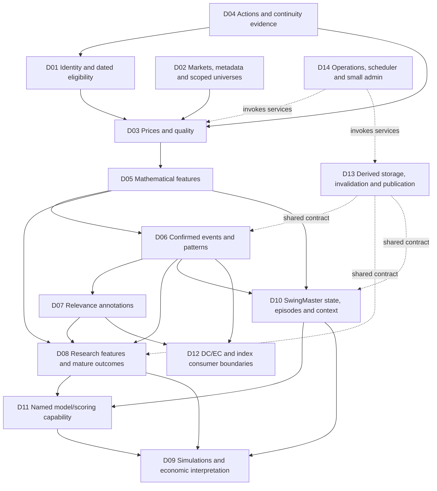

# RawCandle Next — Architecture Decisions 01: review package

2026-10-14. **DECISION PREPARATION ONLY. No implementation or new architecture approval.**

This package consolidates 103 recommendations into **14 decision areas**, D01–D14. [Decision matrix](architecture_decisions_01_matrix.csv) is the review index; [recommendation crosswalk](architecture_decisions_01_crosswalk.csv) accounts for every source ID exactly once as primary ownership. Secondary links express dependencies, not additional ownership. Original KEEP/REWRITE/REMOVE/OPEN classifications and all original `RECOMMENDATION_NOT_APPROVED` statuses remain unchanged in the source worksheets.

Evidence: [Audit 01](architecture_audit_01_ohlcv_identity.md) and [worksheet 01](keep_rewrite_remove_01.csv), [Audit 02](architecture_audit_02_technical_analysis.md) and [worksheet 02](keep_rewrite_remove_02.csv), [Audit 03](architecture_audit_03_research_consumers.md) and [worksheet 03](keep_rewrite_remove_03.csv), plus [Yahoo price-basis comparison](../yahoo_price_basis_comparison_20261014.md). Findings below are attributed to these inspections, not newly measured production facts. Current authority is the user's **Architecture Decisions 01 request, §§3–4**. Earlier audit wording does not override that request.

## 1. Executive summary

The common direction is already settled: renew the architecture, preserve production, reuse stable security identity, retain six Yahoo price fields with explicit consumer bases, separate source evidence from calculation eligibility, correct decision-time defects, retain compact Technical Relevance, selectively integrate useful SwingMaster capabilities, and expose plain services through a small administrative UI.

The remaining high-impact choices are **ownership and scope**, not whether to repeat those principles: who allocates shared identities; collection/universe and refresh policy; which detector/structure definitions are required; which research and simulation claims NG must support; the initial SwingMaster scope and continuity requirement; evidence needed before operational model scores; and derived storage/replay/retention boundaries.

**AUDIT RECOMMENDATION:** prefer a small set of headless Python services and shared mathematical primitives, confirmed events and compact relevance annotations, revision-aware derived publications, and consumer-owned domain projections. Preserve existing user/source/model evidence selectively. Avoid copying the SwingMaster repository or rebuilding legacy compatibility, UI and repeated run-history machinery merely because it exists. These are preferred directions for review, not approved implementations.

**OPEN DECISION:** identity location, consumer basis/definition choices, divergence score usefulness, confirmed Dow semantics, exact historical decision reconstruction, simulation economics, live episode continuation, fitted-model deployment and separate derived database ownership. They can be discussed in small coherent groups. Correctness contracts can be settled before all optional features are selected.

Status summary: **2 AGREED_PRINCIPLE, 7 READY_FOR_USER_DECISION, 3 NEEDS_TARGETED_EVIDENCE, 2 DEFER_TO_DETAILED_DESIGN.** A status belongs to the area’s next review action; it does not certify every subchoice in that area. In particular, AGREED_PRINCIPLE identifies an established broad requirement only. No technical alternative below is approved.

## 2. Consolidated architecture landscape



This is a conceptual dependency view, not a module/SQL/process specification. D13 also governs relevance, models and downstream publications; D14 operates all included services. Macro context in D10 has its own source-evidence contract; it does not imply another OHLCV collector. Research labels feed model development, not decision-time feature inputs. No microservices, HTTP API or generic DAG is assumed.

The provided D01–D14 structure is retained. D12's title adds **index consumer boundaries** to account for A01-30 without misclassifying legacy sector/industry indexes as DC/EC algorithms. Its assessment stays at ownership/input/output boundaries; no new index methodology review is undertaken. Mixed recommendations remain primary in the area owning their principal capability, with explicit secondary links; for example A03-40 belongs to SwingMaster integration scope while identity/model/evidence-storage choices are linked to D01/D11/D13.

## 3. Existing agreed requirements and authority

| Requirement group | AGREED USER REQUIREMENT — current request §4 | What it does not approve |
|---|---|---|
| U01 Renewal and baseline | Architectural renewal; production operational and unchanged during preparation; permanently `_ng` database filenames; technical derived rebuild from2018/new zero-day; no legacy-output equality requirement | A specific NG filename beyond suffix convention, table layout, source migration, initial universe or rebuild job |
| U02 Source representation | Yahoo auto_adjust=False; same-vintage Open/High/Low/Close/Adj Close/Volume; valid adjusted reconstruction possible | Universal ordinary-basis indicators, executable historical exchange-unit prices or lossless inversion of old adjusted-only data |
| U03 Basis and qualification | Explicit consumer basis; preserve source observations including invalid values where appropriate; calculation eligibility separate; action units/continuity/revisions explicit | Silent basis substitution, arbitrary imputation, guessed action correction or a complete source-vintage archive |
| U04 Identity and provider metadata | Reuse Fundamentals concepts/stable IDs where possible; retain permaticker; optional Sharadar AVAILABLE/NOT_FOUND/UNCERTAIN/NOT_CHECKED plus last check; coverage separate; ticker alone insufficient | Fundamentals physical storage as mandatory identity owner or Sharadar membership as collection gate |
| U05 Classification and evidence | External `data/osakedata.db.ticker_meta` remains current Yahoo Sector/Industry authority; complementary issuer CIK/SIC; dated history/listing/action evidence and uncertainty | A competing metadata master, verified historical sector history or treating first observed price as listing proof |
| U06 Technical meaning and clocks | Explicit mathematics; share genuinely matching primitives; preserve deliberate domain predicates; fix verified defects; event/confirmation/outcome maturity distinct; no silent gaps/security-history bridging | A replacement divergence algorithm, one universal Dow definition or retaining a bug for legacy parity |
| U07 Reliability and simplicity | Historical source modifications invalidate affected derived results; determinism, maintainability/restoration; avoid redundant state, elaborate version chains and unnecessary copies | Generic event sourcing/DAG, automatic full history deletion, exact replay from a truncated recursive warm-up or any migration procedure |
| U08 Technical Relevance | Core capability retained; ordinary event needs class, optional compact reason, availability and minimal accepted calculation/quality receipt; no large repeated run materialization; concise explanation/context projection allowed | Finally approved rules/classes, mandatory verbose traces or a required literal SQL field instead of a narrow extension |
| U09 SwingMaster | Selective useful-capability integration into RawCandle; retain valuable domain semantics and share identity/prices/features/jobs; no wholesale repository/infrastructure migration | All candidates in first release, fitted-model deployment, exact live-state continuation or financial-source migration |
| U10 UI and execution | Separate UI/services/calculations/database access; plain headless Python; initially small admin for jobs/status/coverage/quality/holds/reports; rich research UI later | Replicating legacy menus, five-tab admin suite, another scheduler, mandatory web API or microservice deployment |
| U11 Earnings events | REMOVE automatic earnings-blackout restriction mechanism; KEEP announcement dates as research events | Removing exchange closures, missing-session diagnosis, explicit user research exclusions or all corporate-action evidence |
| U12 Functionality preservation | Reuse working components when practical; preserve useful functionality without automatically preserving old code | Mechanical copying, retiring a real capability from its filename, or authorizing deletion of production history |

Authority categories remain distinct throughout: **AGREED USER REQUIREMENT** is the table above; **AUDIT RECOMMENDATION** is a proposed direction based on cited evidence; **OPEN DECISION** is unresolved. The CSV status vocabulary adds review timing, not a fourth source of authority. No source worksheet classification is rewritten to reflect newer authority; the conflict/supersession is explained explicitly below.

## 4. Decision areas

Each card gives A purpose, B evidence, C agreed requirements, D open questions, E alternatives, F recommendation, G consequences, H dependencies/timing and I proposed status. Source IDs list primary ownership; the crosswalk includes secondary relationships and the original classification. Alternatives address genuine unresolved choices only.

### D01. Security identity and historical eligibility

**A — Purpose.** Resolve one security across dated ticker routes and link its issuer/provider identities, including OHLCV instruments outside Fundamentals, without requiring financial coverage.

**B — Evidence.** Audit01 §§7–8 found reusable company/security/provider IDs, 2,354 price routes outside the canonical current-ticker set, and2,475 effectively undated aliases. The set comparison is not historical identity proof. Alias interval edges and review fingerprint handling differ across consumers. Audit03 §§6,10 confirms SwingMaster/current metadata cannot form another authority. **Primary IDs:** A01-15, A01-16, A01-17, A01-18, A01-21.

**C — Agreed.** U04–U05: preserve IDs/permaticker and issuer CIK/SIC semantics, optional four-state Sharadar metadata and independent history coverage, evidence-qualified dates; physical identity owner is explicitly OPEN.

**D — Open.** Which owner allocates IDs for all collection instruments and owns continuity review? How is price collection kept independent of financial-pipeline availability? Minimum evidence/hold authority is a policy choice; exact columns/alias interval encoding are detailed design.

**E — Alternatives.** (1) Extend the existing Fundamentals identity owner behind a narrow shared interface, isolating financial observation workflows. (2) A small neutral RawCandle identity owner preserves existing IDs and serves both domains. (3) That same single owner plus a validated local read projection for operational availability. A projection never allocates competing IDs.

**F — Recommendation.** Agree one general allocation/review authority and a narrow read boundary first. Prefer extending the existing owner if it can serve non-Fundamentals instruments independently; choose the neutral owner if existing generation/workflow coupling prevents that. Do not add a projection without an operational need. Evidence does not choose physical ownership by itself.

**G — Consequences.** Correctness: avoids ticker reuse/stitching. Simplicity: one allocator. Reliability: ownership/projection freshness must be clear. Reproducibility: dated uncertainty survives. Cost: small identity reads. Consumers: existing IDs stable where reusable. Integration: financial and general collection ownership must be reconciled.

**H — Dependencies/timing.** Review now with D02; identity semantics precede price/event keys and state mapping. Physical transfer mechanics, schema and broader historical enrichment can wait; unresolved individual identities may be held rather than guessed.

**I — Proposed status:** `READY_FOR_USER_DECISION`. User decision: allocation/review owner and acceptable operational coupling; no implementation approval.

### D02. Market metadata, universe and classifications

**A — Purpose.** Control what is collected and what is eligible for a named analysis without confusing current classification, research exclusions and source availability.

**B — Evidence.** Audit01 §§3,8 documents suffix/fallback market logic, externally maintained current ticker_meta, repeated per-bar labels and incomplete SIC/type/history coverage. Audit03 §4 shows current-roster/future-coverage research sampling. **Primary IDs:** A01-19, A01-20, A01-22, A01-24, A01-25.

**C — Agreed.** U04–U05,U11: current Yahoo Sector/Industry authority remains external ticker_meta; CIK/SIC are complementary issuer information; Sharadar optional; blackout restrictions removed while research events remain.

**D — Open.** First-release collection universe and market scope; external maintainer's read/refresh/freshness contract; whether any initial research question needs dated sector membership. User research exclusions stay scoped policy, not a collection/security-type gate.

**E — Alternatives.** (1) Explicit maintained collection roster, with current classification and separate research exclusions. (2) Source-observed candidates proposed for reviewed roster changes, with the same single authority and scoped policies. For sector history: current-only labeled views initially, or a bounded dated history for a demonstrated study; neither pretends current labels are historical.

**F — Recommendation.** Start with explicit collection membership and current classification reader; preserve reviewed user exclusions by identity/scope. Treat automatic candidate onboarding as optional. Add historical classifications only for a named need, retaining uncertainty. Exact external synchronization remains an evidence gap.

**G — Consequences.** Correctness: no current-metadata PIT claim. Simplicity: no per-bar label copies. Reliability: missing metadata explicit. Reproducibility: record cohort policy/date. Cost: small roster/read projection. Consumers: index/research readers change boundary. Integration: no competing classifier owner.

**H — Dependencies/timing.** D01 identity; D03 calendar/route/quality. Market/universe scope is a user preference now; enrichment and dated sector history need not block a qualified pilot.

**I — Proposed status:** `READY_FOR_USER_DECISION`. User decision: initial market/universe scope and historical-classification need.

### D03. OHLCV acquisition, storage and refresh

**A — Purpose.** Collect and inspect source observations reliably, recover missing sessions and refresh corrected history without losing usable stored data.

**B — Evidence.** Audit01 §§3,5,13 finds multiple writers, implicit adjusted-only storage, append missing interior revisions and optional nondefault Polygon adapter. The Yahoo comparison's Six-field and Point-in-time sections support information preservation but not universal basis or economic validity. Audit02 §§9–10 traces stale descendants. **Primary IDs:** A01-01, A01-02, A01-03, A01-04, A01-05, A01-06, A01-07, A01-08, A01-09, A01-10.

**C — Agreed.** U02–U03,U07: False OHLC+Adj Close+volume, explicit consumer basis, source preservation distinct from eligibility, explicit actions/identity/revisions and production isolation.

**D — Open.** Historical refresh policy/budget and optional second-source role. USA/Nordic calendars, currencies and action units need focused qualification; pacing/window sizes/DDL are design details. No alternative here discards the agreed six-field representation.

**E — Alternatives.** Refresh: small scheduled bounded overlap plus explicit targeted refresh/gap diagnosis, or explicit targeted refresh with coverage diagnosis and no routine overlap. Neither guarantees detecting all old provider revisions. Second source: Yahoo-only operational collection with unavailable/held results, or optional Polygon/Massive candidate diagnosis subject to source/basis reconciliation; automatic mixed replacement lacks supporting evidence.

**F — Recommendation.** One acquisition and validated atomic writer owner; distinct append/insert-gap/replace intents, source receipts and pending derived invalidation. Prefer bounded routine refresh plus targeted deeper diagnosis if operating cost permits; decide coverage expectations first. Keep optional second-source integration outside the critical first-release path until need/semantics are proven.

**G — Consequences.** Correctness: basis/quality never silently substituted. Simplicity: one writer. Reliability: validate before replacement, preserve good history on failure. Reproducibility: receipt identifies response/coverage, not complete PIT history. Cost: refresh budget explicit. Consumers: revised inputs trigger invalidation. Integration: Nordic qualification and external sources stay bounded.

**H — Dependencies/timing.** D01/D02 routing/roster, D04 units, D13 invalidation. Representation is settled; refresh/provider scope is reviewable now; calendar qualification precedes declaring a market supported. No collection or refetch is authorized here.

**I — Proposed status:** `READY_FOR_USER_DECISION`. User decision: refresh coverage/cost policy and optional-source scope.

### D04. Corporate actions and historical continuity

**A — Purpose.** Keep sourced splits/dividends/earnings/listing/terminal/rename/combination evidence and qualify historical comparability and price/share units.

**B — Evidence.** Audit01 §9 finds split flags do not certify quality, dividend amounts discarded by blackout persistence, sparse action/listing evidence and delete-before-fetch refresh. The Yahoo comparison documents NFE unit discontinuity despite usable-looking factors. **Primary IDs:** A01-11, A01-12, A01-13, A01-23.

**C — Agreed.** U03–U07,U11: explicit action/identity uncertainty; no silent history bridging; retain research dates and remove automatic earnings blackout. Good source history must not be deleted automatically to obtain replacements.

**D — Open.** Minimum action evidence and confidence for calculation eligibility; ordinary distributions versus special/action-unit boundaries; payment/entitlement depth if executable P&L is wanted. D01 allocates identities; this area owns continuity evidence, not another registry.

**E — Alternatives.** (1) Minimal sourced events sufficient for qualified technical segments and descriptive research, with explicit holds where economics is unknown. (2) The same base plus selected cash/share/entitlement evidence for a separately selected simulation contract. Complete corporate-action genealogy is not a demonstrated requirement.

**F — Recommendation.** Preserve sourced event observations and reviewed continuity; support bounded validated refresh, never delete-first. Use conservative holds at unsupported identity/unit boundaries. Obtain small targeted source-unit/continuity evidence before declaring those histories eligible; do not infer a replacement ratio from the price jump.

**G — Consequences.** Correctness: action semantics precede valid returns. Simplicity: small evidence records. Reliability: no destructive refresh coupling. Reproducibility: provenance/uncertainty retained. Cost: targeted review versus all-history action expansion. Consumers: explicit segment/reset holds. Integration: economic depth grows only with D09's need.

**H — Dependencies/timing.** D01 continuity authority; D03 representation; D09 economics determines deeper action requirements. Qualified ordinary cases need not await comprehensive historical listing/cash accounting.

**I — Proposed status:** `NEEDS_TARGETED_EVIDENCE`. User preference on economics can be made now; action-unit eligibility requires evidence.

### D05. Shared technical feature library

**A — Purpose.** Give genuinely shared SMA/EMA/RSI/ATR/MACD/returns/volatility/gap/range/volume features one explicit mathematical meaning per named definition.

**B — Evidence.** Audit02 §3 proves RSI no-loss error, flat/EMA seed disagreements, price-level versus return-volatility naming and two-pass feature overwrites. Audit03 §§3,5–6 shows those values reaching regression/simulation/DC. **Primary IDs:** A02-01, A02-02, A02-03, A02-04, A02-05, A02-27, A02-29, A03-16.

**C — Agreed.** U03,U06: explicit basis, seeds/units/warm-up/quality and causal cutoff; fix defects and share matching primitives without erasing purposeful differences.

**D — Open.** Exact flat/seed/partial-window/gap conventions and required named variants. These are contract design choices, not fourteen additional user-level architecture votes. Domain-specific model changes and consumer basis choices are escalated only where meaning changes.

**E — Alternatives.** (1) Small common pure kernels with explicit named parameter/quality conventions. (2) Those same shared kernels with narrow named bundles for established consumer definitions. Bundles simplify callers but may obscure differences if undocumented; duplicate unowned kernels are not a preferred alternative.

**F — Recommendation.** Common simple primitives plus thin explicit domain adapters. Remove conflicting last-writer feature meanings. Preserve feature definition/units/cutoff with publication; no generic plugin registry. Audit evidence supports this direction but does not select a universal ATR/RSI/model basis.

**G — Consequences.** Correctness: mathematical edge cases visible. Simplicity: one owner per definition. Reliability: consistent input qualification. Reproducibility: definition/basis/seed pinned. Cost: linear rolling passes, avoid repeated event-history work. Consumers: intentional variant changes explicit. Integration: fewer duplicated calculations, still distinct state predicates.

**H — Dependencies/timing.** D03–D04 source/basis/segments; D06/D10/D12 supply actual consumer semantics. Fundamental direction agreed; detailed definition selection can occur with small evidence-backed design proposals after capability scope.

**I — Proposed status:** `DEFER_TO_DETAILED_DESIGN`. No new user approval for each helper/column is presumed.

### D06. Confirmed technical events and patterns

**A — Purpose.** Detect selected divergences, pivots/Dow, candles and chart formations, with stable logical event identity and honest availability.

**B — Evidence.** Audit02 §§4–5,8 establishes V2's early event date, backdated composites, insufficient daily pattern history, distinct Dow/tie/reset rules and repainting chart markers. V1 strengths are dense candidate features, not confirmed pivot events. Audit03 §§5–6 traces consumption and confirms SwingMaster Dow has its own confirmation-aware semantics. **Primary IDs:** A02-06, A02-07, A02-10, A02-11, A02-12, A02-14, A02-15, A02-16, A02-17, A02-18, A02-19, A02-21.

**C — Agreed.** U06: actionable availability correct, retrospective association distinct, defects fixed under zero-day without legacy parity; pure working detectors may be reused.

**D — Open.** Continuous V1 score value versus sparse confirmed events; supported detector set; confirmed Dow semantics to expose to each domain; legacy detector/facade usefulness and external reachability. No replacement divergence algorithm is proposed.

**E — Alternatives.** Divergence: retain explicitly named continuous candidate strengths alongside corrected confirmed events, or confirmed-event capability only if no needed continuous use is established. Dow: one selected confirmed engine with domain projections after semantic comparison, or a common pivot primitive with explicitly named state/reset interpretations when differences are purposeful. Algorithm differences cannot be erased by renaming.

**F — Recommendation.** Confirmed event contract, separate research associations, sufficient context versus publication range, quality/identity segments and zero-event coverage. Retain continuous strengths provisionally only as named features pending usefulness evidence; do not treat positivity as event identity. Focused comparisons determine the remaining detector/structure scope.

**G — Consequences.** Correctness: no premature historical signals. Simplicity: sparse events plus shared features. Reliability: stale positives removed on replacement. Reproducibility: chosen anchors/parameters/times clear. Cost: selected persistent events, expensive scans bounded. Consumers: explicit conversion from legacy strengths/flags. Integration: Dow comparison needed before engine substitution.

**H — Dependencies/timing.** D01/D03–D05 define inputs; D07/D10/D12 depend on confirmed semantics. Event/availability separation can be settled now; score utility/Dow equivalence need targeted evidence, not a full strategy backtest. Optional legacy displays must not block initial qualified patterns.

**I — Proposed status:** `NEEDS_TARGETED_EVIDENCE`.

### D07. Technical Relevance

**A — Purpose.** Retain essential event-level relevance and concise explanations for daily support, research and DC/SwingMaster reporting.

**B — Evidence.** Audit02 §§3,6,12 left history depth OPEN. Audit03 §7 identifies actual class/reason/context/trace/run readers and scoped AA duplication:787 rows for22 logical events across177 runs. These measurements explain redundant persistence, not a universal duplication ratio. **Primary IDs:** A02-24, A02-25, A03-23, A03-24, A03-25, A03-26, A03-27, A03-28.

**C — Agreed.** U08 explicitly retains relevance and replaces large repeated operational materialization with event annotation, optional compact reason, correct availability and minimal accepted receipt. Classes/rules are separately reviewable; narrow one-to-one extension is allowed.

**D — Open.** Annotation publication ownership/timing, compact context projection and exceptional retained diagnostic/old-export needs. Current-context reassessment is a separate named requirement if ever needed, not an assumed second class/history stream.

**E — Alternatives.** For remaining storage attachment only: literal annotation on the event, or a narrow event-owned extension when independent publication requires it. Explanation: derive compact context on demand where inputs remain available, or retain a small explicit projection needed for routine reports. Repeated all-run projections are not an admissible default under the current requirement.

**F — Recommendation.** Preserve the classifier; ordinary accepted event annotation plus compact receipt, reason and quality status. Adapt reports/diagnostics to concise context and an explain operation. Do not make NOISE mean unavailable. Exact explanation of superseded historical inputs is possible only when the required evidence remains; retain justified artifacts rather than universal traces.

**G — Consequences.** Correctness: classify using available context; later evidence cannot become earlier knowledge. Simplicity: one logical annotation. Reliability: accepted/failed publication clear. Reproducibility: small receipt plus specifically retained evidence. Cost: eliminate overlapping routine copies. Consumers: report context/run selection adapters needed. Integration: one relevance capability across domains.

**H — Dependencies/timing.** D06 truthful availability; D13 source receipt/publication; D10/D12 compact context. Broad direction needs no new vote. Attachment layout and retention details can wait; specific exact-old-export claims need evidence, not reversal of the agreed simplification.

**I — Proposed status:** `AGREED_PRINCIPLE` **only for U08**. No rules, schema, retention interval or publication implementation approved.

### D08. Research features, outcomes and statistical studies

**A — Purpose.** Preserve useful event/control/cohort studies, regression diagnostics, matched/publication/PE studies and exports, with separate decision-time features and mature future outcomes.

**B — Evidence.** Audit02 §§3,10 and Audit03 §§2–4,9 show global-max omissions, t+20 gate, missing-outcome success0, random row splits, correlated windows, current-roster/metadata selection and optional outcome-bounded exports. Forward labels themselves are legitimate. Default regression does not simply use t5/t20 as predictors. **Primary IDs:** A01-14, A02-20, A02-22, A02-30, A03-01, A03-02, A03-03, A03-05, A03-06, A03-07, A03-08, A03-09, A03-11, A03-12, A03-13.

**C — Agreed.** U06–U07,U11–U12: honest availability/maturity, rebuild permitted, useful research retained, no automatic earnings-blackout restrictions. Exchange-session gaps and explicit research policies remain separate.

**D — Open.** First required studies, descriptive revised-history versus claimed historical decision/OOS research, historical universe evidence, selected cohort/model artifact retention and export provenance depth.

**E — Alternatives.** (1) Initially explicit descriptive research artifacts with mature labels, disclosed current/revised input limits and named cohorts. (2) Additionally support named decision-time/OOS studies with evidence-qualified universe, chronological/group/outcome-window separation and retained inputs as required. These modes can coexist, but the second claim requires stronger evidence; neither needs a new generic regression framework now.

**F — Recommendation.** Separate events/features from horizon-specific outcomes and pending/invalid/mature coverage; regenerate missing/stale logical outputs instead of advancing only a global maximum. Preserve standalone bounded studies and diagnostic value; add neutral sample/filter/seed/definition/source receipts. Do not port outcome-conditioned exports as unqualified training samples or impose automatic blackout exclusions.

**G — Consequences.** Correctness: missing label≠failure and no future predictor confusion. Simplicity: shared features, research-specific artifacts. Reliability: maturity/revision coverage explicit. Reproducibility: named cohorts/filters retained. Cost: shared sequential label passes. Consumers: wide exports remain projections. Integration: stronger OOS/PIT claims add evidence effort only where selected.

**H — Dependencies/timing.** D01–D06,D13; D11 only for model deployment. Decide intended research claims and first study scope now; advanced toolkit UI, complete historical sectors and exhaustive old-run recreation should not block basic event research.

**I — Proposed status:** `READY_FOR_USER_DECISION`.

### D09. Simulations and trading economics

**A — Purpose.** Keep useful hypothetical transaction/simulation research with explicit signal availability, execution timing and economic interpretation.

**B — Evidence.** Audit03 §5: RawCandle next-open orders after close signals, moving-reference close exits, no complete cash/action/cost model; strengths read as events; batch results are independent per ticker and omit successful nontraders. SwingMaster adds episode-driven one-share/close-price transaction research and portfolio-series analyses. The Yahoo comparison rejects adjusted-level ratios as certified executable P&L. **Primary IDs:** A03-14, A03-15, A03-17, A03-18, A03-37.

**C — Agreed.** U03,U06,U12: explicit price basis and knowability; useful behavior may survive without old code. No simulation redesign or profitability claim is authorized.

**D — Open.** Descriptive signal/outcome research, hypothetical fill modeling, or cash/share/action/cost accounting? Which existing strategy/report behaviors are actually needed first?

**E — Alternatives.** (1) Descriptive outcome and explicit hypothetical next-bar/close-price studies, labeled with their limitations. (2) A selected execution/economics model including actions/quantities, commissions/slippage and fill assumptions with required historical evidence. “Realistic” is not established merely by adding a fee parameter; exact fills remain assumptions.

**F — Recommendation.** Preserve signal studies and named simulation rules as research consumers; defer executable-P&L claims until the economics and evidence scope is chosen. Use confirmed events, shared primitives and action-qualified price units; retain nontraders/errors/selection counts in cohort summaries. No need for two general simulation infrastructures.

**G — Consequences.** Correctness: detection, availability, fill and maturity separated. Simplicity: descriptive mode small. Reliability: input holds explicit. Reproducibility: fixed inputs/settings/selection receipt. Cost: full economics adds state/data needs. Consumers: legacy profit summaries relabeled. Integration: strategy semantics survive through common interfaces.

**H — Dependencies/timing.** D03–D06; D04 economic depth; D10–D11 only for selected state/model strategies. User can choose economic scope now; implementation and graphical simulation UI can follow later. This need not block source/event/relevance administration.

**I — Proposed status:** `READY_FOR_USER_DECISION`.

### D10. SwingMaster state and episode integration

**A — Purpose.** Select useful six-state lifecycle, guardrails, decline/stabilization/entry facts, episodes, market regime/macro context and cross-domain snapshot capabilities from the separate repository.

**B — Evidence.** Audit03 §6, **SwingMaster Repository — Selective Integration Assessment**, documents actual v2/v3 delegation, live v1 internals, graph/age/history precedence, distinct Dow, episode outcomes and market/macro definitions. Default price reading already uses RawCandle. Current SwingMaster UI is a financial-pipeline browser, not an established technical state workbench. **Primary IDs:** A03-29, A03-30, A03-31, A03-32, A03-35, A03-36, A03-38, A03-40.

**C — Agreed.** U09,U12: selective integration, valuable domain semantics retained and common identity/prices/features/jobs, never wholesale copy. Models, live continuation and financial-source migration remain OPEN. `/home/kalle/projects/swingmaster` stays a separate read-only source during this phase.

**D — Open.** First integrated capabilities and whether NG replay suffices or an exact live episode must continue. How much market/macro/source evidence is genuinely needed? State age/history, confirmation and recurrence semantics must be preserved before reuse choices.

**E — Alternatives.** Scope: six-state lifecycle/facts and compact state report first, or those plus episode research and selected market/macro context. Continuity: deterministic replay into the new baseline from a documented initial state/warm-up, or a small validated accepted boundary-state import for an explicit exact-continuation need. Replay does not promise equality after corrected definitions.

**F — Recommendation.** Prioritize lifecycle/guardrails and unique predicates as a selected capability, adapting common services rather than its infrastructure. Retain useful tests/definitions and sources in place. Add episodes/regimes/context when requested; keep existing market-state rules provisionally, no threshold redesign. Prefer replay unless exact continuation has demonstrated business need; financial evidence remains an owning-domain assessment, not disposable derived state.

**G — Consequences.** Correctness: preserve observable policy+guardrails, not proposal alone. Simplicity: one source/job layer. Reliability: explicit warm-up/initial state. Reproducibility: episode outcomes remain future research. Cost: state history and macro depth selected. Consumers: snapshot context retained. Integration: adapters/state tests versus repository migration.

**H — Dependencies/timing.** D01/D05/D06 for facts and structure, D07 context, D13 replay/publication. Decide capability scope/continuity preference now; confirmed Dow comparison and macro release evidence gate their uses. Not every SwingMaster candidate must block first NG functionality.

**I — Proposed status:** `READY_FOR_USER_DECISION`.

### D11. SwingMaster statistical models and scoring

**A — Purpose.** Preserve selected EW fastpass/rolling and episode-exit/dual scoring research while deciding which, if any, are operational predictions.

**B — Evidence.** Audit03 §§6,9: current episode dual scores use exit features, train on a default2020–21 band and score all episodes; EW attachment lacks model/feature availability bound. Training-period scores can be in-sample. Model files/manifests are evidence, not reproducible solely from new zero-day prices. **Primary IDs:** A03-33, A03-34.

**C — Agreed.** U06,U09: selected useful scoring is a candidate, deployment/artifact scope OPEN, exit-time features cannot be entry-time predictors, no research training in this task.

**D — Open.** Required named models/markets, actual feature and trained-artifact availability, label maturity, out-of-sample evidence and artifact/source preservation requirements.

**E — Alternatives.** (1) Preserve models/manifests and research/inference evidence in place, expose no operational score initially. (2) Select a specifically qualified named inference model with cutoff/input/model receipts and limited operational use after evidence review. Refit/recalibrate after zero-day definition changes would be a separately authorized research decision, not automatic migration.

**F — Recommendation.** Keep research capability and unique artifacts; withhold actionable historical interpretation until feature/model availability and evaluation evidence qualify it. Exit-time inference must stay exit-time. Avoid new classifier design or retraining as part of consolidation.

**G — Consequences.** Correctness: no entry-time future-score substitution. Simplicity: optional model boundary. Reliability: unavailable/incompatible artifacts explicit. Reproducibility: training cohort/definition/model receipt needed. Cost: optional dependencies isolated. Consumers: score-driven reports/trades gated. Integration: zero-day definitions may invalidate fitted-model applicability.

**H — Dependencies/timing.** D05/D08/D10 and D13; D09 if scores drive simulations. Named model evidence can follow first source/event/state capability. It must precede any claim of actionable historical predictions.

**I — Proposed status:** `NEEDS_TARGETED_EVIDENCE`.

### D12. Downstream DC/EC and index contracts

**A — Purpose.** Preserve DC/EC and useful index-domain outputs through correct shared technical inputs without redesigning taxonomy, weighting, synthetic methodology or trading states.

**B — Evidence.** Audit02 §§5,10 and Audit03 §6: DC Dow filters confirmation; divergence r3 uses stored date; EC copies DC fields/receipts; relevance companion misses confirmation filtering; metadata/index helpers can write current labels. A01-30 old index redundancy remains unproven. **Primary IDs:** A01-30, A03-19, A03-20, A03-21, A03-22.

**C — Agreed.** U03,U05–U07,U09: explicit shared prices/features/events/availability, domain semantics retained, external classification authority intact and revisions propagated.

**D — Open.** Direct shared feature consumption versus accepted DC projection for EC, exact context/quality fields and definition selection; old index data usefulness/retirement evidence. These are consuming-domain design questions, not permission to redesign their models.

**E — Alternatives.** (1) EC keeps a narrow accepted DC projection with source/definition receipts and invalidation. (2) DC and EC read matching shared technical inputs directly while retaining distinct domain projections. The first minimizes domain changes; the second removes duplicated technical copies only if ownership/workload justify it.

**F — Recommendation.** Keep current domain ownership initially; adapt confirmed as-of input and revision contracts, preserving NULL/hold meaning and relevance context. Decide copying versus direct reads from measured real need at detailed design. Do not migrate or remove old index history just from its filename.

**G — Consequences.** Correctness: confirmation gates and matching definitions. Simplicity: one technical source of truth. Reliability: accepted projections/invalidation explicit. Reproducibility: domain/source receipts retained. Cost: reads versus copies depends on workload. Consumers: bounded adapters. Integration: no taxonomy/synthetic-method rewrite.

**H — Dependencies/timing.** D02,D05–D07,D13. Contract meaning can be reviewed now; projection layout and obsolete-index confirmation can wait. Full DC/EC migration need not block qualified source/event/relevance pilot operation.

**I — Proposed status:** `DEFER_TO_DETAILED_DESIGN`.

### D13. Derived storage, invalidation and rebuilding

**A — Purpose.** Keep efficient useful derived outputs rebuildable, detect source/definition changes and publish accepted results atomically without excessive history/state machinery.

**B — Evidence.** Audit01 §13; Audit02 §§6–7,10,12; Audit03 §§3,7–8: date/run existence misses revisions, recursive bounded reseeding differs, delete-before-save can leave holes, repeated features/run projections dominate storage, and current inputs cannot reconstruct erased vintages. **Primary IDs:** A01-31, A02-08, A02-09, A02-13, A02-23, A02-26, A03-04, A03-10, A03-41.

**C — Agreed.** U01,U07–U08: `_ng` naming if new databases chosen, zero-day derived rebuild allowed, invalidation mandatory, compact relevance/no elaborate histories, determinism and restoration priorities.

**D — Open.** Separate `analysis_ng.db` versus co-location/minimal artifact persistence; exact replay versus accepted checkpoints; current recomputation versus specifically retained decision evidence; daily feature cache needs. Broad source-source ownership and consumer receipt semantics can be agreed before DDL.

**E — Alternatives.** Storage: separate compact derived SQLite database, co-located compact derived tables, or minimal operational state with explicit research artifacts/on-demand features. All must support accepted coverage and invalidation. Recurrence: deterministic segment replay, or valid checkpoints plus replay after invalidation; arbitrary finite RSI reseed is not an exact-equality option. Retention: compact current recomputation plus selected decision/source artifacts, or bounded additional historical evidence for explicitly required studies.

**F — Recommendation.** Prefer a separate compact derived SQLite boundary if independent rebuild/restoration and source-writer isolation are valuable; keep this conditional on operating ownership/read cost, not legacy filename/size. Use simple source-change ranges, named consumer influence/reset rules and accepted partition receipts; no generic DAG/event-sourcing framework. Replay first where affordable; introduce checkpoints/caches for demonstrated repeated cost and invalidate them explicitly. Source success remains independent of derived failure.

**G — Consequences.** Correctness: corrected values invalidate stateful tails/labels/projections. Simplicity: small current state+receipts. Reliability: compute then atomic publish; cross-database acceptance coordinated, not assumed globally atomic. Reproducibility: retained evidence bounds exact old replay. Cost: cache/checkpoint versus recompute trade-off. Consumers: explicit accepted generation/coverage. Integration: common status contract, domain writers still own their outputs.

**H — Dependencies/timing.** D01,D03–D08,D10/D12 for actual data influence and evidence needs. Review storage/retention scope now; checkpoint frequency/schema/indexes/partition mechanics wait. Physical database choice must precede implementation but need not block semantic decisions.

**I — Proposed status:** `READY_FOR_USER_DECISION`.

### D14. Operations, scheduler and initial admin UI

**A — Purpose.** Control the included collection/calculation services safely, inspect coverage/quality/holds/events/reports and recover failures through one small operational surface.

**B — Evidence.** Audit01 §§4–5, Audit02 §2 and Audit03 §§2,6,8 find manufactured UI objects in headless jobs, UI writers/selection logic, useful locks/receipts and duplicate SwingMaster infrastructure. Legacy UI includes stubs/unbound handlers as well as real valuable research features. **Primary IDs:** A01-26, A01-27, A01-28, A01-29, A02-28, A03-39, A03-42.

**C — Agreed.** U07,U09–U10,U12: strict separation, plain services, one shared scheduler/locking infrastructure and small initial admin; rich graphical research independent later; no mandatory web API/microservices.

**D — Open.** Which retained job/review actions belong to the first scope, who may approve identity/refresh holds, and what report/coverage receipts operators need. Physical purge and broad financial/taxonomy editors are not implied.

**E — Alternatives.** The interface principle is settled. Remaining operational composition: one small coordinator invokes explicit independently usable services, or the same scheduler invokes individual service jobs with small dependency/status rules. Both expose one common lock/receipt/coverage surface. UI toolkit and optional remote API can wait for an actual need.

**F — Recommendation.** Reuse useful lock/status ideas, replace UI-object construction and hidden cross-domain writes, and expose source/derived success separately. Include plan/run/skip/status/coverage/holds/compact inspector/explain/receipts; defer charts, training and rich simulation. Retire redundant UI/infrastructure implementations only after preserving selected capability and confirming external reachability.

**G — Consequences.** Correctness: job intent/selection visible. Simplicity: small UI and plain Python. Reliability: cooperating writers share locks, failures resumable. Reproducibility: accepted receipts accessible. Cost: no extra deployment stack. Consumers: CLI/UI use same services. Integration: no second SwingMaster admin/scheduler stack.

**H — Dependencies/timing.** D01–D13 define included actions and receipts; broad separation needs no new vote. First scope/admin powers can be reviewed alongside D02/D10. Toolkit, transport and exact job configuration are detailed design.

**I — Proposed status:** `AGREED_PRINCIPLE` **only for U10 and shared operational direction**. No UI implementation, schedule or job configuration approved.

## 5. Verified cross-audit dependencies

- **Identity → source → technical:** Audit01 §§7–9 establishes identity/units/eligibility limits; Audit02 §§3–5 shows seed/window/pivot calculations need those segments; Audit03 §§3,6 shows downstream availability predicates cannot repair wrong upstream dates.
- **Source changes → every derived consumer:** A01-31, A02-09/13/18/26 and A03-03/20/22/41 cover overlapping stages. D13 owns the shared invalidation/publication decision; D03 reports actual source change, D06 replaces stale events, D08 rematures labels and D10–D12 refresh their own outputs. A successful fetch or latest date is not successful downstream publication.
- **Events → relevance → reports:** A02-07/11/24 and A03-23–28 require component availability and compact context. D06 owns event truth, D07 owns annotation meaning and D12 owns report adapters. Historical association can be retained without becoming actionable.
- **State/episode → research/model → execution:** A03-29–37 distinguishes confirmed facts, policy+guardrails, episode outcome maturity, exit features and score availability. D10 capability scope does not automatically deploy D11 models or approve D09 fills.
- **Research evidence ≠ operational state:** A02-22/25 and A03-02/07/12/13/27/40 distinguish mutable recomputation from retained cohorts/source/model evidence. D08 and D11 state reproducibility claims; D13 chooses justified retention. U08 prevents rebuilding all repeated relevance-run storage to solve an unspecified evidence need.

These are verified implementation dependencies or audit-established contract requirements, not proof of affected trade counts, performance, economic validity or complete historical coverage. Domain taxonomy/synthetic methods, state rules, independent research studies and later graphical presentation can remain independent behind the shared boundaries.

## 6. Significant contradictions and trade-offs

| Conflict | Accurate competing positions / type | Resolution recommendation or OPEN; owning areas |
|---|---|---|
| C01 Fundamentals IDs versus neutral shared owner | A01-15 KEEP existing identity model; A01 §13 leaves allocation/storage OPEN; user §4.3 explicitly leaves physical owner OPEN | **Ownership, not semantic conflict.** Preserve reusable IDs and one allocator; choose existing or neutral owner based on operational independence. Do not declare Fundamentals mandatory physical authority. D01 |
| C02 Global kernel versus domain-specific predicates | A02-01/02 KEEP common primitives; A03-30 REWRITE adapters while preserving unique predicates | **Terminology/ownership.** Share matching mathematics, retain named state/screen definitions. MA windows including t0 versus t−1 are a real model difference; do not collapse them silently. D05/D10 |
| C03 Ordinary OHLC versus adjusted indicators | A01-06 favors False+Adj Close representation; A02 §9 allows adjusted trend/oscillator use; Yahoo comparison finds meaningful basis sensitivity | **False universal-choice conflict.** Representation settled, per-consumer basis OPEN. Neither current basis certifies exchange-original/PIT prices. D03/D05/D09 |
| C04 Sparse events versus continuous strengths | A02-06 OPEN V1 usefulness; A02-08 REWRITE dense persistence; A03-15 rejects strength>0 as actionable event | **Real capability trade-off.** Continuous feature can coexist with sparse events under separate meanings; determine usefulness before removing it. A03 simulation defect does not prove continuous research value is absent. D06/D13 |
| C05 One relevance annotation versus detailed report context | A03-24 compact annotation; A03-26 actual context/diagnostic readers; current U08 requires simple ordinary persistence | **Output versus explanation distinction.** Keep compact context/explain adapter where justified; no routine full trace/run copies. Exact old explanation conditional on retained inputs. D07/D12 |
| C06 Full historical reproducibility versus simple replacement | A02-25 historical granularity OPEN; A03-27/40 preserve evidence; U07 avoids elaborate chains | **Real evidence/cost trade-off.** Recomputed-history determinism and exact past knowledge are different promises. Choose specific retained artifacts/source evidence; a receipt/hash cannot recover erased inputs. Universal exact replay remains OPEN and must not silently mandate version chains. D08/D11/D13 |
| C07 Small database versus daily caches | A02-08/23 prefer compactness; A02 §12 and A03 §8 allow persistent frequently read features | **Workload trade-off.** Compact accepted events plus selected revision-aware caches may be simpler/faster than repeated full scans. No measured runtime case establishes cache granularity; defer details. D05/D13 |
| C08 State replay versus live episode continuation | A03-29 preserves lifecycle; A03-40 leaves boundary-state import OPEN; zero-day permits changed results | **Real business requirement.** Prefer replay; exact live continuation requires a narrowly validated accepted state/attrs/import evidence. It does not require importing all derived history. D10/D13 |
| C09 Research scores versus historical actionable predictions | A03-33 REWRITE inference; A03-34 deployment OPEN; exit features/training scores can reach earlier EW attachment | **Real correctness conflict.** Preserve research/models, gate operational interpretation on actual feature/model availability and evaluation evidence. No exit-feature-to-entry projection. D11/D09 |
| C10 UI retirement versus useful functionality | A01-29 REMOVE stubs; A02-19 facade OPEN; A03-42 REWRITE admin/later research UI | **Implementation versus capability.** Retire duplicate/unbound presentation after reachability review; preserve selected functions and later UI access. Old filename/menu age proves neither value nor obsolescence. D14/D08/D10 |
| C11 Earlier relevance alternatives versus current requirement | A02-25 OPEN, Audit02 §12 offers justified all-run history as one option; A03-25 REMOVE repeated NG mechanism; current user §4.5 explicitly rules it out as ordinary model | **Authority constraint, not an approved audit conversion.** Original OPEN/REMOVE rows preserved in crosswalk; current U08 determines ordinary NG direction. Retain only specifically justified evidence in old artifacts or bounded exceptions. D07/D13 |
| C12 Compatibility/equality checks versus zero-day | Yahoo comparison Migration section discusses legacy-basis equivalence/cutover compatibility; audits/current U01 say rebuilt technical outputs need not match | **Different scenario/authority.** Legacy live basis-change precautions do not require NG legacy parity. Keep production isolated and preserve information/definitions; test mathematical correctness and declared incremental semantics, not erroneous legacy output equality. D03/D05/D13 |
| C13 Two confirmation-aware Dow engines | A02-12 KEEP RawCandle kernel; A03-31 OPEN SM engine choice; both can confirm pivots but reset/tolerance/state rules differ | **Real algorithm difference.** Common confirmation alone is not equivalence. Focused semantic comparison before one-engine decision; no algorithm replacement invented here. D06/D10 |

**Targeted evidence clarification:** Audit03 §2 lists the Analysis Dashboard route and its `_run_analysis` handler; Audit02-19 explicitly found no action-button binding. A read of [analysis/view.py](../../analysis/view.py#L374), lines374–390, confirms the action row contains only filtered deletion. Treat the analysis handler as callable, not proof of a live Run control. This resolves an apparent reachability wording difference without declaring its detector functions obsolete. No application was run.

The user-approved earnings-blackout removal also supersedes any legacy automatic exclusion behavior in A01-14/A02-30/A03-11. Those three remain separate source IDs with primary D08 ownership. Explicit research exclusions, earnings dates and market calendars are separate capabilities, so there is no mandate to remove them.

## 7. Targeted evidence needed, without expanding this task

| Evidence question | Bounded follow-up recommendation | Decision it informs / can it wait? |
|---|---|---|
| Identity owner independence | Inspect allocator/generation coupling and non-Fundamentals allocation paths; clarify actual review owner and external classification maintainer contract | D01/D02; owner and basic interface needed early, comprehensive historical metadata can wait |
| Market/action qualification | Selected Nordic session/currency/volume/Adj Close and sourced unit/identity cases; establish meaningful quality holds | D03/D04; required before a market/history is declared eligible, not a reason to invent data |
| Divergence feature utility and Dow differences | Compare named anchor/tie/confirmation/reset contracts and known consumer uses; bounded prefix/semantic fixtures later if authorized | D06/D10; optional continuous scores/legacy displays can wait, actionable timing cannot |
| Recurrence and repeated-read cost | Representative bounded workload estimates for exact replay versus checkpoint/cache, including revision invalidation cost | D13; cache granularity can wait, exact/approximate semantics must be explicit |
| Research reproducibility claim | Choose descriptive/revised-history studies versus named historical/OOS studies; identify actual retained universe/source/cohort evidence | D08/D13; optional stronger claims must not block honest basic studies |
| Model readiness | Named model/market feature timestamps, training cutoff/outcome maturity and artifact/input evidence; no full retraining implied | D11; can wait, gates operational model interpretation |
| Live continuity and unique evidence | Ask whether exact current episode continuation matters; identify minimal accepted state/user/source/model evidence if it does | D10/D11/D13; replay-based pilot can proceed after separately approved scope |
| Exact previous-run export need | Identify actual compliance/research/diagnostic need for old exports and compact context, not hypothetical universal trace retention | D07/D13; ordinary annotation direction already settled |
| Obsolete adapters/index data | Confirm external callers and actual old-index relationship before later deletion/retirement | D06/D12/D14; no production deletion now, should not block common contracts |

These are **recommendations for later focused evidence**, not jobs authorized by this package. No old database measurement or existing synthetic test was rerun, no provider research was performed, and no new calculation was needed to consolidate the audits.

## 8. Recommended decision sequence

Discuss a few related questions per conversation; do not request blanket approval of all14 areas.

| Review group | Main user-level question | Can settle now / what follows |
|---|---|---|
| 1 — D01/D02 | Who owns general security allocation/review, and which markets/universe belong initially? | Principles/authority already agreed. Physical owner/universe are user choices; external maintainer detail may need focused evidence. These choices clarify D03 without dictating SQL |
| 2 — D03/D04 | What source refresh/coverage promise and minimum action qualification are required? | Six-field representation/explicit basis fixed. Choose budget/provider scope now; hold unsupported histories and qualify markets/actions with evidence |
| 3 — D05/D06/D07 | Which technical capabilities and domain definitions are needed under confirmed availability? | Shared explicit mathematics and compact relevance settled. Detector/continuous-score/Dow choices need focused evidence; exact kernels/annotation attachment remain detailed design |
| 4 — D08/D09 | What research claims and simulation economics must NG initially support? | User preference on descriptive versus stronger historical/OOS/execution claims sets evidence needs; rich graphical tooling can wait |
| 5 — D10/D11 | Which state/episode/regime/context functions belong first, and is exact continuity/model deployment required? | Select useful scope and continuity now. Preserve state semantics; model qualification or optional macro depth can wait and need not block basic state support |
| 6 — D12/D13/D14 | Which projections, derived-store boundary, accepted evidence and operator actions support that selected scope? | Adopt simple shared publication/invalidation/service principles without a generic framework. User chooses storage/retention scope; adapter fields/checkpoints/UI toolkit wait for detailed design |

This is a **decision conversation sequence**, not a development/cutover plan. D13's invalidation and D14's service separation principles apply from the first discussion; their physical details should not be chosen before actual scope is known. D10 capability priority can be raised earlier if state support is the user's first objective. No ordering requires all predictive models, every market or a complete graphical interface before a useful NG version.

## 9. Proposed minimum NG functional scope

**AUDIT RECOMMENDATION — unapproved scope candidate:** an operationally useful source-and-technical baseline for an explicitly selected qualified universe/market, containing shared stable identity/routes and current classification reads; six-field source collection/inspection and bounded validated refresh/gap diagnosis; explicit quality/identity/action holds; a selected set of shared features and confirmed pattern/divergence/structure events; compact relevance with explain/context; source-change invalidation, accepted coverage/receipts and simple restoration; and plain CLI/service plus lightweight admin operations. Exactly which detector/Dow definitions and bases qualify those words remains D05/D06, not hidden approval.

Keep a minimal headless research export separating features and horizon-mature outcomes if useful for verification; advanced statistical toolkit and graphical research UI can follow. REMOVE automatic earnings-blackout restrictions from the new baseline, retaining announcement research dates.

**SwingMaster scope choice:** if lifecycle is a first-release business priority, add its selected six-state/guardrail/fact capability and compact report using the same common boundaries once D06's relevant Dow contract is qualified. Otherwise keep it as the next selective integration, with definitions/tests/evidence preserved in its existing repository. Episode studies, market/macro depth, scoring and exact live-state continuation are separate scope choices; selectively integrating later is consistent with U09, not abandoning it.

**Should not block a qualified first version:** Polygon/Massive integration, complete historical sector/listing coverage for the entire market, old-index migration, full historical run exports, verbose traces, predictive-model deployment/retraining, full cash/share simulation economics, comprehensive financial-source migration, rich chart/research UI, optional web API and speculative generalized workflow infrastructure. A deferred requirement gates any claim depending on it: e.g. no historical-universe or executable-P&L claim without its evidence.

Production remains isolated. Derived baseline may rebuild from2018 but each security/feature needs its real eligible start and warm-up/initial state; the date alone grants no validity. This scope authorizes no databases/modules/jobs/migrations or production cutover.

## 10. Unresolved risks and interpretation limits

- Audits verified defects/reader paths, not real executed trade impacts, affected-frequency counts, profitability or runtime forecasts. Synthetic confirmation tests isolate chronology; they do not prove a strategy edge.
- Current Yahoo history can be revised and split-adjusted on either representation. Same-vintage six fields preserve alternatives, not original exchange units, every action entitlement or certified PIT data.
- Existing IDs are useful but undated routes and partial action evidence constrain historical eligibility. SIC/CIK are issuer metadata, not a universal security key. Optional provider coverage must remain separate from collection eligibility.
- A compact receipt/definition hash alone cannot reproduce superseded source values or fitted-model training data. Evidence retention is a concrete requirement decision; do not promise exact historical knowledge from current replacement state.
- Shared primitives and one scheduler do not imply one formula/state machine/database writer for all domains. Domain outputs need explicit owners and accepted revision propagation; separate databases do not provide automatic cross-database atomicity.
- Source fixes must reach stateful recursive tails, events that cease matching, delayed labels, relevance and copied domain outputs. Date-max freshness or an existing run ID cannot certify that.
- Physical purge, wholesale SwingMaster migration, financial-source deletion, mandatory parity, complete historical metadata and new infrastructure are not authorized by broad reuse/rebuild principles.

## 11. Validation and no-new-approval statement

**No architecture decisions were newly approved.** The current request supplies agreed requirements U01–U12; audit classifications remain proposals. The matrix uses only `AGREED_PRINCIPLE`, `READY_FOR_USER_DECISION`, `NEEDS_TARGETED_EVIDENCE`, `DEFER_TO_DETAILED_DESIGN`. No status or preferred direction approves a SQL schema, algorithm, ownership transfer, schedule, source correction or implementation task. All103 input rows remain `RECOMMENDATION_NOT_APPROVED` in their unchanged worksheets.

Lightweight checks validate31/30/42 source counts,103 unique preserved classifications, one primary owner each,14 matrix/cards, complete A–I evidence/recommendation/dependency coverage, allowed statuses, local references, explicit relevance/SwingMaster authority, and unchanged input/unrelated tracked files. Exact commands:

```bash
python3 -S /tmp/rawcandle_decisions01_prepare.py
python3 -S /tmp/rawcandle_decisions01_write_csv.py
python3 -S /tmp/rawcandle_decisions01_validate.py
git diff --check -- docs/rawcandle_ng
git diff --name-only
git status --short
```

Preparation/readers use only standard-library file/CSV/JSON operations. Baseline hashes record all seven input documents plus the pre-existing modified Fundamentals publication journal; validation checks they are unchanged. The crosswalk preserves the original classification, records audit number and primary/secondary area rationale, and never upgrades a source row. Review headings/links point to retained audit evidence. No package imports, database queries, application tests or new synthetic tests were executed. One targeted `sed -n '374,391p' analysis/view.py` resolved the handler-binding wording issue in section6.

**Validation result:** PASS — 14 decision areas; 31/31 + 30/30 + 42/42 = 103/103 unique primary mappings; original classifications preserved; complete A–I cards; allowed statuses; local references and input/unrelated tracked-file hashes verified.

## 12. Production safety and handoff

**Production changes initiated by this task: ZERO.** No application/SwingMaster/Fundamentals/Forecast source, production databases, scheduler configuration, provider data, histories or models were modified. No NG database, DDL/migration, database copy/backup, provider request, scheduler job, recalculation, training or backtest was created/run. SwingMaster code was not copied, moved or edited. Earlier audits/evidence remain intact; no final architecture specification or master implementation plan is created.

Only this review and its two companion CSV files are new repository deliverables. Temporary standard-library preparation/validation scripts, small mapping JSON and hashes under `/tmp` are task-local aids. Unrelated journal/generation, repair/report/output and PE plotting work is preserved. The zero statement concerns actions of this task, not a guarantee that independent live processes cannot change files.

**Commit: NOT COMMITTED. Push: NOT PUSHED. TEE COMMIT — REVIEW ONLY, NO COMMIT.** Begin subsequent review with D01/D02 or another small user-selected capability group; this package requests no blanket decision.
