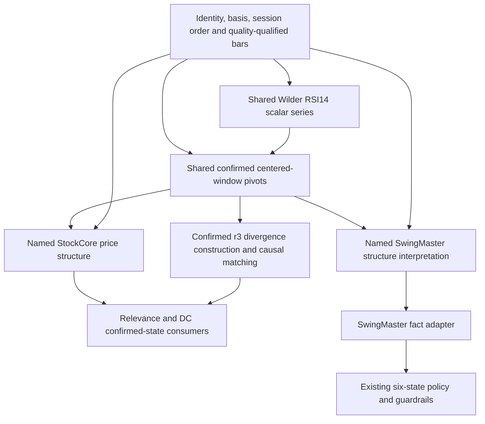

# StockCore — D06: confirmed Dow structure and shared pivot research

2026-10-15, Europe/Helsinki. **RESEARCH / DECISION PREPARATION ONLY.** RawCandle inspected HEAD `008bb0e8fa5d6076c21df79e2bb4204a051d35d1`; SwingMaster HEAD `0a62a6db590677f0043f753e874d097790deb3ab`. RawCandle paths below are relative to `/home/kalle/projects/rawcandle`; `SM/` paths resolve under `/home/kalle/projects/swingmaster`.

Sources reused: [Audit02](architecture_audit_02_technical_analysis.md) §§3–5,10; [Audit03](architecture_audit_03_research_consumers.md) §6; [decision review](architecture_decisions_01_review.md) D05/D06/D10. This request supplies newer approved StockCore constraints; those supersede older OPEN alternatives concerning V1 scores, radius2, repository/identity ownership and standard indicators. Historical audit files remain unchanged. [Compact worksheet](stockcore_d06_dow_pivot_decision.csv) distinguishes approved requirements from new proposals.

Evidence labels: **VERIFIED** means inspected source behavior or the isolated synthetic result stated; **INFERENCE** identifies a consequence not measured on production; **RECOMMENDATION** is an unapproved design direction; **OPEN** identifies remaining semantic evidence/choice. Difference categories use the six requested classifications; explicit implemented domain rules are called domain differences without asserting that their thresholds have demonstrated investment value.

## 1. Executive recommendation

**RECOMMENDATION_NOT_APPROVED — prefer Option B:** one small confirmed centered-window pivot detector, with separately named RawCandle/StockCore and SwingMaster structure interpretations. Both interpretations also need completed source bars: BOS/reset conditions are evaluated on bars without new pivots. A pivot-only stream cannot replace a full structure calculation. The SwingMaster fact adapter then feeds its existing six-state policy/guardrails; that policy is not a Dow algorithm and is not redesigned here.

**Yes, divergence and Dow can share the mathematical pivot detector.** High maxima, Low minima and RSI scalar extrema use the same centered-window operation with explicit value source, radius, quality segment and tie semantics. Price/RSI matching and divergence construction remain a separate consumer. The existing divergence tie-cluster code cannot simply become a confirmed common primitive: T09 proves a previously selected pivot is retracted when a flat history grows.

**Preferred minimal tie direction, still a proposal:** strict unique extrema for Dow and provisionally for divergence as well. This matches the interior mathematical Dow rule and is inherently prefix-stable once the right window closes. Divergence tie/plateau behavior is not an approved choice in this request; choosing strict uniqueness changes legacy tied cases and needs explicit review. If a useful plateau requirement survives, add only one explicitly named causal tie policy with its own finalization/availability contract. Do not build a general configurable pivot framework or preserve legacy retraction as actionable behavior.

**Most consequential verified differences:**

- Identical raw confirmed highs20→18→19 produce RawCandle `H,LH,HH`, SwingMaster `H,LH,LH`: RawCandle compares with the latest high, SwingMaster with a retained active structural high. This alone rules out silently replacing both interpretations with one Dow state engine.
- With the same confirmed pivots and two intraday lows below support7 while closes stay8, RawCandle emits BOS then RESET; SwingMaster remains UP. Their break input is High/Low versus Close, not an implementation optimization.
- SwingMaster filters insignificant repeat levels below0.01%, can reinterpret intrinsic low as structural high (and vice versa), checks reset before confirmed pivots, and emits `DOW_BOS_BREAK_*` on the second-breach reset day. RawCandle lacks these same semantics.
- SwingMaster admits incomplete left-edge windows; its finite provider slice can yield different current structure from full history. Missing values are skipped in the helper rather than uniformly rejected; RawCandle can raise TypeError. These need an explicit input/warm-up contract, not silent shared-library changes.
- A RawCandle restart from the last emitted event can retain a stale breach counter after a recovery bar that emitted no event. T26 produces an early RESET where full replay produces only BOS; last-event state is not automatically last-processed state.
- Legacy divergence's−1 RSI offset can publish one bar before the corresponding price pivot confirms; the p1 RSI is merely sampled at the price pivot, not required to be a separately confirmed RSI pivot. Approved StockCore component confirmation must replace those assumptions.

**Already approved, not reopened:** one shared basic mathematics library with full-window SMA, SMA-seeded EMA, Wilder RSI14, Wilder ATR14, MACD12/26/9 and explicit returns/volatility/basis/eligibility; divergence confirmed events only, radius3 only, all four regular/hidden directions, RSI±1 trading-bar locality, all required price/RSI pivots confirmed; compact event/date/availability separation; preserve six-state lifecycle and meaningful predicates/guardrails; future separate StockCore repository owns shared identity with approved existing IDs, `_ng` databases, ordinary OHLC+Adj Close+Volume and zero-day derived baseline. No StockCore repository/module/database was created.

## 2. Existing pivot implementation inventory

| Implementation / exact inspected entry | Mathematical operation and current caller | Output / state ownership |
|---|---|---|
| `analysis/stock_dow_structure.py:504 _build_pivot_candidates`; `:1133 calculate_ticker_events` | Unique High maximum / Low minimum in full2r+1 bars; defaultr3; stock Dow calculation | Separate pivot and confirmation indices; events plus rich post-event structure snapshots and coverage/status |
| `SM/swingmaster/app_api/providers/signals_v2/dow_structure.py:49 compute_dow_markers`; `:469 compute_dow_signal_facts` | Strict neighbor comparisons, High/Low or scalar; helper defaultwindow5/Close, fact wrapper default3/HighLow; provider v2/v3 pass configured defaults3/HighLow | Basic candidates are internal; structure markers dated at confirmation, facts projected from marker history; no independent pivot SQL store here |
| `analysis/divergence_engine.py:155 _compute_raw_pivot_candidates`; `:176 _collapse_tied_clusters`; `:207 _compute_v2_event_flags_for_radius` | Weak/equal extrema then last adjacent equal-candidate cluster, both price and RSI; legacyr2/r3 | Arrays/flags and limited geometry on daily rows; shared fields can collapse multiple structures; no lossless component identities |
| `analysis/divergence_v1.py:18 compute_rsi_wilder`; `:54/:66 trailing candidates` | Wilder RSI recurrence reusable; prior rolling10-bar low/high membership has no future side | RSI is shared mathematics; trailing V1 candidate/strength architecture is removed by current approval, not a confirmed pivot primitive |
| `pages/index_page/index_utils.py:9 compute_dow_markers` | Similar strict neighbor scan but truncated edges and structure processing at pivot date | Repainting graphical markers/summary; `index_plot.py:139/:219`, `trend_chains.py:76` consume it |
| `pages/index_page/trend_snapshot.py:9 _swing_points`; `:46 compute_snapshot` | Full strict scalar-value window, k2/3/4 (default2), bounded lookback | SwingPoint records pivot date only; snapshot bias/break/confidence, no RawCandle BOS epoch or SwingMaster six-state policy; `trend_calc.py:12` facade |
| `SM/.../signals_v3/structural_downtrend_detected.py:23` | Prefer Dow DOWN/NEW_LL; fallback strict radius1 local Close extrema over latest30 closes | Named domain predicate, not a second radius3 divergence engine; could use the shared scalar primitive at its own named radius later |

**VERIFIED:** all inspected operational legacy readers inherit stored price units/basis. High/Low detection does not imply ordinary versus dividend-adjusted policy. Neither detector identifies corporate-action/security boundaries by itself. StockCore's shared identity, explicit price basis and qualified segments are required input contracts, not work implemented by this research.

## 3. RawCandle versus SwingMaster pivot algorithm comparison

| Characteristic | RawCandle stock Dow | SwingMaster Dow | Difference classification / implication |
|---|---|---|---|
| Price component | High for high pivots, Low for low pivots; persisted `price_source='close'`/`structure_price=close` misleading | Defaults in live fact provider: High/Low pivots, Close for breaks; helper permits scalar | **EQUIVALENT** interior High/Low detection for valid inputs; **POTENTIAL DEFECT** RC metadata conflates component and basis |
| Radius | `DEFAULT_PIVOT_RADIUS=3`; caller parameter | fact/provider default3; helper default5 | **IMPLEMENTATION DIFFERENCE WITHOUT SEMANTIC IMPACT** when explicitly same radius; defaults are not interchangeable |
| Left/right history | exactlyr previous+r subsequent bars required | r right bars required before marker; left window clipped at index0 | **MATHEMATICAL DIFFERENCE**, partial-left bootstrap **POTENTIAL DEFECT** if interpreted as a full-window confirmed pivot |
| Local ties | center must be unique max/min | any equal neighbor rejects center | **EQUIVALENT** on complete finite windows; exact equality, no local epsilon |
| Both kinds same bar | H and L independently possible; H before L | independent H/L candidates, H before L; later effective-kind conversion possible | **EQUIVALENT** candidate ordering; interpretation differs |
| Adjacent same-kind pivots | possible only with sufficient separation under strict uniqueness; no enforced high/low alternation | same raw constraint; insignificant repeats then suppressed by structure | **EQUIVALENT** detector constraint; **INTENTIONAL DOMAIN DIFFERENCE** structure filter |
| NULL in needed values | neighbor max/min may raise; NULL Close loader drops bar, compressing positions | helper skips NULL comparison; production reader float(None) can raise before helper | **POTENTIAL DEFECT** in both qualification boundaries; neither is an accepted gap policy |
| NaN/infinite/nonpositive/order | no comprehensive qualification in pure detector | no comprehensive qualification in helper | **POTENTIAL DEFECT** for a claimed qualified common input; no synthetic economic validity claim |
| Identity/actions | ticker/date input, no segment recognition | same general absence | **INSUFFICIENT EVIDENCE** of universal historical continuity; source segmentation required |
| Dates | pivot indexp, confirmed indexp+r; both dates stored | internal p and p+r, marker contains only confirmation date and pivot value | **IMPLEMENTATION DIFFERENCE WITHOUT SEMANTIC IMPACT** for filtering confirmation; missing observation date matters to shared contract |
| Right edge | no pivot without full right window | scans edge but drops candidates withp+r outside data | **EQUIVALENT** confirmed output right-edge rule |
| Prefix behavior | fixed qualified input/history and state → tested causal | fixed original series origin → tested causal; moving origin is a different calculation | **EQUIVALENT** causal confirmation on tested valid fixtures; bounded-window drift is not future leakage |

T01–T08 test these distinctions directly. Strict unique maxima/minima naturally separate intrinsic detection from subsequent HH/HL/etc. Labels are not fields the basic detector must decide.

**Missing observations versus missing values:** an absent expected session must not be removed and then counted as one less trading bar. None of these pure array functions can infer an absent exchange session from a compressed list. StockCore must provide stable session ordinals/segment boundaries; RSI±1 means adjacent trading sessions within the same eligible history, not adjacent retained rows after rejecting a candle.

## 4. Tie/plateau and confirmation differences

**VERIFIED — full-window behavior at radius3:**

| Example | Strict Dow detector | Current divergence detector | Chronological significance |
|---|---|---|---|
| Unique high/low at index3 with7 bars | Candidate3 confirms6 | Same unique extrema | After close/validation of bar6, never at pivot3 |
| Adjacent equal highs or lows at3,4 | Neither qualifies | Adjacent weak candidates collapse to4 | This is a mathematical tie choice, not mere storage deduplication |
| Flat10-bar scalar series | No pivot | Last eligible center6 is both low and high | A flat plateau is not a unique turning point |
| Nonadjacent equal highs at3,5 within radius | Neither qualifies | Both weak candidates remain3,5 | Adjacent-cluster collapse does not deduplicate nonadjacent equals |
| Same flat history extended10→11 bars | Still none | Selected6 becomes7 | Candidate6's full radius window was already present at bar9, yet cluster selection retracts it at bar10 (T09) |

**POTENTIAL DEFECT:** the legacy whole-array “last cluster candidate” is not a causal confirmed-event rule atp+r. T09 proves pivot-selection retraction, not an independently measured production divergence-event frequency. Correcting only `event_date=max(component p+r)` does not make a retracting component selection stable.

**RECOMMENDATION:** strict unique full-window rule is the smallest common detector. It needs no tolerance setting. Structure-level0.01% filters stay in the SwingMaster interpretation; they are not local pivot comparisons. Two same-kind strict pivots within3 bars are impossible: each lies in the other's comparison window, so strict inequalities cannot both hold. Thus an RSI±1 neighborhood (three indices) has at most one same-kind strict RSI pivot. T22's two equal eligible legacy RSI lows at11/13 show why that property cannot be assumed for the current weak+cluster definition.

**OPEN tie choice:** use strict uniqueness for divergence as well, or retain a specifically justified plateau-capable behavior with causal finalization. Configurable tie policy is **not mathematically mandatory** for sharing; it is needed only if approved consumers require differing semantics. If preserving last-cluster meaning, do not publish a cluster winner until the next adjacent candidate's eligibility is known to terminate the cluster. That knowledge can require observations beyondp+r; declare it as selection availability, not radius4 or permission to backdate. No revised plateau detector is implemented or calibrated here. Reject broad epsilon/plateau/alternation plugin configuration without a demonstrated requirement.

**Availability rule:** `confirmed_at` means all needed completed bars and qualified source inputs exist. Date-only p+r is a session label, not a promise to trade before that session closes. A revised historical source publication is not evidence it was known then. Deterministic pivot output must remain unchanged under future append when compared at its declared availability and the same source/definition/segment.

## 5. RawCandle versus SwingMaster Dow-state semantics

Pivot interpretation and SwingMaster's investment lifecycle are separate layers. The following are actual implemented differences, not proposals to change state policy.

| Structure characteristic | RawCandle | SwingMaster | Classification |
|---|---|---|---|
| First labels and trend rule | First H/L; latest HH+HL→UP, LH+LL→DOWN, otherwiseNEUTRAL | Same label vocabulary and combination rule after latest reset | **EQUIVALENT** trend combination, conditional on same interpreted labels |
| High reference | Every confirmed high updates previous labeled high; higher→HH, otherwiseLH including equality | HH updates active structural high; LH usually leaves it unchanged | **INTENTIONAL DOMAIN DIFFERENCE** in reference memory; T11 proves differing labels on same pivots |
| Low reference | Every low updates latest low; higher→HL, otherwiseLL | HL/LL update active structural low | **EQUIVALENT** basic low comparison except tolerance/effective-kind/reset rules |
| Insignificant repeats | Exact equality labeledLH/LL | Relative difference<0.0001 against active same-kind level skips marker | **INTENTIONAL DOMAIN DIFFERENCE**; equality/near-equality materially affects facts (T14) |
| Intrinsic versus effective kind | High stayshigh, Low stayslow | Low≥ASH*(1−0.0001) can become high; high≤ASL*(1+0.0001) can become low | **INTENTIONAL DOMAIN DIFFERENCE**; T18 raw low22 becomesHH, RC emitsL |
| Support/resistance | Active support only whenUP+HL, resistance onlyDOWN+LH; cleared otherwise | ASH/ASL retained through neutral/changes until reset, with separate update rules | **INTENTIONAL DOMAIN DIFFERENCE**, richer named state required |
| Sensitive downward reset | No equivalent flag | Explicit `sensitive_down_reset` can updateASH onLH inDOWN | **INTENTIONAL DOMAIN DIFFERENCE**; T24 shows20 versus19 retained threshold |
| Break input | Current Low below support or High above resistance | Current Close (`value`) belowASL/aboveASH | **INTENTIONAL DOMAIN DIFFERENCE**; T12 produces RC RESET versus SM UP |
| Break publication | First breach→BOS; second consecutive breach→RESET+trend change; recovery clears count | Counters first; second breach→R; `DOW_BOS_BREAK_*` fact derived onR day | **INTENTIONAL DOMAIN DIFFERENCE** in event availability/meaning; not interchangeable BOS aliases (T13) |
| Same-bar precedence | Process confirmed pivots and adjust trend/levels, then break logic | Check old structure break/reset first; on reset `continue`, skipping confirming pivots that day | **INTENTIONAL DOMAIN DIFFERENCE**; T23 LL+NEUTRAL withoutRESET versusRESET and suppressedLL |
| Epoch | Explicit epoch ID/start; clears state at reset | R marker separates interpretation history; clearsASH/ASL; no explicit epoch ID in helper | **IMPLEMENTATION DIFFERENCE WITHOUT SEMANTIC IMPACT** for naming reset segments only; reset timings themselves differ |
| Direction markers | Explicit TREND_CHANGE event after state change | U/D marker check occurs before pivot processing; direct labels also drive `_trend_changes` | **POTENTIAL DEFECT / redundant presentation path:** do not rely on U/D marker emission alone; actual facts use recomputed marker trends |
| Events versus persistent facts | Rich structure state and explicit event rows | `DOW_LAST_*`, `DOW_NEW_LL/HH` from last qualifying markers; NEW flags need not occur only on newest bar; reset/change facts explicitly date-bound | **INTENTIONAL DOMAIN DIFFERENCE**; distinguish state predicates from pulse events |
| History origin | Can replay history with reconstructable prior state | Rebuilds structure from bounded OHLC slice; provider default51 rows | **MATHEMATICAL DIFFERENCE**: T17 fullUP versus tailNEUTRAL; whether exact finite-window meaning must be retained is **INSUFFICIENT EVIDENCE** |
| Restart state between events | Prior emitted event snapshot can retain counter1 after a silent recovery bar; starting later skips that recovery | Recalculates from chosen finite input origin instead of loading a structure event snapshot | **POTENTIAL DEFECT** RC restart contract (T26); both require explicit processed-state/history origin |
| Event identity | SQL unique key lacks an ordinal for two same-day TREND_CHANGE states | No independent structure SQL stream here; daily signal/state publication owned by facade | **POTENTIAL DEFECT** RC key can merge intermediate changes; T25 emitsNEUTRAL andDOWN with same inspected unique key, no SQL run |

**VERIFIED — policy dependency:** `SM/swingmaster/app_api/providers/osakedata_signal_provider_v2.py:158` and v3`:167` call the fact adapter; both may inject TREND_STARTED when UP→NEUTRAL coincides with last lowLL. `signals_v3/structural_downtrend_detected.py` accepts DOWN orNEW_LL before its scalar fallback. v3 maps lastHL to HIGHER_LOW_CONFIRMED and reset-derived BOS_UP to STRUCTURE_BREAKOUT_UP_CONFIRMED. `core/policy/rule_v2/policy.py:82` injects INVALIDATED for NEW_LL only in STABILIZING/ENTRY_WINDOW, and its NO_TRADE slow-decline entry is blocked by DOW_TREND_UP. `rule_v3/policy.py:88` uses MA20 reclaim plus higher-low presence for entry gate/quality. A changed structure definition can therefore change lifecycle behavior without any policy code edit.

**Preserve policy and guardrail composition:** facade `run_daily` obtains signals/previous state, calls `core/engine/evaluator.py:36 evaluate_step`, then writes daily state/signals/transitions. Wrapper policy_v2/v3 delegates to corresponding implementation; v2 still relies on v1 rule helpers. Evaluator applies graph/min-age guardrails after proposals. A policy test producing NO_TRADE on invalidation is not proof the evaluator allows every immediate reset. Current evaluator also does not forward its ticker/as_of arguments to `policy.decide`; full history-dependent behavior is not established solely by reading a policy signature. This is an existing caller-contract limitation to retain as a prerequisite, not a policy rewrite authorized by this research.

**Answer to representation sufficiency:** RawCandle snapshot alone does **not** contain all semantics SwingMaster requires. It lacks SwingMaster's retained-high reference, effective-kind/tolerance filtering, Close-based counters/precedence and finite-window initialization. A common confirmed pivot stream plus completed bars and a named SwingMaster interpretation can supply those facts. Simply renaming RawCandle BOS/HL fields would silently change decisions.

## 6. Divergence pivot-reuse feasibility

**Approved constraints fixed:** radius3 only; regular/hidden bullish and bearish events remain; RSI extrema may be at−1/0/+1 trading bar relative to their corresponding price pivots; both price and RSI components must confirm. Current Low+RSI-low bullish and High+RSI-high bearish mapping is the inspected candidate convention recommended for retention here, not an additional user-approved price-component/basis decision. V1 continuous daily strengths and radius2 are removed from the future StockCore capability. Existing V1 code is read only for Wilder RSI and historical pivot context, never used as the recommended divergence score architecture.

**VERIFIED current gaps:** `divergence_engine.py:262–373` pairs consecutive price pivots with legacy5…30-bar gap, takes RSI atp1 without a pivot requirement, searchesp2−1,p2,p2+1 in that order using direction inequalities, and sets flags atmatchedRSI2+r. Hidden event geometry is less complete than regular geometry; collisions collapse to binary daily flags. The gap and anchor-selection rules were not approved by this request and must not become silently binding StockCore requirements.

| Price2 index | RSI2 offset/index | Legacy event index | All-component confirmation lower bound in unique test | Result |
|---:|---|---:|---:|---|
| 12 | −1 / 11 | 14 | 15 | Full history has flag at14, prefix ending14 has0: early legacy availability |
| 12 | 0 / 12 | 15 | 15 | Existing unique fixture is available at15 |
| 12 | +1 / 13 | 16 | 16 | Existing unique fixture needs the extraRSI bar |

T10 uses controlled oscillator values to isolate chronology, not prices passed through Wilder RSI. The existing first-anchor scalar is atindex4 and also a true RSI pivot in this fixture; that does not repair its general missing first-anchor check.

**RECOMMENDATION — minimal construction contract:**

1. Select shared confirmed price and scalar RSI pivots from the same stable trading-session/eligible-security segment and declared basis/RSI definition. Keep their intrinsic kind and component value source.
2. Match an RSI pivot of the corresponding kind to each required price anchor within the approved±1 window. Do not replace a missing first RSI pivot with an unconfirmed scalar sample or a farther anchor. Fail/hold/no-event reasons remain distinct from an event.
3. Under strict uniqueness andr3 there is at most one same-kind RSI pivot in a three-index neighborhood; matching is deterministic without a scoring/ranking model. Emit when the chosen components and any selection dependencies are confirmed. An earlier−1 RSI pivot cannot make the price pivot available beforep+3; a+1 RSI pivot requiresp+4.
4. If an approved non-strict tie policy allows multiple matches (T22), define one stable ordering, provisionally nearest offset then earlier (`0,−1,+1`) with intrinsic pivot identity as final tie-break. That ranking is a new recommendation, not the current `−1,0,+1` contract or an approved model choice. Decide whether to finalize only after the candidate neighborhood/tie cluster is knowable, or irrevocably freeze a documented first-confirmed match. Never choose using later full-history candidates and backdate to a formerly selected component.
5. Mathematical earliest availability is `max(all selected component availability times, match/anchor-selection finalization time)`. Componentp+r is sufficient only for fixed strict-window components and a causally fixed selection. Operational use additionally requires qualified accepted inputs and successful calculation publication; retain that receipt timestamp separately from the mathematical earliest session. Source-revision/publication evidence does not certify the values were historically known at that mathematical session.
6. Build a compact event referencing both price anchors and their matched RSI anchors, direction/family and the chosen rule definition. Preserve multiple distinct logical structures if the selected model permits them; do not merge by daily boolean. No new calibrated strength is needed or proposed.

**OPEN, within approved constraints:** tie treatment; deterministic matching selection for any multi-candidate policy; whether the current consecutive-price/5…30 spacing is useful; exact anchor reuse/deduplication and simultaneous regular/hidden structures. These choices do not reopen radius3,±1, four directions, confirmed-only publication or removal of continuous V1. Prefer a small explicit rule decision over an elaborate generalized matcher.

## 7. Synthetic test results

**26 check families passed**, using only standard-library Python and AST-loaded existing pure definitions. No application imports, database handles, provider requests or production series. SM internal raw candidate lists are observed with `sys.settrace` at function return, allowing detector versus interpretation comparison without implementing a replacement detector. Fixture arrays stay in memory; only compact result JSON and scripts are retained under `/tmp`.

| Check | Tested existing behavior / observed result |
|---|---|
| T01 Unique maximum/minimum | Both strict Dow detectors give index3→confirmation6 for High andLow; divergence unique pivots agree |
| T02/T03 Equal adjacent highs/lows | Dow rejects; legacy divergence picks last index4 |
| T04 Flat plateau | Strict none; divergence last eligible center6 is both low/high |
| T05 Nonadjacent equal extrema | Strict none; divergence retains3 and5 |
| T06 NULL candle component in window | RC TypeError; SM helper accepts center ignoringNULL; divergence rejects affected window |
| T07 Right-edge/exact three later observations | Six-bar prefix cannot confirm pivot3; seventh bar does |
| T08 Left-edge bootstrap | RC excludes index0; SM accepts index0 confirmed3 without3 left observations |
| T09 Plateau prefix retraction | Divergence selected6 at10 bars becomes7 at11 bars; declaredp+r was already present |
| T10 RSI offsets−1,0,+1 | Legacy event14/15/16 versus component lower bounds15/15/16;−1 prefix mismatch |
| T11 Same pivots, different interpretation | High20/18/19: RC H/LH/HH, SM H/LH/LH |
| T12 Different Dow state | Same pivot stream; lows6/6 belowHL7, closes8: RC BOS/RESET, SM UP |
| T13 Meaning of BOS fact | SM first Close breach has noBOS_BREAK; second emits RESET/BOS_BREAK/change |
| T14 Equal/near retained reference |20/20/20.001: RC H/LH/HH; SM H only (0.005% final difference) |
| T15 Full versus prefix | Both structure algorithms match available full-history output at all53 prefixes across2 valid fixture histories with fixed origin |
| T16 RC restart state |26 restart boundaries match full-event suffix using actual prior-event snapshot; no SQL/schema helpers |
| T17 Shifted SM input origin | Full intraday fixtureUP, tail starting9NEUTRAL; bounded replay not full-state equivalence |
| T18 Effective kind | IntrinsicLow22 becomes SM HH; RC labels itL |
| T19 Retrospective chart repaint | Prefix right-edge H disappears after append; no trading consumer inferred |
| T20 Scalar snapshot | Full strict scalar high3 has implicit confirmation6; primitive shape reusable |
| T21 Policy fact adapter | NEW_LL injectsINVALIDATED forSTABILIZING, notDOWNTREND_EARLY; full lifecycle not executed |
| T22 Multiple RSI candidates | Legacy weak equal lows11/13 both fitp2±1; strict policy cannot accept both |
| T23 Same-bar precedence | NewLL confirming23: RC LL→NEUTRAL withoutRESET; SM RESET and skipsLL |
| T24 Sensitive DOWN option | Retained structural high20 default versus19 sensitive; explicit semantic switch |
| T25 Same-day structure event identity | RC emits twoTREND_CHANGE post-statesNEUTRAL/DOWN sharing inspected SQL unique key; overwrite consequence inferred from INSERT OR REPLACE, no SQL executed |
| T26 Restart after silent recovery | SavedBOS at20, silent recovery21, restart22 yieldsRESET versus full replayBOS; last event is not latest processed state |

These tests verify fixtures and the stated contracts, not all-series equivalence, model usefulness, timings of real trades or provider correctness. Two initial harness-only issues were corrected: compile only the needed pure RC definitions rather than defaults depending on application paths; use a shaped synthetic price series instead of a flat baseline that introduced extra weak legacy pivots. Final assertions all pass; production source/tests were never edited.

**Existing tests to retain as contracts, not blanket proof:** `tests/test_stock_dow_structure.py` contains top-level tests for trend/reset/recovery/rebuild/status; however six `test_*` helpers atlines168–411 are nested in `test_pivot_confirmation_uses_event_date_and_confirmed_as_of_date` and not individually invoked by that outer test. Their existence does not prove pytest executed their High/Low/BOS assertions. `SM/swingmaster/tests/test_dow_structure_confirmation_day.py` explicitly tests confirmation day and incomplete right side; `test_rule_policy_v2_dow.py` tests context invalidation/UP entry block; `test_osakedata_signal_provider_v3.py` tests HL/breakout fact wrappers. Preserve these meanings plus T09/T11/T12/T23/T26 and causal matching/restart/quality tests in future implementation, without retaining defect/parity expectations. Existing tests were inspected, not run or changed.

## 8. Downstream consumer impact

| Consumer / inspected source | Needs raw pivots only? | Required preserved meaning and change risk |
|---|---|---|
| Technical Relevance: `rawcandle/technical_signal_relevance_sources.py:766` snapshot, events and pivots readers | **No.** Trend, activeBOS levels, epoch, BOS/reset events, confirmed pivots | Correct confirmation filters already present; must select named interpretation and actual component/basis. A shared raw pivot cannot replace reset/context state. Current divergence observation reader`:502` trusts storeddate as confirmation and must later consume corrected confirmed events |
| DC: `analysis/datacenter_indices/swing_analysis_readers.py:241` | **No.** Latest structure label/trend/epoch/BOS/reset with confirmation/freshness | Keep confirmed-as-of boundary; explicitly choose StockCore structure definition. Avoid interpreting SM reset-dayBOS as RC first-breachBOS |
| EC: `rawcandle/ec_ticker_signal_daily_loader.py:REQUIRED_SOURCE_COLUMNS` | **No direct pivot dependency.** Copies DC structure/event dates/flags | Inherits DC choice/source invalidation; retain projection ownership/taxonomy/synthetic methods. No EC redesign |
| SM v2/v3 provider facts | **No.** Interpreted labels, ASH/ASL reset memory, NEW_LL/HH, change/reset pulses, Close stream | Replacing this with RC snapshot changes meaningful state inputs (T11–T14/T18/T23). Named SM interpretation/fact adapter required |
| SM v3 structural fallback | Scalar local pivots can be shared at its explicitly named radius1 | Keep its30-Close fallback predicate separate; approved divergence radius3 does not forbid domain-specific radius1 here |
| SM six-state policy/evaluator | **No price/pivot detection.** SignalSet + previousState/attrs/history + guardrails | Preserve graph, min-age, order/quiet-signal semantics and reason codes. HL/BOS/NEW_LL availability must survive adapters; do not rewrite policy |
| Divergence construction | **Yes, component pivots**, plus values/matching/anchor-selection readiness | Shared centered primitive feasible; corrected timestamps/ties/first-anchor and complete component identity are prerequisites |
| Historical finding/results/simulation readers | Consume final signals, sometimes generic strengths/dates rather than pivots | Approved V1/r2 removal requires explicit NG event adapters and fresh zero-day results; no silent reinterpretation of old stored flags as new events |
| SM RawCandle Dow snapshot: `SM/analysis/stock_dow_structure_reader.py:45/:231` | **No.** RC rich state/status with radius/source/as-of filters | This is separate from SM's internally computed Dow facts. Name the interpretation; do not assume a common file means one model |
| Index chart/chain/snapshot: `index_plot.py`, `trend_chains.py`, `trend_calc.py` | Charts may use pivots; summary/chains/snapshot also interpret them | Tentative/retrospective labels must remain clearly separate from confirmed execution inputs; graphical feature retention does not justify a second operational detector |

**INFERENCE:** a new shared definition changes annotations, relevance, downstream structure flags and state/episode research through these actual reader boundaries. This research does not measure affected counts or assert every consumer uses every flag. Source revisions/basis/identity corrections require recomputation through interpretation, facts, relevance, labels and domain projections; shared pivot reuse does not solve invalidation by itself.

## 9. Option A/B/C comparison

| Criterion | A — one pivot and full Dow engine | B — shared pivot, named structure interpretations | C — separate confirmed engines, shared math |
|---|---|---|---|
| Mathematical correctness | Can be correct only after selecting common/toggled rules; current outputs not equivalent | One tested local extremum rule; explicit downstream rules | Each can be correct, but duplicated qualification/ties drift |
| Decision-time correctness | Shared dates help; not enough to fix semantics/tie finalization | One availability contract; named break/match timing preserved | Must validate chronology independently in each engine |
| Simplicity | Small only if a domain is discarded; preserving both via many switches becomes a framework | Small detector +2 named state reducers/fact adapter; straightforward responsibilities | Least initial adaptation, more long-term duplicated work |
| Algorithms/duplicate definitions |1 structure engine if actual common semantics; otherwise hidden2 behind switches |1 mathematical detector;2 intentionally named structure algorithms;1 divergence constructor; six-state policy remains separate |2+ detectors and2 interpretations plus divergence pivots; common RSI etc only |
| Runtime | Potential one pass, but wrong semantics not a valid optimization | Reuse detected events per compatible key; two small structure passes still read bars | Duplicated scans; fixedr3 cheap, SM repeated history processing remains |
| Rebuildability | Simple only if full chosen state is defined | Replay/checkpoint per named interpretation/segment, shared source receipt | Independent restart/invalidation contracts maintained |
| Testability | Difficult compatibility matrix if generalized | Primitive fixtures + each reducer's domain fixtures + policy adapter tests | Repeated pivot/quality/confirmation suites and cross-engine drift checks |
| Consumer migration risk | **High**: RC↔SM substitution changes labels/levels/BOS facts | **Lowest semantic risk** if named adapters/warm-up/ties explicitly reviewed | Low initial change; later consolidation still unresolved |

**Preferred B.** Option A is not currently supported by semantic equivalence; it would need a separately approved domain-rule change or generalized multi-profile engine that offers little advantage over B. Option C is defensible as a temporary migration boundary if required plateau/bootstrap semantics cannot yet be reconciled, but it should not be the intended common mathematical architecture without a concrete remaining reason.

Runtime observations are source-derived complexity assessments, not benchmarks. Existing RC local scan isO(Nr) and state replay approximatelyO(N+P); SM repeatedly scans accumulated markers inside its bar loop and `_trend_changes` scans prefixes (up toO(NP+P²) around the basicO(Nr) detection). Its normal51-row slice bounds practical per-call size, but repeats per ticker/day. A shared detector alone does not remove structure/fact recomputation; cache/restart need explicit definition and source-revision keys.

## 10. Preferred StockCore architecture and conceptual contracts



Names below are **illustrative contracts, not approved classes/tables/modules**:

| Concept | Minimum fields / semantics |
|---|---|
| `ConfirmedPivot` | Shared security ID, timeframe/session segment, intrinsicHIGH/LOW, value source(HIGH/LOW/RSI/scalar), value, observation session/date/ordinal, confirmation session/time, earliest selection availability, radius/tie definition, explicit price basis and input/definition receipt. Logical identity independent of run ID; no HH/LH or ASH semantics here |
| `StructureEvent` | Named interpretation and version, security/segment, event kind, observation/reference and availability dates, referenced pivot IDs or breach-bar identity, affected level/label/reset reason; deterministic same-bar ordering/identity if multiple changes retained. Raw firstBOS and SM reset-derivedBOS have different names/meaning |
| `StructureSnapshot` | Named interpretation/as-of cutoff and consumed receipt, current trend/levels/latest labels, necessary breach counters/reset epoch or equivalent, completeness/hold status. SM needs its retained structural-high and initialization rule; RC state alone is not enough. Snapshot/restart representation compact and sufficient, not everybar full history by default |
| `DivergenceEvent` | Shared identity/segment/basis, regular/hidden bullish/bearish kind, radius3/RSI definition, two price pivot IDs and matched RSI pivot IDs/values/dates, offsets within±1, component and selection availability, definition/source receipt. Event date distinct from available date; no V1 dense strength or daily boolean collision as identity |

**RECOMMENDATION — minimal interface responsibilities:** qualified bars/scalars in stable ascending session order → confirmed pivots; named structure interpretation consumes those pivots **and every completed bar**, optionally prior accepted interpretation state; SwingMaster fact adapter produces its existing SignalKeys; divergence constructor consumes confirmed components and causal match selection. Only genuinely matching detector calls can reuse the same results: security/segment/basis/value source/radius/tie/quality definition/input receipt all matter. Price pivots cannot be shared across different bases just because radius matches.

Detector warm-up requiresr bars on each side, with no gaps/identity boundaries silently removed. Whole structure interpretation requires prior state or an explicit chosen history origin; a few extra bars do not reconstruct a retained old high/epoch. Keep the actual bounded SM semantics explicitly named until its required initialization is reviewed. Approved zero-day removes legacy output parity requirements but does not authorize changing meaningful policy inputs silently.

No global engine registry, strategy DSL, workflow graph, model scoring subsystem or new persistence machinery is justified by this research. Existing pure kernels can inform implementation, but copying a module wholesale would retain intertwined state/SQL/quality semantics.

## 11. Genuine remaining user decisions

1. **Approve Option B or choose another justified boundary.** This research recommends shared pivot detection and named structure interpretations; it is not yet approved.
2. **Divergence tie semantics.** Prefer strict unique common rule, or a justified causal plateau policy with explicit later selection availability. Radius3/±1/four confirmed directions/V1 removal stay fixed.
3. **Which named price-structure interpretation serves each consumer?** Retain RC-style relevance/DC structure and SM-style state facts provisionally; decide whether any later unification of retained-high, tolerance, break input or precedence is actually wanted. No such rule redesign occurs here.
4. **Initialization/horizon for SM facts.** Preserve a named bounded context, or an explicitly qualified carried/replayed structure state? T17 shows these are different model inputs, not a harmless optimization. Preserve six-state policies either way; meaningful input change requires review.
5. **Remaining divergence construction rules.** Pair spacing/consecutive anchor semantics, both-anchor RSI matching, any multi-candidate tie ranking/finalization and collision identity need a small explicit decision. No scoring calibration or radius/locality redefinition is proposed.

Exact object names, table placement, indexes and cache/checkpoint frequency are detailed design. Existing approved standard indicators, StockCore repository/identity ownership and database suffix are not reopened. Neither complete old history migration nor predictive-model deployment is part of this decision.

## 12. Risks and implementation prerequisites

- **Shared detector qualification:** finite ordered eligible prices/scalars, required left/right windows, segment/session integrity and corporate-action/security holds. Preserve rejected source values independently; raw array positions are not a calendar.
- **Causal tie/match finalization:** test append-prefix invariance of component and constructed event availability, not just pivot centers or final full-history flags. Reject retracted “confirmed” selections; delayed availability is allowed where the named selection rule actually needs it.
- **Domain preservation:** test identical pivots with different interpretation output, reset-day BOS meaning, persistentNEW_LL/HH predicates, effective-kind conversion and same-bar precedence before adapting policy inputs. Do not replace SM facts with RC snapshots via field renaming.
- **Restart/publication:** keep state at an actual processed bar (or replay through every intervening no-event bar), with identity/source/definition receipts; atomic scoped publication and revision invalidation. Same-day event sequencing must avoid T25 collisions if intermediate changes are retained; alternatively publish an explicitly chosen end-of-bar snapshot rather than pretending those intermediate events were independently persisted.
- **SM facts/caller contract:** provider defaults51-row context, optional exact-date check and float conversion require deliberate interface qualification. Caller forwarding/history semantics and existing guardrails must be represented in later integration tests; no policy change in this task.
- **Indicator consistency:** approved standard ATR is Wilder ATR14, while existing SM helper ATR uses meanTR. That adjacent fact is not a reason to reopen the approved standard or silently change meaningful SM predicates. Name/adapt any deliberate legacy domain measure separately if required; a later reviewed predicate-input decision is needed beyond this Dow research.
- **Test evidence limits:** preserve actual collected test contracts; do not count nested test definitions as executed cases or consider legacy assertions of early divergence dates mandatory. Our26 families test synthetic existing behavior, not a StockCore implementation.
- **Deployment isolation:** future StockCore common ownership does not authorize creation of `/home/kalle/projects/stockcore`, copying SwingMaster files, rewriting current databases or changing either live application. No inferred performance/profitability or provider point-in-time certificate follows from these tests.

## 13. Exact commands, harness and validation

Inspections used the named prior documents and targeted source ranges. Main commands executed (cwd RawCandle):

```bash
cat '/home/kalle/.codex/attachments/5bd6ef1c-3cde-4a25-af48-931b72b0b9fb/Pasted text.txt'
git status --short
rg --files -g AGENTS.md -g '!venv/**' -g '!.venv/**' .
rg -n '^def |^class |^    def |PIVOT|EPS|TOL|radius|epoch' analysis/stock_dow_structure.py
sed -n '504,550p' analysis/stock_dow_structure.py
sed -n '959,1007p' analysis/stock_dow_structure.py
sed -n '1080,1405p' analysis/stock_dow_structure.py
sed -n '310,540p' /home/kalle/projects/swingmaster/swingmaster/app_api/providers/signals_v2/dow_structure.py
sed -n '120,207p' analysis/divergence_engine.py
sed -n '1,100p' analysis/divergence_v1.py
cat pages/index_page/trend_snapshot.py
sed -n '1,235p' pages/index_page/index_utils.py
sed -n '155,245p' /home/kalle/projects/swingmaster/swingmaster/app_api/providers/osakedata_signal_provider_v3.py
sed -n '230,290p' /home/kalle/projects/swingmaster/swingmaster/app_api/providers/osakedata_signal_provider_v3.py
sed -n '500,592p' rawcandle/technical_signal_relevance_sources.py
sed -n '766,865p' rawcandle/technical_signal_relevance_sources.py
sed -n '241,280p' analysis/datacenter_indices/swing_analysis_readers.py
python3 -I -S /tmp/stockcore_d06_synthetic.py
python3 -S /tmp/stockcore_d06_validate.py
git diff --check -- docs/rawcandle_ng
git -C /home/kalle/projects/swingmaster status --short --untracked-files=no
git diff --cached --name-only
```

Other exact targeted ranges: RC stockDow35–90/141–224/362–412/1007–1080/1461–1600; divergence1–395/390–438; SMv2 provider150–180; SM policyv3 50–135; RC tests165–180/320–380; SM confirmation tests1–92. `rg -n` searched named direct consumers/tests for confirmation/BOS/radius/epoch fields and used local symbol line references. Prior-document excerpts were selected by numbered sections/D05/D06/D10 headings with standard-library regex; no previous database counts or synthetic suites were rerun. The new narrow fixtures intentionally retest current pivot chronology and add tie/structure comparisons needed here.

**Validation:** PASS — 14 required sections,21 complete worksheet rows (6 agreed requirements;15 unapproved proposals/open questions),26 synthetic families, local references, exact embedded harness,38 unchanged source/input hashes and both unrelated worktrees preserved.. Both requested artifacts are checked for complete required sections, worksheet authority/disposition/status, approved constraint consistency,26 synthetic result families, local references, source/input hashes and unchanged unrelated worktree state. CSV uses LF line endings. No application test suite/constructors are invoked.

<details>
<summary>Reproducible final isolated synthetic harness</summary>

Save this task-authored harness under `/tmp/stockcore_d06_synthetic.py`. It reads existing definitions directly into memory; it does not copy SwingMaster files, import its application or implement a StockCore pivot engine. Outputs are task-local JSON/text only. Synthetic date increments are ordinal labels (not exchange-calendar claims).

```python
"""AST-only comparison of existing implementations; all fixture data in memory."""
import ast,sys,types,dataclasses,typing,collections,math,json,contextlib,io,hashlib,subprocess
from pathlib import Path
from enum import Enum
from datetime import date,timedelta
R=Path('/home/kalle/projects/rawcandle');S=Path('/home/kalle/projects/swingmaster')
READ=[]
def load(path,names=None,extra=None,assign_names=()):
 text=path.read_text();READ.append(path)
 module=types.ModuleType('audit_d06_'+str(len(READ)));sys.modules[module.__name__]=module
 module.__dict__.update(vars(typing));module.__dict__.update({'dataclass':dataclasses.dataclass,'Enum':Enum,'defaultdict':collections.defaultdict,'Path':Path})
 module.__dict__.update(extra or {})
 nodes=[]
 for n in ast.parse(text).body:
  if isinstance(n,(ast.FunctionDef,ast.ClassDef)) and (names is None or n.name in names):nodes.append(n)
  elif isinstance(n,(ast.Assign,ast.AnnAssign)):
   targets=n.targets if isinstance(n,ast.Assign) else [n.target]
   selected=any(isinstance(t,ast.Name) and t.id in assign_names for t in targets)
   try:ast.literal_eval(n.value);literal=True
   except (ValueError,TypeError):literal=False
   if selected or literal:nodes.append(n)
 future=ast.ImportFrom(module='__future__',names=[ast.alias(name='annotations')],level=0)
 exec(compile(ast.fix_missing_locations(ast.Module(body=[future]+nodes,type_ignores=[])),str(path),'exec'),module.__dict__)
 return module
key=load(S/'swingmaster/core/signals/enums.py',{'SignalKey'})
stateenum=load(S/'swingmaster/core/domain/enums.py',{'State','ReasonCode'})
sm=load(S/'swingmaster/app_api/providers/signals_v2/dow_structure.py',extra={'SignalKey':key.SignalKey},assign_names=['HIGH_LABELS','LOW_LABELS'])
rc=load(R/'analysis/stock_dow_structure.py',{'PriceBar','PivotCandidate','DowStructureState','_build_pivot_candidates','_determine_high_label','_determine_low_label','_compute_trend_state','_sync_active_bos_levels','_build_event_row','_make_initial_state','_reset_state','_append_trend_change_event','calculate_ticker_events','_state_from_row'})
class NullShim:
 @staticmethod
 def isna(v):return isinstance(v,float) and math.isnan(v)
div=load(R/'analysis/divergence_engine.py',{'_is_valid_pivot_index','_window_has_null','_compute_raw_pivot_candidates','_collapse_tied_clusters','_compute_signed_change_pct','_compute_v2_event_flags_for_radius'},extra={'pd':NullShim})
legacy=load(R/'pages/index_page/index_utils.py')
models=load(R/'pages/index_page/trend_models.py')
snap=load(R/'pages/index_page/trend_snapshot.py',extra={'SwingPoint':models.SwingPoint,'TrendSnapshot':models.TrendSnapshot})
signalmodels=load(S/'swingmaster/core/signals/models.py',extra={'SignalKey':key.SignalKey})
policy=load(S/'swingmaster/core/policy/rule_v2/policy.py',{'_apply_dow_invalidation'},extra={'State':stateenum.State,'SignalKey':key.SignalKey,'Signal':signalmodels.Signal,'SignalSet':signalmodels.SignalSet})
def bars(high,low=None,close=None):
 low=low if low is not None else [1.]*len(high);close=close if close is not None else [(h+l)/2 if h is not None and l is not None else 5. for h,l in zip(high,low)]
 return [rc.PriceBar('SYN','usa',(date(2020,1,1)+timedelta(days=i)).isoformat(),c,h,l,c,1000) for i,(h,l,c) in enumerate(zip(high,low,close))]
def series(bs):return [{'date':b.date,'value':b.close,'high':b.high,'low':b.low} for b in bs]
def rc_pivots(bs,r=3):return sorted((c.event_index,c.event_type,c.confirmed_index) for cs in rc._build_pivot_candidates(bs,r).values() for c in cs)
def sm_run(bs,r=3,sensitive=False):
 captured={}
 def trace(frame,event,arg):
  if frame.f_code is sm.compute_dow_markers.__code__:
   if event=='return':captured.update(frame.f_locals)
   return trace
 sys.settrace(trace)
 try:result=sm.compute_dow_markers(series(bs),window=r,use_high_low=True,sensitive_down_reset=sensitive)
 finally:sys.settrace(None)
 raw=sorted((i,'PIVOT_HIGH' if k=='H' else 'PIVOT_LOW',confirm) for confirm,ps in captured['pivots_by_idx'].items() for k,v in ps for i in [confirm-r])
 return result[0],raw,captured

def rc_events(bs,start=0,state=None):return rc.calculate_ticker_events(bs,pivot_radius=3,start_confirmed_as_of_date=bs[start].date,initial_state=state,run_id='SYN',created_at_utc='2026-10-15T00:00:00Z')
def div_piv(values,is_low):return [i for i,v in enumerate(div._collapse_tied_clusters(div._compute_raw_pivot_candidates(values,radius=3,is_low=is_low),values)) if v]
out={}
def check(k,value):out[k]=value
bs=bars([10.,11.,12.,20.,12.,11.,10.],[8.,7.,6.,1.,6.,7.,8.])
assert rc_pivots(bs)==[(3,'PIVOT_HIGH',6),(3,'PIVOT_LOW',6)]
assert sm_run(bs)[1]==rc_pivots(bs)
check('T01_unique_extrema',{'rc_and_sm':rc_pivots(bs),'div_high':div_piv([b.high for b in bs],False),'div_low':div_piv([b.low for b in bs],True)})
bs=bars([2.,3.,4.,10.,10.,4.,3.,2.]);assert rc_pivots(bs)==[] and sm_run(bs)[1]==[];assert div_piv([b.high for b in bs],False)==[4]
check('T02_adjacent_equal_highs',{'rc_sm':[],'div_last':[4]})
low=[9.,8.,7.,1.,1.,7.,8.,9.];bs=bars([12.]*8,low);assert not rc_pivots(bs) and not sm_run(bs)[1];assert div_piv(low,True)==[4]
check('T03_adjacent_equal_lows',{'rc_sm':[],'div_last':[4]})
v=[5.]*10;assert not rc_pivots(bars(v)) and not sm_run(bars(v))[1];assert div_piv(v,False)==[6]
check('T04_flat_plateau',{'strict':[],'divergence_high_low_both_last':[6]})
v=[2.,3.,4.,9.,3.,9.,4.,3.,2.];assert not rc_pivots(bars(v)) and not sm_run(bars(v))[1];assert div_piv(v,False)==[3,5]
check('T05_nonadjacent_equal_extrema',{'strict':[],'divergence':[3,5]})
bs=bars([2.,None,4.,10.,4.,3.,2.]);err=None
try:rc_pivots(bs)
except TypeError:err='TypeError'
assert err and (3,'PIVOT_HIGH',6) in sm_run(bs)[1] and div_piv([b.high for b in bs],False)==[]
check('T06_null_neighbor',{'rc':err,'sm_accepts_center':True,'div_rejects':True})
bs=bars([2.,3.,4.,10.,4.,3.,2.]);assert not rc_pivots(bs[:6]) and not any(x[0]==3 for x in sm_run(bs[:6])[1]);assert rc_pivots(bs)[0][2]==6
check('T07_exact_three_later_bars',{'pivot_index':3,'six_bar_prefix_confirmed':False,'seven_bar_prefix_confirmed':True,'confirmation_index':6})
bs=bars([10.,4.,3.,2.,3.,4.,5.]);assert not rc_pivots(bs);assert (0,'PIVOT_HIGH',3) in sm_run(bs)[1]
check('T08_incomplete_left_window',{'rc':[],'sm_initial_high':[0,3]})
# Exact existing last-cluster algorithm: already emitted plateau candidate vanishes when history grows.
v=[5.]*11;before=div_piv(v[:10],False);after=div_piv(v,False);assert before==[6] and after==[7]
check('T09_divergence_plateau_prefix_retraction',{'ten_bar_last':before,'eleven_bar_last':after,'prior_candidate_confirmation_index':9})
# Current divergence emitter, controlled scalar RSI values; not a trading-history sample.
matching={}
for offset in [-1,0,1]:
 n=23;lo=[18.-2*i if i<=4 else 10.+2*(i-4) if i<=8 else 18.-2.5*(i-8) if i<=12 else 8.+(i-12) for i in range(n)];hi=[40.]*n;rsi=[50.]*n;rsi[4]=20.;rsi[12+offset]=30.
 ds=[str(i) for i in range(n)];f=div._compute_v2_event_flags_for_radius(ds,lo,hi,rsi,radius=3);old=[i for i,v in enumerate(f[0]) if v]
 assert old==[15+offset]
 pre=div._compute_v2_event_flags_for_radius(ds[:15+offset+1],lo[:15+offset+1],hi[:15+offset+1],rsi[:15+offset+1],radius=3)
 safe=max(4+3,12+3,12+offset+3)
 matching[str(offset)]={'price2':12,'rsi2':12+offset,'legacy_event':old[0],'all_component_confirmation_lower_bound':safe,'prefix_flag_on_legacy_date':pre[0][old[0]]}
assert matching['-1']['prefix_flag_on_legacy_date']==0
check('T10_divergence_offsets',matching)
# High reference differences using widely separated unique highs; identical raw pivot tuples.
h=[10.]*27
for i,p in [(4,20.),(12,18.),(20,19.)]:h[i]=p
bs=bars(h,[1.]*27,[9.]*27);raw=rc_pivots(bs);markers,smraw,ctx=sm_run(bs);assert raw==smraw
re=rc_events(bs);rc_labels=[e['dow_label_high'] for e in re if e['event_type']=='PIVOT_HIGH'];sm_labels=[m['label'] for m in markers if m.get('pivot')]
assert rc_labels==['H','LH','HH'] and sm_labels==['H','LH','LH']
check('T11_identical_pivots_different_reference',{'pivot_values':[20,18,19],'identical_raw_pivots':raw,'rc_labels':rc_labels,'sm_labels':sm_labels})
# Establish UP with high4/12 and low8/16; then breach intraday lows while close stays above support.
h=[15.]*26;lo=[10.]*26;c=[13.]*26
for i,p in [(4,20.),(12,22.)]:h[i]=p
for i,p in [(8,5.),(16,7.)]:lo[i]=p
lo[21]=6.;lo[22]=6.;c[21]=c[22]=8.
bs=bars(h,lo,c);intraday_fixture=bs;re=rc_events(bs);markers,smraw,ctx=sm_run(bs)
assert rc_pivots(bs)==smraw
assert any(e['event_type']=='BOS_DOWN' and e['event_date']==bs[21].date for e in re)
assert any(e['event_type']=='RESET' and e['event_date']==bs[22].date for e in re)
assert not any(m['label']=='R' for m in markers)
check('T12_intraday_breach_different_state',{'identical_raw_pivots':rc_pivots(bs),'rc_break':bs[21].date,'rc_reset':bs[22].date,'sm_summary':sm._trend_from_markers(markers)[0],'sm_reset':False})
# Both close breaches => SM only emits reset-day BOS fact, not first-break-day BOS fact.
c2=list(c);c2[21]=6.;c2[22]=6.;bs2=bars(h,lo,c2)
fd={}
for end in [21,22]:
 desc=[(b.date,b.open,b.high,b.low,b.close,b.volume) for b in reversed(bs2[:end+1])]
 fd[str(end)]=sorted(k.value for k in sm.compute_dow_signal_facts(desc,bs2[end].date))
assert 'DOW_BOS_BREAK_DOWN' not in fd['21'] and 'DOW_BOS_BREAK_DOWN' in fd['22']
check('T13_bos_fact_is_second_breach',fd)
# Exact equality/near equality suppresses structure marker in SM, no epsilon in raw label comparator.
h=[10.]*27
for i,p in [(4,20.),(12,20.),(20,20.001)]:h[i]=p
bs3=bars(h,[1.]*27,[9.]*27);markers,rawsm,ctx=sm_run(bs3);assert rawsm==rc_pivots(bs3)
rc_l=[e['dow_label_high'] for e in rc_events(bs3) if e['event_type']=='PIVOT_HIGH'];sm_l=[m['label'] for m in markers if m.get('pivot')]
assert rc_l==['H','LH','HH'] and sm_l==['H']
check('T14_equal_near_reference_tolerance',{'rc':rc_l,'sm':sm_l,'relative_last_move':.001/20})
# Whole histories compared at every prefix, fixed fixture definitions and source series.
for label,fixture in [('reference',bars([10.]*4+[20.]+[10.]*7+[18.]+[10.]*7+[19.]+[10.]*6,[1.]*27,[9.]*27)),('breach',bs2)]:
 fullr=rc_events(fixture);fullsm=sm_run(fixture)[0]
 for length in range(1,len(fixture)+1):
  day=fixture[length-1].date
  assert rc_events(fixture[:length])==[e for e in fullr if e['confirmed_as_of_date']<=day]
  assert sm_run(fixture[:length])[0]==[m for m in fullsm if m['date']<=day]
check('T15_full_prefix_stability',{'fixtures':2,'prefixes':53,'rc_sm':'all equal to available full-history output'})
# Restart from actual prior event state at every boundary. Do not seed from SQL/app constructors.
fullr=rc_events(bs2)
for start in range(len(bs2)):
 prior=[e for e in fullr if e['confirmed_as_of_date']<bs2[start].date]
 st=rc._state_from_row(prior[-1]) if prior else None
 suffix=rc_events(bs2,start,st)
 assert suffix==[e for e in fullr if e['confirmed_as_of_date']>=bs2[start].date]
check('T16_restart_snapshot',{'boundaries':len(bs2),'fixture':'breach','matched':True})
# A bounded SM window has a different initial structure than full history, even without changed prices.
full=sm_run(intraday_fixture)[0];tail=sm_run(intraday_fixture[9:])[0]
check('T17_bounded_sm_reseed',{'full_state':sm._trend_from_markers(full)[0],'tail_state':sm._trend_from_markers(tail)[0],'full_markers':len(full),'tail_markers':len(tail)})
assert full!=tail
# Intrinsic-kind versus effective-kind conversion, when low pivot is at/above retained high level.
h=[10.]*23;lo=[1.]*23;c=[8.]*23;h[4]=20.
for i in range(9,23):h[i]=35.;lo[i]=25.;c[i]=30.
lo[14]=22.;bs4=bars(h,lo,c);markers,smraw,ctx=sm_run(bs4)
assert (14,'PIVOT_LOW',17) in smraw
converted=next(m for m in markers if m.get('pivot')==22.)
assert converted['label']=='HH'
check('T18_effective_kind_conversion',{'raw_kind':'PIVOT_LOW','pivot':22.,'sm_label':converted['label'],'rc_low_label':next(e['dow_label_low'] for e in rc_events(bs4) if e['event_type']=='PIVOT_LOW')})
# Legacy chart alone repaints right edge; no database/report consumer inference from this test.
with contextlib.redirect_stdout(io.StringIO()):
 a=legacy.compute_dow_markers([{'date':str(i),'value':float(i+1)} for i in range(3)],window=3)[0]
 b=legacy.compute_dow_markers([{'date':str(i),'value':float(i+1)} for i in range(5)],window=3)[0]
assert any(m['date']=='2' and m['label'] in {'H','HH','LH'} for m in a) and not any(m['date']=='2' and m['label'] in {'H','HH','LH'} for m in b)
check('T19_legacy_chart_repaint',{'prefix_high_date':'2','retained_after_extension':False})
# Scalar snapshot's full strict window can reuse same mathematical extrema rule.
values=[2.,3.,4.,10.,4.,3.,2.];sw=snap._swing_points([{'date':str(i),'value':v} for i,v in enumerate(values)],3)
assert [(x.date,x.kind,x.value) for x in sw]==[('3','H',10.)]
check('T20_scalar_snapshot',{'strict_scalar_high':3,'implicit_confirm_index':6})
# Policy consumer preserves meaning: LL injects invalidation only in stabilization/entry contexts.
ss=signalmodels.SignalSet({key.SignalKey.DOW_NEW_LL:signalmodels.Signal(key.SignalKey.DOW_NEW_LL,True,None,'SYN')})
assert policy._apply_dow_invalidation(stateenum.State.STABILIZING,ss).has(key.SignalKey.INVALIDATED)
assert not policy._apply_dow_invalidation(stateenum.State.DOWNTREND_EARLY,ss).has(key.SignalKey.INVALIDATED)
check('T21_policy_fact_context',{'STABILIZING_invalidated':True,'DOWNTREND_EARLY_invalidated':False})
# Legacy weak extrema permit two equal nonadjacent RSI pivots inside approved matching neighborhood.
v=[50.]*23;v[11]=v[13]=30.
assert [i for i in div_piv(v,True) if 11<=i<=13]==[11,13]
check('T22_multiple_rsi_matches',{'legacy_eligible':[11,13],'legacy_order':[11,12,13],'strict_unique_has_no_equal_pair':True})
# New LL confirms on the second close breach: RC pivots-before-BOS differs from SM reset-before-pivots.
h=[15.]*27;lo=[10.]*27;c=[13.]*27
for i,p in [(4,20.),(12,22.)]:h[i]=p
for i,p in [(8,5.),(16,7.),(20,6.)]:lo[i]=p
lo[21]=8.;c[21]=9.;lo[22]=6.5;c[22]=6.6;lo[23]=6.3;c[23]=6.5
bs5=bars(h,lo,c);re=rc_events(bs5);markers,rawsm,ctx=sm_run(bs5)
assert rawsm==rc_pivots(bs5)
assert any(e['event_type']=='PIVOT_LOW' and e['event_date']==bs5[20].date and e['dow_label_low']=='LL' for e in re)
assert not any(e['event_type']=='RESET' and e['event_date']==bs5[23].date for e in re)
assert any(m['label']=='R' and m['date']==bs5[23].date for m in markers)
assert not any(m.get('pivot')==6. for m in markers)
check('T23_same_bar_order',{'raw_low_pivot':20,'confirmation':23,'rc':'LL then NEUTRAL without RESET','sm':'RESET and skip confirming LL'})
# Default SM retained HH level differs from explicit sensitive-down LH replacement.
h=[15.]*27;lo=[10.]*27;c=[13.]*27
for i,p in [(4,20.),(12,18.),(20,19.)]:h[i]=p
for i,p in [(8,5.),(16,4.)]:lo[i]=p
bs6=bars(h,lo,c);m0,_,ctx0=sm_run(bs6);m1,_,ctx1=sm_run(bs6,sensitive=True)
assert ctx0['active_structural_high'][1]==20. and ctx1['active_structural_high'][1]==19.
check('T24_sensitive_down_level',{'default_retained_high':20.,'sensitive_retained_high':19.,'switch_explicit':True})
# Two trend changes on a dual-pivot confirmation share the legacy SQL unique key.
b=bars([10.,11.,12.,18.,12.,11.,10.],[8.,7.,6.,4.,6.,7.,8.])
st=rc.DowStructureState(trend_state='UP',last_high_label='HH',last_high_label_price=20.,last_high_label_date='2019-12-01',last_low_label='HL',last_low_label_price=5.,last_low_label_date='2019-12-05',active_bos_low_price=5.,active_bos_low_date='2019-12-05')
e=rc_events(b,6,st);changes=[x for x in e if x['event_type']=='TREND_CHANGE']
assert [x['trend_state'] for x in changes]==['NEUTRAL','DOWN']
keys=[(x['ticker'],x['confirmed_as_of_date'],x['event_type'],x['event_date'],x['pivot_radius'],x['price_source']) for x in changes]
assert keys[0]==keys[1]
check('T25_same_bar_structure_identity',{'trend_changes':['NEUTRAL','DOWN'],'same_legacy_unique_key':True,'no_SQL_executed':True})
# A prior event snapshot omits a later recovery bar that emitted no event; restart can carry a stale counter.
full=rc_events(bs5);start=22;prior=[e for e in full if e['confirmed_as_of_date']<bs5[start].date];st=rc._state_from_row(prior[-1]);suffix=rc_events(bs5,start,st);expected=[e for e in full if e['confirmed_as_of_date']>=bs5[start].date]
assert suffix!=expected
assert prior[-1]['event_type']=='BOS_DOWN' and prior[-1]['event_date']==bs5[20].date
assert any(e['event_type']=='BOS_DOWN' and e['event_date']==bs5[22].date for e in expected)
assert any(e['event_type']=='RESET' and e['event_date']==bs5[22].date for e in suffix)
check('T26_restart_after_silent_recovery',{'saved_event':20,'silent_recovery':21,'restart':22,'full_at_22':'BOS_DOWN','restart_at_22':'RESET','prior_event_counter_incomplete':True})
Path('/tmp/stockcore_d06_synthetic.json').write_text(json.dumps(out,indent=2))
print(json.dumps(out,indent=2));print('PASS:',len(out),'synthetic check families; no application imports/database connections/provider requests.')
```

</details>

## 14. Production safety and local Git commit

**Production changes initiated by this research: ZERO.** No application code or existing tests in either repository were changed. No production database was opened/modified/copied, no NG database/DDL/migration/StockCore repository was created, and no scheduler/provider/backfill/training/backtest was run. SwingMaster was read-only; no code/files were copied or moved. Pure source definitions were compiled in memory only for the synthetic fixtures.

The two repository deliverables are this report and `stockcore_d06_dow_pivot_decision.csv`. Small task scripts/result JSON/baseline hashes under `/tmp` are audit aids, not extra repository deliverables. Existing Fundamentals journal/generation files, prior OHLCV repair/research files and outputs, and unrelated PE plot work remain outside this task. Both repository worktrees were checked; source/input hashes cover38 named files during final verification. This is an action-level zero-production-change claim, not a guarantee against unrelated external processes.

**Git instruction:** the user's later correction explicitly authorizes a local commit after research and validation, containing only these two files. That correction supersedes the pasted initial “do not commit automatically” instruction for this task. Local commit is to be made after checks; **NO PUSH**. Dow architecture proposals remain `RECOMMENDATION_NOT_APPROVED` even when their documentation is committed. The completion message reports the actual local commit identifier.
