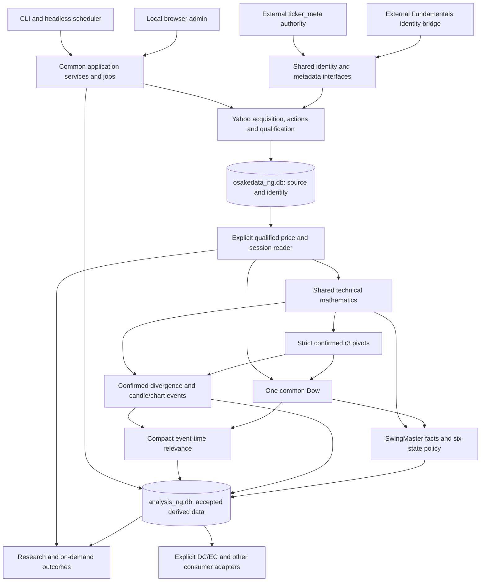

# StockCore Architecture Specification V1

2026-10-15 · V1 evidence-review revision after the initial V1 specification (commit `a6681ef3`). Documentation and read-only source review only; no implementation acceptance.

**Authority:** the user's *StockCore — Master Architecture Specification V1* request and subsequent *Architecture V1 Evidence Review & Decision Update*, including D01–D14 and the explicit Q03/Q07/Q15/Q30/Q31 approvals. This specification consolidates those approvals; it grants no implementation, production cutover or migration permission. **APPROVED REQUIREMENT** denotes that authority. **RECOMMENDATION** denotes a proposed implementation boundary. Remaining questions use the five statuses in §16. Historical audit recommendations retain their original status in their original files.

**Review conclusion:** the approved architecture is coherent. No unresolved contradiction requires a second Dow engine, a second identity allocator, a wholesale migration or abandoning the required first-release capabilities. Implementation is nevertheless gated by real semantic details and evidence: identity handoff, complete Dow reduction rules, V3 history/fact delivery, relevance threshold review, and accepted publication/restoration contracts. Ordinary technical basis, selected V3 and no old relevance/episode transfer are settled. These are recorded explicitly rather than silently supplied as approvals.

Companion artifacts: [database responsibilities](stockcore_database_responsibilities_v1.csv), [open design questions](stockcore_open_design_questions_v1.csv), and [architecture acceptance checklist](stockcore_architecture_acceptance_v1.md). See also the [evidence investigation](stockcore_architecture_evidence_review_v1.md) and [Master Plan readiness assessment](stockcore_master_plan_readiness_v1.md). This is a system specification, not a development schedule or task backlog.

## 1. Purpose, authority and system boundaries

**APPROVED REQUIREMENT — D01–D14:** StockCore is a new independently maintained Python application: future directory `/home/kalle/projects/stockcore`, independent Git repository `stockcore`, Python package `stockcore`. Existing RawCandle remains production; SwingMaster supplies selected functionality and evidence. Neither repository is copied wholesale, and StockCore must not permanently import arbitrary legacy modules. This task does not create the future repository.

The zero-day technical baseline starts on 2018-01-01, or the later verified eligible history start for the security/segment. A session calendar determines the first actual bar. Listing/identity/action boundaries and mathematical warm-up further constrain usable outputs. Legacy derived-output equality is not required; meaningful policy behavior still needs validation.

Required evidence reviewed:

| Reference | Material and role |
|---|---|
| E01 | [Audit 01](../rawcandle_ng/architecture_audit_01_ohlcv_identity.md), [31 recommendations](../rawcandle_ng/keep_rewrite_remove_01.csv): identity, source acquisition, metadata, actions, operations and database ownership evidence |
| E02 | [Audit 02](../rawcandle_ng/architecture_audit_02_technical_analysis.md), [30 recommendations](../rawcandle_ng/keep_rewrite_remove_02.csv): mathematical differences, event clocks, pattern context, persistence and invalidation defects |
| E03 | [Audit 03](../rawcandle_ng/architecture_audit_03_research_consumers.md), [42 recommendations](../rawcandle_ng/keep_rewrite_remove_03.csv): research, consumers, SwingMaster selective integration, evidence preservation |
| E04 | [Decision review](../rawcandle_ng/architecture_decisions_01_review.md), [D01–D14 matrix](../rawcandle_ng/architecture_decisions_01_matrix.csv), [103-row crosswalk](../rawcandle_ng/architecture_decisions_01_crosswalk.csv): recommendation ownership and earlier unresolved choices |
| E05 | [D06 research](../rawcandle_ng/stockcore_d06_dow_pivot_comparison.md), [D06 worksheet](../rawcandle_ng/stockcore_d06_dow_pivot_decision.csv): focused semantic comparisons and 26 synthetic families reported by that task |
| E06 | [Yahoo price-basis comparison](../yahoo_price_basis_comparison_20261014.md): same-vintage reconstruction, basis sensitivity, source-vintage and action-unit limits |

The three audits' 103 recommendations are evidence, not 103 independent approvals. E04's old READY/OPEN statuses and E05's Option B recommendation are superseded where this request makes an explicit choice. In particular, **one unified Dow replaces E05's proposed two named operational interpretations**; strict r3 pivots, both-anchor RSI matching, consecutive 5–30-session pairing, full replay, first-close BOS and second-close RESET are now requirements. Earlier suggestions to defer market regime, leave the derived database undecided or use a non-browser initial UI likewise do not govern V1.

The audits' removal of automatic earnings-blackout restrictions remains the inherited approved direction (E04 §3 U11); earnings research evidence and explicit scoped user exclusions are separate. No old source worksheet is rewritten.

### 1.1 Decision and document history — evidence-review revision

The initial V1 recorded 31 open questions (22 detail, five user decisions, four evidence). The subsequent user update resolves the five decisions below. Their original IDs, questions and earlier reasoning remain in the register's decision-history fields; they are excluded from current open counts.

| ID | APPROVED REQUIREMENT | Consequence and remaining detail |
|---|---|---|
| Q03 | **Ordinary Yahoo OHLC is the technical default** for indicators, pivots/common Dow, divergence, candle/chart patterns, relevance, SwingMaster technical/state calculations and StockCore technical inputs to DC/EC. | Ordinary = auto_adjust=False, generally split-adjusted, not dividend-adjusted. Dividend-adjusted OHLC is an explicitly requested research alternative. Basis/definition remains in every persisted result; existing DC/EC synthetic methodology/production is unchanged. |
| Q07 | **Small understandable rebuildable current state**, with accepted sources/actions/reviewed identities/user policies, essential quality/change/publication receipts and justified irreplaceable artifacts/important reports preserved. | No permanent every-feature/every-Dow/every-relevance-generation history, redundant full DB snapshots or unjustified lineage/event sourcing. Minimal source-vintage retention is detailed design, not a reopening of the principle. |
| Q15 | **V3 is the first-release SwingMaster policy.** | Preserve six states, graph/minimum ages/guards/domain predicates and fact → proposal → guarded final state distinction. Earlier module logic may be selectively adapted as V3 dependencies; V1/V2 are historical references, not parallel operational engines. Q16 addresses actual delivery defects. |
| Q30 | **No legacy Technical Relevance row-history import or exact classification reproduction.** | Recompute with StockCore confirmed events/common Dow/reviewed rules. Selected important old reports/evidence remain under Q07; legacy remains comparison evidence. |
| Q31 | **No legacy episode migration or continuation as active state.** | Recompute the complete new V3 lifecycle from qualified 2018+ start using Ordinary OHLC/common definitions. Explain/test meaningful differences without requiring old-state equality. |

Evidence review found the Q01 allocation/generation boundary and Q16 V3 call/history behavior sufficiently observable in source; their **evidence investigation is resolved**, while the handoff/input contracts remain **OPEN — DETAIL DESIGN**. Q05 external-maintainer freshness and Q29 exact later artifact-preservation scope remain **NEEDS TARGETED EVIDENCE**, with bounded findings and missing evidence documented. No recommendation is relabeled a user approval.

## 2. Approved architecture principles and decision coverage

| Decision | Approved ownership or behavior | Specification | Acceptance families |
|---|---|---|---|
| D01 | StockCore shared identity; preserve accepted IDs/evidence; one allocator; dated routes | §5, §10 | ID |
| D02 | USA first; explicit collection membership; current external classification authority | §5, §14 | ID, SRC |
| D03 | Yahoo six fields, Ordinary technical default, explicit research alternative, six-session overlap, layered quality, invalidation | §6 | SRC, BAS, REV |
| D04 | Sourced cash dividends; qualified automatic split/ticker/delisting maintenance | §6 | ACT |
| D05 | One named mathematics library; approved seeds/defaults; domain predicates remain named | §7 | MATH |
| D06 | Strict confirmed r3 pivots, one Dow, causal compact divergences and patterns | §8 | PIV, DOW, DIV, PAT |
| D07 | Core relevance; three evaluated classes plus separate held/unevaluated states | §8 | REL |
| D08 | Two named research modes; outcomes normally on demand; honest source clocks | §9 | RES |
| D09 | Genuine simulation target; excluded from first release | §15 | SCOPE |
| D10 | V3 six-state policy/guards and new replay, named facts, combined SP500/NDX regime and inspection in V1 | §10 | SM |
| D11 | Preserve model evidence; no first-release model deployment or automatic training | §15 | SCOPE |
| D12 | Shared technical authority; DC/EC retains domain models and projections | §10 | CON |
| D13 | Two core databases plus justified specialized ones; exact rebuild/increment, safe publication and Restic | §4, §12–13 | REV, PUB, DB |
| D14 | Local browser UI, headless services and one scheduler; isolated failures with honest overall status | §11 | OPS, UI |

Shared infrastructure owns acquisition, identity, metadata integration, mathematical definitions, accepted persistence and job coordination once. Consumer domains own their investment/research/group rules. A retained capability does not imply keeping its present implementation, SQL tables or UI.

## 3. High-level components and shared interfaces

**RECOMMENDATION:** one local Python application with explicit service and storage adapters; no distributed microservice or generic workflow framework is justified by the evidence. These conceptual boundaries do not prescribe module names, an ORM, DDL or a web framework.

| Component | Owns | Narrow conceptual interface and required meaning |
|---|---|---|
| Identity/metadata | Allocation, issuer/security separation, dated routes, confidence and sourced metadata | Resolve security/provider symbol at session; return accepted/uncertain/held result and evidence; expose optional Sharadar identity and separate coverage |
| Source acquisition/actions | One Yahoo adapter, pacing, action evidence, bounded fetch intent | Security/route/session range → candidate same-vintage six fields, actions, request/source evidence and typed success/empty/incomplete/error outcome; no derived writes |
| Source acceptance/quality | Sole source writer and four qualification layers | Validate candidate; atomic accepted replacement/insert plus durable change receipt; failure preserves good history |
| Price reader | Basis, sessions, quality and eligible segments | Read by security ID, range/cutoff, explicit basis/value fields; expose gaps/holds/segment starts and accepted source receipt; never silently filter away calendar positions |
| Shared mathematics/events | Named definitions, recurrence, pivots, common Dow, divergence and selected patterns | Pure qualified inputs plus sufficient accepted state → outputs with observation, availability and source/definition dependencies |
| Relevance | Event-time rule classification and concise explanation | Event plus common confirmed context at cutoff → evaluated class or separate calculation state; event-owned compact publication |
| SwingMaster domain | Six-state lifecycle, named facts, graph/age guards and combined index regime | Previous state/attributes/history plus accepted facts at completed session → proposal then guarded final state, reasons, accepted coverage |
| Research | Explicit cohort, feature cutoff and on-demand outcomes | Accepted events/features plus requested horizons → outcome/status/maturity and reproducibility receipt; future information excluded from predictors |
| Operations/storage | Locks, source/derived jobs, coverage, invalidation, publication and restoration | Same services for scheduler/CLI/browser; per-stage/per-security receipts and accepted reader selection |
| External domain adapters | Explicit Fundamentals and DC/EC contracts | Versioned identity or technical projection with basis/cutoff/quality/publication; no hidden allocation or duplicate math |

All persisted derived products identify security, timeframe, eligible segment, definition/parameters, basis/value fields, processed range, source dependency and accepted publication. The minimum contract is semantic; physical field layout remains detailed design. A receipt names evidence but cannot reconstruct discarded source values.

## 4. Database inventory and ownership principles

**APPROVED REQUIREMENT — D13:** `osakedata_ng.db` owns core identity, metadata, accepted OHLCV and corporate-action source responsibilities. `analysis_ng.db` owns core derived technical responsibilities. More databases are allowed when distinct ownership, lifecycle, source obligations or restoration needs justify them. There is no two-database maximum and no blanket migration approval.

**APPROVED REQUIREMENT:** every retained/introduced NG counterpart preserves the recognizable existing filename and inserts `_ng` before `.db`. Thus `fundamentals_v4_ng.db`, never an invented renamed counterpart, if that domain later needs one. Naming permission is independent of necessity or transfer permission.

**RECOMMENDATION — first-release inventory:** the two approved core databases are sufficient for the evidenced initial shared technical and SwingMaster capabilities. Place SwingMaster derived lifecycle/regime outputs behind a domain-owned adapter in `analysis_ng.db`; do not automatically recreate its separate generic, regional or year-scoped databases. This is a new recalculation destination, not a renamed physical copy of `swingmaster_rc.db`. A later independently managed state store could be `swingmaster_rc_ng.db` if demonstrated lifecycle/restoration needs justify it. The same test applies to later `swingmaster_macro_ng.db` and Fundamentals counterparts. This recommendation does not prohibit specialized databases.

The unchanged 18-row [database matrix](stockcore_database_responsibilities_v1.csv) distinguishes approved boundaries from recommended inventory, enumerates relevant legacy stores and identifies selective import versus recomputation versus external retention. Operational configuration/receipts may be small files or owned core records; no third jobs database is mandated without evidence. Its question-reference column is a traceability list, not a current-open count: Q03/Q07/Q15/Q30/Q31 now resolve through §1.1 and the register. No database inventory change or new store is introduced by this evidence review.

Fundamentals provider/canonical/analysis roles and active-generation selection remain external initially. Resolve its accepted generation/role contract, not a guessed flat `data/fundamentals_*.db` or stale preparation path. StockCore identity ownership does not take over that generation publisher, financial observation engine, scoring, valuation or forecasts. DC/EC outputs mixed into legacy `analysis.db` remain domain-owned; the existence of that file does not transfer every table to StockCore.

Reviewed IDs, provider links, user policies and unique source/model evidence need preservation. Technical state, events, relevance, features, episode scores and hypothetical transactions are derived and normally recomputed. Existing five-field adjusted OHLCV cannot losslessly produce six same-vintage fields. Preserve it as legacy evidence where needed; future authorized acquisition supplies a qualified StockCore baseline rather than relabeling it. No existing database is declared disposable in place.

## 5. Identity, markets, universes and metadata — D01/D02

**APPROVED REQUIREMENT:** retain accepted `security_id` and `company_id` values and reviewed permaticker/provider mappings. Issuer, tradable share/security, listing route and group/entity key are distinct concepts. Ticker strings, related-ticker lists or similar names do not authorize identity merging. Resolve aliases and eligible histories by date, including reuse, terminal listings and uncertain starts. Preserve review evidence/confidence and normalized issuer CIK; SIC is supplementary sourced metadata.

Optional Sharadar state is AVAILABLE / NOT_FOUND / UNCERTAIN / NOT_CHECKED, with permaticker and last-check evidence where available. NOT_FOUND requires a real scoped lookup, not absence from a local cache. AVAILABLE does not certify historical Fundamentals coverage. Non-Sharadar and non-Fundamentals securities remain valid collection candidates.

**RECOMMENDATION — identity transition contract:** before activation, Fundamentals remains the current allocator and StockCore preparation uses a read-only accepted identity view. No second allocator starts during that phase. A later separately authorized handoff validates IDs, maximum allocation state, aliases, provider links, confidence and review evidence from the accepted generation, assigns exactly one allocation owner to StockCore, and changes legacy allocation requests to that shared interface or holds them. Fundamentals may retain read projections and its own financial generations; they cannot allocate independently. If the owning integration cannot establish this contract, activation that requires shared allocation is blocked, not solved with disjoint unreviewed ID ranges. Q01 now records remaining handoff detail: source inspection found explicit MAX(id)+1 allocation in onboarding, implicit SQLite allocation in bootstrap/prototype helpers, provider-map writers and metadata/deactivation writers, with generation publication a separate owner. The existing lock/generation mechanism does not itself enforce a future cross-repository single allocator. Bind a stable accepted generation under coordinated writer exclusion, preserve issued IDs/evidence and allocation high-water state, redirect or disable every allocation/identity-mutation path, and reject stale identity projections when Fundamentals republishes financial generations. The [Q01 findings](stockcore_architecture_evidence_review_v1.md#q01) define the narrow staged contract. No production allocator changes occur in this task.

USA is the first implemented/validated market. OMXH and OMXS are target markets after USA; Xetra is excluded initially. Market calendars, timezones, currencies and provider routes are explicit, with no unknown-market fallback to USA. Collection membership is a separately managed roster. Research and strategy universes and Fundamentals membership have independent scopes. Historical delisted securities remain available; current membership/classification never fabricates past eligibility.

Current Yahoo Sector/Industry comes from externally maintained RawCandle `data/osakedata.db.ticker_meta` until separately authorized transition. **RECOMMENDATION:** a read-only sourced projection records freshness and original authority; StockCore/Fundamentals/index helpers must not backfill that authority from old per-price labels. Essential security type/class/exchange/currency/country and issuer attributes retain source/as-of/unknown semantics. Unknown listing evidence is not filled from first observed price. Alias interval edges and eligibility evidence requirements remain Q02/Q04; current classification is explicitly current-only.

## 6. OHLCV, bases, quality and corporate actions — D03/D04

### 6.1 Source representation and price interfaces

Yahoo is the only initial price provider; Polygon/Massive automatic fallback is excluded. Acquire `auto_adjust=False` and persist Open, High, Low, Close, Adj Close and Volume from the same response vintage. A bounded range call may involve multiple underlying HTTP requests; rate controls cover the transport, not just Python invocation counts. Do not combine newly fetched OHLC with a stale Adj Close.

Readers explicitly select ordinary Yahoo or qualified dividend-adjusted basis. Ordinary Yahoo history is generally split-adjusted, not exchange-original unsplit prices. For qualified adjusted reconstruction, `f = Adj Close / Close`, adjusted OHLC = ordinary OHLC × f (Close becomes Adj Close); volume is not multiplied by this dividend factor. Require finite positive denominator/factor and separately qualified action/identity units. No fallback from an invalid adjusted factor to ordinary prices under the same feature identity. **APPROVED REQUIREMENT — Q03:** Ordinary Yahoo OHLC is the default for all StockCore technical calculations listed in §1.1, including shared index technical inputs; dividend-adjusted OHLC remains an explicitly requested research alternative. Invalid adjusted factors do not silently disable an independently qualified Ordinary calculation or cause an implicit basis switch. Every persisted result identifies basis/definition. Actual DC/EC adapter compatibility remains Q28; this choice does not change existing production calculations or domain-specific synthetic OHLCV methodology.

Maintain four separate layers: (1) received observation and request evidence, (2) numeric/action-unit qualification, (3) security/segment eligibility, (4) consumer-specific calculation usability. Preserve unusual received values with reasons even when unavailable to a calculator. **RECOMMENDATION:** require finite positive ordered OHLC, finite nonnegative volume and valid adjustment factors where used; precise source/action exception rules remain Q02. No silent clipping, interpolation, truncation of volume or compressed missing-session time axis. Numerical validity alone does not qualify continuity or splits.

### 6.2 Daily overlap and historical repair

Daily fetch includes the latest **completed market session and the preceding five trading sessions: six sessions total**. Use the market calendar, including holidays/early closes, rather than host date or the last stored row. Prefer one bounded Yahoo `history()` range per security with safe sequential transport/rate controls and exclusive range-end handling.

Compare overlapping returned observations with accepted stored values; insert missing observations and identify revisions to any field. Validate complete intended accepted replacement coverage before transactional publication. Failed/partial/empty responses must not overwrite usable history. Quality-held candidates remain distinguishable from accepted replacements. Record expected/received/accepted sessions, source vintage, changes and failure/hold reasons. Exact numeric comparison tolerance is Q08; it must not hide material revisions.

Older missing sessions/revisions require explicit bounded maintenance, not an assumption that six-session overlap detects all history changes. The overlap is a detection scope, not the influence scope: a changed Adj Close factor or recursive seed can invalidate much more derived history. Candidate staging may be bounded temporary data, not permanent whole-database generations.

### 6.3 Corporate actions and continuity maintenance

Persist dividends as sourced **ex-date and cash amount**, with currency/distribution type/amount-unit interpretation/source/quality where available. The legacy dividend dates alone do not recover discarded amounts. Neither adjusted returns nor Yahoo cash fields establish a complete tax/payment/entitlement ledger; that deeper accounting is deferred.

A newly confirmed split requiring processing triggers **automatic full six-field refetch from 2018-01-01 or later verified eligible start**. Qualify route/security continuity, expected eligible coverage, action date/ratio orientation, price/cash/share units, six-field consistency and quality before replacement. A previous `corrected` bit is not qualification. **No manual confirmation is required for qualified automatic replacement.** Failed or unqualified replacement preserves the previous accepted history, holds the affected action/calculations as appropriate and reports review need. Never delete good history before acquisition or multiply already split-adjusted Yahoo again.

Publish the successful replacement and durable source-change/processing receipt atomically within the source owner. Log split identity/evidence, requested range, affected rows, changed values, acceptance or failure/hold outcome. Idempotency is based on the qualified action identity/version and accepted result, not simply ticker/date or a perpetual uncorrected flag. An unchanged processed split is a no-op; revised action evidence re-enters qualification. Downstream success is a separate result and never marks failed source work corrected.

Well-evidenced same-security ticker changes and delistings are automatic, with effective dates, durable evidence, alias history and preserved prices. Missing Yahoo prices alone do not prove delisting. Qualified evidence conceptually needs identifiable source authority, matching security/issuer/listing, effective date and no unresolved contradictory reuse/unit/continuity evidence. M&A, SPAC combination, reorganization, ticker reuse or uncertain successor comparability is held. Exact source hierarchy/thresholds are Q02. Scheduler reports list every automatic action and hold.

## 7. Shared mathematics — D05

One shared Python calculation library owns the following default meanings on **Ordinary Yahoo OHLC by default (Q03)**. A consumer requests a named definition, cutoff and basis rather than computing an apparently equivalent copy in its UI or persistence layer.

| Primitive | Approved mathematics | Remaining explicit details |
|---|---|---|
| SMA(n) | Trailing arithmetic mean of the full n-session qualified window | Named n; include/exclude current completed bar and segment handling |
| EMA(n) | Seed with first complete n-price SMA, then α=2/(n+1) recurrence | Qualified start/checkpoint and numerical convention |
| RSI14 | Wilder gains/losses smoothing, first 14 price deltas | Zero-loss/flat conventions in Q08; **recommend** rising=100, falling=0, flat=50; 15 prices needed for initial 14 deltas |
| ATR14 | TR=max(H−L, abs(H−previous C), abs(L−previous C)); Wilder smoothing with mean seed | First TR/prior-close availability convention and segment restart in Q08; not legacy mean of partial TR window |
| MACD12/26/9 | Difference of SMA-seeded EMA12 and EMA26; SMA-seeded EMA9 signal of available MACD values | First signal readiness; no first-price shortcut or premature zero fill |
| Volatility | Standard deviation of daily returns | Return type/window/ddof explicit; **recommend** simple returns with population SD as a named default, subject to Q08; price-level dispersion has a different name/units |
| Gap | Open / previous Close − 1 | Fraction units; same basis and qualified adjacent sessions |
| Return(h) | Explicit trading-session close-to-close horizon | Fraction units; start/cutoff/horizon and actual terminal session explicit; no t0-low denominator disguised as return |

Every definition identifies basis, value fields, formula, units, seed/warm-up, cutoff, missing/invalid/segment behavior, parameters and publication receipt when persisted. Absent expected sessions retain positions and qualification status; no rolling window becomes shorter by dropping them. **RECOMMENDATION:** invalid/identity/unit boundaries reset recursive state and require new warm-up unless a documented consumer-specific contract safely permits continuation. Q08 settles this before acceptance.

Intentional decline, stabilization, entry, volume-growth and screen predicates stay separately named, including whether they use t0 or t−1. Standard Wilder ATR does not silently become legacy arithmetic ATR to preserve outputs. Conversely, a legacy domain formula is not silently replaced solely because its helper was called ATR. Audit the actual predicate dependence, use shared approved primitives where intended, and expose any intentionally retained domain measure under a distinct name after review. No parallel mutable enrichment pass may overwrite a feature with another formula/units under the same definition.

For exact recursive incremental results, carry accepted recurrence/processed state or replay from the qualified segment origin. Arbitrary 154-row reseeding approximates Wilder RSI and fails the approved full/incremental agreement contract.

## 8. Confirmed events, unified Dow and relevance — D06/D07

### 8.1 Shared pivots

One shared detector uses **radius3, full centered seven trading sessions**, High maxima/Low minima for price and scalar RSI extrema. The center must be the strict unique extremum; equal competitors in the window reject it. Three following qualified bars must exist before confirmation. Incomplete left windows are not valid bootstrap pivots. Keep observation session, confirmation/availability session, intrinsic kind, component field, basis, security/segment and source/definition receipt distinct. A dual High/Low pivot may exist on a wide-range bar; structure collision rules are Q12.

On unchanged qualified input, a confirmed pivot does not retract under append. Source revision is a new input publication requiring invalidation, not ordinary repainting. Legacy adjacent-cluster last-tie behavior and unconfirmed chart edge markers are excluded as operational confirmed sources. Other named scalar fallback lookbacks remain separately scoped future questions; r3 approval does not redefine them.

### 8.2 One common Dow reducer

**APPROVED REQUIREMENT:** SwingMaster, SetupMaster, relevance and DC/EC consume **one common Dow interpretation**. No second operational reducer/profile preserves incompatible legacy HH/HL/BOS/reset semantics. Domain projections translate facts, not reinterpret the structure.

High pivots compare with retained active structural high, not immediately preceding high; structural-low semantics must be coherent. Close, not intraday High/Low, breaks active levels. A first completed Close beyond the active threshold produces BOS; a second consecutive Close beyond that threshold produces RESET; recovery clears the breach counter. Every completed bar is processed even without a new pivot or emitted event.

The approved per-bar order is:

1. Evaluate completed Close against structural levels accepted at the **previous completed bar**.
2. Apply BOS/RESET and associated counters.
3. Process newly confirmed pivots, including on a reset bar.
4. Publish new structure state for subsequent bars.

A pivot confirming today cannot retroactively change the threshold against which today's Close was tested. Old SwingMaster's reset-day `continue` must not suppress step 3. Intraday touches alone generate neither BOS nor RESET. Initialization, coherent retained-low updates, equality/tolerance, threshold changes during a breach, dual pivots and final-state/event representation remain Q09–Q13. **Recommended** strict beyond comparisons treat equality as the non-broken side; this detail must be explicit rather than inherited from a legacy epsilon.

Full replay starts from qualified 2018+ history. Increment resumes from last **processed-bar state**, including silent breach-counter recovery, pending pivot-window context, active levels, initialization/epoch and dependency receipts as needed for exact continuation. A last emitted event snapshot is insufficient. Source or definition changes invalidate affected checkpoints and replay dependencies. The E05 T26 silent-recovery case is a mandatory future restart acceptance fixture.

The high-level contract is approved; the low/tolerance/init/collision/snapshot details are implementation gates, not reasons to reopen unification. Relevance and policy threshold reviews use this common output. A first-close BOS must not be silently aliased to old SwingMaster's second-close reset-derived BOS fact.

### 8.3 Divergence construction

Only confirmed radius3 events remain: no V1 daily strengths and no r2 product. Compare **two consecutive confirmed same-kind price pivots** separated by **5–30 trading sessions inclusive**. Do not skip an intervening same-kind pivot for a more attractive pair; an intermediate pivot may close one pair and open the next. Pair distance uses observation-session ordinals in the eligible segment, not calendar days or compressed rows.

Each price anchor must match its **own separately confirmed same-kind RSI pivot within ±1 trading session**. First-anchor RSI samples are insufficient. All price/RSI components and required matching choices must be confirmed before publication. Under strict r3 uniqueness there can be at most one same-kind RSI extremum in a three-session ±1 neighborhood; there is no approved ranking/scoring/plateau matcher to invent. Missing matches create no divergence and retain appropriate coverage/quality status. Q14 defines incremental matching completion without premature no-match conclusions.

| Event type | Price anchors | RSI anchors |
|---|---|---|
| Regular bullish | Second Low strictly lower | Second RSI Low strictly higher |
| Hidden bullish | Second Low strictly higher | Second RSI Low strictly lower |
| Regular bearish | Second High strictly higher | Second RSI High strictly lower |
| Hidden bearish | Second High strictly lower | Second RSI High strictly higher |

Ties generate no event. Availability is at least the maximum of all four component confirmations and selection readiness. A −1 RSI match cannot make an event available before price confirmation; a +1 match needs its own later confirmation. Store compact component references, values/dates as justified, pair/type logical identity and true availability; rerunning does not duplicate the pair/type. Do not collapse distinct events to one daily boolean or backdate a candle composite. If an association with an earlier candle is useful, label it retrospective research or give a composite the latest component availability.

### 8.4 Candlestick/chart events

Retain useful existing detector types as **initial candidates**, with one explicit mathematical definition per selected type. E02 §5 inventories one-bar Hammer/Dragonfly/Shooting Star/Hanging Man; two-bar engulfing/Piercing/Dark Cloud; three-bar Soldiers/Stars/Abandoned Baby; five-bar Falling Three Methods; six/seven-bar flags/rectangles/triangles/pennants; long-context Cup and Handle. This list approves neither all thresholds nor a new setup taxonomy.

Calculation reads sufficient qualified history before the requested output interval. Daily one-bar output requests must still evaluate multi-bar windows. Publish compact positive events and completed coverage, including completed-no-event. Revised sources may remove old positives through safe partition replacement; insert-only findings are insufficient. Keep occurrence and availability separate and attach relevance. Detector selection/threshold utility remains detailed design/SetupMaster research Q27; no trading setup definitions are invented.

### 8.5 Technical Relevance

Relevance is a core rule-based capability. Evaluated classes are **RELEVANT / WEAK_CONTEXT / NOISE**. Calculation states **NOT_EVALUATED / HELD** are separate from those classes; missing/unqualified context never becomes NOISE. Context includes event direction/type, common Dow trend, confirmed pivots, recent BOS/RESET and active structural levels available at the event cutoff.

Persist one compact event-time annotation or narrow event-owned one-to-one extension, with concise reason, context references, rule identity, cutoff and publication/quality receipt. A pending annotation does not imply event rejection or a fabricated evaluated class. Reports may request concise context/explanation (including the useful SwingMaster snapshot projection); that need does not justify recurring overlapping full traces/run rows. Exact explanation of an old decision requires retained old inputs/definitions; otherwise label the response current recomputation.

E02's existing near-pivot/BOS/reset/level thresholds are **evidence, not automatically approved V1 thresholds**. Review them against the unified Dow and corrected divergence before implementation (Q18). Any future current-context view of an old event must be separately named; it cannot overwrite event-time relevance unnoticed.

## 9. Research and on-demand outcomes — D08

Support two named modes:

- **Descriptive revised-history research:** current accepted potentially revised prices/events and explicitly disclosed cohort, source and basis limitations. Current metadata/universe can be used when honestly labeled.
- **Historically decision-time-aware research:** features/components/relevance available by the stated decision cutoff; labels separate and matured later. Missing source vintages or historical rosters limit claims even when the mathematical event is correctly confirmed. Do not market this as complete provider point-in-time reconstruction.

Persist confirmed events, compact relevance and selected reusable features. Normally compute forward returns and labels **on demand**, using explicit trading-session horizons and qualified close-to-close basis. Return PENDING / AVAILABLE / UNAVAILABLE and maturity/terminal date as appropriate; missing, held, delisted or insufficient outcomes are not failed predictions. A delisting does not justify inventing an executable terminal price. Different horizons may mature independently; lack of day20 must not erase a usable event or day2 outcome.

**RECOMMENDATION:** reuse indexed per-security source arrays for requested events/horizons; retain study-specific receipts/results and bounded revision-aware caches only where justified. No universal daily forward table, global maximum result-date gate or wide `results_data` operational truth. Repeated requests and late-discovered events use logical IDs and dependency coverage, not ticker membership/max-date alone.

Research receipts identify mode, source/accepted publication, basis, feature definitions/cutoff, horizons/label definitions/maturity, cohort membership/filter/exclusion policy and any sampling seed/split policy. If inference/OOS claims are later made, control chronological/group/overlapping-label dependence; random held-out rows alone do not establish those claims. Outcome-conditioned exports are valid descriptive selections only when disclosed. Retain useful publication-window partial/completeness and authority/hash contracts, and explicitly revised PE-style studies; they need not become one general SQL table or a first-release regression platform.

## 10. SwingMaster, Fundamentals and DC/EC integration — D10/D12

### 10.1 SwingMaster functionality, not infrastructure copying

**APPROVED REQUIREMENT — Q15/Q31:** the first release uses V3 and recomputes its entire new lifecycle from the qualified 2018+ origin, without importing/continuing old active episodes. It includes deterministic six-state lifecycle, transition graph/guardrails, decline/stabilization/entry facts and named predicates, common Dow/technical inputs, S&P500/Nasdaq100 combined regime and lightweight inspection. States are `NO_TRADE`, `DOWNTREND_EARLY`, `DOWNTREND_LATE`, `STABILIZING`, `ENTRY_WINDOW`, `PASS`. Existing minimum ages are respectively 0,2,3,2,1,1 (E03 §6). Preserve proposal → graph/age guardrails → final state/reasons composition and meaningful history dependence, not merely standalone policy return values.

| Source capability (paths under `/home/kalle/projects/swingmaster`) | Treatment and destination/interface | Dependencies and risks |
|---|---|---|
| `swingmaster/core/domain`, `core/engine`, `core/policy/rule_v1`, `rule_v2`, `rule_v3` | **KEEP / INTEGRATE functionality**; selectively adapt pure policy/guard contracts into independently owned StockCore domain | V3 delegates to earlier implementation helpers; adapt needed logic within one selected V3, not active parallel V1/V2 engines; history delivery Q16 |
| `app_api/providers/signals_v2/*`, `signals_v3/*` under `swingmaster/` | **REWRITE / INTEGRATE adapters**; retain named decline, stabilization, entry, invalidation and reclaim predicates | Shared basis/warm-up/math; actual thresholds versus ignored constructor parameters; t0/t−1 semantics |
| `signals_v2/dow_structure.py` and old RC Dow consumers | **REWRITE / INTEGRATE facts over one common Dow**; remove second operational interpretation from final target | Persistent NEW_LL/HH-like predicates versus first-BOS/reset pulses require explicit mapping and policy-impact tests |
| `swingmaster/regime/production.py` | **KEEP / INTEGRATE formula**, rewrite shared index feature/persistence access in V1 | Qualified index routes, 200-session warm-up, joint-session alignment and CRASH confirmation Q17 |
| `analysis/*_reader.py`, technical sections of `swingmaster/cli/run_fundamental_ticker_snapshot.py` | **REWRITE / INTEGRATE** compact technical snapshot/inspection through shared interfaces | Preserve useful confirmation/quality/explanation contracts, not legacy table assumptions |
| `swingmaster/infra/market_data`, duplicate SQLite/job/CLI launch infrastructure | **REMOVE duplicate infrastructure from target** while preserving required read/write/recovery behavior in common services | No second collector, identity master, scheduler or math/persistence stack |
| Episode builders, macro, EW/dual scoring, transaction research and advanced UI | **Later selective integration**; see §15 | Preserve evidence in place; no first-release deployment or wholesale import |
| `ui_fundamental_pipeline`, financial/provider/scoring packages | **OPEN outside initial technical integration** | Financial obligations and user/source evidence insufficiently audited; no obsolescence inference from filenames |

The named facts include useful trend-start/maturation, relative-range stabilization, entry-base/reclaim/risk predicates and v3 decline profile/entry gate attributes. E03 §6 documents their existing definitions. Do not redesign them merely to force old output parity, or substitute RawCandle random-control predicates with different cutoff windows. Q15 is resolved: V3 is selected. [Q16 source findings](stockcore_architecture_evidence_review_v1.md#q16) verify V3 → V2 → V1 helper delegation, daily/range callers explicitly disabling history, evaluator omission of ticker/as_of forwarding, and a history-reader schema mismatch that returns empty history on SQL error. Preserve named predicates and explicitly design their causal history/age/fact contract; do not copy silent omission or pretend enabling one flag fixes all wiring. Any behavioral choice beyond required delivery/input correction remains reviewable, not an invented approval. Q16 is now a detailed-design/acceptance gate, not an unknown call path.

The combined market regime retains existing formula: BULL if SMA50>SMA200 and Close>SMA200; BEAR if SMA50<SMA200; CRASH if SMA50>SMA200 and Close<SMA200 for configured consecutive confirmation days; otherwise SIDEWAYS. Combined S&P500/NDX equals their common state when both agree, otherwise SIDEWAYS. Require 200 qualified observations and aligned accepted sessions; absent index data is unavailable, not automatically SIDEWAYS. This formula is distinct from ticker investment state and must not be redesigned by consolidation. Inspected source defaults to two CRASH confirmation days and serializes that state as CRASH_ALERT; Q17 still specifies the accepted configuration/label and missing-session contract. No global-regime input reaches the inspected V3 policy path: it is separately published/episode/report context. The provider's stock-local 30-bar SMA20 regime test is different. Do not invent a new global-regime policy gate.

Changed common Dow, Wilder ATR and bases may change meaningful facts and final states. Required evidence compares controlled old/new input scenarios, names which fact changed and identifies final guarded state/reason/age effects. Exact old derived histories are not acceptance oracles. Retain actual collected confirmation/graph/min-age/reason/predicate/regime/as-of tests; do not count E05's six nested test helpers as executed coverage or port assertions of early divergence dates.

### 10.2 External owning systems

Fundamentals initially retains provider financial observations, canonical financial data, financial universe/generation publication, scoring, valuation and forecasts. Its narrow integration consumes accepted StockCore identity/provider mappings after the authorized handoff; it exposes coverage independently from provider identity. No all-Fundamentals migration, model redesign or per-price fetch initialization is required.

DC/EC retains taxonomies, group memberships/weights, synthetic OHLCV methodology, domain signal rules, projections and reports. StockCore supplies authoritative indicators, common Dow, r3 divergences, candle/chart events and relevance through accepted as-of interfaces. EC may retain a justified accepted DC projection rather than independently copy everything. Domain entity/group IDs are mapped to securities where applicable, not replaced indiscriminately by security IDs.

Adapters declare basis, definition, timeframe, cutoff, coverage/holds and publication/source dependencies. Confirmation <= cutoff applies to every component and relevance companion, not just signal date. Source revisions/corrected availability invalidate affected domain projections and report/cache artifacts. No taxonomy or synthetic-OHLC redesign follows from a new shared technical interface. Q28 records remaining projection/ownership details; full DC/EC replacement is not a first-release requirement.

## 11. Scheduler, services and browser UI — D14

**APPROVED REQUIREMENT:** one headless Python core/scheduler works without an active browser. All future UI is browser-based. Initial use is a simple local administrative service, Windows browser to WSL-hosted local services, **localhost-only by default**; no cloud/public deployment prerequisite.

**RECOMMENDATION:** a small local server with server-rendered pages/forms and optional modest client-side interaction calls the same application services as CLI/scheduler. Keep research/chart/Master views modular later. Framework selection remains Q25; no need to preserve either legacy UI toolkit or its module wiring. Browser code owns neither calculations nor database writes. Local write actions call controlled services; no arbitrary SQL/file-path/provider options in the UI.

Daily services first resolve collection/routes/calendars, acquire source/action evidence, qualify and safely accept changes, then process dependency invalidations and derive features/pivots/common Dow/events, relevance, SwingMaster state/regime and required external notifications. This is a dependency/acceptance contract, not a cron schedule or mandatory sequence among independent calculations. Relevance waits for its required event/Dow inputs; a failed prerequisite holds dependents rather than fabricating inputs.

Common locks coordinate all cooperating writers, including manual and scheduled runs. Each ticker can fail without rolling back successful independent tickers or committing its own partial delete. Overall job state must retain PARTIAL/FAILED when any required scope fails; source SUCCESS does not become downstream SUCCESS. Retry/restart uses accepted source/processed coverage and idempotent intent, not only run existence or latest date. Durable source-change receipts bridge a crash before derived scheduling.

Initial browser controls cover explicit collection/market scope, source refresh and calculation job requests, progress/status, accepted/missing/stale/held coverage, source quality/basis, identity/action holds, automatic maintenance outcomes, logs/receipts, compact event/relevance/state/regime inspection and explanation. Operations permissions, cancellation and hold resolution are Q25 details. Physical purges, bulk financial editors, training, rich charting and simulations are not implied.

## 12. Historical correctness and invalidation — D13

Maintain distinct clocks as applicable: observation/occurrence, mathematical confirmation/selection availability, actual source acquisition/revision and accepted publication, research outcome maturity, and later hypothetical execution. Correct event availability on a currently revised series is not proof those values were in the provider response on that old date. Readers select compatible accepted definitions/bases/receipts and enforce availability <= decision cutoff; current source evidence limits historical claims.

Invalidation follows actual dependencies, not global maximum dates:

| Changed input | Required derived influence |
|---|---|
| OHLC/Adj Close/Volume or sourced action units | Local finite windows; pivots whose windows intersect; affected divergence pairs/matches and candle events; recursive indicators and Dow/state tails from a valid prior checkpoint/segment origin |
| Dated identity/eligible segment or calendar correction | Re-resolve route/session positions, reset affected warm-ups and rebuild dependent history; no cross-security stitching |
| Technical or relevance definition/basis/parameters | Explicitly different definition or invalidated product; no silent field overwrites under an old receipt |
| Corrected event availability or removed positive event | Relevance, SwingMaster facts where dependent, consumer snapshots/DC/EC/report selections and affected study/cache dependencies |
| Revised outcome input or cohort/feature policy | Relevant on-demand outcome/cache/study invalidation; retained historical artifacts stay labeled with their original evidence |

A three-bar pivot confirmation and ±1 matching can require replay before the first changed output day. Recursive influence may extend to the end; a six-session fetch does not justify a six-session rebuild. Recompute replacement ranges including removal of ceased events, coverage and processed state. Incremental and full replay must agree for identical accepted inputs, definitions, origin and quality rules, including no-event bars and corrected history. Q22/Q23 define efficient checkpoints, caches and dependency granularity without relaxing exactness.

## 13. Accepted publication and restoration — D13

**APPROVED REQUIREMENT:** safely publish validated source and derived work, distinguish source success from downstream success, retain sufficient job/quality/coverage receipts, and restore practical cross-database consistency. Do not assert globally atomic multi-database transactions.

**RECOMMENDATION — practical protocol:** source owner commits accepted rows, changed ranges/receipt and pending downstream invalidation together in its local transaction. Derived work computes against a pinned accepted source scope; before local transactional replacement it verifies dependencies still match. Publish derived rows, affected-event removal, processed state and coverage/receipt together. A source change during computation prevents that result being accepted as current. Accepted readers verify required source/definition dependencies and expose CURRENT/STALE/HELD/PARTIAL meaning rather than mixing incompatible publications. These labels are proposed API terminology, not a mandatory schema.

A crash after source acceptance but before derived acceptance leaves source usable and derived stale/pending; restart consumes the durable invalidation. A failed derivative does not revoke good source history or advertise complete results. Independent security scopes can progress, but a combined regime or report requires all its actual dependencies. Exact receipt/partition/checkpoint representation is Q23. Avoid permanent whole-database generations and elaborate event sourcing.

**RECOMMENDATION — restoration:** use existing Restic practices where applicable and SQLite-consistent backup methods that include relevant WAL state; do not invent redundant full copies or raw-copy an active SQLite file. Record enough backup/source/identity/definition/config evidence to verify a restore. After restoring independently captured databases, compare dependency receipts; serve only compatible scopes, mark mismatched derived outputs stale and rebuild them from restored qualified sources. Check identity authority and active external Fundamentals generation separately before enabling writes. Recovery never guesses that two files with similar timestamps form one atomic snapshot. Q24 defines the actual consistency/recovery drill and retention requirements.

Preserve irreplaceable evidence selectively: reviewed identities/user policies, necessary source response/action vintages, retained historical reports/cohorts and fitted model/training manifests. Hashes alone do not restore missing observations. Unneeded derived rows can be rebuilt; unique macro/CBOE or financial evidence is not presumed reproducible from fresh provider calls. **APPROVED REQUIREMENT — Q07/Q30/Q31:** retain a small understandable current state and the justified evidence listed in §1.1, not permanent feature/Dow/relevance generation histories or redundant full DB snapshots. Routine derived results are deterministically rebuilt. Old relevance classifications need not be reproduced, and old episodes cannot seed active V3. Exact minimal source-vintage retention is detailed design under Q07; Q29 remains a later artifact-specific evidence gate. Retained important legacy studies/reports support comparison without requiring a universal archive.

## 14. First working release boundary

The independently usable first release includes all approved capabilities below; this is functional scope, with no schedule or implementation task ordering:

| Included capability | Completion boundary |
|---|---|
| Shared identity and USA collection/metadata foundation | Accepted IDs/evidence, single allocation authority at activation, dated routes/holds, optional Sharadar state, explicit rosters and external classification interface |
| Yahoo source and maintenance | Six same-vintage fields, explicit bases, completed six-session overlap, qualified automatic split/ticker/delisting maintenance and bounded historical repair interface |
| Shared technical core | Named standard indicators, strict r3 pivots, one common processed-bar Dow, four confirmed divergence types, selected qualified candle/chart events and coverage |
| Relevance and simple event research | Compact evaluated/held annotation, explanation, both named research modes with honest limitations, on-demand horizons/statuses/receipts |
| SwingMaster functionality | Selected V3 six states/graph/guardrails/named predicates on Ordinary/common inputs, new eligible-2018+ lifecycle replay, combined SP500/NDX regime and compact state/results inspection |
| Storage and operations | Source/derived acceptance and revision invalidation, deterministic full/incremental replay, practical recovery, one scheduler/services and local browser admin |
| External integration boundaries | Fundamentals identity/coverage/active-generation responsibilities and DC/EC technical input/notification contracts clear; existing production implementations remain external |

The first release may have held/unqualified securities; it may not conceal missing capabilities with fabricated results or silently omit combined regime/six-state functionality. USA validation does not certify Nordic calendars/action units. Market indexes are explicit reference instruments through the same owned Yahoo/identity/quality interfaces, not a second acquisition subsystem.

## 15. Deferred capabilities and preservation

OMXH/OMXS implementation/validation follows USA; Xetra is outside initial implementation. Later browser research/chart/Master views do not delay headless capability. Defer episode-history research, extended macro risk appetite, EW and other trained inference, broad strategy/transaction research, advanced UI and genuine trading simulation. Existing distinct rules/source obligations remain documented evidence, not automatic targets for deletion.

D09's later simulator must separate confirmed signal availability, hypothetical execution/fills, sizing/stops/costs/actions and P&L. V1 on-demand forward returns are studies, not a simulator. D11 preserves fitted files/manifests/training evidence in place where appropriate; no predictive model deployment in V1, automatic retraining or unqualified model import. Later qualification binds new feature/basis definitions, actual model availability, training cutoff and label maturity. Exit-time features cannot be entry-time predictions; in-sample historical scores cannot be relabeled OOS. Forecast/financial model ownership is not redesigned.

Detailed SwingMaster financial/macro/model integration still needs Q29 owning-domain evidence. Q30/Q31 are resolved exclusions: no old relevance-history copy/exact-classification reproduction and no migration/continuation of old episodes as active state. The complete new Ordinary-based V3 baseline and selected important legacy evidence coexist; legacy histories remain available for comparison without any state-table transfer requirement.

## 16. Critical consistency review and open design gates

Use these exact statuses: **RESOLVED BY APPROVED REQUIREMENT**, **RECOMMENDATION**, **OPEN — DETAIL DESIGN**, **OPEN — REQUIRES USER DECISION**, **NEEDS TARGETED EVIDENCE**. A resolved broad choice can still have a separate detailed-design row. The [question register](stockcore_open_design_questions_v1.csv) is the authoritative inventory of unresolved questions and their blocking scope/stage; none requires a user answer to finish this documentation task.

The register retains **31 traceable records: five RESOLVED BY APPROVED REQUIREMENT and 26 open items (24 OPEN — DETAIL DESIGN; two NEEDS TARGETED EVIDENCE; zero OPEN — REQUIRES USER DECISION)**. Q01/Q16 each mark resolved source investigation separately from remaining design, so they are not counted as fully closed. Q05 gates metadata synchronization acceptance; Q29 gates only later evidence disposal/import/integration. Blocking entries retain their original scope and distinguish implementation/activation/acceptance from Master Plan preparation.

| ID | Cross-decision issue | Status | Resolution or remaining gap |
|---|---|---|---|
| C01 | One identity owner versus active Fundamentals generation | RESOLVED BY APPROVED REQUIREMENT | StockCore owns future shared identity; Fundamentals retains financial generations. Concrete allocation handoff is Q01, not a competing master. |
| C02 | Many legacy names versus `_ng` convention | RESOLVED BY APPROVED REQUIREMENT | Every actual counterpart preserves its root; examples do not mandate counterparts. |
| C03 | Unified Dow versus E05 Option B and SwingMaster old facts | RESOLVED BY APPROVED REQUIREMENT | One common reducer; adapt facts and test policy effects. Low/tolerance/init details Q09–Q13 remain. |
| C04 | Standard mathematics versus domain predicates | RESOLVED BY APPROVED REQUIREMENT | Defaults fixed, intentional predicates named; no mutable same-name definitions. Exact edge/seed conventions Q08. |
| C05 | Divergence matching versus event readiness | RESOLVED BY APPROVED REQUIREMENT | Both anchors matched, all four pivots/selection confirmed; strict unique r3, consecutive 5–30 spacing. Incremental readiness Q14. |
| C06 | Technical basis versus adjusted research/action accounting | RESOLVED BY APPROVED REQUIREMENT | Q03 fixes Ordinary technical default; adjusted is explicit research alternative. Neither is original exchange units or a cash ledger; Q28 preserves DC/EC methodology. |
| C07 | Full 2018 replay versus later listing/security start | RESOLVED BY APPROVED REQUIREMENT | Later verified eligible start and resets bound replay; no pre-listing warm-up. Q02/Q11 govern qualification/bootstrap. |
| C08 | Persistent events versus forward outcomes | RESOLVED BY APPROVED REQUIREMENT | Events/compact relevance retained; normal forward labels on demand with maturity, no wide universal results table. |
| C09 | Compact annotation versus report context | RECOMMENDATION | Narrow annotation plus context references/explain projection; Q19 determines actual concise fields. No recurring full traces. |
| C10 | Two core databases versus specialized stores | RESOLVED BY APPROVED REQUIREMENT | Core roles approved; more stores allowed on justified ownership/lifecycle. First inventory remains recommendation. |
| C11 | Automatic split refetch versus validation holds | RESOLVED BY APPROVED REQUIREMENT | Qualified replacements automatic without manual approval; unqualified candidates hold/preserve old history. Q02 details evidence. |
| C12 | Source success versus daily derived scheduling | RECOMMENDATION | Durable local source receipt/invalidation then dependency-qualified derived acceptance; Q23 specifies protocol. |
| C13 | Browser UI versus independent headless execution | RESOLVED BY APPROVED REQUIREMENT | Thin localhost browser client; core/scheduler operates without it; Q25 toolkit/actions remain detail. |
| C14 | Required V1 versus later models/simulation/macro | RESOLVED BY APPROVED REQUIREMENT | Six states and combined regime required now; trained models, advanced research/UI and simulator later. |
| C15 | Rebuildability versus irreplaceable evidence | RESOLVED BY APPROVED REQUIREMENT | Q07 fixes compact current-state preservation; Q30/Q31 prohibit legacy relevance/episode operational migration. Minimal vintage detail and Q29 artifact selection remain scoped. |
| C16 | Silent counter changes versus event-only restart | RESOLVED BY APPROVED REQUIREMENT | Last processed-bar state or exact replay, not last emitted event. T26 must be covered. |
| C17 | Same-bar reset and pivot collision | OPEN — DETAIL DESIGN | Approved reset-before-pivots order does not choose dual-pivot ordering/event keys/final snapshot; Q12. |
| C18 | New Dow/divergence versus old relevance thresholds | OPEN — DETAIL DESIGN | Q18 review before implementation; class vocabulary approved, legacy thresholds not grandfathered. |
| C19 | V3 history requirements versus observed delivery/schema | OPEN — DETAIL DESIGN | Q16 source investigation is resolved: history disabled/arguments omitted/schema mismatch. Specify and test complete causal adapter/history/fact contracts before V3 acceptance. |
| C20 | One six-state lifecycle versus several policy versions | RESOLVED BY APPROVED REQUIREMENT | Q15 selects V3 only; earlier helper logic is a dependency/reference, not a parallel engine. Preserve graph/guards while adapting approved common inputs. |
| C21 | Physical cross-DB publication versus atomicity claims | OPEN — DETAIL DESIGN | Q23/Q24 define compatible receipt selection and crash/restore behavior; no globally atomic transaction assumed. |
| C22 | Source-vintage limits versus historical-aware research | RESOLVED BY APPROVED REQUIREMENT | Enforce available component clocks and disclose missing historical source/universe evidence; no universal provider PIT claim. |

These gates prevent false precision, not a coherent specification. First-release blocking items must be resolved before their named implementation/activation/acceptance scope; deferred evidence does not block unrelated qualified functionality. The CSV marks scope explicitly rather than declaring every future question a project-wide blocker.

## 17. Acceptance and documentation validation

The [acceptance checklist](stockcore_architecture_acceptance_v1.md) defines objective future properties, fixtures and evidence, with coverage for every D01–D14 boundary. It is not a claim that StockCore exists or those runtime tests have passed. It separates definition review, pure contract tests, isolated publication/recovery tests and later authorized pilot evidence.

The initial V1 task validated four documents. This evidence-review revision updates three of them and creates two reports, leaving the database CSV unchanged. It validates five requested documents: decision coverage, approval/proposal separation, conditional `_ng` naming/inventory, open-question links and statuses, acceptance traceability, CSV parsing/unique IDs, local Markdown references and whitespace. Source material and unrelated worktree state are checked against the task baseline. Read-only source/configuration/text-artifact inspection supports the four evidence entries. No application tests, source recalculation, provider calls, database opens/queries/jobs, repository creation, model runs or migration occur. Only this revision's five requested documents are staged and locally committed; no push. Production changes initiated by this task: **zero**.

**Initial V1 validation history:** the initial four-document package passed artifact checks with 31 then-open questions, 22 consistency rows and 84 future acceptance criteria. That result was documentation validation, never runtime acceptance. This revision retains the 31 IDs, resolves the five user choices, records two resolved source investigations with residual detail and two outstanding evidence questions. See the [evidence report validation record](stockcore_architecture_evidence_review_v1.md#validation) for the current five-file checks and [readiness assessment](stockcore_master_plan_readiness_v1.md) for remaining planning/design gates. Production changes initiated by this revision: **zero**.
