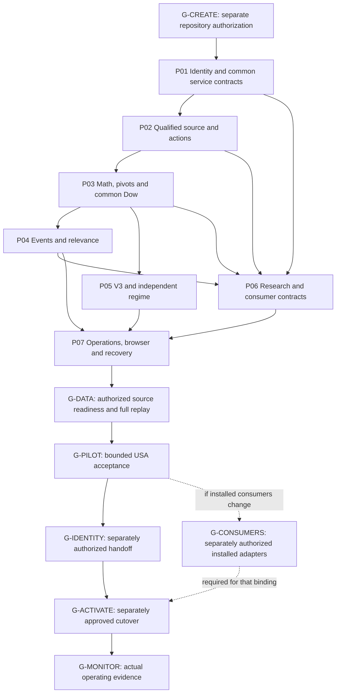

# StockCore Implementation Master Plan V1

2026-10-16 · Planning and documentation only. **No repository creation, implementation, database/migration creation, provider call, production workflow or runtime acceptance is authorized or performed by this plan.** Subsequent implementation requests must authorize their scope; operational handoff/cutover requires a separate explicit user decision.

This plan uses **seven substantial capability phases**. Each joins definitions, an independently usable service, its owned persistence, adversarial tests and recovery evidence. Shared service/job/publication contracts start in P01 and are exercised by every subsequent slice; the final phase composes them into scheduling/browser operations rather than introducing a competing runner. The phases are the largest useful boundaries that isolate source replacement, stateful mathematics, event clocks and V3 investment behavior from each other.

## 1. Authority, sources and release boundary

Read before preparing this plan:

- [Architecture specification](stockcore_architecture_spec_v1.md).
- [Evidence investigation, including V2/V3 comparison](stockcore_architecture_evidence_review_v1.md).
- [Master Plan readiness assessment](stockcore_master_plan_readiness_v1.md).
- [Database responsibilities](stockcore_database_responsibilities_v1.csv).
- [Open-design register and decision history](stockcore_open_design_questions_v1.csv).
- [88 future acceptance criteria](stockcore_architecture_acceptance_v1.md).

Execution indexes produced by this task: [phase matrix](stockcore_implementation_phases_v1.csv), [31-record question map](stockcore_question_phase_map_v1.csv), [88-row acceptance map](stockcore_implementation_acceptance_map_v1.csv), and [critical sequencing review](stockcore_implementation_sequence_review_v1.md). Primary ownership is unique; secondary test dependencies do not duplicate records. The existing sources remain unchanged.

**APPROVED REQUIREMENTS** come from D01–D14 and resolved Q03/Q07/Q15/Q30/Q31. Phase boundaries, conceptual package paths and implementation mechanisms below are **PLANNING RECOMMENDATIONS** within those requirements. Open definition details remain open: planning allocates their resolution and acceptance, it does not silently approve formulas, thresholds, a framework or investment-policy changes.

| Authority | Binding requirement and implementation owner |
|---|---|
| D01 | Preserve accepted issuer/security IDs, provider/permaticker mappings/reviews and dated continuity; one eventual StockCore allocator. P01 designs/tests the boundary; G-IDENTITY alone enables real ownership handoff. |
| D02 | USA first, explicit collection distinct from research/strategy/Fundamentals universes, retained delisted history and externally authoritative current ticker_meta. P01 establishes contracts; P06 enforces research claims. OMXH/OMXS later; Xetra excluded initially. |
| D03 | Yahoo only, auto_adjust=False and same-vintage Open/High/Low/Close/Adj Close/Volume; latest completed session plus five previous trading sessions; quality layers and source invalidation. P02. |
| D04 | Cash dividend ex-date/amount/evidence; qualified automatic complete split-history refresh and same-security rename/delisting; ambiguous cases hold. P02, with shared identity activation constraints. |
| D05 | One calculation library: full-window SMA, SMA-seeded EMA/MACD12/26/9, Wilder RSI14/ATR14, return-SD volatility and explicit gap/return units. P03. Intentional domain predicates retain named meaning. |
| D06 | Strict unique full-window r3 pivots; one common Close-based Dow; causal four-type divergence and selected candle/chart events. P03/P04; no second operational Dow, V1 strengths or r2 product. |
| D07 | Core rule-based compact event-time relevance: RELEVANT/WEAK_CONTEXT/NOISE separate from NOT_EVALUATED/HELD. P04 reviews thresholds before implementation. |
| D08 | Descriptive revised-history and historically decision-time-aware modes; on-demand outcomes, honest source/universe limitations and maturity. P06; normal horizons 5/10/20/60 trading sessions are supplied by this request. |
| D09 | Genuine trading simulation remains target architecture, outside first release; outcomes are not fills/P&L. P06/P07 preserve that boundary. |
| D10 | Selected six-state V3, graph/ages/guards/named facts and independent combined SP500/NDX regime in first release. P05; no new global-regime policy gate. |
| D11 | Preserve justified fitted/training/research evidence; no initial trained inference, automatic retraining or unqualified model transfer. P07 tracks Q29 preservation in place; later integration stays gated. |
| D12 | StockCore authoritative shared technical inputs; Fundamentals financial generations and DC/EC taxonomy/weights/synthetic/domain methods stay external. P06 owns contracts, not installed legacy changes. |
| D13 | Core source osakedata_ng.db and derived analysis_ng.db; justified additional stores allowed, recognizable legacy root+_ng naming; exact replay/increment, safe publication and practical Restic/SQLite recovery. P01–P07. |
| D14 | One headless core/services/scheduler, browser-only localhost admin, independent of browser sessions, honest per-ticker and overall partial/failure status. Contracts P01 onward; operational composition P07. |
| Q03 | Ordinary Yahoo OHLC is technical default across math/events/relevance/V3/StockCore-provided DC/EC inputs. Adjusted OHLC only explicitly requested for research; basis/definition persisted. |
| Q07 | Small understandable rebuildable current state plus accepted source/action/review/user/essential receipt and justified irreplaceable artifact evidence. No permanent every-generation feature/Dow/relevance copies. |
| Q15 | V3 remains sole selected operational policy. Useful delegated V2/V1 logic may be adapted inside it; no version superiority claim or parallel active engines. |
| Q30 | Recompute relevance; no millions-row legacy history import or exact old-classification reproduction requirement. |
| Q31 | Full new qualified 2018+ V3 lifecycle; no continuation/import of old episodes/boundary state. Explain meaningful old/new differences; no exact equality requirement. |

First release includes every source/security/technical/event/relevance/research/V3/regime/operations/browser capability above and explicit external integration contracts. It does not require full financial engines, predictive deployment, macro, old episode migration, a simulator, rich charts or SetupMaster/LongMaster implementation. The same stable price/event/fact contracts support those later consumers without speculative strategy frameworks.

## 2. Environments, authorization and completion states

| Boundary | Permitted future scope and gate |
|---|---|
| Existing production | RawCandle `/home/kalle/projects/rawcandle`, SwingMaster `/home/kalle/projects/swingmaster`, Fundamentals accepted generations/configuration remain operational and unchanged by P01–P07 development. Only explicitly scoped read-only identity/metadata inputs may be consulted. |
| Isolated development/test | Future independent `/home/kalle/projects/stockcore`, package `stockcore`; create only after **G-CREATE** explicit repository authorization. Temporary test stores and synthetic identities stay in task-owned roots and cannot become official allocations. Network/job autostart disabled. |
| Isolated first historical data/replay | **G-DATA** separately authorizes cohort, accepted identity source, Yahoo ranges/history origin, reference instruments, transport/pacing and owned target stores. Source qualification and derived replay have distinct receipts. No live legacy writes or whole DB copies. |
| Bounded USA pilot | **G-PILOT** requires agreed cohort/session/date/basis/definition/evidence scope, qualified sources and full included stack. Separately authorize any provider operations. Pilot identity projection remains read-only and allocation remains disabled. |
| Operational activation | **G-IDENTITY** authorizes and qualifies single-allocator handoff; **G-CONSUMERS** separately qualifies any installed legacy consumer changes; **G-ACTIVATE** is explicit operational cutover authorization with recovery/monitoring. None follows automatically from code completion or pilot success. |

Completion states must be reported separately:

1. **Ready to develop:** appropriate phase authorization, prerequisites and definition gates identified; G-CREATE required for actual P01 creation.
2. **Development tested:** G-DEV-P01…G-DEV-P07 records independent expectations, isolated integration/adversarial/recovery tests and a clean intended commit boundary. This is code/contract evidence, not provider data acceptance.
3. **Ready for historical replay:** acquisition scope authorized, accepted identities/routes/calendars/bases and quality contracts fixed, target isolation/space/restart checks complete. Source acquisition and replay do not run as a hidden side effect of tests.
4. **Historical data ready:** required source coverage/actions/segments qualified, derived replay/current compatible receipts accepted or explicitly held by scope. A successful source job alone is insufficient.
5. **Pilot accepted:** G-PILOT dataset and end-to-end criteria actually validated; applicable Q05 freshness contract supplied before claiming metadata synchronization acceptance. Technical-only partial pilot is labeled partial rather than whole-release accepted.
6. **Ready for activation:** pilot/recovery evidence, single-owner handoff and actual external adapter gates ready, no unqualified blocking scope. Request the separate explicit cutover decision.
7. **Activated and monitored:** the authorized handoff/cutover actually completed, exactly one allocator/writer ownership verified, initial run/held/error/backup/consumer receipts reviewed under **G-MONITOR**. No state is inferred merely from a commit.

P01–P07 are development capabilities. They can finish on meaningful isolated data without a provider request or production handoff. Data runs/pilot receipts are separate execution gates associated with those capabilities. The complete operational first release is not declared active until its actual activation gates pass.

## 3. Phase dependencies and rationale

Phase numbers supply a convenient delivery order, not fabricated algorithm dependencies: core V3/regime depends on P03 inputs and its own causal lifecycle history, **not on divergence or relevance tables**. P05 may proceed after P03 while P04 definitions are independently reviewed. P06 basic event research does not need V3/model deployment; V3-context study/inspection can use P05 when explicitly requested. Final qualification P07 includes both branches. G-DATA may be authorized for a smaller owned source pilot once its source and required reader capabilities exist; full-stack data/release readiness follows all required slices.

Cross-phase contract work is deliberately early. Q08's source-value comparison subset must be agreed before P02 although its feature owner is P03. Q16's common-Dow fact needs and Q19/Q28's definition/availability fields inform P03 before consumer code. Q23's publication contract is P01-owned, exercised with real two-store fixture transactions in P03 and the complete stack in P07. Q24's safe own-store recovery rules begin P01; its complete Restic/restore qualification belongs P07. These are gates inside substantial phases, not extra scaffold phases or backwards implementation prerequisites.

## 4. Implementation discipline and common evidence

Each phase starts by reading the current approved source package and its own question/acceptance map rows. It records exact definitions/interfaces and independent expected results before affected code. Routine representation/layout choices can be resolved within authorized work. If a material policy/formula/ownership choice is not settled by approval/evidence, produce the concrete alternatives and pause only dependent work for the required decision. Do not silently inherit a defect or reopen approved Ordinary/V3/r3/no-migration choices.

For each mathematical/stateful product: definition and edges → independent positive/negative/adversarial expected fixtures → implementation → isolated reader/writer integration → full replay → daily continuation/restart → historical revision/invalidation → accepted compatible publication. Never generate the expected values by invoking the function under test; legacy outputs are comparison evidence only. Cases actually collected/executed are identified; nested test helper names are not counted as coverage.

Every phase completion dossier identifies source definition/version, owned schema changes/readers, fixtures and expected/actual results, fault injection points, unresolved scoped holds, data/authorization mode, impacted files and commit. No phase is complete from compilation or a nominal happy-path test. Preserve no permanent run-by-run full output history to prove these checks; retain compact justified evidence and selected failure/recovery artifacts.

Prefer one coherent capability commit per phase once it is reviewable and validated. A necessary separate definition/evidence commit may precede code if a gate remains unresolved, but the capability is not declared complete. No arbitrary file-count split or unvalidated partial phase commit is required by this plan.

## 5. P01 — Independent application, identity projections and common contracts

**Outcome:** a headless operator can resolve fixture or authorized version-pinned identities, inspect current metadata/holds and plan a scoped USA collection request through one service/receipt boundary. The source identity/configuration slice works end to end on isolated fixtures; this is more than an empty package skeleton.

| Requirement | P01 specification |
|---|---|
| Included | Independent package/configuration; owned path guard; issuer/security/provider identity and dated route resolver; accepted-ID projection reader; explicit collection roster versus research/strategy policies; four-state optional Sharadar metadata and separate coverage; CIK/SIC/type/class/exchange/currency/country provenance; calendar/reference-instrument contract; minimal common job intent/progress/receipt/lock interfaces and source acceptance/change-receipt contract. |
| Excluded | Actual repository creation in this planning task; real shared allocation/handoff, financial engines, provider calls, technical kernels, legacy writes/copies, elaborate job engine and GUI scaffold. |
| Sources/selective reuse | Architecture §§3–5,11–13; evidence Q01/Q05; approved original ID/DB criteria. Review RawCandle `rawcandle/fundamentals/admin/identity_resolution.py` fingerprint/readiness concepts and `generations.py` accepted-role resolution. Adapt logic/evidence contracts only; no per-fetch Fundamentals initialization/runtime imports. |
| Dependencies/gates | G-CREATE before later repository creation. Own Q01/Q04/Q05/Q06/Q23/Q26. Resolve identity eligibility subset Q02 and minimal future migration/recovery/service-action boundaries Q24/Q25; obtain Q05 maintainer evidence before its real synchronization acceptance. |
| Input/output contracts | Input accepted generation/identity projection with issuer/security/provider/review/route provenance and explicit scope, or clearly synthetic fixture IDs. Output resolved route or held/unknown result, collection plan/receipt and definition/owner binding. Content fingerprint and reader observed-at do not become provider freshness. |
| Database/modules | Future conceptual `stockcore.identity`, `metadata`, `universes`, `sessions`, `services`, `storage`, `operations`, `cli`, configuration/path checks. Isolated `osakedata_ng.db` initially owns identity/metadata/projection/configuration/minimal receipts. `analysis_ng.db` is not created until it has a derived writer in P03. |
| Schema/data creation | Later authorized source identity/config schema initialization and thin schema-version checks on owned stores only; fixture projection/mapping import with unchanged IDs. Real selective data read/import requires its own pinned authorized source, not a whole production DB snapshot. |
| Tests/criteria | Primary ID-01–ID-08 and DB-01/DB-02 (10 rows). Unit independent alias/provider/CIK/unknown/membership cases; SQLite identity service round-trip; adversarial ticker reuse/interval overlap/stale generation/path aliases; restart of compact fixture job; simulated one-owner handoff and stale-candidate denial. Actual ID-02/ID-08 ownership qualification waits G-IDENTITY. |
| Failure/recovery/isolation | Bad projection/ambiguous route holds without guessed ID. Reject resolved legacy-root targets, production aliases/symlinks/hard links and unapproved write roots. Fixture IDs and allocator remain incapable of authoritative external use. Preserve accepted projection on refresh failure; restart only owned transactions/receipts. |
| Completion/commit/next | G-DEV-P01 evidence demonstrates fixture plan → identity resolution → owned state/receipt → CLI inspection, route/quality contracts and path rejection. Commit the independent slice only in the later authorized StockCore repo. P02 starts with qualified route/session/source/job contracts; Q05 may remain a named metadata acceptance hold. |

**Implementation instructions:** first bind configuration and own-store path policy; then write route/identity/session/job contract expectations; implement the complete offline service/store/CLI flow; validate independent identity/universe cases and denial paths; record disabled authoritative allocation and external freshness limitations. The authority-mode guard covers allocation and identity mapping/alias/deactivation mutation: source action observations may be recorded, but the pinned real identity projection cannot become an independently edited competing master. An interface to future allocation/mutation may be tested with synthetic stores, but no second official ID authority starts while Fundamentals allocates. For a real early pilot choose accepted-ID instruments; unassigned official IDs are held rather than allocated locally or rejected merely for absent Sharadar coverage.

**Later P01 prompt capsule:** “Implement P01 after explicit authorization to create the independent repository. Resolve its stated contract gates, build the isolated identity/collection-plan vertical slice and common service/path/publication interfaces, validate the mapped criteria with independent fixtures, and commit only P01-owned work. No provider calls, legacy writes or allocator activation. Report fixture development completion separately from metadata/handoff acceptance.”

## 6. P02 — Qualified Yahoo source, corporate actions and maintenance

**Outcome:** the same headless services can acquire via an injected Yahoo adapter, qualify and safely publish source observations/actions, and inspect changed/held coverage. Tests use fake/captured responses; live contact requires G-DATA scope.

| Requirement | P02 specification |
|---|---|
| Included | Same-response six fields with auto_adjust=False; conservative injected transport/pacing/cancellation; latest completed plus five previous trading sessions; insert/compare overlapping values and durable source changes; received/numeric-action/security-segment/consumer qualification; explicit Ordinary and qualified adjusted readers; missing-session diagnosis and bounded repair; dividend cash evidence; automatic qualified split full-history refresh, same-security rename/delisting and ambiguity holds. |
| Excluded | Second price provider/fallback, production provider job, silent repair/interpolation/basis switching, full payment/tax/P&L ledger, source-history deletion before qualification, derived calculations hidden in source callbacks, official identity allocation before handoff. |
| Sources/selective reuse | Architecture §6; evidence Q01/Q05 source boundaries; RawCandle `services/stock_update_service.py` range/transport seams and `services/missing_day_recovery.py` validation/recheck ideas; `stock/splits.py` and `analysis/splits_price_backfill.py` as action/deletion-failure evidence. No wholesale writer/UI callback or corrected-bit contract reuse. |
| Dependencies/gates | P01 contracts; Q02 source/action evidence, Q08 numerical change-comparison subset before writer implementation, Q04/Q06 eligible routes/session calendar and Q23 local atomic changes. Ordinary default is already approved. |
| Input/output contracts | Scoped security/dated route/eligible range/calendar/request mode → candidate six-field observations/actions plus source evidence → separate qualification/accepted receipt or hold/error. Accepted changes expose security/segment/range/field/revision dependency for future consumers; errors distinguish empty versus incomplete versus failed fetch. |
| Database/modules | Extend owned osakedata_ng.db with six-field observations, necessary source evidence, accepted qualification/actions and durable pending invalidation/processing receipts. Conceptual `sources.yahoo`, `prices`, `actions`, `quality`, `storage.source`, existing services/jobs/CLI. No analysis store/source-to-feature cross-write yet. |
| Schema/data creation | Owned source extension and reader compatibility/migration test on P01 fixtures. Safe staged candidates are bounded temporary operation data, not whole DB copies or permanent generations. Real baseline must be qualified six-field acquisition, not inversion/relabeling of old adjusted-only history. |
| Tests/criteria | Primary SRC-01–SRC-07, BAS-01–BAS-03, ACT-01–ACT-05 and PUB-01 (16 rows). Unit calendar/reconstruction/action-unit/quality cases; actual isolated source transactions; truncated/rate-limited/mixed-vintage/error adversaries; crash around source commit; split failed coverage/unit replacement and repeated unchanged action idempotency. |
| Failure/recovery/isolation | Fetch/validate before replacing; accepted rows plus source-change/processing receipt commit together. Failure/hold preserves good history. Cancellation cannot certify half publication. Isolate per-security transactions and retain overall partial/failure intent. Provider calls are disabled in tests; acquire outside short publication locks and never target legacy stores. |
| Completion/commit/next | G-DEV-P02: offline source/action services, readers, owned schema and retry/crash evidence accepted. Commit the complete source-maintenance slice. P03 consumes qualified accepted fixture history and source receipts; it does not require a real full-history fetch to begin. G-DATA/provider readiness remains separate. |

**Implementation instructions:** agree expected eligible coverage and evidence rules; test one bounded daily history request per security with safe rate controls; retain all six fields from each response vintage; publish only qualified replacements; report unchanged/missing/revised/held sessions. Daily overlap is six sessions, not assurance about older revisions. Split processing refetches all six fields from 2018-01-01 or later verified eligible start, qualifies identity/coverage/action units, and is automatic without manual confirmation inside an authorized job. No multiplication of already split-adjusted Yahoo data. Bind action version/outcome so unchanged processed splits are not repeatedly refetched; changed evidence is requalified. Exercise qualified automatic rename/delisting on owned fixture identity stores. Before real handoff, pilot records action evidence and requests an accepted owner projection update or holds affected routing instead of independently changing canonical aliases/active status. After G-IDENTITY, the same qualified service applies StockCore-owned authoritative continuity changes automatically, retaining aliases/prices and reporting outcomes. This ownership gate does not add manual confirmation to each qualified action.

**Later P02 prompt capsule:** “Implement the six-field acquisition/qualification/action slice on P01 contracts using injected offline transport. Resolve Q02 and the Q08 source-comparison subset; verify all mapped replacement/failure/overlap/action cases. Commit only the qualified source slice. Provider access or real historical repair requires separately scoped G-DATA authorization; qualified automatic split processing needs no per-action manual approval once that job scope is authorized.”

## 7. P03 — Shared mathematics, strict pivots and one Dow

**Outcome:** an operator can run a qualified fixture security from eligible origin, inspect accepted indicators/pivots/common Dow and resume or revise it deterministically through the common services and actual source/derived persistence boundary.

| Requirement | P03 specification |
|---|---|
| Included | Approved Ordinary math and explicit feature contracts; strict unique seven-session r3 detector on High/Low and scalar RSI; one Dow with retained structural levels, Close first BOS/second consecutive same-threshold RESET, previous accepted thresholds, reset/break before new pivots; last processed-bar state including silent counters; exact full/increment/restart; real derived local publication and dependency checks. |
| Excluded | Divergence/pattern/relevance classification or V3 policy implementation; alternative operational Dow profiles; tentative chart pivots as actionable input; RSI short reseed approximation; newly invented low/tolerance/init semantics without definition gate. |
| Sources/selective reuse | Architecture §§7–8,12–13; evidence Q16/V2/V3 input implications; RawCandle `analysis/stock_dow_structure.py`, `analysis/divergence_v1.py` Wilder kernel and scan EMA/SMA kernels as selective mathematics/test ideas. D06 T09/T11/T23/T25/T26 findings supply adversarial goals; no source wrapper SQL/UI import or defect-equality oracle. |
| Dependencies/gates | P01/P02; Q08 complete feature seed/flat/TR/ddof/units/segment/numerical contracts, Q09–Q13 Dow low/tolerance/init/collision/checkpoint contracts, Q22 influence/state reuse and P01 Q23 compatibility protocol. Agree Q16 common fact needs and Q19/Q28 context/definition fields before finalizing consumer outputs. |
| Input/output contracts | Qualified ascending trading-session Ordinary bars with actual gaps/segments/source receipt, definition and valid prior processed state → named feature values/readiness, intrinsic pivots with observation/confirmation, one structure event/state snapshot, coverage and consumed source/definition receipt. |
| Database/modules | Create owned analysis_ng.db for selected reusable features/pivots/structure events/processed state/coverage. Conceptual `technical.features`, `pivots`, `dow`, `storage.analysis`, existing services/readers and source-change consumer. osakedata_ng.db remains sole source/identity owner. |
| Schema/data creation | Owned initial derived schema plus atomic partition/state/coverage writer and compatible as-of reader; real isolated two-store tests, not only mocked SQL. Derived fixture history created by replay; never copy old Dow rows or stored misleading price_source metadata. |
| Tests/criteria | Primary MATH-01–MATH-06, PIV-01–PIV-04, DOW-01–DOW-08, REV-02/REV-03, PUB-02/PUB-03 (22 rows). Independent mathematical fixtures; all-prefix confirmation; retained high/low; close-only breaks; same-day pivot+RESET; dual keys; silent recovery; restart every fixture boundary; historical value/identity/calendar/definition correction; source changes during computation. |
| Failure/recovery/isolation | Compute against pinned qualified inputs; failed or stale calculation cannot publish current state. Publish affected derived additions/removals/checkpoint/coverage together locally. A source success with derivative failure remains source accepted/derived stale. Restore/replay from valid processed checkpoint or eligible origin, never last emitted event only. |
| Completion/commit/next | G-DEV-P03 proves definition → independent expected → full/daily/restart/revision equality and no incompatible readers. Commit math/pivots/common Dow as one coherent accepted capability. P04 and P05 may consume only accepted common definitions/fields; open material Dow/fact semantics stop their dependent branch. |

**Implementation instructions:** resolve edge/seed/invalid-segment definitions before kernels; hand-compute primitive expectations. Keep SMA full-window, EMA SMA seed, Wilder RSI14/ATR14 and EMA-seeded MACD12/26/9; name any intentional domain measure separately rather than overwriting standard columns. Specify volatility's return convention/window/ddof and fraction gap/return units under Q08. Resolve coherent retained-low updates/active thresholds and all remaining Dow state transitions in a reviewable table before implementing them.

At each completed bar test Close against **previous completed-bar accepted** thresholds, apply BOS/RESET/counters, process confirming pivots even after RESET, then publish next state. Same-day new pivots must not change the threshold retroactively. Equality/threshold identity and dual-pivot ordering are Q10/Q12 definitions, not copied epsilon logic. Checkpoints include everything needed to reproduce no-event bars and pending confirmation windows. Replaying an affected recursive/stateful tail may start before the revised day; finite fetch overlap is not a computation influence bound.

**Later P03 prompt capsule:** “Before coding, settle Q08–Q13 and the consumer fact-output contract with independent adversarial expected fixtures. Implement one Ordinary mathematics/pivot/Dow library, processed-bar continuation, real analysis publication/readers and revision replay. Prove full/increment/restart/changed-source agreement and stale-publication rejection. Do not introduce a second Dow or implement consumers on unsettled definitions.”

## 8. P04 — Confirmed events, selected patterns and compact relevance

**Outcome:** the headless event inspector/explain service returns compact confirmed divergence/candle/chart events, completed no-event coverage and reviewed relevance at true event-time cutoffs.

| Requirement | P04 specification |
|---|---|
| Included | Four confirmed r3 divergence types; consecutive same-kind price anchors5–30 trading sessions, each matching a separately confirmed same-kind RSI pivot within±1; causal component/selection readiness; selected useful candle/chart detectors with context; compact positives and no-event coverage; reviewed event-time relevance and concise explanation/projection. |
| Excluded | V1 continuous strength, r2, retracting tie clusters, skipping intervening price pivot, sampled first RSI masquerading as pivot, retrospective composite backdating, all legacy detector variants, threshold optimization/new trading setups, relevance-row migration/full run traces. |
| Sources/selective reuse | Architecture §8; evidence/D06 confirmation and clustering findings; RawCandle `analysis/divergence_engine.py` as defect/anchor evidence, pure `analysis/candlestick_patterns.py`/`analysis/chart_patterns.py` candidates, `rawcandle/technical_signal_relevance.py` rule/explain concept. Use correct mathematics and reviewed definitions, not old flags or date assumptions. |
| Dependencies/gates | P01/P02/P03; Q14 matcher/no-match finalization, Q27 selected detector definitions, Q18 threshold review against new Dow/divergence before classifier implementation, Q19 concise context and Q22/Q23 influence/publication extensions. |
| Input/output contracts | Accepted pivots/RSI/common Dow and enough qualified source context → stable logical events with four anchor refs where applicable, occurrence/confirmation/selection availability/publication, definition/basis/source dependencies and compact relevance class or separate HELD/NOT_EVALUATED. |
| Database/modules | Extend analysis_ng.db events/components/annotations/coverage through the existing writer. Conceptual `events.divergence`, `patterns`, `relevance`, `interfaces.context`, existing jobs/readers/CLI. No universal daily divergence/result table or separate relevance DB. |
| Schema/data creation | Owned derived extensions with idempotent pair/type identity, correction partition replacement and obsolete annotation/event removal. Select a small meaningful candle/chart catalog under Q27, with multibar tests and explicit warm-up; this plan approves no exact catalog/threshold. |
| Tests/criteria | Primary DIV-01–DIV-05, PAT-01–PAT-03, REL-01–REL-04 (12 rows). Four direction/tie cases, gap 4/5/30/31, intervening pivot, −1/0/+1 RSI matches, pending no-match, every prefix, simultaneous event identities; multibar daily context; revised positive disappears; class/held separation and compact rerun context. |
| Failure/recovery/isolation | Missing component/context yields no fabricated signal/class and keeps pending/held coverage clear. Publish events/removals/annotation state/coverage atomically in owned derived scope; late annotation can use a narrow event-owned extension. Retry never duplicates pair/type or recurring verbose run projection. |
| Completion/commit/next | G-DEV-P04 confirms causality, independent detector/classifier expectations, idempotent publication and corrected-source removals. Commit one complete event/relevance slice. P06 uses its true availability and compact context; P05 core policy does not gain a divergence-table prerequisite. |

**Implementation instructions:** use P03's strict components, not an independent extremum detector. Consecutive pairing cannot search past a same-kind pivot for a better match; each intermediate pivot may finish/open adjacent pairs. Wait until all required components and match choices confirm; a −1 oscillator match cannot publish before price confirmation and +1 can require another session. Under strict r3 uniqueness no multi-match ranking framework is needed. For patterns load context before the requested output range and preserve invalid/session positions. Relevance thresholds inherited from legacy are evidence only; finalize the rule table against common BOS/RESET before implementation. NOISE is an evaluated result, never unavailability.

**Later P04 prompt capsule:** “Resolve Q14/Q18/Q19/Q27 and implement confirmed divergence/pattern/relevance products on accepted P03 outputs. Validate component readiness, no intervening-pivot skip, full-prefix agreement, sufficient pattern history, event removal and compact classification/explanation. No legacy relevance migration or threshold optimization. Commit the complete causal event slice.”

## 9. P05 — Complete V3 lifecycle and separate market regime

**Outcome:** a headless service replays and resumes the selected V3 lifecycle from qualified 2018+ input, exposing facts, proposed versus guarded states/reasons/age, and independent combined index regime with quality status.

| Requirement | P05 specification |
|---|---|
| Included | V3 six states; graph/ages/guards and named decline/stabilization/entry/invalidation/profile/phase/gate predicates; required selectively adapted V2/V1 delegated meaning; causal security/ticker/date/fact/history delivery; exact lifecycle replay/continuation/revision; independent SP500/NDX SMA50/200 regime and compact inspection. |
| Excluded | Active V1/V2 parallel engines, old episode/boundary-state import, moving 51-row Dow bootstrap, model scoring/training, extended macro, transaction simulation, new global-regime policy gate, unapproved business-rule or threshold redesign to recover old equality. |
| Sources/selective reuse | Evidence Q16 V2/V3 table and architecture §10; SM `swingmaster/core/policy/rule_v3/policy.py`, `rule_v2/policy.py`, delegated `rule_v1/policy.py`/rules, `core/domain/transition_graph.py`, `core/policy/guardrails.py`, provider named predicates and `regime/production.py`. Adapt useful pure functions/contracts with correct inputs; not facade/SQLite/history wiring wholesale. |
| Dependencies/gates | P01/P02/P03; Q16 fully specified **before policy adapter implementation**, Q17 regime config/label/alignment, P03 Q11/Q13/Q22/Q23 state/segment/publication. P04 is optional context inspection, not core policy input. |
| Input/output contracts | Current confirmed shared technical facts plus previous accepted lifecycle state/attrs and explicit prior-session history → named policy facts → proposed state/attrs/reasons → graph/age-guarded final state/attrs/reasons and coverage. Current decision is excluded from its own stored prior history on rerun. Index qualified inputs produce separate regime receipt/status. |
| Database/modules | Extend analysis_ng.db with current accepted V3 lifecycle state/attrs, compact transitions and minimal factual/history projection needed by the actual recency rules, processed coverage and regime; reuse existing storage/jobs. Conceptual `state_v3.facts`, `policy`, `history`, `regime`, `interfaces.state`. |
| Schema/data creation | Define one explicit reader/writer history schema with states/reasons/signal facts/required attrs and absence/error status. Choose bounded facts plus compact transitions/current state or justified accepted daily projection under Q16/Q22; no per-run full copies. Required history must remain sufficient for replay/restart and historical cutoffs. |
| Tests/criteria | Primary SM-01–SM-07 (7 rows). Independent graph/stay/min-age/reason expectations; reset/churn/edge/setup windows; omitted context, absent/incomplete/broken history, reader/writer compatibility and rerun; actual defaults; entry gate age/reason/graph collisions; controlled changed-input lifecycle effects; full/daily/restart/revision equality; missing/unaligned index and warm-up/regime fixtures. |
| Failure/recovery/isolation | Unqualified facts/history hold affected accepted work with explicit reason, never silently become valid empty history. Retain last accepted state marked stale when dependencies change. Publish state/history/transition/processed coverage compatibly and resume every processed session. New history is rebuilt, never seeded from production episodes. |
| Completion/commit/next | G-DEV-P05 proves complete delivered inputs and final guarded output, effective parameters and separate regime. Commit one V3/regime slice. P07 can compose it; optional P06 V3-context research requires its accepted inputs. Any unresolved material Q16 policy effect blocks only that dependent implementation/acceptance. |

**Implementation instructions:** explicitly list delegated history windows/fields, state initialization, age progression on stays/changed/blocked states and reasons after V3 proposal overrides; derive fixtures independently. The existing evaluator drops ticker/as_of, both daily/range callers disable recent history, and the history SQL expects columns different from shipped writers. Correct the independent contract and delivery rather than flipping one flag. A history error is distinct from an intentionally empty complete window, and prior state/age alone is not recency evidence.

Preserve minimum ages NO_TRADE/EARLY/LATE/STABILIZING/ENTRY/PASS=0/2/3/2/1/1 and the accepted transition graph. V3 MA20/HL gate proposals remain subject to that graph; EARLY/LATE→ENTRY_WINDOW cannot bypass it. Resolve the known delegated-age/reason carryover after gate override before coding expected final state. Adapt persistent NEW_LL/HH-like facts separately from first-BOS and second-RESET pulses; old reset-day BOS aliasing is not valid. Preserve actual used slow-decline 3% provider behavior versus helper 4.5% default distinction and ignored constructor knobs; do not automatically expose unused controls. Approved Ordinary/Wilder/common-Dow inputs may change useful predicates/final states; record causal impact without claiming V2 is more reliable.

Regime retains BULL when SMA50>SMA200 and Close>SMA200, BEAR when SMA50<SMA200, CRASH when SMA50>SMA200 and Close<SMA200 for agreed consecutive confirmation, otherwise SIDEWAYS; combine equal SP500/NDX state else SIDEWAYS. Source evidence defaults two candidate days/CRASH_ALERT label; Q17 records exact accepted configuration/naming. Require 200 qualified sessions and alignment; absent one index is unavailable, not SIDEWAYS consensus. This is separate context, not a new V3 transition gate. Existing named scalar fallback predicates keep their explicit lookback meaning; r3 divergence does not authorize a silent fallback rewrite or second Dow engine.

**Later P05 prompt capsule:** “Resolve the full Q16 causal history/fact/proposal/final age/reason contract and Q17 regime contract first. Implement selected V3 using useful delegated foundations, shared Ordinary/Wilder/common-Dow inputs and owned consistent history. Prove guards, missing-versus-broken history, gate-override behavior, new-origin full/increment/restart/revision equality and separate index regime. No old episodes/models or new regime policy gate. Commit V3/regime only after meaningful final-state evidence.”

## 10. P06 — On-demand research and external consumer contracts

**Outcome:** an operator can query/export confirmed events under either named research mode, request independently matured 5/10/20/60-session outcomes, and exercise explicit Fundamentals/DC/EC-compatible contracts without changing their production engines.

| Requirement | P06 specification |
|---|---|
| Included | Named study modes, cohort/filter/seed/definition/source receipts and feature cutoff; on-demand close-to-close horizons/statuses; explicitly requested qualified adjusted research basis; justified study artifacts/cache; shared as-of technical/context projections and correction acknowledgment contracts; Fundamentals identity/coverage/generation responsibilities. |
| Excluded | Huge daily forward label tables, universal wide results_data truth, future labels as features, false provider PIT/OOS claims, fitted inference/training, simulator/fills/P&L, historical taxonomy fabrication, installed legacy adapter change or financial migration. |
| Sources/selective reuse | Architecture §§9–10; Audit03's publication-window partial/authority and disclosed descriptive study contracts, Results max-date/missing-label/export/sampling defects; `rawcandle/research/result_publication_event_window.py` and source/consumer reader tests as selective contract ideas. DC/EC technical projection boundary evidence is sufficient; no taxonomy audit repetition. |
| Dependencies/gates | P01/P02/P03/P04. Q20 cohort/claims, Q21 cutoff/horizon/maturity/labels, Q28 consumers and Q19/Q22/Q23 projection/cache/receipt semantics. Q05 before classification-dependent accepted claims; Q01 before real shared identity owner binding. V3-context research additionally consumes P05; base event research does not. |
| Input/output contracts | Event/cohort IDs, mode, basis, feature cutoff and requested horizons → outcomes/status/maturity/terminal session and reproducibility receipt. External interfaces expose identity versus separate financial coverage and technical definition/basis/availability/quality/accepted receipt plus invalidation acknowledgment, preserving domain/group keys. |
| Database/modules | Read core source/derived owners; only needed study/cache/receipt extensions in analysis_ng.db or named file artifacts. Conceptual `research.events`, `outcomes`, `cohorts`, `exports`, `interfaces.fundamentals`, `interfaces.dc_ec`, existing services/CLI. No copied domain data master or separate DB without ownership evidence. |
| Schema/data creation | Owned optional bounded cache/artifact metadata, invalidated by actual source/cohort/definition dependencies; no default persistent every-event/every-horizon universal table. StockCore-owned contract fixtures/stub consumers validate compatibility. Real consumer installation/activation is outside development. |
| Tests/criteria | Primary RES-01–RES-05 and CON-01–CON-03 (8 rows). Hand-computed horizons/denominators/session ordinals/maturity, outcome unavailable not loss, missing/late discovery and revision; cutoff leakage/cohort/seed disclosure; interface NULL/hold/basis/definition/confirmation/stale projection/acknowledgment adversaries. |
| Failure/recovery/isolation | Held/insufficient/delisted outcomes remain explicit and no executable terminal price is invented. Existing study artifacts keep their evidence identity when current cache invalidates. External stub acknowledgment never claims installed production consumption. No domain database writes, taxonomy/weights/synthetic-method conversion or source auto-acquisition. |
| Completion/commit/next | G-DEV-P06 accepts actual on-demand service and StockCore-owned contracts/fixtures; real CON ownership/binding evidence waits G-IDENTITY/G-CONSUMERS. Commit the research/interface slice. P07 qualifies total operations; actual external deployment remains separately authorized. |

**Implementation instructions:** implement default requested horizons 5/10/20/60 without redefining all remaining Q21 label semantics. A recent event stays readable when longer outcomes are PENDING; absent/unqualified outcomes are not failed predictions. Mathematical confirmed availability on revised sources does not certify historical provider knowledge. Exports identify current-cohort or outcome-conditioned filters honestly; any later stronger OOS/PIT claim needs its evidence. Preserve useful partial-window and source-authority receipts. DC/EC receives one technical meaning while retaining its synthetic methodology; an adapter cannot silently relabel existing stored adjusted data as new Ordinary output.

**Later P06 prompt capsule:** “Implement the two named event-research modes and normally on-demand 5/10/20/60-session outcomes with explicit maturity/cohort/cutoff/basis receipts. Resolve Q20/Q21/Q28 and test external contracts with owned fixtures, including corrected confirmation/invalidation acknowledgment. Keep financial/DC/EC production untouched; no universal forward tables, models or simulator. Commit the complete research/interface capability.”

## 11. P07 — Operations, browser admin, recovery and USA qualification

**Outcome:** one headless scheduler and lightweight local browser invoke the same accepted source/technical/relevance/V3/research services, expose quality/holds/partial failures and restore compatible state. The release dossier makes data/pilot/activation readiness explicit.

| Requirement | P07 specification |
|---|---|
| Included | Scheduler composition and common lock/retry/cancel/status; durable source-to-all-consumer invalidation; manual bounded service requests; localhost browser administration and Windows→WSL access; compact event/relevance/V3/regime inspection; SQLite-consistent Restic-compatible backup/restore; first-run/replay/pilot manifests and independent acceptance evidence; activation and preservation runbooks. |
| Excluded | Production scheduler launch/cutover by development completion, browser calculation/SQL, duplicate runners/collectors, public/cloud exposure, rich chart/Master UI, trained scoring/simulation/macro/episode migration and new mandatory operations DB. |
| Sources/selective reuse | Architecture §§11–17; evidence/readiness gates; existing lock/receipt/report and Restic practices where applicable as contract evidence. Reuse no RawCandleApp manufactured-object path, legacy UI ownership or full generation-copy framework. |
| Dependencies/gates | P01–P06 accepted development slices, Q24 complete backup/restore and Q25 browser/operation contract. Q29 is preserved-in-place/deferred tracking only. Recheck scoped Q01/Q05/Q16/Q22/Q23/Q28 and actual data/pilot authorization before claiming readiness. |
| Input/output contracts | Explicit operation/security/market/range/definition/authorization intent → plan/progress/source/derived/consumer receipts and complete/partial/failed/held status. Browser requests the same action as CLI/scheduler. Restore verifies source/identity/config/definition/receipt compatibility before current use. |
| Database/modules | Existing owned core stores and narrow operational/coverage indexes/records only where needed. Conceptual `operations.scheduler`, `recovery`, `reporting`, `web`, existing services/CLI. Backups/restores target controlled isolated paths; no extra job DB or permanent copies by default. |
| Schema/data creation | Only coordinated owned schema/index extensions justified by actual operations; all readers use compatible contracts. Offline integrated/recovery fixtures first. Actual Yahoo acquisition, historical source load, full replay and USA pilot occur only under their separately scoped G-DATA/G-PILOT authorization, using the same production-ready services in isolated mode. |
| Tests/criteria | Primary REV-01, PUB-04/PUB-05, OPS-01–OPS-04, UI-01–UI-03, SCOPE-01–SCOPE-03 (13 rows), plus integrated secondary evidence for every earlier phase. Repeated jobs/concurrency/cancel/one-ticker failure; source-accepted crash; real entire revision chain; stale compute; WAL-aware inconsistent restore; closed-browser scheduling; local listener/forwarding and required inspectors. |
| Failure/recovery/isolation | Source success never hides failed derivatives; one ticker cannot commit partial deletes or suppress overall PARTIAL/FAILED. Stop new owned jobs on a failed publication/recovery invariant, preserve qualified sources and stale markers, replay only owned scope. Roll back owned code/config/schema compatibly or restore/rebuild verified owned stores; never revert live legacy systems during development. |
| Completion/commit/next | G-DEV-P07 is the code/fixture release candidate with all required capabilities and operational evidence. Commit the complete operations/browser/recovery slice. G-DATA and G-PILOT receipts then establish real data/USA acceptance when authorized. G-IDENTITY/G-CONSUMERS/G-ACTIVATE remain explicit separate decisions/evidence, not an eighth hidden development phase. |

**Implementation instructions:** compose rather than replace the P01 service/receipt framework; schedule only compatible dependencies. Source/action acceptance feeds the invalidation dispatcher, then shared features/pivots/Dow, confirmed events/relevance and independent V3/regime products, with research caches/consumer projections invalidated by their actual dependencies. Independent branches need not block each other unless a reader really requires both. Present collection progress, accepted/missing/stale/held coverage, source/derived stage status, identity/action holds, automatic outcomes, logs/receipts and bounded requests. Keep browser lifecycle irrelevant to execution.

Select a lightweight local browser approach under Q25 after the service boundary exists; no framework choice is preapproved here. Verify actual localhost listener/Windows-to-WSL forwarding, not just a configuration label. Recovery drill uses active-WAL fixture databases and an isolated supported backup repository/practice; never raw-copy an active main file and assume consistency. Measure representative replay/read/revision work during authorized qualification and report limits; no fabricated throughput or deadline target.

**Later P07 prompt capsule:** “Compose the existing services into one headless scheduler/local browser and operational receipt/status surface. Resolve Q24/Q25, run meaningful entire-stack fault/retry/invalidation/restore/local-binding tests on isolated data, preserve Q29 artifacts in place, and commit the operational release candidate. Report code completion, data readiness, pilot acceptance and activation separately. Do not contact providers, run real backfills/replay, change legacy adapters or activate unless their explicit scope is authorized.”

## 12. Cross-phase contracts and source-to-derived publication

| Contract | Established/implemented | Required consumer obligation |
|---|---|---|
| Identity/session/eligible segment | P01; action/source qualification extends P02 | Security ID/issuer/provider route, date eligibility/evidence, calendar ordinals and unknown/held state are explicit. No missing-session compression or first-price-as-listing fabrication. |
| Source/basis/quality | P02 | Six fields same response vintage; Ordinary technical default; adjusted research explicit/qualified; distinguish received/numeric-action/security/consumer usability and source acquisition versus mathematical availability. |
| Definition/math/events | P03/P04 | Named formula/value fields/units/seed/warm-up/cutoff/segment/parameters; stable component/event IDs; true component/selection availability; no implicit caller variants or overwritten meanings. |
| Processed state/history | P03 for recurrence/Dow, P05 for V3 | Last processed bar plus sufficient state/confirmation window; separate V3 prior lifecycle facts/history/attrs. No-event state changes survive restart; no old live episode seed. |
| Publication/invalidation | Contract P01; source P02; actual two-store implementation P03; all consumers/P07 | Source writes accepted rows+durable changes locally; derived output/removal/state/coverage receipt locally; compatible readers and durable pending work, no global atomic transaction claim. |
| Relevance/research/consumers | P04/P06 | Event-time annotation versus later context explicit; outcomes separate/matured; mode/cohort/source limitations; corrected confirmations and source changes invalidate dependent projections. |
| Jobs/inspection/recovery | P01 core and every slice; operational composition P07 | Same intent/action/lock/status service, per-scope failures with honest overall status; browser no math/writes; backup/restore source and accepted dependency compatibility verified. |

**Recommended simple publication protocol under Q23:** acquire/provider-compute candidates outside long publication locks. Source acceptance uses the common cooperative write/acceptance lock and one source transaction to commit accepted data plus source revision/change and pending downstream receipt. Derived work reads pinned accepted dependencies, computes off to the side, then reacquires the common acceptance lock, verifies source/identity/definition dependencies and commits its own outputs/removals/processed state/coverage together. All cooperating source writers use the same lock for commit, preventing a check-then-commit race. Compatible as-of readers verify consumed receipts; source may advance immediately afterward, making old results explicitly stale. This is two local commits with explicit compatibility, not an asserted multi-DB atomic transaction.

If another protocol is chosen in detailed design it must pass the same race/crash/reader properties; a bare check followed by an unprotected commit is insufficient. Failed derivative work leaves source usable and durable invalidation pending. Cross-security scope can progress independently, while combined regime/reports require their actual multi-input coverage. A run ID/date watermark is not source freshness. Every new consumer declares finite lookback and recursive forward influence; receipt fields remain small and purposeful, not a generic lineage engine.

## 13. Database evolution and controlled data creation

| Phase | Owned schema/data evolution in later authorized implementation |
|---|---|
| P01 | osakedata_ng.db identity/metadata/universe/projection/configuration/minimal receipts; fixture or narrowly authorized read-only accepted identity input. Allocation disabled for real authority. |
| P02 | Six-field accepted/received source, actions/quality/change/idempotency receipts and basis readers in same source owner. All source changes retain downstream invalidation; no old five-field inversion. |
| P03 | analysis_ng.db selected features/pivots/common structure/checkpoints/coverage and compatible writer/readers. Source remains separate. |
| P04 | Compact event/component/relevance/coverage extensions, including event removal; no every-run relevance history. |
| P05 | V3 accepted current lifecycle/necessary causal history and independent regime. Reader/writer schema must match; retain only justified history needed for accepted behavior/rebuilding. |
| P06 | Justified study/cache/receipt artifacts, normal forward returns on demand; external financial/DC/EC stores remain external. |
| P07 | Only justified operational/index/coverage extensions, recovery metadata and release evidence; no mandatory third store. |

Every schema change belongs to its writer/reader phase, is ordered/version-checked with simple owned migration helpers and is tested from the previous owned schema/fixture data. Do not assume reversing DDL restores accepted data. A failed migration leaves a verified old store or a qualified recoverable owned result; otherwise restore a SQLite-consistent owned backup or rebuild derived state from retained sources. Early migration tests use bounded fixtures; real data backup/recovery evidence waits Q24/G-DATA scope. No phase's migration targets existing production.

Additional specialized stores remain allowed on evidenced distinct owner/lifecycle/source/restoration need. A genuine counterpart must preserve its recognizable original root, e.g. `swingmaster_rc_ng.db` or `fundamentals_provider_ng.db` **if later justified**, not invented generic replacement names. These examples do not authorize creation or transfer. Current plan recommends V3/regime in analysis_ng.db; it does not impose a global two-store maximum. Unique model/source/report artifacts can remain files or existing retained stores; Q29 does not require a model database.

## 14. Identity handoff and legacy-generation protection

P01 prepares contract/tests/runbook; P06 defines the financial consumer boundary; P07 release qualification verifies readiness. **Actual handoff is outside routine P01–P07 development** and requires G-IDENTITY authorization with concrete scopes/rollback evidence. Known creation/mutation paths include onboarding MAX(id)+1, implicit bootstrap/prototype allocation, historical creating helpers, provider mapping/CIK/alias/deactivation writers and financial candidate-generation publication. Static evidence is resolved; actual full operational exclusion is not.

A reviewable handoff package must:

1. Identify all currently enabled creating/mapping/mutation/launch paths and their coordinated exclusion mechanism, including external/manual and old financial candidates. Do not infer completeness from one Python search or local SQLite lock.
2. Pin the authoritative accepted generation and validate the narrowly selected company/security/provider/alias/review/evidence records plus issued-ID/high-water obligations. Do not renumber accepted IDs or infer all issued identities solely from live MAX(id).
3. Qualify the bridge: financial generations retain financial ownership, consume a versioned shared identity projection, and cannot republish stale conflicting identity state. Consumer financial membership/removal is distinct from shared security eligibility/delisting.
4. During the separately approved maintenance/ownership window, stop/reroute or guard every competing allocation/identity mutation path, verify that exclusion, then enable exactly one StockCore authority. No overlapping owner window or disjoint unofficial ID ranges as a workaround.
5. Validate accepted-ID preservation, non-Sharadar/non-Fundamentals support, financial refresh/projection compatibility and restart before broad activation.
6. Define rollback **before** the switch. If StockCore has issued IDs after handoff, preserve/reconcile those obligations before any old owner can resume; do not restore an old DB snapshot and reuse issued IDs. Until a safe single-owner rollback is qualified, hold allocation and keep last accepted price/read services rather than enabling both writers.

Any necessary legacy application/launch/financial publisher modifications to implement this bridge belong to that separately authorized handoff scope; no development phase silently performs them. A bounded pilot can use accepted read-only projections with allocation disabled, making real technical evaluation possible while legacy allocation remains authoritative. Its universe limitation is disclosed and does not turn Sharadar membership into a collection gate.

## 15. Correctness strategy and required adversarial evidence

The acceptance CSV maps each original ID verbatim to one primary owner, first relevant test stage/type/evidence, secondary phase dependencies and real final gate. “NOT EXECUTED” is retained for every future criterion. Initial fixture evidence never claims installed production handoff or a complete provider point-in-time archive.

| Required challenge | Primary phase and existing criteria |
|---|---|
| Strict r3 equal/flat/edge cases and exactly three following bars | P03: PIV-01–PIV-04. |
| Retained structural highs/lows and no intraday-only break | P03: DOW-02/DOW-03. |
| Same-day pivot confirmation plus BOS/RESET, dual event keys, pivots after reset | P03: DOW-04/DOW-05. |
| Silent recovery before next breach and restart at every boundary | P03: DOW-06/DOW-07, MATH-05. |
| Earlier history revision changes pivot/recursive/state tail | P03/P07: DOW-08, REV-01–REV-03. |
| Divergence RSI±1 availability, both anchors and intervening price pivot | P04: DIV-02–DIV-05. |
| Pattern one-day output needing prior context, removed positives | P04: PAT-02/PAT-03. |
| Relevance new first-BOS/reset semantics, missing versus NOISE | P04: REL-01/REL-02/REL-04. |
| V3 entry gate age/reasons, graph and min ages, missing versus broken history | P05: SM-01–SM-03, SM-06/SM-07. |
| Missing SP500/NDX sessions, warm-up and consensus | P05: SM-04. |
| Split replacement failure and retry without destroying good history | P02: ACT-02–ACT-04, SRC-04/SRC-05. |
| Source accepted then process crash; derived computed against stale source | P02/P03/P07: PUB-01–PUB-03, OPS-03. |
| Repeated scheduler, cancellation and per-ticker failure | P07: OPS-01–OPS-04. |
| Inconsistent independent cross-DB backup/restore with WAL | P07: PUB-04/PUB-05. |
| Outcomes not mature, current-vintage/cohort limitations and late discovery | P06: RES-01–RES-05. |
| Source revision reaches every included real consumer/cache fixture | P07: REV-01, CON-03 with P06 external contract evidence. |

A reasonable fixture state-space and deterministic seeded property checks can extend independent expected cases; do not build an excessive test framework that mirrors implementation. Expand tests when new failures/changes justify it. Future pilot performance evidence describes actual workload/source/coverage/limits, not invented throughput. SetupMaster/LongMaster interfaces can be exercised with small consuming fixtures; those applications are not implemented to satisfy DOW-01.

SCOPE-03 literally describes the prior evidence-review task's five-document production isolation. Preserve that attributed provenance and verify analogous permitted-change/production-isolation boundaries for this plan and later implementation; do not pretend new application tests rerun a historical documentation task or rewrite the original checklist.

## 16. First historical replay, pilot and activation approach

Before a real source run, G-DATA manifest fixes accepted cohort/security routes/eligible 2018+ starts, index references, market calendar, six-field representation, quality/action evidence, transport/rate settings, request scope, owned paths/temporary data and cancellation/recovery. A named authorization covers actual provider acquisition/replay in that environment. Routine within-scope qualified split/rename/delisting maintenance remains automatic; no new per-action manual confirmation is inserted.

First source readiness verifies expected versus received/accepted/held sessions and action units, not just maximum date. Full technical/V3 history is rebuilt from qualified origin using approved definitions; compare daily/restart/revision on the **same accepted sources**, not current versus revised provider responses as if equal vintages. Warm-up/held segments and lack of source-vintage historical knowledge are disclosed. Keep source acceptance, each derived stage and total required scope separate in reports.

G-PILOT is bounded USA evidence chosen to exercise real workflows plus adversarial fixtures for cases not present in that sample: accepted/missing/held identities, dividend/split sensitivity, rename/reuse holds, recursive/replay boundaries and both index regimes. No fixed sample size, duration or runtime is invented. Record its chosen scope and why coverage is adequate. Test source revision → features/pivots/Dow → events/relevance/V3 → research/cache/consumer receipt behavior, repeated scheduled/manual operations, closed-browser execution and recovery.

StockCore-owned consumer contracts can pass isolated/pilot fixtures while installed external bindings remain pending G-CONSUMERS. Actual legacy adapters/source/projection changes cannot be inferred from stub acknowledgment. Similarly P01 identity fixtures establish algorithm readiness, but ID-02/ID-08 and real CON-01 ownership qualification wait G-IDENTITY. Q05 blocks relevant metadata synchronization acceptance until actual maintainer evidence is supplied; UNKNOWN remains honest diagnostic status. Q29 does not block this first release while artifacts remain preserved and no disposal/import occurs.

A concrete activation request includes pilot/restore receipts, known holds/limitations, source/derived/identity ownership and write-path inventory, consumer compatibility, supported backup/rollback, expected monitoring and separate authorization scopes. After approval, report actual ownership switch and operating/consumer/quality/job receipts at G-MONITOR. No calendar deadline or automatic cutover is attached to P07.

## 17. Risks, stop conditions and controlled resumption

| Risk | Mitigation and objective stop/resume condition |
|---|---|
| Competing ID allocator or stale financial generation restores identity | P01/Q01 single-owner and stale-candidate contract. Stop activation on any enabled competing path; resume only with exclusion/issued-ID/publisher/rollback evidence. |
| Wrong identity/listing/action units | P01/P02 dated evidence and separate qualification layers. Hold affected segment, retain good observations; resume only with qualified route/coverage/unit evidence, not similar symbols/first prices. |
| Destructive or incomplete split replacement | P02 atomic validated candidate replacement and idempotency; failed refresh keeps old history and review hold. Stop publication if coverage/units fail; source inspection remains possible. |
| Unsettled Dow low/tolerance/collision or V3 policy behavior | P03/P05 definition-first gates. Pause dependent reducer/policy code; independent source/fixture work can continue. Any material new policy choice is made explicit before resuming. |
| Early/retracting events or stale positive findings | P03/P04 strict confirmation/all-prefix/component readiness and partition removal. Stop consumer acceptance on failed causality; rebuild affected owned scope after corrected definitions/sources. |
| Broken history treated as absent, reused age/reasons after gate override | P05 typed history and final-state composition tests; fail/hold instead of silently taking a fallback. Resume after independent expectations agree with the preserved policy/guard contract. |
| Source/derived compatibility race or silent partial job | P01/P03/P07 common publication coordination, dependency recheck and honest scope statuses. Stop affected publication, preserve source/pending work, retry deterministically; no overall SUCCESS for failed required work. |
| Backup restore appears compatible from timestamps only | P07 receipts/WAL-aware restore and identity owner check. Keep restored derived scopes stale until verified/rebuilt; real production restore is separate authorization. |
| Evidence gaps or scope inflation | Q05 metadata acceptance hold; Q29 preservation in place. No missing evidence becomes fake PIT/freshness or compulsory full DB/model migration. |
| Accidentally inherited production paths or network/autostart | P01 physical path guards and explicit environment/network/job scope. Fail before opening a writer/provider; tests cannot auto-run old constructors/jobs. |
| Premature optimization/abstractions | Use bounded source arrays/simple SQLite transactions/checkpoints/receipts; measure actual work before adding cache/storage complexity. No duplicate collectors/math/jobs or permanent whole-generation archive. |

Each stop record names affected scope, accepted source/derived state and next evidence needed. Resumption revalidates dependencies and replay origin; a successful retry does not erase prior partial/failure evidence or infer a whole release is accepted.

## 18. Definition of first-release completion and this planning task

**Development release candidate:** all seven coherent capability slices and their primary/secondary isolated acceptance evidence are reviewable/committed, all required first-release functions exist, no hidden default legacy path, and unresolved data/activation scope is explicit. All 26 open questions are either resolved within later authorized implementation with recorded evidence or remain a correctly scoped hold/deferred gate; this planning task closes none.

**Data/pilot-qualified first release:** authorized qualified 2018+ six-field source and new technical/V3 replay, per-scope coverage/quality and actual bounded USA end-to-end/recovery evidence accepted. Contracts for Fundamentals/DC/EC are qualified without a financial/taxonomy/synthetic redesign. No claim of complete provider PIT history, legacy equality or executable trading profitability.

**Operational first release:** explicit G-IDENTITY/G-CONSUMERS as applicable/G-ACTIVATE decisions and actual monitoring establish the single shared authority and accepted operational scope. Without that evidence the state remains development-tested or pilot-qualified, not activated.

Deferred work remains: full Fundamentals engine migration, DC/EC methodology redesign, OMXH/OMXS activation, extended macro, EW/dual inference/training, old episode migration, full trading simulator, rich research/chart/Master views and SetupMaster/LongMaster implementations. Later integration uses these shared contracts and its own source/evidence/authorization gates; it is not quietly bundled into P07.

This task creates only the five requested plan documents in RawCandle. Document validation checks seven acyclic phases, all 31 source question IDs/statuses exactly once (five resolved; 24 detail; two evidence), all 88 acceptance IDs exactly once with unique primary ownership, current source wording/links and unchanged architecture/documents/worktrees. It does not execute future acceptance tests or create the StockCore repository, DBs, migrations, modules or scheduler. Production changes initiated: **0**. Only these five files receive one local commit; **NOT PUSHED**.
