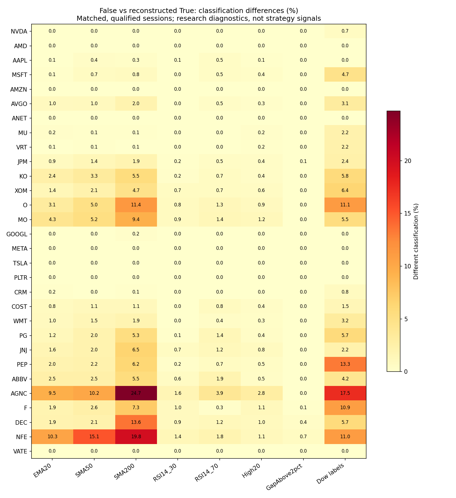

# Yahoo adjusted versus non-dividend-adjusted OHLC — 2026-10-14

## Executive summary and recommendation

**RECOMMENDATION: SWITCH to `auto_adjust=False` with stored Adj Close in a separately authorized future ingestion migration. Do not switch production now or silently change every indicator to the ordinary basis.** Six same-vintage values (OHLC, Adj Close, volume) preserve more useful information than adjusted OHLCV alone and reproduce existing adjustment semantics. Consumers must explicitly select the appropriate basis. This is an architectural recommendation, not evidence that ordinary OHLC is universally better or that all provider observations are usable.

The decision is supported by the full sample, not just DEC/NFE/VATE: five non-dividend controls are unchanged, while dividend payers show real differences in moving-average, RSI, breakout-level, multi-candle and Dow classifications. Switching a consumer's basis is a model change requiring review and result/cache invalidation. Ordinary OHLC is useful for price-action and execution-oriented research; dividend-adjusted prices remain useful for distribution-neutral comparisons. Neither is a substitute for explicit dividends and split-aware accounting in executable P&L.

**VERIFIED FACT:** No production database writes/copies/backups, application changes, scheduler jobs, split refreshes or production recalculations were performed. Research calculations reuse pure RawCandle functions, never their database/job wrappers. Outputs are separate and bounded. A later user instruction authorized committing this completed comparison; no push is authorized or performed.

## Sample, identity and coverage

The deliberate 30-equity sample is not a historical point-in-time universe or an enlargement of SetupMaster's canonical boundary. JPM is an explicitly requested comparison equity even though it is outside current canonical Fundamentals. All 30 current Yahoo responses identify exact requested symbols, `EQUITY`, USD and New York timezone; local provider stocks metadata classifies them as US common equity/REIT holdings, not ETFs or indices. Most canonical starts are undated; current membership alone was not treated as full historical identity proof.

Selection roles: growth/no-or-low/later dividends (NVDA, AMD, AMZN, ANET, MU, VRT, GOOGL, META, TSLA, PLTR, CRM); regular dividends (AAPL, MSFT, AVGO, JPM, KO, XOM, WMT, PG, JNJ, PEP, ABBV); high dividends/REITs (O, MO, AGNC); special distributions (COST, F); diagnostic cases (DEC, NFE, VATE). Split/reverse-split examples overlap these roles. No ticker was replaced with an unrelated instrument.

Corporate-action-sensitive identity decisions:

- **VRT:** use from **2020-02-10**; exclude the earlier GS Acquisition SPAC operating-company history and do not use it for warm-up. [Issuer announcement](https://www.vertiv.com/en-asia/about/news-and-events/news-releases/2020/vertiv-lists-on-the-new-york-stock-exchange/) and [SEC merger filing](https://www.sec.gov/Archives/edgar/data/1674101/000119312520028315/d880241d8k.htm) establish the combination and new trading identity.
- **META:** historical FB observations are explicitly identified as the same Class A security under its former ticker, not different companies. [Issuer notice](https://investor.atmeta.com/investor-news/press-release-details/2022/Meta-Platforms-Inc.-to-Change-Ticker-Symbol-to-META-on-June-9/default.aspx) confirms the **2022-06-09** symbol change and unchanged CUSIP. No FB/META duplicate observations are combined.
- **VATE:** pre-**2021-09-20** observations are labeled HC2/HCHC history folded by Yahoo into the present route. The [SEC-filed issuer announcement](https://www.sec.gov/Archives/edgar/data/1006837/000114036121031765/brhc10029101_ex99-2.htm) confirms continuing common-stock trading after the name change. Unrelated PTGI/PMUG strings are not used to construct history. The [preceding issuer notice](https://www.sec.gov/Archives/edgar/data/1006837/000100683721000123/a202108198-kxexh991.htm) explicitly identifies HCHC and no capitalization change; a [corrected filing](https://www.sec.gov/Archives/edgar/data/1006837/000100683721000128/hchc-20210818.htm) records the changed CUSIP 45784J105. The comparison follows issuer-confirmed continuing common stock; it does not claim unchanged CUSIP or infer continuity solely from the related-ticker field.
- **DEC:** fetch Yahoo's available history from 2021 for diagnostics, but exclude everything before the verified **2023-12-18 NYSE admission** from the US primary comparison. [Issuer filing](https://ir.div.energy/financial-information/sec-filings/content/0001104659-23-126545/tm2333102d1_ex99-1.htm). The [2025 annual report](https://ir.div.energy/financial-information/sec-filings/content/0001922446-26-000020/dec-20251231.htm) establishes a one-for-one exchange into newly issued US common shares following domestication; independently reset indicator/Dow warm-up at the **2025-11-24** new listing boundary rather than silently assuming an unchanged security.
- **NFE/PLTR:** begin at locally corroborated provider/first-trade dates **2019-01-31 / 2020-09-30**. NFE's separate **2026-09-14** price-unit discontinuity breaks calculation warm-up and cross-boundary returns; it is not repaired or interpreted as a momentum signal.

No pre-listing observations qualify for the primary comparison, no prior-security warm-up is borrowed across declared boundaries, and no source classification is changed. These checks target the identified sensitive cases; they do not claim an independently verified listing/security master for every sample session.

**MEASURED RESULTS:** 63,962 False observations; 61,635 primary paired qualified observations. 744 DEC pre-NYSE observations are diagnostic-only. Of the full returned False universe, no ordinary bar fails the defined numerical OHLCV qualification; 2,315 reconstructed True bars fail it: DEC 732 zero factors, NFE 988 negative factors, VATE 595 negative factors. All ordinary Close denominators are positive and finite; no missing/zero denominators. The True `keepna=False` emulation removes 39 all-zero/no-volume DEC rows (a subset of the invalid rows), not 39 additional quality failures. The exclusion sets overlap and must not be summed.

| Ticker | Selection role | False rows | Qualified pairs | Max Close difference % | EMA20 changed days | Dow label changes |
|---|---|---:|---:|---:|---:|---:|
| NVDA | Growth/no-low-later | 2,207 | 2,207 | 1.339 | 0 | 3 |
| AMD | Growth/no-low-later | 2,207 | 2,207 | 0.000 | 0 | 0 |
| AAPL | Regular dividend | 2,207 | 2,207 | 6.578 | 2 | 0 |
| MSFT | Regular dividend | 2,207 | 2,207 | 8.607 | 3 | 19 |
| AMZN | Growth/no-low-later | 2,207 | 2,207 | 0.000 | 0 | 0 |
| AVGO | Regular dividend | 2,207 | 2,207 | 21.295 | 21 | 13 |
| ANET | Growth/no-low-later | 2,207 | 2,207 | 0.000 | 0 | 0 |
| MU | Growth/no-low-later | 2,207 | 2,207 | 2.486 | 5 | 9 |
| VRT | Growth/no-low-later | 1,678 | 1,678 | 0.553 | 1 | 7 |
| JPM | Regular dividend | 2,207 | 2,207 | 21.175 | 19 | 9 |
| KO | Regular dividend | 2,207 | 2,207 | 23.548 | 53 | 23 |
| XOM | Regular dividend | 2,207 | 2,207 | 32.011 | 30 | 25 |
| O | High dividend/REIT | 2,207 | 2,207 | 34.473 | 68 | 43 |
| MO | High dividend/REIT | 2,207 | 2,207 | 47.436 | 95 | 22 |
| GOOGL | Growth/no-low-later | 2,207 | 2,207 | 0.943 | 1 | 0 |
| META | Growth/no-low-later | 2,207 | 2,207 | 0.949 | 1 | 0 |
| TSLA | Growth/no-low-later | 2,207 | 2,207 | 0.000 | 0 | 0 |
| PLTR | Growth/no-low-later | 1,516 | 1,516 | 0.000 | 0 | 0 |
| CRM | Growth/no-low-later | 2,207 | 2,207 | 1.873 | 4 | 3 |
| COST | Special distribution | 2,207 | 2,207 | 10.797 | 17 | 6 |
| WMT | Regular dividend | 2,207 | 2,207 | 12.573 | 21 | 13 |
| PG | Regular dividend | 2,207 | 2,207 | 20.855 | 26 | 24 |
| JNJ | Regular dividend | 2,207 | 2,207 | 21.288 | 34 | 9 |
| PEP | Regular dividend | 2,207 | 2,207 | 24.029 | 43 | 56 |
| ABBV | Regular dividend | 2,207 | 2,207 | 30.610 | 54 | 17 |
| AGNC | High dividend/REIT | 2,207 | 2,207 | 66.855 | 208 | 63 |
| F | Special distribution | 2,207 | 2,207 | 36.917 | 41 | 42 |
| DEC | Diagnostic | 1,451 | 707 | 26.995 | 13 | 7 |
| NFE | Diagnostic | 1,935 | 947 | 82.331 | 94 | 19 |
| VATE | Diagnostic | 2,207 | 1,612 | 0.000 | 0 | 0 |

All tickers end 2026-10-13. Most begin 2018-01-02; VRT begins 2020-02-10, PLTR 2020-09-30, NFE 2019-01-31, and the DEC diagnostic frame 2021-01-04. Primary DEC eligibility begins 2023-12-18. Exact per-ticker coverage/factors/actions: [coverage.csv](../outputs/yahoo_price_basis_comparison_20261014/coverage.csv).

## Acquisition and reconstruction equivalence

Research end is **2026-10-13**, the latest completed session at acquisition start; end parameters are exclusive **2026-10-14**. Histories begin January 2018 or the later bounded dates above. Each ordinary frame is acquired once in existing safe roughly yearly windows with `auto_adjust=False`, via RawCandle's normal Ticker/fetch helper and existing range and legacy ticker/batch pauses. Calls are sequential. No `yf.download` batch, new retry system, faster transport, global setting change or alternative price provider was introduced. Logging watches stop on rate-limit signals; none occurred.

**MEASURED RESULTS:** 262 False historical calls + 11 short independent True calls + three bounded same-window False follow-ups = **276 history invocations**. These are API method calls, not an assertion of the upstream HTTP count. All history calls completed; no rate-limit signal, acquisition error or identity hold. The source windows/request timestamps are in `acquisition.json` and `equivalence.json`.

Across all **63,962 rows / 30 frames**, reconstructed OHLC equals installed `yfinance.utils.auto_adjust` bit-for-bit, including invalid outcomes. The **11 independent samples contain 183 common rows**, of which 161 pass numerical quality and 22 do not. There are **96 differing rows** at strict `rtol=atol=1e-10`, but **0** beyond `rtol=atol=1e-6` (one-ppm numerical screen). Maximum independent absolute difference is **0.000249071444046 price units** and maximum relative difference **3.83624085246e-07** (fraction, approximately 0.00003836%). Volume, dividend and split fields differ on **0 common sample rows**.

| Independent True sample | Window (end exclusive) | Common rows | Strict differing rows | Max abs OHLC difference |
|---|---|---:|---:|---:|
| NVDA | 2024-06-03–2024-06-19 | 12 | 9 | 1.583749727e-05 |
| AMD | 2023-09-01–2023-10-03 | 21 | 0 | 0 |
| AAPL | 2024-08-01–2024-08-21 | 14 | 10 | 1.568644851e-05 |
| KO | 2024-09-03–2024-10-03 | 22 | 10 | 1.544432466e-05 |
| O | 2024-09-03–2024-10-03 | 22 | 20 | 1.154451046e-05 |
| COST | 2023-12-01–2024-01-11 | 27 | 17 | 0.000249071444 |
| F | 2023-02-01–2023-03-02 | 20 | 16 | 2.88445484e-06 |
| WMT | 2024-02-20–2024-03-06 | 11 | 5 | 1.526400854e-05 |
| NFE | 2022-12-20–2023-01-11 | 14 | 9 | 3.874764264e-06 |
| VATE | 2020-05-01–2020-05-22 | 15 | 0 | 0 |
| DEC | 2023-06-28–2023-07-07 | 5 | 0 | 0 |

All expected reconstruction-retained dates match independent True dates. **DEC 2023-07-03** is the one extra raw False date in these windows: ordinary OHLC 1.1430000066757202 and volume 0 become all-zero adjusted OHLC/volume and are dropped by normal True filtering. Raw False has six dates in that window, normal True five. Do not silently treat those session sets as identical. The full frame emulation drops 39 such dates. No denominator exception was encountered in the sample; zero-denominator/missing-factor behavior is covered by synthetic tests. [equivalence.json](../outputs/yahoo_price_basis_comparison_20261014/equivalence.json).

Installed yfinance **0.2.66** computes `factor = Adj Close / Close`, multiplies open/high/low by it and substitutes Adj Close for close. Reconstruction uses that exact formula and retains volume/actions. Its `keepna=False` subsequently removes a row when every retained OHLC/volume/action field is zero or missing. This matters: a mathematical reconstructed frame retaining all dates is not automatically the same returned-session set as a normal True call.

In the three narrow False follow-ups, OHLC/volume/actions themselves matched the earlier False sample, but adjusted-close response values differed. The same-window follow-up reconstructed True exactly. Substituting observed True close (the provider adjusted close in this implementation) into the earlier ordinary frame explains all independently fetched OHLC at strict tolerance. This identifies a source response/window-vintage difference, not a demonstrated formula error. The experiment does not distinguish time revisions from request-window/cache-dependent precision. Large absolute numbers on expensive equities also require relative precision context.

Invalid factor equivalence is never accepted as valid data. Current False frames have positive finite ordered OHLC throughout this sample, but DEC's zero and NFE/VATE's negative Adj Close still reproduce invalid adjusted prices. Raw ordinary validity does not prove historical identity, corporate-action consistency or executable prices. No zero, missing or negative denominator was silently filled, and no factor was clipped.

## Paired feature methodology

The primary comparison uses the same ticker/date index, quality mask, segment starts, lookbacks and parameters on both bases. Qualification requires finite positive OHLC and finite nonnegative volume on both frames; ordering allows only scaled 1e-12 arithmetic round-off. No nonpositive price is accepted. Preserve excluded positions; do not drop a bad row and connect the surrounding sessions as though consecutive. Segments reset at unsuitable observations, DEC's new-security boundary and NFE's observed split-unit discontinuity. Counts refer to returned Yahoo sessions, not an independently certified complete exchange calendar. False-only valid intervals with invalid True counterparts do not enter the indicator comparison; their exclusion is reported separately rather than counted as neutral/equivalent signals. The False-versus-derived-True universe is explicitly paired; independently retrieved validation-window date differences are reported separately.

- EMA10/20: SMA seed, alpha `2/(n+1)`, matching the inspected RawCandle synthetic-EMA convention. SMA50/200 use complete rolling windows.
- RSI14: existing `analysis.divergence_v1.compute_rsi_wilder`, same initialization on each basis.
- Daily return: `close/previous_close-1`; gap: `open/previous_close-1`. Both are arithmetic research features, not trade P&L.
- High/low20 and 60: prior 20/60 returned qualified bars' High/Low, excluding the current bar.
- Candles and existing flag/cup detectors: unchanged pure functions in `candlestick_patterns.py` / `chart_patterns.py`. No SetupMaster EP or Momentum Breakout production definition was invented.
- Dow: existing pure `calculate_ticker_events`, radius **3**, identical segment starts and initial states. Compare event and confirmation dates, HH/HL/LH/LL labels, trend/BOS/reset classifications; pivot features are only known on `confirmed_as_of_date`, never backdated to their event date for a decision.
- ATR14: explicitly labeled **research-only Wilder true range**, because a directly relevant reusable production ATR implementation was not established in the inspected paths. Seed with mean first 14 true ranges; no app ATR behavior changes.

The primary numerical mismatch criterion is `isclose(rtol=1e-8, atol=1e-8)`. Relative difference is `abs(True-False)/abs(False)` where `abs(False)>1e-12`; absolute gaps/returns are fractions and RSI differences are points. Near-zero denominators make relative return differences a poor materiality measure. Classification comparisons have only a numerical tie tolerance of `1e-10` times their scale. Cross-date metrics require adjacent original provider-index positions and valid prior classifications.

A separate sensitivity count requires a basis-induced coordinate change of **1 basis point** for normalized price/MA/level/gap/return/ATR coordinates, or **0.01 RSI point**. These are diagnostic materiality screens, not optimized trading thresholds or changes to application rules. They separate precision-induced boundary flips from larger basis changes; all primary counts remain available.

## Measured numerical and classification impact

| Feature | Comparable pairs | Numerically different | Max absolute difference | Max relative difference % |
|---|---:|---:|---:|---:|
| Open | 61,635 | 48,414 | 36.5859 | 82.331 |
| High | 61,635 | 48,414 | 37.8988 | 82.331 |
| Low | 61,635 | 48,414 | 35.8451 | 82.331 |
| Close | 61,635 | 48,414 | 37.1008 | 82.331 |
| EMA10 | 61,347 | 48,996 | 35.4242 | 82.331 |
| EMA20 | 61,027 | 48,869 | 35.0263 | 82.331 |
| SMA50 | 60,094 | 47,929 | 33.9309 | 82.331 |
| SMA200 | 55,444 | 44,382 | 29.4973 | 77.2406 |
| RSI14 | 61,187 | 48,911 | 34.072 | 121.418 |
| DailyReturn | 61,603 | 44,699 | 0.912713 | 9707.21 |
| High20 | 60,995 | 48,203 | 37.8988 | 82.331 |
| Low20 | 60,995 | 48,172 | 33.6681 | 82.331 |
| High60 | 59,753 | 47,453 | 37.8988 | 82.331 |
| Low60 | 59,753 | 47,521 | 29.7725 | 81.0535 |
| Gap | 61,603 | 44,722 | 0.857655 | 10065.2 |
| ATR14 | 61,219 | 49,031 | 1.63484 | 82.331 |

Price/MA/high-low/ATR absolute values are price units; RSI is points; DailyReturn/Gap are fractions (multiply by 100 for percentage points). Feature comparison counts include only matched fully warmed-up values. Relative return/gap maxima are large partly because the ordinary denominator is near zero; they are not strategy profit estimates. Single-price scale differences are distinct from changes in price-relative classifications.

| Classification / diagnostic threshold | Comparable days | Different days | Material-shift different days | Crossing-date disagreements |
|---|---:|---:|---:|---:|
| ATR14_5pct | 61,219 | 19 | 17 | 30 |
| EMA10 | 61,347 | 590 | 585 | 946 |
| EMA10_vs_EMA20 | 61,027 | 1,037 | 1,027 | 1,076 |
| EMA20 | 61,027 | 854 | 845 | 1,288 |
| GapAbove2pct | 61,603 | 18 | 18 | 36 |
| GapSign | 61,603 | 1,488 | 314 | 1,709 |
| High20 | 60,995 | 273 | 205 | 435 |
| High60 | 59,753 | 274 | 236 | 451 |
| Low20 | 60,995 | 167 | 134 | 282 |
| Low60 | 59,753 | 142 | 124 | 233 |
| RSI14_30 | 61,187 | 177 | 177 | 278 |
| RSI14_50 | 61,187 | 1,021 | 1,021 | 1,472 |
| RSI14_70 | 61,187 | 396 | 396 | 580 |
| ReturnSign | 61,603 | 168 | 168 | 325 |
| SMA200 | 55,444 | 2,100 | 2,100 | 1,658 |
| SMA50 | 60,094 | 1,089 | 1,089 | 1,451 |

MA/level classifications compare close to that feature; Low20/60 report relative side, not a prescribed long setup. RSI thresholds 30/50/70, gap 2% and ATR/close 5% are transparent sensitivity diagnostics, not production SetupMaster rules. Gap-sign differences fall from 1,488 to 314 with the material-shift screen, illustrating how tiny source precision differences can change strict signs near zero.



The five no-dividend controls **AMD, AMZN, ANET, TSLA and PLTR** have factor 1 and identical prices, indicators, patterns and Dow events, despite several having splits. Dividend-payer effects are not limited to the three problematic cases. Excluding DEC/NFE/VATE entirely still gives **747/57,856** EMA20, **1,914/52,996** SMA200, **158/57,991** RSI14_30, **256/57,829** High20 changed classifications. These results support basis-sensitive model review on ordinary dividend payers, not a conclusion based only on anomalies.

| Existing detector | False signals | Derived True signals | Different signal dates |
|---|---:|---:|---:|
| BearishEngulfing | 2,572 | 2,488 | 144 |
| BearishFlag | 41 | 41 | 0 |
| BullishEngulfing | 1,999 | 2,082 | 107 |
| BullishFlag | 83 | 85 | 2 |
| CupHandle | 9 | 11 | 2 |
| DarkCloud | 1,022 | 1,106 | 92 |
| DragonflyDoji | 366 | 366 | 0 |
| EveningStar | 1,637 | 1,619 | 20 |
| Hammer | 2,914 | 2,939 | 25 |
| HangingMan | 1,692 | 1,680 | 12 |
| MorningStar | 2,772 | 2,817 | 49 |
| Piercing | 877 | 928 | 71 |
| ShootingStar | 1,391 | 1,385 | 6 |

Dow: **11,479 vs 11,578 pivots**; **11,292 common pivots**, with **432 HH/HL/LH/LL disagreements**. There are **187 False-only** and **286 True-only** pivot/confirmation-date keys. Across all event classifications (also trend/BOS/reset), multiset differences are 1,570 False-only and 1,744 True-only; these are classified-event differences, not necessarily distinct trading dates.

**Numerical sensitivity, not a dividend-induced geometry change:** 25 Hammer, 12 HangingMan and six ShootingStar flips (43 total) occur despite normalized single-candle OHLC agreeing to at most **2.22e-16**, and all agree when normalized to 12 decimals. Positive per-bar scaling is geometrically invariant; strict floating-point boundary comparisons explain these cases. Do not count them as economic improvements. DragonflyDoji is unchanged. Multi-day patterns can genuinely change when a dividend alters the relative scale between bars; their strict-boundary/numerical sensitivity is not exhaustively classified here. Dow event differences likewise can amplify precision-sensitive pivot ties; the 432 label differences are observed basis differences, not 432 independently proven dividend-caused economic changes. The primary counts are retained rather than relabeled as uniformly material. [Numerical cases](../outputs/yahoo_price_basis_comparison_20261014/single_candle_numerical_sensitivity.csv).

## Dividends, splits and persistence

Examples use returned provider action fields, not independently validated original-unit cash amounts.

| Example | Prior ordinary close → event ordinary close | Ordinary return % | Derived adjusted return % | Ordinary gap % | Derived adjusted gap % | Yahoo action |
|---|---|---:|---:|---:|---:|---|
| COST 2023-12-27 | 674.619995 → 666.799988 | -1.159172 | 1.088518 | -1.766918 | 0.466951 | Dividend 15; split 0 |
| F 2023-02-10 | 13.490000 → 12.730000 | -5.633805 | 0.315224 | -4.818381 | 1.182053 | Dividend 0.8; split 0 |
| NVDA 2024-06-10 | 120.888000 → 121.790001 | 0.746146 | 0.746140 | -0.428494 | -0.428499 | Dividend 0; split 10 |
| WMT 2024-02-26 | 58.520000 → 59.599998 | 1.845519 | 1.845521 | 1.025288 | 1.025290 | Dividend 0; split 3 |

COST and Ford examples show materially different ex-date returns/gaps in otherwise numerically valid data. AAPL 2024-02-09 (reported dividend 0.24) also switches the existing close/EMA20 classification from below to above. NVDA 2024-06-10 and WMT 2024-02-26 are smooth ordinary split boundaries, with essentially the same daily returns on each basis. NVDA has a dividend the next session, so differences in a ±3-session split bucket cannot all be attributed to the split. NFE and VATE action values associated with negative factors are preserved diagnostically, not treated as independently verified original-unit cash entitlements.

Future split adjustment remains a limitation of ordinary historical OHLC: NVDA and WMT samples are smooth across their split dates, demonstrating split-adjusted historical units, not exchange-original historical levels. **NFE is a counterexample to assuming universal split consistency**: the 2026-09-14 response reports ratio 0.02 while close jumps 0.33 → 13.88 on both bases (+4,106.06%). The source shows a price-unit discontinuity; the six fields alone do not make this a valid return. Preserve it diagnostically and break calculations there. No empirical split correction was applied. [Split diagnostics](../outputs/yahoo_price_basis_comparison_20261014/split_boundary_diagnostics.csv).

| Since last dividend | Daily-return max difference (percentage points) | RSI14 max difference (points) | EMA20 max difference (price units) |
|---|---:|---:|---:|
| ex_date | 91.27129 | 34.07199 | 30.80934 |
| 1_4_after | 9.734505e-05 | 32.59469 | 30.72368 |
| 5_19_after | 0.0001118316 | 25.16234 | 32.78833 |
| 20_59_after | 8.34704e-05 | 9.959603 | 35.02629 |
| 60plus_after | 6.933725e-05 | 0.5362913 | 30.93338 |
| no_previous_dividend | 6.563324e-05 | 0.0004309501 | 33.37052 |

Away from ex-dates, maximum return differences are approximately 1e-6 as a fraction (about 0.0001 percentage points), consistent with source adjusted-close precision effects. Recursive RSI/EMA history still differs materially after an event; note that EMA absolute differences also include constant future scale, so they are not pure post-dividend transients. [Event-window metrics and denominators](../outputs/yahoo_price_basis_comparison_20261014/event_window_metrics.csv).

Persistence buckets are descriptive time since the most recent observed dividend, not causal impulse-response estimates: events overlap, quarterly/monthly payers have different coverage, and current adjustment factors include later distributions. Mathematically a constant positive scale over a complete lookback cancels from relative indicators/classifications. When an ex-date divides the window, the factor changes within that window: rolling effects last until old inputs leave, EMA/Wilder effects decay recursively, and a different Dow event can propagate through later labels until subsequent events/reset. Absolute level differences can remain from later dividends even when relative classifications agree.

## Point-in-time interpretation and strategy use

Four different notions must not be conflated:

1. **Exchange-traded levels then:** actual currency/share units and actual auction/fill prices, with contemporary share counts and action entitlements.
2. **Current ordinary Yahoo history:** generally adjusted for later splits and sometimes other actions, subject to revisions. This study also observed a split-unit exception. `auto_adjust=False` is not a certificate of original historical price or PIT validity.
3. **Current dividend-adjusted history:** retrospectively scales prior OHLC using current adjusted-close factors. Adjusted intraday highs/lows are transformed values, not literal attainable executions.
4. **Information available then:** dated identity, action announcements, data vintages and feature decision/confirmation time. Neither current frame alone establishes this.

Uniform future scaling may cancel in a scale-invariant feature using only pre-event inputs; its presence is not automatically proof of leakage in every moving-average/RSI comparison. It does contaminate historical absolute-dollar screens, dollar-volume thresholds, position sizing and dollar stops if treated as original levels. Nonuniform provider revisions, unidentified successors and mixed action units require separate safeguards.

- **Breakouts / MA pullbacks:** specify basis and causal lookback. Dividend-neutral structure and the actual price chart can classify differently. Do not relabel changed signals as better merely because they are more numerous.
- **Gap-up research:** ordinary split-consistent OHLC better represents quoted price movement, but split/ex-dividend sessions need action flags and separate diagnostics. An adjusted gap can remove a real cash-distribution price drop or create a different threshold crossing.
- **Entry/stops:** price orders need contemporaneous exchange units, costs, spread and feasible timing, not simply retrospective adjusted OHLC. A stock split changes share quantities/price units; dividends affect cash/entitlements and the ex-date price path separately.
- **Forward returns:** adjusted-close ratios are descriptive reinvestment-style returns with provider conventions. For strategy P&L model splits, actual held quantities, dividends/cash timing, eligibility, withholding/taxes where relevant and costs explicitly. Do not add dividends again to an already dividend-adjusted return. An ex-date field alone is not complete payment/entitlement accounting.

This is a basis-sensitivity study, not an edge test, profitability backtest or validation of published setup thresholds. Current-survivor selection, US-only coverage and current data vintages limit inference.

## Six-field architecture assessment

**VERIFIED FACT / MEASURED RESULT:** retaining same-vintage `open, high, low, close, adj_close, volume` is sufficient to reproduce the installed automatic OHLC transformation, including its invalid outcomes. It is not sufficient to certify good adjustment factors, reconstruct discarded missing fields, recover provider revisions or execute dividend-aware simulations. Exact full `history()` DataFrame/session-presence equivalence also depends on action fields and `keepna` options: an all-zero adjusted/volume row with a nonzero action is retained by yfinance. Six fields reproduce prices, but cannot alone distinguish that row-presence case. Preserve ordinary rows and quality reasons by default; if a compatibility view must reproduce the legacy filter exactly, retain the relevant actions in the minimal action sidecar/manifest as well.

Prefer ordinary OHLC + Adj Close as the single persisted price representation. Compute factor/adjusted OHLC lazily in a shared read adapter. Ratio computation is cheap; cache only when repeated large reads justify it, and key any derived cache by source run/vintage, basis and parameters. Persistent duplicate adjusted OHLC columns are not justified by this study.

Required safeguards are simple and explicit:

- Preserve missing/zero/negative source fields. A finite nonzero Close is needed to compute factor; adjusted-use eligibility additionally checks factor/output validity. Undefined ratios remain unavailable, not 1 or an interpolated value. A negative factor cannot be treated as usable merely because it reproduces True.
- Use adequate floating precision; avoid premature UI rounding. Retain source options/version and fetch time in the existing run manifest so same-vintage reproduction is auditable without building a version-chain framework.
- Expose an explicit `price_basis` contract to OHLCV consumers (ordinary versus dividend-adjusted). Preserve compatibility for existing consumers during a staged change; never silently repurpose fields while caches still assume old semantics.
- Existing split refresh must retrieve all six fields together using the approved new convention if migration is later implemented. It is not an action-quality repair. Dated identity checks and calendar/quality reasons stay independent from price-basis choice.
- Keep minimal action evidence for splits and dividends where P&L/research requires it; six prices alone cannot supply dividend amounts, payment dates or successor identity. An action side table/export is justified by that concrete need, not by an unnecessary lineage framework.

The information-preservation argument and observed normal-company signal sensitivity support the proposed ingestion representation. They **do not justify declaring ordinary prices the universally correct input for every existing technical model**. That consumer-policy decision and production migration remain separately reviewable.

## Migration impact: future plan only

| Area / inspected path | Dependency and verification before a future cutover |
|---|---|
| Schema / `services/stock_update_service.py` | Add nullable `adj_close` and extend row types, conversion/writer contracts. Existing adjusted OHLC cannot be inverted safely, especially at zero/negative factors: obtain ordinary OHLC and Adj Close from Yahoo together. |
| Main UI collection/import / `main.py`, `stock/services.py` | Update every existing price writer/loader explicitly; chart/display and SMA consumers must declare basis. Keep missing/zero preservation independent of calculation qualification. |
| Split refresh / `stock/splits.py`, `analysis/splits_price_backfill.py` | Fetch/store all fields on one basis/vintage; verify quantity/price units and action boundaries. Prevent a refresh from reintroducing an old convention. |
| Missing-day / `services/missing_day_recovery.py` | Extend selected-day representation/validation to six fields while retaining exact keys, identity checks, pacing and incremental persistence. Occupied rows are not a migration mechanism. |
| Technical analysis / candles, divergence, Dow, `compute_new_features.py` | Explicit basis per feature version; recalculate only the approved affected outputs after equivalence tests. Compare old-basis compatibility outputs against retained existing results before adopting different-basis signals. |
| Analytical tables/caches | `analysis_findings`, `results_data`, `divergence_data`, Dow event/status and derived feature caches may encode old-basis values. Mark/invalidate deliberately; do not mix generations or silently trust old watermarks. |
| Synthetic OHLC / `analysis/datacenter_indices/swing_group_synthetic_ohlc.py` | Relative OHLC is derived from member OHLC/previous close, so basis changes propagate into groups, eligibility and reports. Validate member units and recompute only under a separately approved basis-specific version. |
| Research boundaries / `rawcandle/research/result_publication_daily_ohlc.py` | Existing boundary/neighbor SELECTs consume current OHLC without a basis field; extend their contract before research comparisons, labels or reports mix conventions. |
| Scheduler / `rawcandle/scheduler/runner.py`, config | Coordinate approved cutover, writer exclusion, refresh order, watermarks and cache rebuild. No scheduler run/configuration was changed here. |
| USA / OMXS / OMXH | This study is US-only. Independently validate currency/share units, ordinary/Adj Close availability, aliases, special actions and calendars for Nordic pilots before market-wide migration. Do not assume US results establish Nordic readiness. |
| Cutover / rollback | Use a reviewed chunk manifest and bounded staging, final original-row checks, integrity and basis counts, and an explicitly planned maintenance/cutover window or consumer hold while a market is mixed. Reuse approved existing backup/Restic recovery facilities only if needed; no duplicate full-history database or per-ticker full copy. Retain necessary rollback evidence until conclusive verification; clean only operation-specific temporary backups after success. |

Suggested independently testable phases: (1) approve representation/basis and quality contracts with Nordic samples; (2) synthetic adapter/writer/split/missing-day compatibility tests; (3) bounded pilot refetch and retained old-basis-equivalence diagnostics; (4) reviewed historical migration from 2018, with no implicit inversion of old stored values and no live mixed-basis consumers; a missing/failed refetch leaves the old row intact with explicit legacy-basis handling, never an invented replacement; (5) separately approved cache/analysis regeneration and staged activation of any ordinary-basis technical models. No phase was implemented here.

## Tests, outputs and limits

Research files:

- `analysis/research/yahoo_price_basis_acquire_20261014.py`: bounded False acquisition through existing helpers; refuses duplicate acquisition when an evidence manifest already exists.
- `analysis/research/yahoo_price_basis_validate_20261014.py`: limited True validation/follow-ups and same-vintage checks; refuses blind repeated acquisition.
- `analysis/research/yahoo_price_basis_comparison_20261014.py`: pure research calculations and compact metrics; no network/SQLite/production writing.
- `analysis/research/yahoo_price_basis_plot_20261014.py`: standalone plot from compact metrics.
- `analysis/research/yahoo_price_basis_diagnostics_20261014.py`: offline split-unit and normalized candle diagnostics.
- `tests/test_yahoo_price_basis_research.py`: **9 focused tests passed**: exact installed reconstruction, nonpositive/missing factors, zero denominator, True keepna differences, constant-factor feature/classification invariance, varying-factor gap impact, preserved quality gaps/reset warm-up, pure Dow invariance and the known split-unit calculation boundary.

Executed acquisition/validation used task-local `/tmp/fetch_price_basis_research.py` and `/tmp/validate_price_basis_reconstruction.py`; their reviewed guarded equivalents are retained above. The bounded follow-ups total only three short windows. A task-local offline diagnostic enriched equivalence results with adjusted-close response differences. No further provider calls were made during analysis, sensitivity checks, plotting or tests.

```text
PYTHONPATH=/home/kalle/projects/rawcandle venv/bin/python /tmp/fetch_price_basis_research.py
PYTHONPATH=/home/kalle/projects/rawcandle venv/bin/python /tmp/validate_price_basis_reconstruction.py
PYTHONPATH=/home/kalle/projects/rawcandle venv/bin/python analysis/research/yahoo_price_basis_comparison_20261014.py --out outputs/yahoo_price_basis_comparison_20261014
venv/bin/python -m pytest -q tests/test_yahoo_price_basis_research.py --override-ini addopts='' --tb=short
PYTHONPATH=/home/kalle/projects/rawcandle venv/bin/python analysis/research/yahoo_price_basis_diagnostics_20261014.py
MPLCONFIGDIR=/tmp/rawcandle_matplotlib python3 analysis/research/yahoo_price_basis_plot_20261014.py
```

Analysis was rerun after correcting a duplicate Close metric and adding the discovered NFE unit-boundary reset; final numerical metrics have one unique ticker/feature row each. The classification materiality and single-candle geometry diagnostics were independently cross-checked offline. Tests initially numbered eight; after adding the split-boundary case, the final focused result is **9 passed**. No full suite was run; the existing protected-production-database test inventory checks passed. The venv lacked matplotlib; the plot used the already installed system Python/matplotlib without installing packages or changing application dependencies.

`outputs/yahoo_price_basis_comparison_20261014/` contains one gzip False frame per ticker, only short independent True sample frames, source identity/request manifests, numerical/classification/pattern/Dow/action/split/equivalence tables and one plot. Total footprint is approximately **2.3 MB**, not a database or redundant full True/False history store. Numerical outputs are compact CSV/JSON; no production file is copied. Each row's six values share its response vintage, but yearly windows/tickers are not an atomic global-vintage snapshot. No additional lineage framework is proposed.

Read-only production inspection was restricted to sample first stored dates, current canonical/provider identity metadata and relevant source code. Inspected migration dependencies are named in the table above; production job wrappers were not invoked. No existing application source or Yahoo defaults/pacing/retries were modified. Unrelated worktree changes are excluded from the comparison commit.

VERIFIED FACTS, MEASURED RESULTS, analytical interpretations and recommendations are distinguished above. Remaining uncertainty includes provider/window-vintage revisions, fully dated identity/action provenance, economic validity of every historical bar, dividend cash accounting, non-US coverage and whether changing any particular setup's basis improves out-of-sample usefulness. The report does not optimize setup thresholds or prescribe SetupMaster states/transitions.
